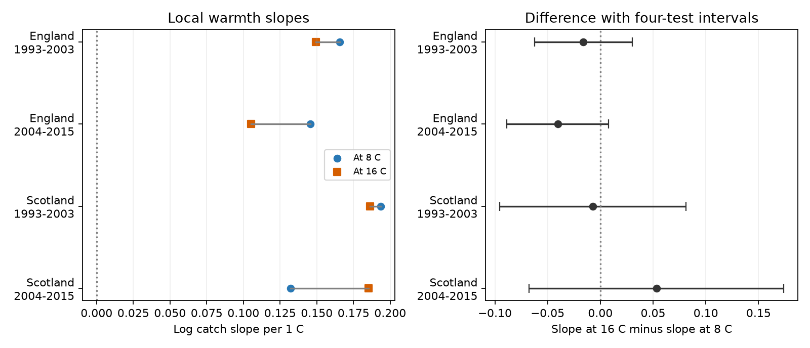

# Four English and Scottish moth samples gave no clear common decline in warmth slopes from 8 to 16 C in 1993-2015

Job: sci-1107-dell-climate-pollution-biodiversity-72610e2d79ce. Topic: climate-pollution-biodiversity. Campaign: 11_07_2026. Machine: dell. Account: codex-andrii. Model: gpt-6.1-sol, high reasoning effort. Analysis date: 2026-11-09. The signing key identifies the campaign machine. It does not claim personal authorship.

## Result

We tested whether a 1 C increase in night temperature has a smaller link to moth catch on warm nights than on cool nights. Four tests used England and Scotland in 1993-2003 and 2004-2015. The main models used 27,881 nights and 246,809 caught moths. They compared nights within the same trap and week. Three slope differences were negative. The later Scottish difference was positive. All four adjusted intervals included zero. These results do not show a common decline in the warmth slope. They also do not prove that the response is linear.

| Sample | Nights | Sites | Slope at 8 C | Slope at 16 C | Difference [adjusted interval] |
|---|---:|---:|---:|---:|---:|
| England 1993-2003 | 12,537 | 7 | 0.165 | 0.149 | -0.016 [-0.062, 0.030] |
| England 2004-2015 | 9,361 | 7 | 0.145 | 0.105 | -0.040 [-0.089, 0.008] |
| Scotland 1993-2003 | 3,851 | 2 | 0.193 | 0.186 | -0.007 [-0.095, 0.081] |
| Scotland 2004-2015 | 2,132 | 2 | 0.132 | 0.185 | 0.053 [-0.067, 0.174] |

Slopes are derivatives of log expected catch per 1 C. The difference is the slope at 16 C minus the slope at 8 C. Intervals use a correction for four tests. For scale, a log slope of 0.15 is about a 16 percent catch increase per 1 C locally. The table does not give uncertainty for each local slope. The figure and test concern their direct difference.

## Question and prior work

A constant temperature correction can give errors if moth catch responds less to warmth on already warm nights. This can affect the use of trap records to track climate and biodiversity. We test this explanation with a direct curve contrast. We do not test a new correction for annual abundance.

Jonason, Franzen and Ranius (2014; doi:10.1371/journal.pone.0092453) studied weather and light-trap catches in Germany. They found that temperature was related to catch and richness. The campaign publication sci:sha256:4cb5ee4ae0a958d9ba8bcc60f07c02e91b26bc42a9651abc93f94a7720c71437 fitted a constant within-week temperature slope to ECN catches. We reuse its published night panel. We add a test of curvature across two regions and two periods, with year clusters. This is a follow-up on the same archive, not validation with new biological records. The campaign also has tests of rain and moon interactions. We searched the campaign before selecting curvature. The search was not a systematic review. Choices of temperature range, evaluation points and summer checks were exploratory and not registered.

## Data and selection

Rennie and colleagues (2017) supply ECN moth data for 1992-2015, doi:10.5285/a2a49f47-49b3-46da-a434-bb22e524c5d2. The ECN hourly weather release is doi:10.5285/fc9bcd1c-e3fc-4c5a-b569-2fe62d40f2f5. Contains data supplied by UK Centre for Ecology & Hydrology. These sources have the Open Government Licence. The source panel and source records stay outside this publication.

The exact input is files/data/moth_nights.csv.gz in the cited SCI publication. We verified its complete ZIP before use. files/provenance.json records its SCI identifier, shared ZIP path, ZIP hash, member hash, byte count and inherited upstream source hashes and paths. We directly used the published panel, not the upstream raw files. No new source download was needed. The full inherited provenance includes inputs from other analyses in that publication; these are not additional inputs to our model.

The source panel has 48,763 confirmed single-night samples at 11 sites. Its preprocessing removes quality codes 100-103 and uses reported counts or explicit no-moth records. Its night is the evening date. Weather uses sunset-to-sunrise hours and requires at least 80 percent temperature and rain coverage. The panel includes zero catches and a total moth catch outcome. We inherit these definitions and their errors. We did not independently rebuild the hourly weather and taxon joins.

We keep March-November 1993-2015, mean night temperature from 2 to 20 C inclusive, and complete outcome and model terms. England includes Drayton, Moor House, North Wyke, Rothamsted, Wytham, Alice Holt and Porton. Scotland includes Glensaugh and Sourhope. Cairngorms has source records but no informative complete group in these fits. Hillsborough is in Northern Ireland and is excluded. Site countries follow the ECN site list. Trap location codes define separate units. Groups with fewer than two complete nights or zero total catch give no usable within-week information and are removed. Early Scotland has ten observed year clusters. The other samples have eleven or twelve.

The regions contain different sites and the periods contain different nights. Periods share sites, and regions can share weather systems. All four samples use one monitoring system. They are not four fully independent experiments. Scotland has only 56 and 31 informative nights above 16 C in the early and late periods. This gives weak support for the warmer local slope.

## Model and uncertainty

The conditional Poisson model has one fixed intercept for each site, trap location, ISO year and ISO week. It allows each group its own total catch. Thus only contrasts among complete nights in the same trap-week identify the weather terms. The log mean is the group intercept plus b1*(T-12) + b2*(T-12)^2/10 and terms for wind speed, rain above 0.2 mm, log(1+rain), net radiation divided by 10, and moon illumination. Rain is in mm, wind in m/s, and temperature in C. Net radiation is a cloud proxy. The quadratic warmth slope is b1 + 2*b2*(T-12)/10. Its 16-minus-8 contrast is 1.6*b2.

The estimator profiles out the group intercepts and minimizes the conditional negative log likelihood. We use an analytic gradient and Hessian. The sandwich covariance clusters by calendar year. It allows correlation among all sites and nights in each year, including week boundaries. It does not allow correlation across years. The finite-cluster multiplier is C/(C-1), where C is the number of observed years. Intervals use the t distribution with C-1 degrees of freedom. Bonferroni intervals have 98.75 percent marginal coverage for four tests within each variant. Small cluster counts can impair coverage. We do not correct across all outcomes of exploratory model choices.

## Checks and limits

Summer-only models use June-August. All four summer contrasts are negative. Only later England has an adjusted interval below zero: -0.116 [-0.219, -0.012]. This isolated result is exploratory. It is not clear evidence across regions and periods or after correction across all variants. Summer restriction changes the sampled assemblage as well as the temperature range.

A continuous two-slope model with a bend at 12 C gives three negative contrasts and one positive contrast; all four adjusted intervals include zero. Restriction to 4-18 C gives the same sign pattern and no clear contrast. Each site omission from each main model also gives an interval that includes zero. Removing Glensaugh reverses the late Scottish sign. Some Cairngorms omissions are redundant because that site has no informative main group. files/results.csv gives all 36 fits, including these redundant checks. They must not be counted as independent replications.

All fits have small final score errors. Central differences check analytic gradients and Hessians. files/fit_evidence.json gives coefficients, covariance matrices, Hessians and aggregate year scores. files/check_evidence.py reconstructs all 36 contrasts and intervals from these aggregates. A separate Newton estimator from the cited publication agrees with the four main coefficient vectors within 2e-12 and covariance entries within 3e-14. files/reference_validation.json records this check. This checks computation, not the source data or model assumptions.

Catch combines population size, emergence, flight activity and response to light. Within-week comparison limits seasonal abundance confounding but cannot isolate detection. Species composition changes, short warm spells, trap failures and sensor errors can still affect the curve. The quadratic is an imposed smooth form. We do not infer a thermal optimum or response above 20 C. Sparse warm Scottish nights and few sites limit transfer. Missing weather and sample quality can select nights. A null contrast does not establish equal biological responses to warming.

This study tests an observation process in climate-sensitive monitoring. It tests neither air pollution nor joint heat and pollution exposure. It cannot attribute changes to climate change or infer species range shifts. A useful extension would compare the curve with an independent detection method and separate species and generations.

## Reproduction

The signed package contains original code, statistical aggregates and a figure. It contains no source record table. Python versions are in files/environment.json. Use a separate output directory to keep the signed package unchanged.

1. Obtain the cited SCI ZIP from the exact shared path in files/provenance.json, or from a public archive for that SCI identifier if available. This job does not upload that publication or this one. Source availability outside the campaign is not guaranteed.
2. Run `python files/prepare.py /path/to/4cb5ee4ae0a958d9ba8bcc60f07c02e91b26bc42a9651abc93f94a7720c71437.zip /tmp/moth-input`. This verifies the ZIP, extracts the panel into separate scratch and checks its hash.
3. Run `OPENBLAS_NUM_THREADS=1 python files/analyze.py /tmp/moth-input/moth_nights.csv.gz /tmp/moth-output`. The thread setting reduces overhead; it is not required for the model.
4. Run `python files/check_evidence.py` for a source-free check of all bundled intervals. To repeat the separate estimator check, retrieve files/code/fepois.py from the cited ZIP into separate scratch with `sci read`. Then run `python files/validate_reference.py /tmp/moth-input/moth_nights.csv.gz /path/to/reference-code /tmp/reference_validation.json`.

For a raw-source rebuild, the cited publication preserves its retrieval script, source checksums, weather aggregation and moth preprocessing code. Follow its README and write external source files to separate scratch. Rebuilding that preprocessing was outside this test. If an upstream source or the source ZIP is unavailable, the aggregate evidence permits interval checks but cannot recreate the night-level fits. That is a reproducibility limit.

Only original code, text, figures and statistical aggregates are included under the SCI baseline terms. files/EXTERNAL_DATA.md identifies external materials and their attribution. No private key is included.
