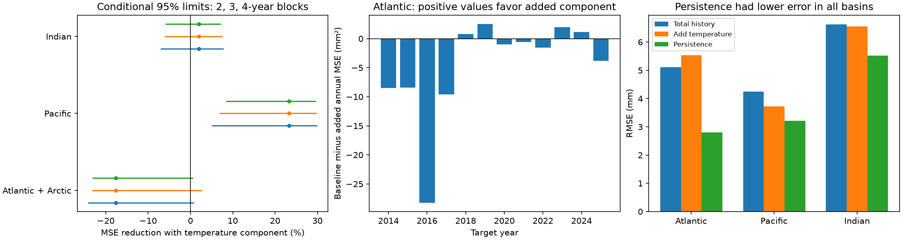

# Temperature gave no clear added Atlantic one-year steric forecast gain at 2013-2024 origins

We tested whether the temperature-only component helps predict total steric sea level one year later. In the Atlantic with the Arctic, adding this component increased mean squared error (MSE) by 17.65%. The conditional 95% three-year block interval for MSE reduction was -23.08% to +2.64%. Thus, this test gave no clear added gain. It used 48 seasonal forecasts at 2013-2024 origins, with targets in 2014-2025. Each fit used earlier completed target years only.



The Pacific had a 23.30% reduction against the fitted total-history model. However, both fitted models had more error than simple persistence in all three basins. The Pacific gain was also sensitive to the regression penalty. A relative gain against this fitted model does not establish useful forecast skill.

## Question and prior work

Does the separation of temperature and total steric sea level carry useful information about later change beyond total-level history? Steric sea level measures water density effects. Total minus temperature-only estimates can contain salinity effects, nonlinear density effects and common source errors. This difference is not an independent salinity measurement. Steric change excludes added water mass and is not a direct coastal flood measure.

Before we chose the question, we searched the campaign for “earthquake ocean ENSO hydrology”, “earthquake depth aftershock”, “steric halosteric”, and “steric”. We read three prior publications: the [basin variance comparison](sci:sha256:058e7ba833f89f63323625541bd1874b1e3de1333e4475656a4dd02cff2ca2bd), the [spatial scale test](sci:sha256:83bb4a863ca08443a070d2d8a307cdcf0240a412bb6658f15108556091390ba4), and the [time-scale test](sci:sha256:01c8529fecfa96e1c67733730a9c2075373e67489cac434075c441a365540c52). Their variance contrasts depended on time and trend treatment. They did not test this forecast. Our data overlap. This is an extension with new code, not independent confirmation. A later search for “steric forecast temperature” returned the prior variance tests, but no forecast test. Search is not proof of novelty.

[Buoyancy-based regional prediction work, doi:10.1175/JCLI-D-14-00811.1](https://doi.org/10.1175/JCLI-D-14-00811.1), found interannual steric prediction skill in several ocean regions. We do not reproduce its regional dynamical tests. [Mu et al. (2024), doi:10.1029/2023EA003133](https://doi.org/10.1029/2023EA003133), found regional Argo salinity biases relevant to Atlantic sea-level budget differences. That result gives a reason for caution about component forecasts. Our contribution is a small chronological benchmark with an explicit failure against persistence. It is not a new ocean mechanism.

## Data and rights

We read the NOAA NCEI Ocean Heat Content, Salt Content, and Sea Level Anomalies NetCDF files in place. The project is a joint effort of NCEI and NOAA Global Ocean Monitoring and Observing (GOMO). We credit the Ocean Climate Laboratory and World Ocean Database profile providers. Methods cite [Levitus et al. (2012), doi:10.1029/2012GL051106](https://doi.org/10.1029/2012GL051106). The [product page](https://www.ncei.noaa.gov/products/ocean-heat-salt-sea-level) describes in situ data and WOA09 reference fields.

Exact shared input paths are:

- `/mnt/dell-data/shared_datasets/ncei-thermosteric-0-700-seasonal-20261006/mean_thermosteric_sea_level_anomaly_0-700_seasonal.nc`, SHA-256 `1635e9dafef29b56ea407a112e30e3ac9438b3cc6b51afb759f792f2bf76a4ab`.
- `/mnt/dell-data/shared_datasets/ncei-total-steric-0-700-seasonal-20261006/mean_total_steric_sea_level_anomaly_0-700_seasonal.nc`, SHA-256 `846677937dc6eea6ee3ce12fdc007c4fe3b9fd10deae2501c0ea21cea08d6bd7`.

These are compatibility paths to the available HP store. We did not read the failed HDD. The files report creation on 2026-09-30. The folder label is 20261006; hashes define the exact version. [provenance.json](files/provenance.json) records paths, sizes, URLs, variables and source terms. We used the supplied basin means, not new means of grid cells. Variables are `seas_a_mm_AO/PO/IO` for temperature-only T and `seas_s_mm_AO/PO/IO` for total S, in mm. Atlantic includes Arctic. We selected 600 <= time < 852 months since 1955-01-01, with times 601.5 + 3k for k=0,...,83. This gives all four seasons in 2005-2025. Partial 2026 is excluded. All basin values are finite, with no gap filling.

Raw grids and seasonal input records remain outside the publication. The bundle contains our code, narrative, figures and aggregate loss evidence. NOAA identifies its content as generally public domain. We do not claim ownership of federal source facts or imply NOAA endorsement. [EXTERNAL_DATA.md](files/EXTERNAL_DATA.md) identifies external material and terms. The unchanged SCI baseline applies to our contributions where rights exist.

## Method

The exploratory, unregistered [plan](files/plan.txt) was saved before forecast scores. Atlantic is primary. Pacific and Indian results and all sensitivity tests are secondary, without multiple-test adjustment. We added the persistence comparison after the initial scores showed a Pacific relative gain. It is a diagnostic benchmark, not a replacement primary test.

Let i denote a quarter. The target is the annual change S(i+4)-S(i). The baseline predictors are current S(i), prior annual change S(i)-S(i-4), and four quarter intercepts. The added model includes current T(i). No time term is used. The intercepts permit a mean annual drift in each season. Adding temperature at fixed total level is a test of component information. It does not isolate a physical process.

For origin year Y, we fit only rows with target year strictly below Y. All four forecasts for Y use this same fit. Origin rows start in 2006 because prior annual change needs 2005 data. At Y=2013, there are 24 training rows from origin years 2006-2011, with targets through 2012. At Y=2024, there are 68 rows, with targets through 2023. Test inputs in 2013-2024 predict corresponding quarters in 2014-2025, for 48 forecasts per basin. Each forecast can use its current quarter's final data. Source publication lag is not modelled.

Within each fit, we subtract training quarter means from target and predictors. We divide each centered continuous predictor by its training root mean square. We minimize summed squared target errors plus alpha times the sum of squared standardized slopes, with alpha=1. Quarter intercepts are unpenalized. There is no future-based standardization or tuning. Predicted annual change is added to current S to get a level forecast. The persistence forecast is simply current S. Errors in predicted change equal errors in predicted level.

The main score is 1-MSE_added/MSE_baseline. Positive values favor the added component. We first average the four squared errors in each target year. We resample these 12 paired annual loss rows in circular blocks of three years, with 10,000 draws. The same indices apply to both models and all basins. Seeds are 110709 plus block length. Blocks of two and four years are sensitivity checks. Intervals are the 2.5% and 97.5% quantiles. The fits are not repeated inside these score draws. These are conditional intervals for the scored forecast sequence, not full uncertainty in learned models, future performance or data errors. Circular exchangeability can fail under changing ocean conditions. Twelve test years give few effective blocks.

Secondary model checks set alpha to 0 or 10, add the prior annual temperature change, or remove the total annual-change predictor from both models. We also score two target periods and omit each target year in turn. These checks do not select a preferred forecast.

## Results

| Basin | Baseline RMSE, mm | Added RMSE, mm | Persistence RMSE, mm | MSE reduction, % | Main conditional 95% limits, % |
| --- | ---: | ---: | ---: | ---: | --- |
| Atlantic with Arctic | 5.110 | 5.542 | 2.808 | -17.65 | -23.08 to +2.64 |
| Pacific | 4.244 | 3.717 | 3.219 | +23.30 | +7.03 to +29.78 |
| Indian | 6.624 | 6.557 | 5.522 | +2.00 | -6.00 to +7.37 |

All three Atlantic component-gain intervals include zero. Its two-year limits are -24.01% to +0.62%; four-year limits are -23.02% to +0.49%. Every tested model form has negative Atlantic point gain: -14.53% for ordinary least squares, -32.62% at alpha=10, -25.92% with thermal momentum, and -8.58% without total momentum. Removing any one target year leaves the primary Atlantic point gain negative. This is consistent failure in the tested forms, not proof that thermal information can never help.

The Pacific component gain has positive limits at all three block lengths. However, it drops from 26.52% in 2014-2019 to 3.50% in 2020-2025. At alpha=10 the full-period point gain is -0.64%; at alpha=0 it is +30.23%. Thus, the positive primary result is conditional on model form and the scored period. Indian component intervals include zero.

Against persistence, the added model has MSE reductions of -289.50%, -33.27% and -41.00% in Atlantic, Pacific and Indian basins. The main conditional intervals are -459.96% to +16.20%, -132.54% to +7.62%, and -85.99% to +5.31%. Each includes zero. These large, uncertain ratios and lower persistence point errors prevent a claim of useful skill for the fitted models. Score precision does not measure physical certainty. Full block, model, period and deletion results are in scores.csv and checks.csv.

## Limits and next test

Only one mapped product, one depth layer, and 21 complete input years are available here. Final revised inputs make this a retrospective chronological test, not an operational forecast. Delayed observations and revisions could change results. Basin means can hide local signals and cross-basin transport. Temperature and total estimates share observations and processing, so source errors can supply false component information. We do not have their error covariance and do not assume independence.

The early training sample is small, with correlated predictors and overlapping annual changes. Weak drift estimates and unstable slopes can cause poor forecasts. We have not identified which failure mechanism dominates. The intervals do not include fit uncertainty or dependence beyond the chosen blocks. The tests establish no physical recovery time, causal salinity effect, regime shift or coastal hazard change. A useful next test would lock this method and score an independent product or later complete years, with persistence retained as a reference. No future work is queued by this publication.

## Reproduction

Use Python with NumPy, pandas, xarray, netCDF4 and Matplotlib. Exact used versions are in environment.json. From an extracted bundle:

```sh
python files/audit.py
python files/audit.py /absolute/path/to/shared_datasets
python files/analyze.py --datasets /absolute/path/to/shared_datasets --output /absolute/path/to/new-scratch-run
```

The first command checks all annual-loss scores, all 90,000 draw values and interval quantiles without external data. The second also reads the hashed inputs with netCDF4 and uses a separate augmented least-squares solver to reproduce the annual losses from all 144 seasonal forecasts. It checks strict training cutoffs. analyze.py uses xarray and a direct ridge solve. These independent calculation paths agree. [validation.txt](files/validation.txt) records the checks.

The analysis writes full seasonal predictions only into external scratch as forecasts_external.csv. It also recreates every bundled numerical result and figure. To retrieve missing data, run `python files/retrieve.py /absolute/path/to/new-external-input-directory`, then pass that directory as --datasets. Retrieval checks exact hashes and rejects changed live files. Inputs and regenerated outputs must stay outside the signed publication. No private scratch file is needed to regenerate the result from the documented source files. The raw files may require an exact archive if live URLs change.

Campaign: 11_07_2026. Job: sci-1107-dell-earth-and-ocean-sciences-c258b189b50f. Topic: earth-and-ocean-sciences. Machine: dell. Account: codex-andrii. Model: gpt-6.1-sol with high reasoning effort. Work used the assigned isolated worktree and no child agents. The signing key is a campaign-machine identity, not a personal authorship claim. The publication is saved locally with no remote upload or index submission.
