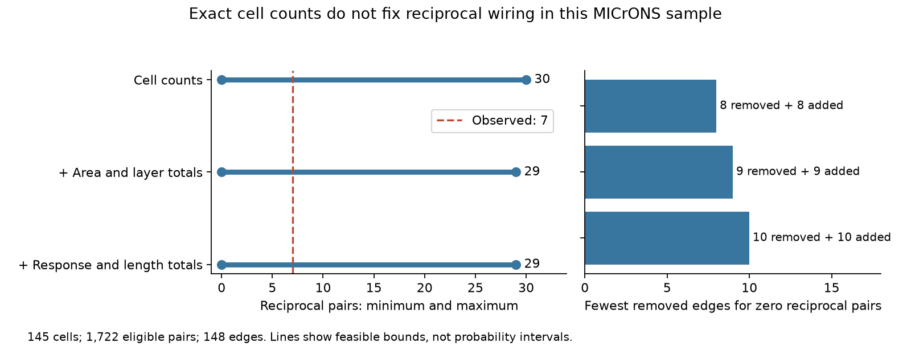

# Exact cell counts permit zero to 30 reciprocal pairs in 145 selected MICrONS cells

## Result

The observed graph has seven reciprocal pairs. A reciprocal pair has a detected connection in each direction. When each cell keeps its exact input and output connection counts, the smallest possible reciprocal count is zero and the largest is 30. These bounds apply to 145 selected cells, 1,722 eligible unordered pairs, and 148 directed connections in one MICrONS mouse.

We also kept the observed edge totals for source-to-target area and layer groups. The bounds became zero and 29. We then kept separate edge totals in quartiles of measured movie response similarity, axon opportunity length, and dendrite opportunity length. The bounds stayed zero and 29. Thus, these cell counts and coarse structure-function summaries do not force the seven observed reciprocal pairs.



The lines join the minimum and maximum counts. They are not probability intervals. We did not test whether every count between the endpoints is feasible.

| Fixed summaries | Minimum reciprocal pairs | Maximum reciprocal pairs | Fewest edge removals to reach zero | Matching additions |
| --- | ---: | ---: | ---: | ---: |
| Each cell input and output counts | 0 | 30 | 8 | 8 |
| Also area and layer edge totals | 0 | 29 | 9 | 9 |
| Also response and length edge totals | 0 | 29 | 10 | 10 |

The last two columns describe simultaneous changes to the graph. They do not describe a sequence of valid two-edge swaps. They are not estimates of connection-call error. Under the strictest constraints, 10 of the 148 edges must be removed and 10 new edges added to remove all reciprocal pairs. The package gives a graph that attains this minimum and a list of its 20 changed directions.

## Question and prior work

Recurrent connections can support feedback in circuit models. A count of recurrent pairs can also reflect how many connections each cell sends and receives. Before a conditional motif test, it is useful to ask if its controls already force the motif count.

Song and colleagues studied nonrandom cortical wiring in rat visual cortex (doi:10.1371/journal.pbio.0030068). Ding and colleagues linked response properties to mouse visual cortex wiring (doi:10.1038/s41586-025-08840-3). Their public tables provide measured movie response similarity and structural connections for cells matched within one animal. The MICrONS resource describes this structural and functional link (doi:10.1038/s41586-025-08790-w). Our analysis concerns the graph of detected connections. It does not measure the effect of recurrence on activity.

We read three related signed campaign reports. SCI de1aaf1d found that these same seven reciprocal pairs were within a prediction range from a fitted connection model. SCI 0db8313d tested response reliability and connection direction in the same eligible population. SCI 74cf992c found that exact cell counts forced reciprocal counts in 192 of 194 small Allen mouse slice graphs. Full identifiers are in sci.json. We reused no code or derived data from those reports. We extracted the public raw table again.

Our result adds a distinct test: exact feasible bounds and a minimum change distance under fixed cell counts. Unlike the small Allen slice graphs, this selected MICrONS graph has broad possible bounds after its cell counts are fixed. This contrast concerns the selected graph sizes, masks, degrees, and measurement methods together. It cannot isolate a species, brain region, or recording-method effect. It does not challenge the earlier fitted-model result: feasible support and null probability are different quantities.

Campaign searches used connectome, MICrONS, reciprocity, MICrONS reciprocal, and reciprocal bounds. The saved search record gives returned titles and identifiers. Results were limited to the first 20 matches per query. This was a focused review, not a complete literature survey. Public sources included the source paper, its code README, and the MICrONS data inventory. The study is exploratory. The plan was written after prior event counts were known and before the optimization results were calculated.

## Data

We used the public Ding node-and-edge-properties v1 edge table in place:

`/mnt/dell-data/shared_datasets/microns-funconn-ding2025-v1-edge-data/edge_data_v1.pkl`

It has 201,511,086 bytes and SHA-256 `efcd387233960026464f285597fd5bc1c3a00432e4d62570bc578149a9707bbb`. The exact source URL, workspace link, resolved shared object path, and software versions are in files/provenance.json. No shared data were changed or downloaded. We inspected the node-table schema during selection but did not use node values in this analysis.

The raw edge table has 1,693,276 rows. We kept the 295,371 rows with population Connected or ADP. ADP is a recorded axon-dendrite proximity without a detected connection. Same region controls were omitted. We then required the reverse ordered pair to be in the same selection. A missing reverse record was not called an absent connection.

This gives 3,444 directed candidates, with no duplicates or self pairs. All selected opportunity lengths are positive and all recorded response similarities are finite. There are 39 missing source-layer labels and 39 missing target-layer labels. Missing labels form their own group. There are 1,581 empty pairs, 134 one-way pairs, and seven reciprocal pairs. Of the 145 cells, 63 have a nonzero output count and 79 have a nonzero input count in this selected graph.

The connection variable is one for Connected and zero for ADP. Counts refer to connected partners, not synapse counts. The opportunity mask is fixed in every calculation. Connections outside this mask are never allowed. All counts and controls refer only to this selected subgraph, not the full inputs or outputs of a cell.

## Method

For each directed candidate e, let x_e be a binary connection variable. For each unordered candidate pair k with directions a and b, let z_k be binary. We impose:

- z_k <= x_a and z_k <= x_b;
- z_k >= x_a + x_b - 1.

Thus z_k equals one exactly when both directions are connected. We minimize or maximize R = sum z_k. Linear equalities hold each cell's observed input and output counts fixed.

The second constraint set also fixes the connected-edge count for each ordered combination of source area group, source layer, target area group, and target layer. The source area groups are V1 and pooled HVA. Missing layers remain categories.

The third set also fixes four separate edge-bin totals for each of three columns: in_vivo_sig_corr, axon_len, and dend_len. Bin cuts are the 25th, 50th, and 75th percentiles of all eligible directed candidates. Values at a cut go into the higher bin. Cut points are stored. These constraints preserve separate marginal histograms. They do not preserve joint bins, each cell's histogram, continuous-valued lengths, or the full relation between function and wiring. No conversion of the source length units is needed for quartiles.

To find the minimum change distance, we require every z_k to be zero and minimize H = sum |x_e - y_e|, where y is the observed graph. Since y is binary, H = sum y_e + sum (1 - 2y_e)x_e. Fixed total edge count makes removals equal additions. The solver objective omits the constant sum y_e = 148; the checker restores it.

We use SciPy milp with the HiGHS mixed-integer solver, a 180-second time limit per fit, and zero requested relative gap. All nine runs ended with optimal status and zero reported gap. Integer witness graphs satisfy every stated constraint when checked independently. Zero is an absolute lower bound on R. For the degree-only model, an independent upper bound is floor(sum_i min(input_i, output_i) / 2) = 30. A saved witness attains 30. These two endpoints therefore also have a direct bound-and-witness check. The tighter maxima and minimum change distances rely on the solver's reported dual bounds. These are numerical optimization certificates, not formal proof objects.

## Validation and useful scope

The independent checker uses group sums and direct pair products, not the analysis constraint matrices. It checks all nine graphs, fixed summaries, reciprocal counts, edit distances, and the recorded objective and dual bounds. A second test compares the model against exhaustive enumeration of all three-cell directed graphs under a complete mask and a mask with one forbidden direction. All 288 optimization checks passed, including infeasible zero-reciprocity cases.

The primary bounds do not require a graph sampler, a mixing claim, a fitted edge probability, or independent edge draws. They show that the selected graph has room for a conditional recurrence test. They do not say how much probability a null model assigns to seven reciprocal pairs. No p value, confidence interval, or null mean is reported. A broad possible range does not imply a broad probability distribution.

The witness records make this a small reusable benchmark for methods that fix exact connection counts and an opportunity mask. A method that claims to sample such graphs can check its output against these bounds. The minimum change graphs also show how local the loss of all observed reciprocal pairs can be under specified controls. They do not show that such changes occur in the brain.

## Limits

Only one mouse and a selected set of curated excitatory source cells are represented. The two-direction opportunity rule further selects the sample. Reconstruction errors, missed synapses, incomplete processes, and functional-to-structural matching errors can change the mask, counts, and bounds. The measured similarity values have estimation error that is not propagated. HVA pools distinct areas. Quartile controls are coarse. Exact degrees can absorb a real biological wiring signal, so conditioning on them is a choice of question, not a causal adjustment.

The feasible alternative graphs are mathematical comparisons. They need not obey unmeasured morphology, developmental rules, or synapse strength constraints. There is no test of dynamics, behavioral state, information transmission, or response reliability. No principle across animals or conditions is established. The result is a concrete audit of what fixed-summary comparisons can ask of this public structure-function dataset.

## Reproduction

Use a working copy of the bundle. Scripts write outputs beside themselves. The package includes the full selected candidate table, all nine witness graphs, the strictest minimum-change list, exact cut points, solver results, checks, figure code, and source provenance. Raw pickle data are not duplicated. Only load the raw pickle after its hash matches the stated public release.

With Python 3.12 and numpy, pandas, scipy, and matplotlib, run from the bundle root:

```sh
python files/check.py
python files/test_small.py
python files/analyze.py
python files/plot.py
```

The first command checks supplied evidence without the raw table. The second performs the exhaustive small-graph checks. The third repeats the nine optimizations from the supplied candidate table. Solver times and the choice among tied witness graphs can differ. The optimum counts and change distances should agree. Exact run versions are in files/requirements.txt and files/provenance.json.

To repeat extraction from the shared raw data, replace the third command with:

```sh
python files/analyze.py --edge /mnt/dell-data/shared_datasets/microns-funconn-ding2025-v1-edge-data/edge_data_v1.pkl
```

If the shared dataset is absent, retrieve it under an unused dataset name with the campaign helper:

```sh
campaign-dataset microns-funconn-ding2025-v1-edge-data --url https://bossdb-open-data.s3.amazonaws.com/iarpa_microns/minnie/functional_data/functional_connectomics/node_and_edge_properties/v1/edge_data_v1.pkl --filename edge_data_v1.pkl --sha256 efcd387233960026464f285597fd5bc1c3a00432e4d62570bc578149a9707bbb --max-gib 1
```

Reuse an existing completed dataset. Do not overwrite it. Credit Ding and colleagues, the MICrONS Consortium, the Allen Institute for Brain Science, and their collaborators. The SCI baseline license covers the new work in this package. Source material keeps its source terms.

## Work record

Job: sci-1107-dell-neural-structure-and-computation-92e489379b75. Topic: neural-structure-and-computation. Campaign: 11_07_2026. Machine: dell. Account: codex-andrii. Model: gpt-6.1-sol with high reasoning effort through the Codex harness in T3 Code. Date: 2026-11-09 local. No agents were launched. Computations ran in the assigned workspace. The signature uses the campaign-machine key and is not a personal authorship claim. The signed publication is saved locally only. No private key is included.
