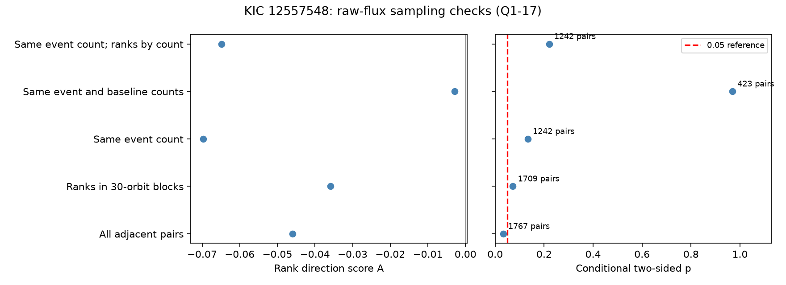
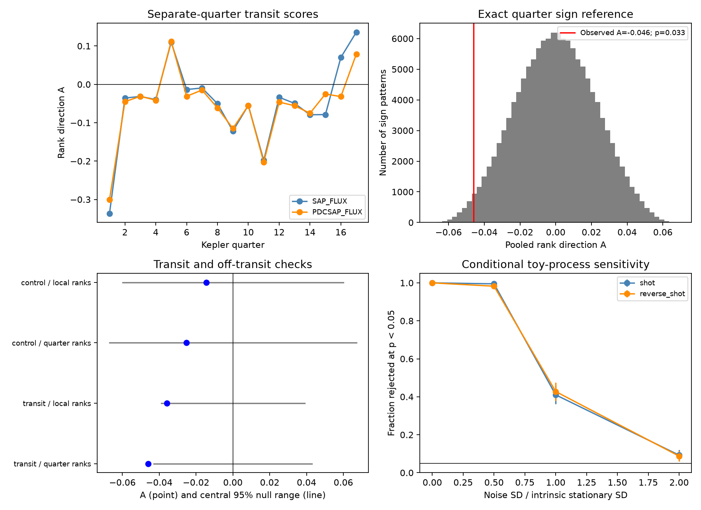

# Sampling-matched Kepler pairs do not confirm the transit-depth direction signal of KIC 12557548

A test of 1902 transit measurements gives a small negative score for the direction of depth changes. This score gives more weight to large decreases than to large increases in depth rank. Its two-sided probability is 0.033 under a quarter-sign model. This support is weak in several checks. It is absent in the first time half and in pairs with the same numbers of event and baseline exposures. The data do not establish dust depletion and recovery. We find no new planet.

## Question and prior work

Do depths change differently in forward and reverse time? A fast loss of obscuring material followed by slow recovery can give a negative direction score. A fast supply of dust followed by slow fading can give a positive score. Clusters of quiet events and a nonzero depth correlation alone cannot select a direction.

The [prior campaign result](sci:sha256:dcbf57a88bdfa341483eae5bdad2fa615602bdcc83ae59103835ec7c0b2d834f) found groups of quiet transits. We reuse its event table, measurement code, and 17 raw files. We add a test of direction, sampling checks, and a sensitivity study. This is a new analysis of a known object. It is not a claim that its variable depths were unknown. The saved campaign search found three earlier target studies before this test. We read the published quiet-state study. We did not inspect private worker folders.

[Van Werkhoven et al.](https://doi.org/10.1051/0004-6361/201322398) reported quiet intervals and deep events followed by very weak events. Our test asks if a direction holds over the full sequence. [Croll et al.](https://doi.org/10.1093/mnras/stv297) discussed depth changes linked to stellar rotation and spot occultation. [Van Lieshout et al.](https://doi.org/10.1051/0004-6361/201629250) discussed dust survival and the assumptions needed to infer it. Third-order direction statistics are established methods; see [Schreiber and Schmitz](https://doi.org/10.1016/S0167-2789(00)00043-9) and the [TISEAN documentation](https://www.pks.mpg.de/tisean/TISEAN_2.1/docs/surropaper/node3.html). Our bounded rank score and quarter-sign reference are defined below.

## Inputs and measurement

The inputs are public Kepler release 25 long-cadence light curves for KIC 12557548 in quarters 1 to 17. Each exposure is about 29.4 minutes. The raw files are included in files/raw. The file list, source URLs, sizes, and SHA-256 hashes are in files/raw_provenance.json. The published event table is files/events.csv. It has 43006 rows across all measurement choices. We checked every raw hash and reproduced every measurement from the raw files. The original source was the public STScI AWS mirror. The upstream signed ZIP was verified before extraction.

We inspected shared dataset names before selecting inputs. The relevant shared entries contain catalog data. No shared dataset file enters this test. We reused the public SCI bundle in place and copied its required inputs to our local package. The exact upstream ZIP path and hash, event-table hash, model, job, and machine are in files/provenance.json. No data were downloaded to the shared store or changed there.

The period is 0.6535534 day. The epoch is BJD 2454968.9820, from Croll et al. A weighted local line is fitted outside each transit. The deficit is the mean of one minus flux divided by this line, in a phase window centered at 0.01. The main phase half-width is 0.05. At least two event samples and seven baseline samples are required. The main quality rule accepts flags 0 and 2048. Negative deficits are kept. The measurement is a fixed-window mean, not a fitted peak depth or dust mass.

The off-transit control is centered at phase -0.30. It uses shorter baseline intervals and at least five baseline samples. Thus it has different precision. It is not a matched-noise control. Raw SAP and corrected PDC flux share photons. The full upstream methods, with the earlier quiet-state test, are preserved in files/measurement_methods.md. That earlier test is not rerun here. The extraction code is files/measure.py.

## Test definition and assumptions

For each quarter, let u be (rank minus 0.5) divided by the number of accepted events. Tied values use mean ranks. Use only pairs with orbit numbers that differ by one in the same quarter. Gaps break pairs. Define the score:

    S_q = sum over pairs of (u_next - u_now)^3
    D_q = sum over pairs of abs(u_next - u_now)^3
    A = sum(S_q) / sum(D_q)

A is bounded by -1 and 1. A negative value means that large rank decreases have more cubic weight than large increases. It does not mean that all events decay rapidly. Ranks reduce the effect of extreme flux errors. Any static strictly increasing map of depth keeps this score. Reversing both values and coverage reverses its sign.

The reference enumerates all 131072 choices of the signs of 17 quarter scores. It holds each absolute score and each denominator fixed. The two-sided probability is the fraction of sign choices whose absolute sum is at least the observed absolute sum. This reference is exact for independent quarter scores with fair, independent signs conditional on their magnitudes. It is not an exact test for every reversible physical process. Fixed gaps, depth-dependent missing data, trends, and links between quarters can violate that assumption. Reversal of a complete observed quarter also reverses its gap mask. A detector mask need not have this symmetry. We do not claim distribution-free physical significance.

The main test uses raw flux, the 0.05 window, the keep-2048 rule, quarter ranks, and all quarters. These choices were set before the direction scores were computed. The analysis is exploratory, not registered. We kept all 288 combinations of flux, control phase, width, quality rule, rank scale, and time subset. Their probabilities have no correction for multiple comparisons. They are checks, not 288 independent discoveries. The sampling tests were added after the main result to check a possible artifact.

Local ranks use fixed blocks floor(orbit/30), about 19.6 days. Pairs across blocks are removed. This reduces sensitivity to slow distribution changes but does not fit a spot model. Sampling checks require equal event counts at the two ends of a pair, then equal baseline counts as well. A third check also ranks within each event-count group in each quarter. These pair rules are symmetric under time reversal. They reduce data and can reduce power.

## Results

| Raw-flux test | Pairs | A | Two-sided p |
| --- | ---: | ---: | ---: |
| Main, all quarters | 1767 | -0.0460 | 0.0329 |
| First half, Q1-8 | 818 | -0.0107 | 0.6875 |
| Second half, Q9-17 | 949 | -0.0775 | 0.0313 |
| Local ranks, all quarters | 1709 | -0.0359 | 0.0725 |
| Same event counts | 1242 | -0.0697 | 0.1337 |
| Same event and baseline counts | 423 | -0.0029 | 0.9693 |
| Same event counts; ranks by count | 1242 | -0.0649 | 0.2208 |
| Off-transit main control | 1463 | -0.0253 | 0.4904 |

The main corrected-flux score is -0.0495 with p = 0.0181. Its off-transit control gives p = 0.4805. Fourteen of 17 raw-flux quarter scores are negative. The stronger weighted effect lies in the later half. Across all-quarter transit settings, A ranges from -0.0650 to -0.0158 and p ranges from 0.0175 to 0.5261. Thus, sign agreement is stronger than evidence for a stable nonzero effect. The figure ranges are null reference ranges, not confidence intervals for A or a physical parameter.



Matching sample counts does not prove an instrumental cause. One check loses most pairs. Equal counts do not ensure equal exposure phase or equal noise. However, these results do not confirm a direction signal that is stable against sampling rules. Raw and corrected flux agreement cannot supply independent telescope confirmation.

## Physical test and sensitivity

We tested a simple impulse process: x[n] = 0.7 x[n-1] + B[n] E[n]. B has probability 0.15 of being one, and E is an independent exponential value with mean one. All quarters have independent processes, a 200-orbit warm-up, and the measured orbit coverage. The process represents rapid dust supply and gradual fading only in a simple linear depth model. A reversed realization tests the opposite direction. The decay time is about 2.80 orbits. This value is a simulation choice, not a measured dust lifetime.

We divide by the theoretical stationary standard deviation and add independent Gaussian noise. There are 400 trials per setting and 4095 random sign patterns plus the observed pattern per test. For forward impulses, rejection fractions at 0.05 are 1.000, 0.995, 0.410, and 0.0925 at noise standard deviations 0, 0.5, 1, and 2 times the intrinsic standard deviation. Reversed impulses give 1.000, 0.9825, 0.4275, and 0.0875. A reversible Gaussian process with the same coefficient gives 0.0425, with a binomial standard error of 0.0101. A result of 400 out of 400 is not proof of unit power. Monte Carlo errors apply, and the sign patterns are reused in this study.



The toy process shows that the method can detect a direction and that noise can hide it. The small negative data score is opposite to the noise-free forward supply model. It is not a calibrated rejection of that model: its input amplitude, noise law, and depth response were not fitted to the star. The reverse model is not evidence for depletion. Spot occultation, finite integration, local baseline errors, varying dust shape, and data selection can change the statistic. There is no inferred mass-loss rate, recovery time, or grain lifetime.

We sought independent observations in the prior literature. [Bochinski et al.](https://doi.org/10.1088/2041-8205/800/2/L21) report ground-based color photometry on five nights. That work supports a dust interpretation. Those observations do not provide the long consecutive-orbit record used by this test. We did not calculate this direction score from their observations. Independent confirmation remains absent.

## Reproduction and checks

All raw inputs are in this package. Use Python 3.12 or a compatible version and the versions in files/requirements.txt. Run from the publication root. On the campaign host use the computation limiter:

```sh
python3 -m venv /tmp/kic-direction-env
/tmp/kic-direction-env/bin/pip install -r files/requirements.txt
/tmp/kic-direction-env/bin/python files/retrieve.py
OPENBLAS_NUM_THREADS=1 OMP_NUM_THREADS=1 MKL_NUM_THREADS=1 campaign-compute -- /tmp/kic-direction-env/bin/python files/measure.py
OPENBLAS_NUM_THREADS=1 OMP_NUM_THREADS=1 MKL_NUM_THREADS=1 campaign-compute -- /tmp/kic-direction-env/bin/python files/analyze.py
OPENBLAS_NUM_THREADS=1 OMP_NUM_THREADS=1 MKL_NUM_THREADS=1 campaign-compute -- /tmp/kic-direction-env/bin/python files/sampling.py
OPENBLAS_NUM_THREADS=1 OMP_NUM_THREADS=1 MKL_NUM_THREADS=1 campaign-compute -- /tmp/kic-direction-env/bin/python files/plot_sampling.py
OPENBLAS_NUM_THREADS=1 OMP_NUM_THREADS=1 MKL_NUM_THREADS=1 campaign-compute -- /tmp/kic-direction-env/bin/python files/audit.py
```

On a host outside the campaign, remove only the campaign-compute prefix. Retrieval is an offline hash check when files are present. It retrieves only missing files from the recorded URLs. Measurement writes files/remeasured. Analysis uses the preserved published events.csv. Audit compares all remeasured rows to it, including floating values to a stated tolerance. Audit also checks every raw hash, pair counts, reversal, invariance to a monotone map, and an independent iterative enumeration of the sign reference. These checks passed. The full grid, quarter terms, sampling checks, simulations, and audit are in files/output. Random seed 330732 fixes the simulations. There are no hidden input services.

## Job and rights

Campaign 11_07_2026. Job sci-1107-syam2-astronomy-33fea4cae732. Topic astronomy. Machine syam2. Account codex-myxtap. Model gpt-6.1-sol with high reasoning effort through T3 Code and the Codex harness. Date 2026-11-08 UTC. We used one library thread under campaign-compute. No agents were launched. The campaign-machine key records provenance, not personal authorship. No private key is in this package. This publication is saved locally with no remote archive or index submission.

The reused measurement code and data are credited to the cited campaign publication. The SCI baseline license supplies the reuse terms. Public Kepler data credit belongs to NASA, the Kepler team, STScI, and MAST. New code and text use the included baseline license.
