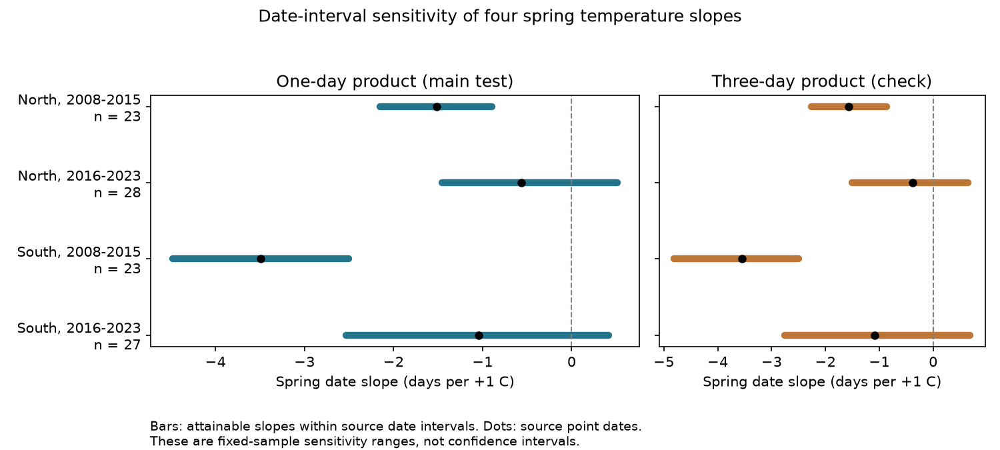

# Source date intervals permitted both temperature slope signs in two eastern US camera samples in 2016-2023

We tested how date uncertainty can change a temperature slope for spring canopy greening. We used the same 101 site-years as a prior SCI study at eight eastern US camera sites. Source date intervals permit negative and positive slopes in both later samples. Both early samples keep negative slopes. These are conditional bounds for the observed records. They do not give confidence intervals or show a causal effect.

## Question and prior work

Can the greening date uncertainty reported by PhenoCam change the sign of four published spring temperature slopes?

Spring canopy timing can change food and habitat timing for other species. Fixed cameras reduce changes in human visit effort. They still estimate dates from a greenness curve. The source work by Richardson and colleagues (2018; doi:10.1038/sdata.2018.28) describes this method and its date uncertainty. Richardson and colleagues (2019; doi:10.1002/aps3.1228) studied temperature-linked camera phenology. Young and colleagues (2025; doi:10.5194/essd-17-6531-2025) describe the V3 data.

Prior SCI publication sha256:05407d959829f2e33063c758370595d92ef7a6c604e61c25bae1830bbabca44f fit four temperature slopes. It compared point dates from one-day and three-day products. It did not propagate each date interval through the temperature coefficient. We add that exact calculation. We reuse all its records, selection rules and source snapshots. This is a sensitivity study of prior evidence, not new independent evidence of a biological response.

Before choosing this question, we searched the campaign for “phenology climate pollution”, “bird ozone”, “Ryalls”, “North Wales” and “PhenoCam”. We read the prior camera publication and its code. We searched public prior work on camera date uncertainty. The analysis is exploratory. files/analysis_plan.txt records the design before the new bound calculations. A later check adds a shared annual error scenario.

## Data and sample

The source is Zimmerman and colleagues (2025), PhenoCam Dataset V3.0, doi:10.3334/ORNLDAAC/2389, with by-ROI files processed in May 2024. We used data record 5, deciduous broadleaf ROI 1000, rising GCC90 at 25 percent seasonal amplitude. A date must fall in days 60-180 in 2008-2023. All site-years with multiple rising events in that window are removed. The source date interval width must be 0-14 days.

The prior frame has 55 available sites in 35-50 N, 95-65 W. Eight sites have at least four accepted years in each of 2008-2015 and 2016-2023 in both products. North means latitude at least 42 N: Harvard, Proctor, Reading MA and Willow Creek. South means latitude below 42 N: Cary Institute, Morgan Monroe, North Attleboro MA and Shenandoah. We rebuilt this frame and all selection rules. All input archive and used member hashes match the prior frozen manifest. The main sample has 101 records at eight sites. The source point dates lie within all used intervals.

Temperature is the equal-weight February-April mean from the nearest 0.5-degree GHCN-CAMS cell. This is NOAA version 3.01, snapshot through October 2026. Only 2008-2023 temperatures enter the models. A kelvin slope equals a Celsius slope. March temperature is a separate check. These fixed windows can overlap or follow some events. They are not fitted chilling or forcing windows.

Exact shared paths, source URLs, versions and SHA-256 hashes for 56 input files and all used camera members are in files/provenance.json. Paths start with datasets/ and resolve through the shared dataset link. We reused these inputs in place. We did not download or change shared data. Raw camera data and derived site-year tables are not in this bundle.

## Model and exact bounds

Each region-period model is:

    date = site intercept + site-specific linear year trend + b * temperature + error

Let Z contain the intercepts and trends. Let r be temperature after least-squares projection on Z. Let w = r / (r'r). The coefficient is b = w'date. For date limits L and U, the smallest coefficient selects L when w is nonnegative and U otherwise. The largest coefficient selects the reverse. The bounds are attained by those endpoint assignments. Any intermediate coefficient is attained for continuous dates by a convex combination of assignments.

This proof needs a fixed, full-rank design, no change in sample, exact temperature and nuisance covariates, and independent freedom to choose each date in its own interval. It does not need a probability model. Integer source dates attain both endpoints too. Intermediate fractional-date choices are a sensitivity convention.

The source intervals are estimated date uncertainty intervals. They are not absence/presence visit brackets or known limits on true dates. We use their Cartesian product as a sensitivity set. We do not assign 95 percent joint coverage to that set. The assignments can align all date errors with temperature in an adverse way. They need not be likely or consistent with unmodeled links between source spline errors.

A separate check allows only a common additive date error within each year and sample. For each year, the common error must be in the intersection of all record-specific error intervals. The sum of w within each year gives exact bounds under this stricter scenario. A constant additive error for a whole site cannot change b, since site effects absorb it. Neither scenario estimates the actual error covariance.

## Results

All slopes and ranges below have units of days per +1 C.

| Sample | Records | Point slope | Independent date range | Shared annual error range |
| --- | ---: | ---: | --- | --- |
| North, 2008-2015 | 23 | -1.517 | -2.150 to -0.892 | -1.954 to -1.128 |
| North, 2016-2023 | 28 | -0.568 | -1.458 to +0.512 | -1.302 to +0.166 |
| South, 2008-2015 | 23 | -3.492 | -4.477 to -2.505 | -4.056 to -2.778 |
| South, 2016-2023 | 27 | -1.047 | -2.530 to +0.414 | -2.052 to -0.048 |

Both early slopes stay negative under all allowed independent date changes. Both late slopes can become positive. The late northern and southern ranges first reach zero when each side of every interval is scaled to 0.526 and 0.716 of its source size around the point date. This is a common interval scaling calculation; it is not a number of days or an error probability. Early zero crossings would need factors 2.427 and 3.538, outside the source intervals.

All four main samples have median date interval width of three days. Temperature after site and trend removal has root mean square values of 1.77 and 1.33 C in the early North and South, versus 0.94 and 0.87 C later. Smaller residual exposure variation increases the scope for date error to change a coefficient. This is a feature of the fitted designs, not proof of a change in plant sensitivity.

The ten percent of records with the largest absolute-weight times interval-width contributions account for 24-47 percent of each range width. Uncertainty is thus uneven across records. These contributions do not estimate which observations are wrong.

The three-day products give early ranges of -2.261 to -0.863 in the North and -4.810 to -2.502 in the South. Later ranges are -1.504 to +0.650 and -2.754 to +0.688. Removing site trends gives the same four sign results. Using March temperature changes the later southern range to +0.298 to +1.910. Thus a negative February-April slope does not fix the sign for a different exposure window.

The common annual error restriction leaves the later South one-day range just below zero. Its three-day range reaches +0.015. The choice of error dependence and data product can matter near zero. We added this restriction as a sensitivity check; there is no evidence here that actual errors follow it.

files/results.csv gives all 16 independent-date fits. files/shared_year_error.csv gives the 16 restricted fits. For each independent-date fit, we checked both endpoints by full design regression and by linear programming. The largest numerical discrepancy was less than 3.6e-11 days per C. All designs have full column rank. The four point slopes match the prior publication within 1e-8. files/checks.json and files/prior_check.json preserve these checks. Regeneration writes endpoint assignments and coefficient weights to separate external scratch.

## Interpretation and limits

The new result separates date sensitivity from sampling uncertainty. The prior study found broad statistical uncertainty, including site-cluster intervals that crossed zero for all four point slopes. An early slope that stays negative in our date set can still be uncertain across samples. A later sign that can change in our date set does not show that the sign is wrong.

The two latitude samples contain separate sites, but can share weather. The time blocks contain separate years but the same sites and archive. Eight selected long-record sites do not represent all forests. Missing or ambiguous dates may depend on weather. Camera shifts, snow, species mix and view changes can affect dates outside the source interval. We did not inspect source imagery or estimate a missingness model. Our audit addresses uncertainty of retained dates, not those sources of selection bias.

Coarse temperature, window choice, omitted rainfall and chilling, and unmeasured common causes remain. We do not infer a period change in the temperature effect from separate ranges. We do not measure species richness or species-specific timing. We test no pollution exposure, extreme event, or human-caused climate trend. This limited result supplies a reproducible method to check how an ecological timing result depends on reported date precision.

## Reproduction and rights

This package contains code, aggregate statistical findings, a figure, source metadata and this report. The baseline LICENSE applies to bundled files. External source rights and required attribution are in files/EXTERNAL_DATA_NOTICE.md and files/ACKNOWLEDGMENTS.md. No source record table or derivative record database is bundled. All generated record tables must stay in a separate local scratch directory. The exact source policies remain in external archives.

From this worktree root, use Python 3.12 with packages in files/requirements.txt:

    python work/result/files/preprocess.py --datasets ./datasets --scratch ./reproduction_records --out ./reproduction_preprocess --manifest work/result/files/provenance.json
    python work/result/files/bounds.py --scratch ./reproduction_records --out ./reproduction_results

Elsewhere, extract the verified ZIP. From the extracted bundle root:

    python files/retrieve.py --dest ../external_inputs
    python files/preprocess.py --datasets ../external_inputs --scratch ../external_records --out ../preprocess_outputs --manifest files/provenance.json
    python files/bounds.py --scratch ../external_records --out ../results

The scripts require the frozen SHA-256 values. If a mutable URL now provides another snapshot, retrieval stops. Obtain the frozen files from an archive or the shared store. Do not replace them silently. Compare regenerated results.csv, shared_year_error.csv, checks.json and bounds.png with bundled outputs. provenance.json also permits a member-level audit. Source metadata and endpoint assignments are regenerated outside the bundle. The bounds calculation needs no random seed.

## Work record

Job: sci-1107-dell-climate-pollution-biodiversity-a4bea1f05b9d. Topic: climate-pollution-biodiversity. Campaign: 11_07_2026. Machine: dell. Account: codex-andrii. Model: gpt-6.1-sol, high reasoning effort, Codex harness in T3 Code. Date: 2026-11-09. We used no child agents. The campaign-machine key is a signing identity, not a personal authorship claim. We made no remote archive or index submission.
