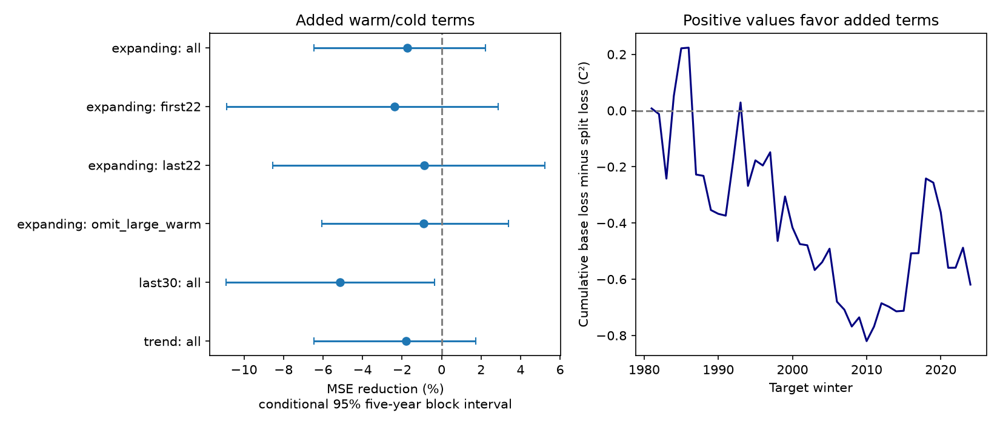

# Separate spring change slopes by winter sign gave no clear RONI forecast gain in 1981-2024

A model with separate spring change slopes after negative and nonnegative winters gave no clear added forecast gain. In 44 next-winter tests, mean squared error rose by 1.73%. The conditional 95% interval for error reduction was -6.47% to +2.24%. This is a null result for one simple response form. It does not show that ENSO has symmetric dynamics.

## Question and prior evidence

ENSO affects rainfall and water supply. A reliable forecast of its ocean state can support later tests of those effects. Here we test the ocean index only. Do separate spring change slopes after negative and nonnegative winter states improve a forecast of the next winter?

The [prior campaign report](sci:sha256:90d10d260dcaba2d2954d7956128e2046adc09975a014c5bd6309476f3038cd8) found that MAM minus DJF relative ENSO index (RONI) adds forecast value beyond MAM alone. We use that report to set a stronger baseline. Its numerical inputs agree with all 222 values used here. This is an extension on the same source record, not independent confirmation.

Prior physical work reports phase-dependent ENSO dynamics: [Asymmetries in the ENSO phase space](https://doi.org/10.1007/s00382-022-06392-0) and [Quantifying the Role of Oceanic Feedbacks on ENSO Asymmetry](https://doi.org/10.1029/2018GL081332). We used indexed abstracts and excerpts to set the question. We do not repeat their physical tests. [L'Heureux et al.](https://doi.org/10.1175/JCLI-D-23-0406.1) provide context for the relative index. Our contribution is a fixed, chronological test of a two-parameter extension to the published lag baseline. We make no claim that sign-dependent models are new.

Campaign searches covered earthquakes, ocean indices, Indian Ocean dipole and RONI. We chose this question after reading the spring RONI report. The [plan](files/plan.md) was saved before extracting and scoring data. It is not a registered protocol.

## Data and method

We use the saved [NOAA CPC ERSSTv5 RONI seasonal table](https://www.cpc.ncep.noaa.gov/products/analysis_monitoring/enso/roni/v5/). RONI removes tropical mean SST anomaly from Nino 3.4 and scales the result to match index variance. Its reference period is 1991-2020. DJF year refers to January year. The inputs are rounded to 0.1 C. The [provenance record](files/provenance.json) gives the exact shared path, resolved path, URL, file size and SHA-256. No raw data were downloaded or changed. [inputs.csv](files/inputs.csv) contains the numerical public domain subset: DJF and MAM issue values and next-DJF targets. Source HTML and paper text are excluded.

For issue year y, let A be MAM RONI, W be DJF RONI, D=A-W and Z=1 when W is at least zero. The baseline ordinary least squares model is target = b0 + b1*A + b2*D. The added model includes b3*Z + b4*Z*D. It thus allows both an intercept change and a spring change slope change. Both groups share the A slope. The zero split includes neutral years and is not an official El Nino or La Nina event definition. A coefficient on D is also a coefficient on past winter level after reparameterization; it does not identify a physical rate effect.

We fit issues 1950 through y-1 and forecast DJF y+1 for issues 1980-2023. There are 44 target winters, 1981-2024. All earlier training targets end by February of the issue year, before MAM ends in May. No forecast uses a later training year. Training samples grow from 30 to 73. There is no tuning, regularization, clipping or model selection on test errors. The added model has five parameters rather than three.

Skill is 1 minus added MSE divided by baseline MSE. Positive skill means lower error. We resample paired annual losses with circular five-year blocks, 20,000 draws and seed 11076. The 95% limits are percentile limits. The models are not refit in these draws. These limits condition on the saved fits and revised record; they do not cover model selection, parameter fitting, data revisions or source errors. Blocks of three and ten years are secondary checks.

Other planned checks use the last 30 training issues, a linear issue-year trend in both models, the two 22-winter target halves, and scoring without 1983, 1998 and 2016. The omitted targets remain in training. Subgroup scores use the sign of DJF at the issue. For masked checks, the full 44-year calendar is resampled with zero loss weight outside the subset. Draws with no selected years are excluded: five for the first half and four for the last half. All 20,000 main draws are valid. Checks are descriptive, without simultaneous coverage.

## Results

| Test | Baseline MSE, C squared | Added MSE, C squared | Error reduction | Conditional 95% limits |
| --- | ---: | ---: | ---: | ---: |
| Main, 44 winters | 0.8149 | 0.8290 | -1.73% | -6.47% to +2.24% |
| First 22 winters | 0.9121 | 0.9339 | -2.39% | -10.89% to +2.87% |
| Last 22 winters | 0.7177 | 0.7241 | -0.89% | -8.54% to +5.23% |
| Omit three large warm targets | 0.7446 | 0.7514 | -0.91% | -6.05% to +3.38% |
| Last 30 training issues | 0.8178 | 0.8599 | -5.14% | -10.91% to -0.36% |
| Add trend to both models | 0.8856 | 0.9016 | -1.80% | -6.46% to +1.74% |

Mean absolute error rose from 0.7529 C to 0.7603 C in the main test. Main RMSE rose from about 0.9027 C to 0.9105 C. The three-year and ten-year intervals also included zero. The negative-DJF and nonnegative-DJF groups each contain 22 forecasts. Their error reductions were -4.00% and +0.19%; both intervals included zero. The point gain is not positive in either half of the test record. The shorter training window gave a larger error increase, with its secondary interval below zero.

The evidence supports keeping the simpler lag model as a benchmark in this tested scope. It does not show that winter sign has no forecast information. Extra fit variance, rounding near zero, a poor response form, and changes through time could each hide useful information. This test does not separate these explanations.

## Limits and checks

This is a retrospective test on revised values, with a reference period that contains future observations relative to early forecasts. It is not real-time validation. ERSSTv5 is one reconstruction; RONI has since also been made from ERSSTv6. There are only 44 test winters and one fixed zero split. We did not test subsurface heat content, winds, rainfall, water storage or a physical mechanism. Results do not establish an advantage against dynamical forecasts or full ENSO statistical systems.

Two HTML parsers agreed on 75 full seasonal rows. All fits had full rank. A normal-equation solver agreed with least-squares forecasts within 2.17e-14 C. A separate group-intercept and group-slope parameterization agreed within 3.78e-15 C. Saved loss and time-order checks passed. A fresh offline run reproduced the input, forecast, score, draw and figure files byte for byte. See [audit.json](files/audit.json) and [independent_audit.json](files/independent_audit.json). Parser development needed a fix to the HTML reader, and masked resamples needed explicit handling of empty subsets. These fixes preceded reported results and did not change the model or scoring plan.

## Reproduction and identity

[REPRODUCE.md](files/REPRODUCE.md) gives offline and source-based commands. The package preserves code, numerical inputs, every forecast and coefficient, all planned scores, bootstrap draws and the figure. [EXTERNAL_DATA.md](files/EXTERNAL_DATA.md) gives NOAA attribution and source terms. The authors claim no ownership in NOAA numbers. All original contributions use the exact SCI baseline license.

Job: `sci-1107-dell-earth-and-ocean-sciences-6ae8c7f8513a`. Topic: `earth-and-ocean-sciences`. Campaign: `11_07_2026`. Machine: `dell`. Account: `codex-andrii`. Model: `gpt-6.1-sol`, high reasoning effort, Codex harness in T3 Code. No child agents were used. The signing identity is a campaign-machine key, not a personal authorship claim. The signed publication is saved locally only.
