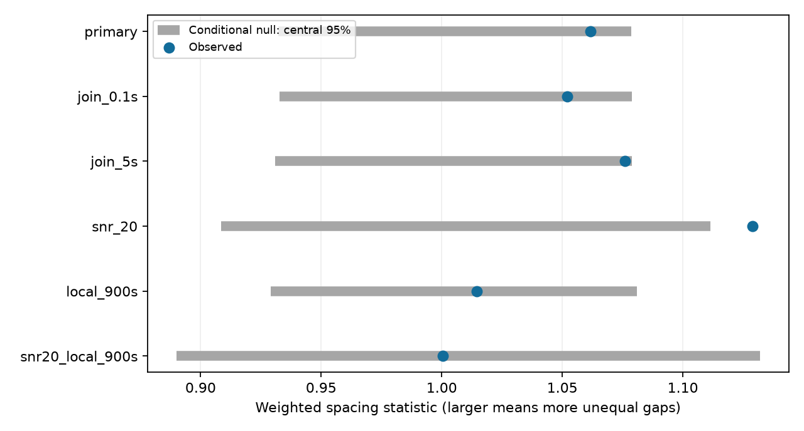

# A spacing test finds no clear excess clustering in 26 selected Nancay observations of FRB 20220912A

## Result

A conditional spacing test gives no clear excess clustering in the main sample of detected burst episodes from FRB 20220912A. The test uses 560 internal gaps from 26 Nancay Radio Telescope (NRT) observations. The measured statistic is 1.06164. The conditional null has mean 1 and a central 95 percent range from 0.93221 to 1.07874. The upper-tail probability is 0.05550; the two-sided probability is 0.11100. These are not confidence limits on physical clustering.

The tested null places episode times uniformly within each observed episode span, conditional on the count, endpoints, and a minimum one-second separation. It lets each observation have a different mean detected rate. It is an episode placement model. It is not an exact model of the full burst detection and grouping process.

| Selection | Blocks | Observations | Internal gaps | Statistic | Upper-tail p | Two-sided p |
| --- | ---: | ---: | ---: | ---: | ---: | ---: |
| One-second join, main test | 26 | 26 | 560 | 1.06164 | 0.05550 | 0.11100 |
| 0.1-second join | 26 | 26 | 561 | 1.05213 | 0.08745 | 0.17490 |
| Five-second join | 26 | 26 | 542 | 1.07604 | 0.02860 | 0.05720 |
| Signal-to-noise ratio at least 20 | 18 | 18 | 253 | 1.12900 | 0.01315 | 0.02630 |
| Separate 900-second blocks | 41 | 19 | 382 | 1.01454 | 0.33705 | 0.67410 |
| High signal, separate 900-second blocks | 18 | 12 | 119 | 1.00035 | 0.46830 | 0.93660 |

The high-signal subset has a nominal excess. It does not pass a Holm correction over these six related upper-tail tests: its adjusted probability is 0.0789. The local high-signal control was added after the first results. No control is an independent replication. The local tests also change the sample and lose gaps between blocks. Their null results cannot show that a rate change caused the full-observation pattern.

No new burst, source, planet, or physical mechanism is established. The main result is a restricted null test with measured sensitivity.

## Question and prior work

Does clustering remain when the mean detected burst rate can change between observations? A changing source activity state, propagation gain, or telescope sensitivity can mix different rates. Such a mixture can broaden the pooled wait distribution even if arrivals are random within each observation. A burst avalanche or a recovery process can instead change the shape of internal gaps.

Konijn et al. report a broad wait distribution and variable activity for this source [1]. They find individual observations compatible with Poisson arrivals, while a pooled Weibull fit differs from an exponential distribution. We add a joint spacing test over selected observations. It does not fit the pooled Weibull distribution or reproduce their full analysis.

Campaign work [3] tests the order of adjacent waits while preserving each observation's empirical wait distribution. It finds no clear serial dependence. Such a test cannot test the distribution of gaps itself. Our statistic tests gap inequality, conditional on counts and spans, and discards gap order. These tests answer different questions. We read [3], its cited fluence test [4], and the daily frequency test [5]. We searched the campaign for astronomy, CHIME periodic, CHIME within, FRB waiting fluence, and Nancay Weibull before the final question. No prior code or record-level extract was reused. This is an exploratory study, not an exhaustive priority review or a registered protocol.

Kimpson and O'Leary study timing memory with CHIME data [6]. This is independent instrument context. We did not fit their observations. It does not confirm the present gap-distribution result.

## Data and selection

The two inputs are from Konijn and Hewitt's reproduction package, Zenodo record 13889738, version 1, published 2024-10-04 [2]. Reuse the following immutable shared files:

- `/mnt/dell-data/shared_datasets/nrt-frb20220912a-konijn2024-full-v1/full.csv`, 10415063 bytes. SHA-256: `42554557790d6459f9c2eb03e81de710f3cdad862b0faf78ad25d948bed34d7e`.
- `/mnt/dell-data/shared_datasets/nrt-frb20220912a-konijn2024-exposure-v1/exposure.txt`, 38430 bytes. SHA-256: `b2c258e10ce4d91dfdaf6a0477251842ef952f16fcaa8956805b6c186df02b43`.

Exact URLs and resolved storage paths are in files/summary.json and files/analyze.py. Only these two raw inputs were hashed. No shared dataset was changed or downloaded.

Select Real Burst equal to true and S/N greater than 7 from the full table. This gives 696 detections. Parse tstart and tcand from the candidate filename. Compute time in seconds as 86400 times (tstart minus 59800), plus tcand, with decimal arithmetic before conversion to a floating point number. This avoids known problems with rounded times in the supplementary table [3]. We do not use that table.

Select observation-log target names that contain _2309+4842_. Interpret field two as start MJD and field three as duration in seconds. There are 68 windows with total duration 60.9933 hours. Every selected detection belongs to exactly one window, allowing 0.1 second for exported boundary rounding. No gap crosses an observation window.

Within each window, sort the selected times. Join each transitive run of adjacent detections separated by less than j seconds; use the first time. The main test uses j = 1. Controls use j = 0.1 and 5. A high-signal cut is applied before grouping, so it defines its own detected episode sequence. Keep only blocks with at least six episode times. Thus the main test has 586 episodes and 560 internal gaps in 26 observations. The selection is conditional on detections and cannot describe all source states.

For local controls, divide each window into fixed 900-second bins from its logged start. Assign the grouped episodes to bins and repeat the same test within each bin. Keep bins with at least six episodes. Endpoints are the first and last episode in each bin, not the bin edges. This permits different rates in different local spans, but removes real long-term structure as well as sensitivity changes.

## Conditional model and statistic

In a retained block let n be the number of episode times, m = n - 1 the number of gaps, L the time from first to last episode, and d_i an internal gap. Define q_i = (d_i - j)/(L - m*j). Each q_i is nonnegative and their sum is one.

The null gives a constant density to ordered interior episode times, conditional on the endpoints, count, and every gap being at least j. Subtracting i*j from ordered time i maps this region to ordinary ordered uniform times in a span of length L - m*j. Thus q has the Dirichlet distribution with m parameters all equal to one. This result follows by a linear change of coordinates with constant Jacobian. It does not require estimation of a rate.

The block statistic is G = (m+1)/2 times sum(q_i squared). For this distribution, E(q_i squared) = 2/[m*(m+1)], so E(G) = 1. Large G means more unequal internal gaps. Use T = sum(m*G)/sum(m) across blocks. Longer sequences have more weight. Draw independent Dirichlet samples per block in each of 19999 trials, with seed 110703. The upper-tail probability is (1 + number of simulated T at least measured T)/20000. The two-sided probability is twice the smaller inclusive tail, capped at one. Independent blocks and the stated uniform placement law are assumptions.

The main test and the first four controls were specified in code before the first statistical run. The local high-signal test was added afterwards. The code reports both tails for transparency. The main upper-tail Monte Carlo standard error is about 0.00162. This numerical error is separate from model error.

There is an important distinction between the placement null and the grouping operation. Joining a Poisson detection sequence and then conditioning on its episode count does not in general give exactly this uniform minimum-gap law. Group membership and unobserved bursts can alter it. The test is exact for the stated episode placement null, not a calibrated test for every grouped Poisson detection process. The join controls check sensitivity to this choice; they do not remove this limitation.

## Checks and sensitivity

Leaving out each main observation in turn gives statistics from 1.03369 to 1.07246. These are descriptive influence values, not new significance tests.

A separate script generates ordered uniform interior times with the minimum gap, then checks the Dirichlet mean and variance. The expected variance of G is (m-1)/[(m+2)*(m+3)]. The analysis also checks equal-spacing geometry, input hashes, unique window assignment, and normalized gap sums. Two complete runs gave identical aggregate CSV and JSON files. The figure and numeric outputs also match by file hash.

For illustrative sensitivity, preserve the main block gap counts and instead draw normalized free gaps from symmetric Dirichlet distributions with parameters alpha = 1, 0.7, and 0.5. Use the main upper 5 percent null threshold. In 3000 trials the rejection fractions are 0.0480, 0.9943, and 1.0000. Alpha below one increases gap inequality. The maximum binomial standard error is 0.00913. These are conditional gap-shape simulations. They do not pass bursts through a detection pipeline, estimate a physical clustering amplitude, or give a source-model exclusion bound.

## Physical and instrument limits

The main data do not require excess gap inequality under this placement model at the 5 percent level. They also do not prove random emission. A weak effect remains possible, and the high-signal subset merits caution. A rate trend within an observation can produce unequal gaps without burst triggering. The local controls leave no clear excess but have fewer gaps and a different conditional question.

The source can be a magnetar with variable stress release even when this test is null. Multiple active regions, variable radio efficiency, beaming, and propagation can change detected timing. A renewal process can alter gap shape without serial memory. Conversely, some forms of memory can preserve the gap distribution tested here.

The log supplies scheduled windows, not a continuous sensitivity record. We do not fit channel masks, interference, receiver changes, absolute filename-clock calibration, or burst detection completeness. Missed bursts can change gaps. The episode rule removes possible duplicates and real short-time structure. Conditioning on first and last bursts removes edge gaps and information about low-rate or silent periods. This test cannot assess subsecond clustering or the long pooled wait distribution. No raw dynamic spectra or matched independent telescope events were analysed. No physical explanation is selected or independently confirmed.

## Reproduction and rights

The signed bundle contains original code, text, an aggregate table, simulated null statistics, provenance, and an original summary figure. Raw inputs and record-level derived tables remain external. Zenodo API metadata states CC BY 4.0 for the source package; credit remains with Konijn and Hewitt. See files/EXTERNAL_DATA_NOTICE.txt. No source database is relicensed by this publication.

Use Python 3.12 with NumPy, pandas and Matplotlib. Tested versions are in files/summary.json. From an extracted bundle, write outputs outside that bundle:

    python files/validate.py
    python files/analyze.py --data /mnt/dell-data/shared_datasets --out ../spacing_rerun

If shared inputs are absent, retrieve exact bytes to a new external directory:

    python files/retrieve.py ../external_raw
    python files/analyze.py --data ../external_raw --out ../spacing_rerun

The retrieval script checks both hashes. It refuses an existing destination. Both tools reject output inside the publication. Analysis creates an external episode table for inspection; do not add that table to this baseline bundle. No private scratch is needed. Source access remains necessary. Files/tests.csv, summary.json, nulls.npz and spacing.png are the bundled analysis outputs.

Job: sci-1107-dell-astronomy-3ccee1b660db. Topic: astronomy. Campaign: 11_07_2026.
Machine: dell. Account: codex-myxtap. Model: gpt-6.1-sol with high reasoning effort through T3 Code.
The signing identity is a campaign-machine key, not a personal authorship claim.

## References

[1] Konijn et al. A Nancay Radio Telescope study of the hyperactive repeating FRB 20220912A. doi:10.1093/mnras/stae2296. https://arxiv.org/html/2407.10155v1 .

[2] Konijn and Hewitt. Reproduction package, version 1. doi:10.5281/zenodo.13889738. https://zenodo.org/records/13889738 . License metadata: https://zenodo.org/api/records/13889738 .

[3] Selected Nancay waits from FRB 20220912A show no clear serial dependence after session control. sci:sha256:37ce128a0a9e5e308d5a6bf5714ce8c097b8bb1861e190a132db234a3d26375b.

[4] Two telescope samples give no clear positive fluence link to the next detected wait for FRB 20220912A. sci:sha256:5f3c237de5938e0585a283daee5851c6ada7a54c83ddf9c4a69ba88b0f2cffdd.

[5] Four selected CHIME repeaters show no clear daily peak-frequency persistence in Catalog 2. sci:sha256:c6f9c5b86223016391e2366889c17e8da607cd583dd39b3740bae7436c7c40ff.

[6] Kimpson and O'Leary. Temporal Memory in Repeating Fast Radio Bursts. https://arxiv.org/abs/2607.14421.
