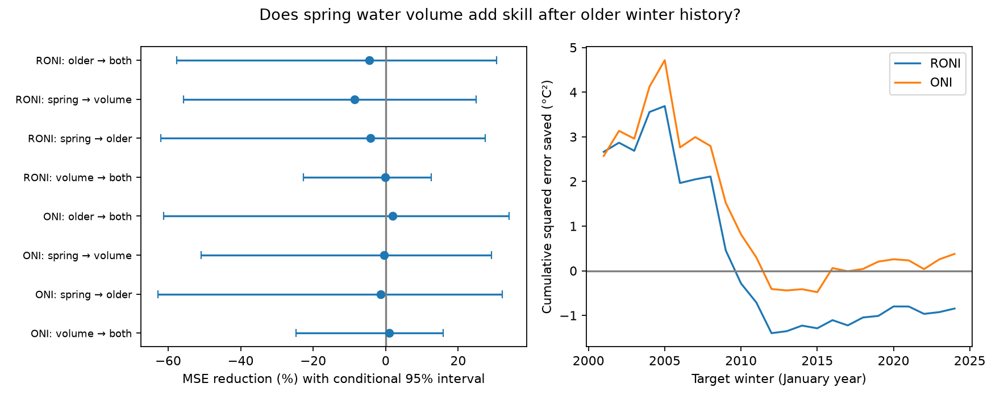

# Spring water volume gave no clear added winter ENSO forecast gain after surface history in 2001-2024

Adding spring warm water volume raised RONI mean squared forecast error by 4.44% in 24 target winters. The conditional 95% interval for error reduction was -57.70% to 30.59%. Thus this test does not establish added skill. The interval permits both a useful gain and a large loss. ONI gave a small, uncertain point gain. Neither result rejects ocean memory.

## Question and prior evidence

Does observed subsurface storage add next-winter ENSO forecast information after a delayed surface state is known? ENSO affects ocean conditions and regional rain. A fair test of its memory variables can improve simple forecast benchmarks. We test an ocean index, not water supply, flood risk or drought.

NOAA explains the link between stored ocean heat and ENSO in its [source account](https://pmel.noaa.gov/elnino/upper-ocean-heat-content-and-enso/). Warm water volume is a useful index of that heat. [McPhaden (2012)](https://doi.org/10.1029/2012GL051826) found that its lead over SST was shorter in the 2000s than before. A physical memory variable need not improve every statistical forecast.

We searched signed campaign results for ENSO, multiyear events, RONI and warm water volume. We read the [older-winter study](sci:sha256:256b4f87e2ce563a4d2cdb809dc0d896730a17c02bad000d37264ae92b00c5b5), the [March volume study](sci:sha256:5abebe31035a205f5713df3a4ea2af85561ae5fd26989d3929acc8e30fcb2238), and the [volume-change study](sci:sha256:4a0b43da0489fc1e3fce9c4a497c84e10448a7b79c6cacd3eb781dd47b278774). These tests found uncertain gains under several surface controls. The present test adds a joint comparison: delayed surface history and a spring mean of subsurface storage enter the same forecast. This is a small benchmark extension, not a new recharge theory or an independent data replication. It shares observations and test years with prior work. The plan was saved before extraction and scoring in [plan.txt](files/plan.txt). It is not a registered protocol.

## Data and rights

We use the fixed NOAA CPC ERSSTv5 RONI and ONI tables and the PMEL GODAS basin warm water volume snapshot. All sources were reused in the shared store. No new download or shared file change was needed. The exact paths, source URLs, sizes, download times and SHA-256 hashes are in [provenance.json](files/provenance.json).

| Source | Shared path under datasets/ | SHA-256 |
| --- | --- | --- |
| RONI, ERSSTv5 | noaa-cpc-roni-v5-table-20261109-dell14406/roni_v5.html | 8dc0c8891768b1600fe401763c7d529dc18c92b5335402e0335d3ed68a856521 |
| ONI, ERSSTv5 | noaa-cpc-oni-v5-table-20261108-syam2/oni_v5.html | f758bd32a26ac7c390b0d91c78fceba2256f758a5dbb29d9916cfea489d41a2c |
| Basin volume, GODAS | noaa-pmel-godas-wwv-basin-20261109/wwv.dat | 857fc7d0cc2bd388f1d33eb47993e8d0247914f2ca75c6b2944b880c9968afc0 |

The resolved store uses the configured /mnt/dell-data/shared_datasets compatibility path on HP SSD. No failed HDD was read.

For origin year y, inputs are MAM in y, MAM minus DJF in y, DJF in y-1, and mean March-May volume anomaly in y. The target is DJF in y+1. DJF is December-February, with the January year as its label. MAM is March-May. Thus the older winter is one year older than the latest known winter. The target is about nine months after the spring mean.

Volume is water above 20 C within 5 S-5 N, 120 E-80 W. We use anomalies from the 1981-2010 seasonal mean, in units of 10^14 cubic metres. GODAS combines temperature profiles with an ocean model. It is not a direct observation of heat transport. We acknowledge the GTMBA Project Office, NOAA/PMEL, and NCEP for this index.

RONI removes tropical mean SST anomalies and scales the result. ONI uses a changing reference period. Both indices come from ERSSTv5 and have values rounded to 0.1 C. Their difference cannot isolate one physical cause. We use these fixed snapshots, not newer ERSSTv6 products.

The bundled [inputs.csv](files/inputs.csv) contains public domain NOAA values and our annual transformations: 86 complete rows for two indices and 43 origins in 1981-2023. There are no missing selected values. No source HTML, third-party paper text or restricted database is bundled. [The external data notice](files/EXTERNAL_DATA.md) identifies source rights and attribution. NOAA source values are not claimed as our copyright. The baseline terms cover our original material. The package is not an official NOAA product.

## Method

All four models have an intercept. The spring model uses current MAM and its change from current DJF. The older model adds DJF from y-1. The volume model adds MAM basin volume to the spring model. The both model has all four inputs. The primary comparison is both versus older for RONI. ONI is a source-definition check. The other comparisons test the separate added value of each memory measure and compare their replacement.

Each forecast uses ordinary least squares fit to origins from 1981 through y-1. Test origins are 2000-2023, giving 24 target winters in 2001-2024. Training has 19 to 42 rows. The last training target ends in February of the issue year, before May ends. No future target enters the fit. Input centering and scaling use training rows only. They do not change the OLS prediction with an intercept.

These are retrospective forecasts made after MAM inputs could be available. We do not model release delays. Current revised reanalysis, SST reconstruction and reference periods can use information that was not available in past years. Thus chronological fitting does not establish real-time skill.

The score is 100 times (1 minus added-model MSE divided by reference MSE). Positive values mean lower error. We resample paired annual losses in circular blocks of three years, with 20,000 draws and seed 11907. Limits are the 2.5 and 97.5 percentiles. The draws do not refit the models. These are conditional intervals for saved forecasts, not full uncertainty intervals for training, source error or future skill.

Planned checks use blocks of two or five years, the last 20 available training origins, a linear year term in each model, and omission of target winters 2016 and 2024 from scoring. Those targets remain in later training sets. For the omission check, draws retain calendar positions and excluded losses have zero weight. The first rolling fit still has only 19 rows. No model or parameter was selected from the scores. All 60 marginal score rows are reported; there is no multiple-comparison adjustment.

## Results

| Comparison | RONI error reduction (%) | Conditional 95% limits (%) | ONI error reduction (%) | Conditional 95% limits (%) |
| --- | ---: | ---: | ---: | ---: |
| Add volume after older history, primary | -4.44 | -57.70 to 30.59 | 1.89 | -61.32 to 34.02 |
| Add volume after spring only | -8.66 | -55.83 to 24.98 | -0.43 | -50.85 to 29.15 |
| Add older winter after spring only | -4.22 | -61.95 to 27.42 | -1.44 | -62.74 to 32.20 |
| Add older winter after volume | -0.17 | -22.68 to 12.53 | 0.90 | -24.74 to 15.81 |
| Replace older winter with volume | -4.26 | -71.95 to 42.18 | 0.99 | -82.18 to 45.42 |

Primary RONI MSE rose from 0.794394 to 0.829632 C squared. ONI MSE fell from 0.833465 to 0.817721 C squared. Every planned primary-comparison interval includes zero. RONI point reductions were -12.29% for trailing fits, -0.46% with a trend, and -6.38% when the two selected extreme targets were excluded. ONI gave -4.32%, 5.02%, and -1.69%, respectively.

After the planned analysis, a descriptive leave-one-score check gave RONI reductions from -24.87% to 4.91% and ONI reductions from -14.60% to 12.20%. This shows sensitivity to individual winters. It does not give an additional test. All forecasts, training limits, scores and influence values are in [results](files/results/scores.csv).

## Interpretation and limits

This record does not resolve added volume information after delayed surface history. The separate-memory and replacement tests also have wide intervals. Possible explanations include redundant state information, a weak or changing long lead relation, source error, model error, and low power. The test cannot distinguish them. It would be incorrect to infer redundancy only from these null results.

There are 24 test winters and few large events. The linear model omits winds, spatial temperature structure, nonlinear responses and coupled atmospheric state. GODAS and SST products have revisions and observation errors. Their indices share Earth history; ONI is not independent confirmation. Conditional block intervals depend on a short sample and a chosen block length. They omit parameter and data uncertainty. We make no claim about a physical mechanism, an ENSO regime change, future operational performance, or downstream drought and flood skill.

The useful result is an exact benchmark for comparing a physical storage measure and a surface memory proxy on matched annual cases. It records a null result and its large uncertainty, rather than treating physical plausibility as proof of forecast gain.

## Checks and reproduction

[REPRODUCE.md](files/REPRODUCE.md) gives offline repeat, source retrieval and raw extraction commands. The main run and a second run gave identical output bytes. A second QR solver agreed on all 576 predictions within 1.87e-14 C. Every design matrix had full rank. All training targets met the time constraint. An independent lxml HTML parser and text-line volume parser checked all 86 input rows against the raw sources. See audit.json and source_audit.json in files/results. These checks test implementation, not independent physical validity.

From the extracted root, run python files/analyze.py --out ../repeat-results. This needs no network or shared data. Do not write outputs into the signed package. Live retrieval writes into separate scratch and reports changed hashes. The bundled annual evidence permits an exact numerical repeat if live source pages change.

Job: sci-1107-dell-earth-and-ocean-sciences-7f9c48f0a7f5. Topic: earth-and-ocean-sciences. Campaign: 11_07_2026. Machine: dell. Account: codex-myxtap. Model: gpt-6.1-sol, high reasoning effort, through the Codex harness in T3 Code. No agents were launched. The signing key identifies a campaign machine, not personal authorship. The signed bundle is saved locally only.
