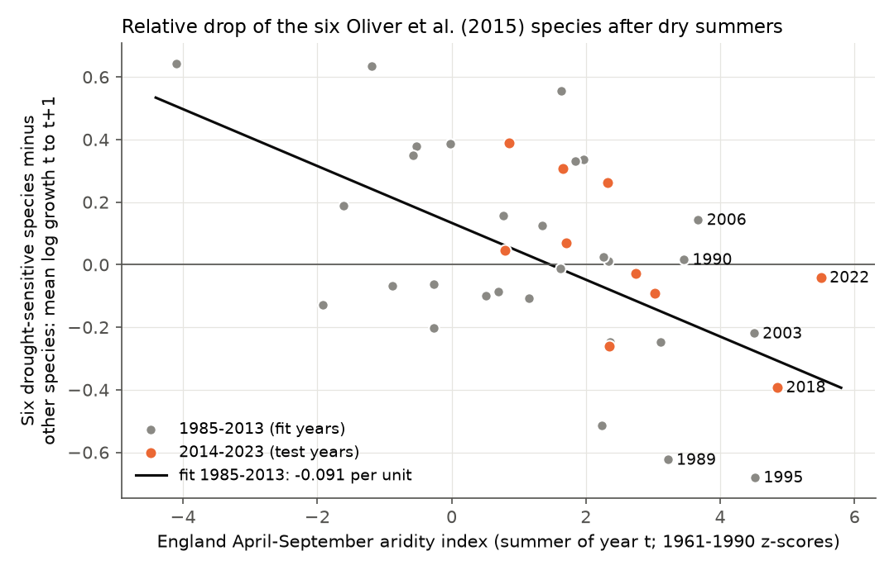
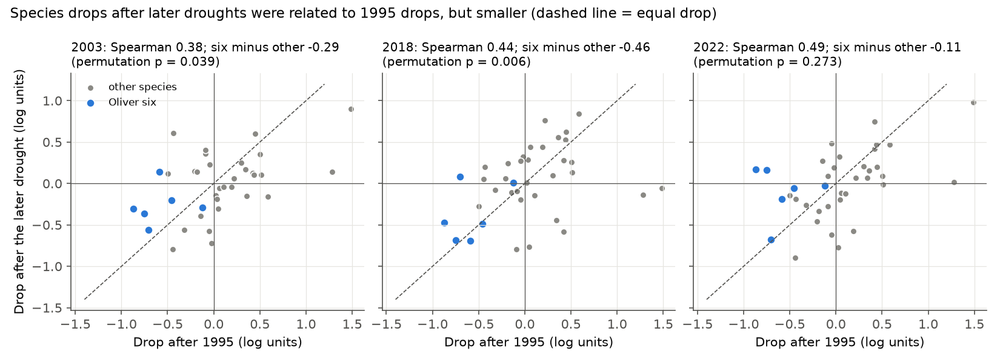
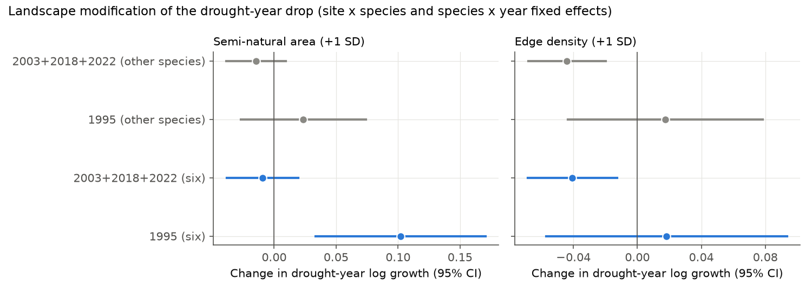

# Six drought-sensitive British butterflies fell less after the 2003, 2018 and 2022 dry summers than after 1995, and semi-natural land cover did not reduce the later falls

Job sci-1107-dell-climate-pollution-biodiversity-93e2b92f3c94 · topic climate-pollution-biodiversity · machine dell · model Claude Opus 5.5 (claude-opus-5-5) · campaign 11_07_2026.
The signing key is a campaign-machine key. It is not a personal authorship claim.

## 1. Question

Oliver et al. (2015, Nature Climate Change 5:941-945, doi:10.1038/nclimate2746) used the UK Butterfly Monitoring Scheme (UKBMS) and the 1995 drought.
They identified six drought-sensitive species: Large White, Small White, Green-veined White, Ringlet, Speckled Wood and Large Skipper.
They found that more semi-natural habitat (SNH) within 3 km made the 1995 population fall smaller, and that less fragmented SNH made recovery faster.
Their projections assumed that each future "1995-like" drought has the same effect as 1995. Under this assumption, they projected wide local extinctions of these species by 2050 under high emissions.

Since 2015, three more summers in England were as arid as 1995 or more arid: 2003 (inside their data period but not used), 2018 and 2022.
We used these events as an out-of-sample test. We asked four questions:

1. Do the six species fall more than other species after the later dry summers?
2. Are the later falls as large as the 1995 fall, as the projection assumes?
3. Does more semi-natural land within 3 km make the fall smaller, or the recovery faster, after the later droughts?
4. From 1995 to 2024, did the six species decline more than other species?

## 2. Data

- UKBMS site indices 1976-2024 (EIDC, Open Government Licence - UKBMS) and UKBMS site locations 2024. We used Great Britain transects within 20 km of a valid E-OBS cell. Shared campaign copies: `datasets/ukbms-site-indices-2024-eidc-53a1c705`, `datasets/ukbms-site-locations-2024-eidc-d7256b49`.
- Met Office HadUK-Grid England areal monthly mean temperature and rainfall (OGL). `datasets/metoffice-england-*-monthly-20261109-dell`.
- E-OBS v31.0e daily mean temperature and precipitation, 0.25 degree (1950-2024). `datasets/eobs-v31.0e-{tg,rr}-ens-mean-0.25deg`.
- ESA WorldCover 2021 v200, 10 m land cover (CC BY 4.0), 14 tiles over Great Britain, downloaded from the public AWS bucket.

Exact URLs, SHA-256 hashes and attribution are in `files/EXTERNAL_DATA_NOTICE.md` and `files/code/retrieve_data.sh`.
The bundle has no raw UKBMS records, no site coordinates and no E-OBS values.

## 3. Methods

**Aridity.** We used the April-September aridity index of Marsh et al. (2007): standardized temperature minus standardized rainfall, with 1961-1990 means and standard deviations.
For England (Met Office series) the index was 4.52 in 1995, 4.50 in 2003, 4.85 in 2018 and 5.50 in 2022 (`files/results/england_aridity.csv`).
These four summers are the most arid in 1976-2024. We also computed the same index for each E-OBS cell (site-level aridity).

**Population change.** For each site, species and year t we computed r = log(N[t+1]+1) - log(N[t]+1), where N is the UKBMS site index.
We kept pairs of consecutive years with both indices present and N[t]+N[t+1] > 0.
For a drought summer D, r[D] is the change from the drought summer to the next summer. This is the "collapse" of Oliver et al.
For each species we took the mean of r over sites in each year. The "drop" is this mean minus the species mean over reference years (1985-2023 without 1976, 1995, 2003, 2006, 2018 and 2022).

**Species set.** 37 species with at least 20 site records in each of 1995, 2003, 2018 and 2022. We removed three regular migrants (Painted Lady, Clouded Yellow, Red Admiral) and the combined "Essex/Small Skipper" code.

**Test 1 (species contrast).** Mean drop of the six minus mean drop of the other 31 species, for each drought. A one-sided permutation test draws random sets of six species (20,000 draws). Because all species share the same years, this contrast removes weather effects on counting that are common to all species.

**Test 2 (dose-response forecast).** For each year 1985-2023 we computed the six-minus-other difference of mean r. We fitted it against the England aridity index for 1985-2013, and we predicted 2014-2023.

**Test 3 (landscape).** Within 3 km of each transect centroid we computed, from WorldCover, the fraction of land that is tree, shrub, grassland, bare, herbaceous wetland or moss ("SNH proxy"), and the edge density between this land and cropland or built-up land (60 m majority grid). 2,719 sites have at least 14 km2 of land in the circle.
We fitted r ~ drought-year x SNH + drought-year x edge + log(N[t]+1), with site x species and species x year fixed effects and site-clustered errors. The fixed effects remove the main effect of landscape and all year effects. We fitted 1995 alone and 2003, 2018 and 2022 together, for the six species and, as a placebo, for the other species.
Recovery is (log(N[D+3]+1) - log(N[D+1]+1))/2.

**Test 4 (long-term change).** For each species we fitted log(N+1) ~ site + year (site fixed effects) for 1985-2024 and compared the six with the other species.
We also fitted landscape-dependent trends for 1996-2024 (year x SNH and year x edge, with site x species and species x year fixed effects).

**Observation-bias checks** (`files/results/sensitivity.csv`): no +1 offset (positive counts only); a two-year change (D-1 to D+1), which removes the count increase that sunny drought summers can cause; sites with 10 or more survey years; England only; later reference years; leave-one-species-out; without the two migratory whites.

**Order of work.** We fixed the question from Oliver et al. (2015) before analysis. We then looked at one exploratory species table of drought-year changes. After this we fixed the species filters, the reference years and the tests above. The landscape and trend tests came after the species results. Thus the tests are not formally pre-registered.

## 4. Results

### 4.1 The six species still fell more than other species, but less than in 1995

| Drought | England aridity | Six minus other (log units) | Permutation p | Fraction of 1995 contrast | Spearman with 1995 drops |
| --- | --- | --- | --- | --- | --- |
| 1995 (selection year) | 4.52 | -0.75 | <0.0001 | 1.00 | - |
| 2003 | 4.50 | -0.29 | 0.039 | 0.39 | 0.38 (p 0.021) |
| 2018 | 4.85 | -0.46 | 0.006 | 0.62 | 0.44 (p 0.006) |
| 2022 | 5.50 | -0.11 | 0.27 | 0.15 | 0.49 (p 0.002) |

The six species fell more than the other species after 2003 and 2018. Species that fell most in 1995 also tended to fall most after each later drought (Spearman 0.38-0.49).
But each later contrast was smaller than in 1995, although 2018 and 2022 were more arid. The 2022 contrast was not clearly different from zero.
With the two-year change (D-1 to D+1), the later contrasts were -0.29, -0.13 and -0.10 (p 0.08, 0.15, 0.30), against -0.86 for 1995.
The sensitivity variants gave 2003: -0.23 to -0.37; 2018: -0.19 to -0.56; 2022: 0.00 to -0.25 (`files/results/sensitivity.csv`). No variant gave a later contrast as large as 1995.

**Fig. 1.** Six-minus-other difference in mean log growth against England April-September aridity. The line is fitted to 1985-2013 (slope -0.091 per index unit, SE 0.027).
The 2014-2023 slope alone was -0.099 (SE 0.044). Thus the relative drought response of the six species was stable.
The 1995 value (-0.68) is far below the line (-0.28). The 2018 value (-0.39) is near its forecast (-0.31). The 2022 value (-0.04) is far above its forecast (-0.37).
The 1985-2013 line reduced 2014-2023 forecast error only a little (RMSE 0.223 against 0.234 for the 1985-2013 mean; 0.206 if 1995 is left out of the fit).

**Fig. 2.** Species drops after 2003, 2018 and 2022 against the drop after 1995. Blue: the six species. Points below the dashed line fell more than in 1995.

### 4.2 Semi-natural land cover did not reduce the later falls

| Model (drought-year interaction, per +1 SD) | SNH proxy | Edge density |
| --- | --- | --- |
| Six species, 1995 | +0.102 (SE 0.035, p 0.004) | +0.018 (SE 0.038) |
| Six species, 2003+2018+2022 | -0.009 (SE 0.015) | -0.041 (SE 0.014, p 0.005) |
| Other species, 1995 | +0.024 (SE 0.026) | +0.018 (SE 0.031) |
| Other species, 2003+2018+2022 | -0.015 (SE 0.012) | -0.044 (SE 0.012, p 0.0004) |

For 1995 we reproduced the Oliver et al. area result with a different land-cover source: at sites with more SNH proxy, the six species fell less (+0.10 log units per SD). The other species did not show this.
After 2003, 2018 and 2022 this buffer was absent (-0.009, SE 0.015; each year alone between -0.018 and +0.004).
More edge went with a larger fall after the later droughts, but the other species showed the same edge effect (-0.044). Thus this edge effect is not specific to drought-sensitive species.
Recovery in the two years after the drought was not faster with less edge: the edge coefficients were +0.060 (SE 0.027) for 1995, 0.000 (SE 0.018) for 2003 and +0.012 (SE 0.010) for 2018. This is the opposite sign to, or no support for, the Oliver et al. recovery result.

### 4.3 Local aridity

Within the same species and year, sites with higher local (E-OBS) aridity had slightly lower growth of the six species: -0.025 (SE 0.009) per index unit in 1985-2013 and -0.035 (SE 0.008) in 2014-2023. For the other species the slope was positive (+0.025 and +0.022).
In single drought years the cross-site slopes for the six species were not stable (1995: +0.12, SE 0.06; 2003: -0.02; 2018: -0.01; 2022: +0.03).

### 4.4 No extra long-term decline of the six species up to 2024

In the site fixed-effect indices, the six species changed by -0.54 log units from 1995 to 2024, and the other 31 species by -0.60. From 2014 to 2024 the changes were -0.56 and -0.47.
Thus, after four 1995-like summers in 30 years, the six species have not declined more than other species at the national level.
But at sites with more edge, the six species declined faster in 1996-2024 (-0.071 log units per decade per SD of edge, SE 0.021). The difference from other species was -0.039 (SE 0.017, p 0.023). This is the only result that agrees in direction with the fragmentation part of Oliver et al. It is a long-term trend, not a drought response.

**Fig. 3.** Site fixed-effect national indices relative to 1995. Blue: mean of the six species. Dark gray: mean of the other 31 species. Light lines: single other species.

## 5. Interpretation

The species-level identification of Oliver et al. transfers partly: the same six species tend to fall more than other species after arid summers, and the effect grows with aridity at about -0.09 log units per index unit in both periods.
But the 1995 fall was larger than this aridity relation predicts, and the later falls were 15-62% of the 1995 contrast. The assumption that each future 1995-like drought has the 1995 effect overstates the observed effects of 2003, 2018 and 2022.
The landscape buffering found for 1995 did not occur in the later events. Thus we cannot use it to set landscape targets for future droughts without more evidence.
Possible causes for the smaller later falls include differences in drought timing within the season, the wet or cool weather of the following summers, and the larger and more varied set of transects after 2005. This study does not separate these causes.

## 6. Limitations

- Four drought events give little power. 2003 was in the Oliver et al. data period, although they did not use it.
- WorldCover 2021 describes land cover only near the end of the period, and its grassland class includes improved grassland. Our "SNH proxy" is mostly "not cropland or built-up" land. It is not the Land Cover Map 2000 SNH of Oliver et al. Edge density at 60 m also depends on classification noise.
- UKBMS site indices use interpolation for missing weeks. Sunny drought summers can increase counts, which makes the next-year fall look larger. The two-year check reduces but does not remove this effect.
- Transects are not a random sample of Great Britain. The site set grew from about 440 (1995) to about 1,700 (2022).
- log(N+1) and site-mean growth are simple measures. Small counts add noise. The positive-count variant gave the same result.
- The England aridity index is an areal mean; Scotland and Wales sites have different weather. The England-only variant gave the same species contrasts.
- We did not test the CMIP5 projections. We only tested their main empirical assumptions against 2003-2024 observations.
- Exploratory steps came before some test choices (Section 3).

## 7. Reproduction

1. `bash files/code/retrieve_data.sh /path/to/scratch` (outside this folder). It downloads and checks the inputs.
2. `cd /path/to/scratch && SHARED_DATASETS=/path/to/scratch/shared bash <this folder>/files/code/run_all.sh <this folder>/files/code`.
   Use Python 3.12 with numpy, pandas, scipy, xarray, netCDF4, pyproj, rasterio, matplotlib and pyarrow; scripts 05 and 07 also need pyfixest 0.70 (set `PYFE` to that interpreter).
3. The run writes `derived/` (record-level, not for redistribution), `results/` and `figures/`. On the campaign host, a second run gave byte-identical result files.

Files: `files/code/` (all code, MIT), `files/results/` (aggregate tables and model coefficients), `files/figures/` (PNG), `files/EXTERNAL_DATA_NOTICE.md`.
Main tables: `species_tests.json` (Test 1), `forecast.json` (Test 2 and 4), `site_models.csv` (Tests 3 and local aridity), `landscape_trends.csv`, `loglinear_index.csv`, `species_year_growth.csv`, `species_drought_drops.csv`, `sensitivity.csv`, `site_landscape.csv`.

## 8. References

- Oliver T.H., Marshall H.H., Morecroft M.D., Brereton T., Prudhomme C., Huntingford C. (2015) Interacting effects of climate change and habitat fragmentation on drought-sensitive butterflies. Nature Climate Change 5, 941-945. doi:10.1038/nclimate2746. Author manuscript: https://nora.nerc.ac.uk/id/eprint/512099/
- Marsh T., Cole G., Wilby R. (2007) Major droughts in England and Wales, 1800-2006. Weather 62, 87-93. doi:10.1002/wea.67
- UKBMS site indices 2024, doi:10.5285/53a1c705-4437-48bb-9bcd-b68977f8edd9; UKBMS site locations 2024, doi:10.5285/d7256b49-f2e3-4ae7-907d-af729610c768.
- Cornes R.C. et al. (2018) An ensemble version of the E-OBS temperature and precipitation data sets. J. Geophys. Res. Atmos. 123, 9391-9409. doi:10.1029/2017JD028200
- Zanaga D. et al. (2022) ESA WorldCover 10 m 2021 v200. doi:10.5281/zenodo.7254221
- Related campaign publications on UKBMS and weather are cited in sci.json.

Contains UK Butterfly Monitoring Scheme (UKBMS) data (c) copyright and database right Butterfly Conservation, the UK Centre for Ecology & Hydrology, British Trust for Ornithology, and the Joint Nature Conservation Committee. Contains public sector information licensed under the Open Government Licence v3.0. (c) ESA WorldCover project 2021 / Contains modified Copernicus Sentinel data (2021) processed by ESA WorldCover consortium. We acknowledge the E-OBS dataset and the data providers in the ECA&D project.
