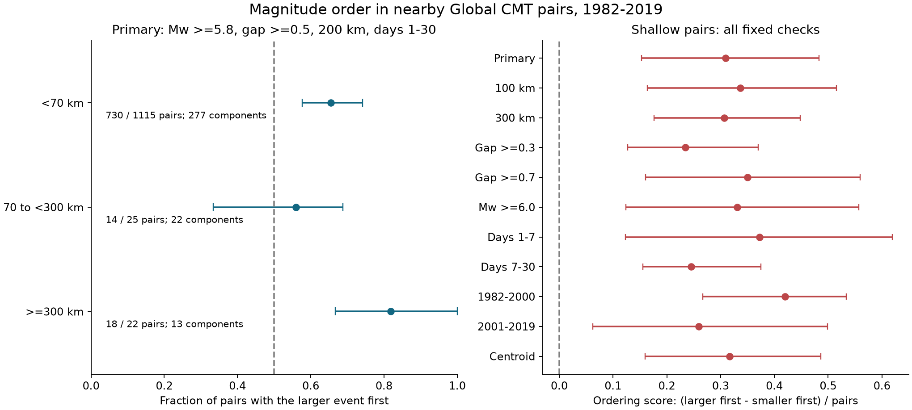

# The larger event came first in 65% of shallow GCMT pairs with Mw at least 5.8 and a gap at least 0.5 within 200 km and 1-30 days in 1982-2019

The larger earthquake came first in 730 of 1,115 selected shallow pairs, or 65.5%. The conditional 95% three-year block interval was 57.7% to 74.2%. This result stayed positive under all fixed selection checks. The shallow-versus-intermediate depth difference remained uncertain.



Figure 1. Left: larger-first fractions by reference depth. Right: the shallow-pair ordering score, defined below, for each fixed check. Lines show marginal 95% intervals from three-year calendar blocks. The main rule uses Mw at least 5.8 for both events, a magnitude gap of at least 0.5, a 3D distance of at most 200 km, and a time gap from 1 day inclusive to 30 days exclusive. All checks use the same source snapshot. The small deep sample does not establish a depth trend.

## Question and contribution

Does the larger event occur first more often than second in nearby earthquake pairs? Does the same pattern appear at different depths? The answer can help assess the time order that seismic interaction models must explain. We do not assign a mainshock from future event sizes. This prevents a larger-first result from being imposed by a mainshock label.

The general increase in aftershock numbers with mainshock size is established work. [Dascher-Cousineau and colleagues (2020)](https://doi.org/10.1029/2019JB018111) studied global productivity and source properties. [Helmstetter and colleagues (2003)](https://doi.org/10.1029/2002JB001991) showed how triggering cascades can produce foreshock and aftershock patterns. [Khan and colleagues (2025)](https://doi.org/10.1029/2024JB030733) studied the sensitivity of foreshock rates to event selection and definitions. Our contribution is a fixed pair-direction measurement, its dependence checks, and a reusable set of exact event and pair evidence. We do not claim the discovery of the aftershock size relation.

We searched the signed campaign results before choosing the precise question. Terms included `earthquake`, `ENSO`, `sea level`, and `magnitude ordering`. We read the [prior depth study](sci:sha256:c88f0e9a9c64455f5d0be8422cdfe3d3014e497fefe9f48dee2d53d7b59e73b3) and the [prior tensor study](sci:sha256:4eeb90d57c4227c719c5f43489c9c6ac8d4f414b92fd1160e69f9578c7101b49). The depth study already noted cancellation in all-center before-after counts. We use that warning to choose a direct magnitude-order statistic. No private worker files, analysis code, or derived tables were used.

## Source and sample

We read the Global CMT January 1976 through December 2020 NDK file in place. The catalog methods are described by [Dziewonski and colleagues (1981)](https://doi.org/10.1029/JB086iB04p02825) and [Ekstrom and colleagues (2012)](https://doi.org/10.1016/j.pepi.2012.04.002).

```text
Shared path: /mnt/dell-data/shared_datasets/gcmt-ndk-jan76-dec20-20261107/jan76_dec20.ndk
Source URL: https://www.ldeo.columbia.edu/~gcmt/projects/CMT/catalog/jan76_dec20.ndk
SHA-256: baed5ad29a69b57344c6025b27769b1012858aa6b5c807f984696d573c0f0eb4
Bytes: 23016960
Source records: 56832
```

The helper metadata record retrieval at 2026-11-08 07:51:14 UTC. The dataset directory has a 20261107 name; we report the recorded time separately. This is one retrospective historical snapshot. No shared file was changed. [provenance.json](files/provenance.json) preserves its exact path, resolved path, URL, version, hash, byte count, and helper metadata.

We calculate Mw from the scalar moment M0 in dyne-cm as `Mw = (2/3) * (log10(M0) - 16.1)`. The [official search documentation](https://www.globalcmt.org/CMTsearch.html) gives this formula. The [NDK format document](https://www.ldeo.columbia.edu/~gcmt/projects/CMT/catalog/allorder.ndk_explained) defines its fields. Thresholds use the unrounded value. We do not use the body-wave or surface-wave magnitudes on the first line.

The selected set contains all 7,400 events with Mw at least 5.8 and reference origin times in 1982-2019. The start is motivated by catalog coverage; [Kagan and Jackson (2016)](https://doi.org/10.1093/gji/ggw161) used a threshold of 5.6 after 1982. A 5.8 threshold does not prove detection of every nearby event. We also check 6.0. [Iwata (2008)](https://doi.org/10.1111/j.1365-246X.2008.03864.x) found short-term detection loss after large events. The first day is excluded in every test, but this cannot remove all catalog error.

Both events must lie in the study period. The early and late checks require both endpoints within their respective period. We use reference origin times with both reference and centroid locations. The bundled selected NDK records have SHA-256 `db90d87426f28276abb4e422276d724b765254348d7916f6a4e9692a3c0ba725`. All five-line bytes are preserved. Each event row has its own source record hash and original source index.

## Fixed rules and statistic

The [local plan](files/design.md) was written before pair counts were computed. It is not an external registration.

For the main rule, both events must have Mw at least 5.8 and reference depth below 70 km. Their absolute magnitude difference must be at least 0.5. Their elapsed time must be at least 1 day and less than 30 days. Their reference hypocenters must be at most 200 km apart in 3D. Each event has Cartesian radius `6371 - depth` km on a spherical Earth. Distance is the Euclidean chord between those points. Each unordered pair is counted once. The first event is the earlier event.

Let L be the number of larger-first pairs, and S the number of smaller-first pairs. The ordering score is `theta = (L - S) / (L + S)`. The larger-first fraction is `(theta + 1) / 2`. All selected pairs have a nonzero magnitude gap. A score of zero means equal counts in the two directions; it does not mean independent event times or sizes.

For the secondary depth results, both depths must be 70 to below 300 km, or both must be at least 300 km. Pairs that cross a depth boundary do not enter those within-group estimates. The shallow-minus-intermediate score is a secondary descriptive contrast. It does not hold magnitude, location, plate setting, or source mechanism constant.

The broad graph joins all selected events with elapsed times from 1 to below 30 days and distance at most 300 km under either reference or centroid geometry. It has 3,883 edges and 767 connected components. Its edges include equal-magnitude and cross-depth pairs. The final checks select subsets from this common graph.

## Why before-after cancellation can hide this result

For a finite set in which every eligible event can be a center, each symmetric nearby pair adds one after count to the earlier event and one before count to the later event. Thus, the sum of after counts equals the sum of before counts. This holds even if every pair has its larger event first. The signed degree sum is exactly zero. Restrictions on center magnitudes or weights can break this identity, so it is not an explanation of every before-after result.

The prior campaign depth study already described this issue. Our audit confirms an exact zero for the finite primary shallow graph. Direct magnitude ordering gives a score of 0.309 in the same graph. This is a demonstration that count cancellation and a strong time-order pattern can coexist. It does not overturn the earlier study, which used different center and neighbor rules and a different target.

## Uncertainty and dependence

The primary interval uses 5,000 circular moving-block samples of the 38 calendar years. Each sample draws three-year blocks with replacement and truncates to 38 years. Every pair is assigned to its earlier event year. All pairs from a sampled year stay together. The same draws are used across depth groups and full-period checks. The two 19-year period checks use a separate 19-year grid. The random seed is 110793081.

Five-year blocks are a check. A second check draws the 767 broad graph components with replacement and keeps their pairs together. Components with no final eligible pairs still enter the common resample grid. The pair-weighted estimate divides the total signed pair count by the total eligible pair count. An additional estimate first calculates a score within each occupied component, then gives each occupied component equal weight.

These are different assumptions about dependence. Year blocks can split sequences at year boundaries. Graph components can omit physical links outside the time, distance, and detection limits. Neither procedure proves independent samples or removes catalog bias. Intervals are conditional on the fixed catalog and selection rules. Reported check intervals are marginal; no simultaneous coverage is claimed. All primary group and contrast intervals use all 5,000 draws. Some sparse secondary checks omit draws with no eligible pairs. The largest omission is 86 of 5,000 draws in a secondary component interval. The saved draw table identifies every omitted value as `nan`.

## Results

| Reference depth | Larger first | Smaller first | Larger-first fraction | 95% three-year block interval | Occupied broad components |
| --- | ---: | ---: | ---: | --- | ---: |
| Below 70 km | 730 | 385 | 65.5% | 57.7% to 74.2% | 277 |
| 70 to below 300 km | 14 | 11 | 56.0% | 33.3% to 68.8% | 22 |
| At least 300 km | 18 | 4 | 81.8% | 66.7% to 100.0% | 13 |

The shallow score was 0.3094. Its interval was 0.1534 to 0.4834 with three-year blocks, 0.1609 to 0.4875 with five-year blocks, and 0.1534 to 0.4704 with component resamples. The corresponding larger-first intervals are 57.7% to 74.2%, 58.0% to 74.4%, and 57.7% to 73.5%.

The shallow-minus-intermediate score was 0.1894. Its three-year interval was -0.1321 to 0.6784. Thus, the data do not resolve that depth difference. The deep result is secondary and comes from only 22 pairs in 13 components. It does not establish a monotonic change with depth.

The largest broad component supplied 119 of the 1,115 primary shallow pairs, or 10.7%. Giving each occupied component equal weight gave a score of 0.4108, with a component interval of 0.3171 to 0.4988. Its larger-first fraction was 70.5%. Omission of one occupied component at a time gave pair-weighted shallow scores from 0.2916 to 0.3902. Omission of one earlier-event year at a time gave 0.2877 to 0.3896. No such omission reversed the shallow point estimate.

The primary shallow pairs had a median lag of 6.73 days and median 3D distance of 65.73 km. These are selected-pair summaries, not independent sequence parameters.

| Fixed shallow check | Pairs | Larger first | Ordering score | 95% three-year block interval |
| --- | ---: | ---: | ---: | --- |
| Primary | 1115 | 730 | 0.309 | 0.153 to 0.483 |
| Radius 100 km | 778 | 520 | 0.337 | 0.164 to 0.515 |
| Radius 300 km | 1307 | 854 | 0.307 | 0.176 to 0.448 |
| Magnitude gap at least 0.3 | 1554 | 959 | 0.234 | 0.127 to 0.370 |
| Magnitude gap at least 0.7 | 800 | 540 | 0.350 | 0.161 to 0.560 |
| Both Mw at least 6.0 | 493 | 328 | 0.331 | 0.124 to 0.557 |
| Days 1 to below 7 | 564 | 387 | 0.372 | 0.123 to 0.619 |
| Days 7 to below 30 | 551 | 343 | 0.245 | 0.155 to 0.375 |
| Both events in 1982-2000 | 348 | 247 | 0.420 | 0.267 to 0.533 |
| Both events in 2001-2019 | 767 | 483 | 0.259 | 0.063 to 0.499 |
| Centroid location and depth groups | 1121 | 738 | 0.317 | 0.160 to 0.486 |

Every check gave a positive shallow score, with its three-year interval above zero. The checks overlap in events and pairs; they are not independent replications. The early and late point estimates differ, but we did not plan or test a change-point claim.

Magnitude composition differs across depth groups. The larger-first counts by maximum pair magnitude were:

| Maximum pair Mw | Shallow | Intermediate | Deep |
| --- | ---: | ---: | ---: |
| 6.3 to below 6.8 | 220 / 390 | 3 / 10 | 6 / 9 |
| 6.8 to below 7.3 | 207 / 357 | 7 / 9 | 3 / 4 |
| At least 7.3 | 303 / 368 | 4 / 6 | 9 / 9 |

Each cell gives larger-first pairs divided by all eligible pairs. The shallow score is larger among pairs with a large maximum magnitude. Repeated sequence members contribute multiple pairs. These descriptive rows do not estimate a causal magnitude effect. Sparse depth strata prevent a strong controlled comparison.

## Explanation and limits

Size-dependent productivity is one explanation consistent with the result. If larger events produce more later nearby events, a local pair sample can have more larger-first pairs even when the size of each later event is drawn independently. Triggering cascades can also make many observed pairs indirect links. Thus, this result is not a test that parent and child magnitudes are statistically dependent. We did not fit or distinguish competing triggering models.

The cancellation identity gives a tested measurement explanation: the total unweighted before-after difference removes the ordering information by construction. The direct score retains it. Neither measure alone identifies causal aftershocks. Background events and unrelated events can enter the selected windows.

The depth comparison is limited by unequal geography, fault types, magnitude distributions, detection, and the small number of intermediate and deep pairs. No causal claim about depth is supported. The modelled intervals do not include source location or magnitude error. Reference depths and centroids can differ. The geometry check helps assess one choice but does not measure that error distribution.

The fixed radius can miss distant interactions from very large ruptures. The 30-day cutoff can miss long sequences. Exclusion of day zero to day one reduces immediate detection loss and omits real early activity. A gap threshold can reduce sensitivity to small magnitude error but cannot remove it. This single-catalog retrospective study does not validate an operational hazard forecast or show that a particular event will be followed by a larger event.

## Audit and reproduction

The separate [audit](files/audit.json) passed. It checked the full-source selection, all 7,400 selected raw records, all 117,904 temporal candidate pairs, all 3,883 broad graph edges, all 767 graph components, all 11 fixed rule sets, and all 660,000 saved bootstrap values. It also checked the intervals and the exact cancellation identity. The maximum scalar-versus-vector distance difference was 5.7e-14 km. The bootstrap arithmetic matched exactly. These checks validate implementation and data flow; they do not validate the scientific assumptions.

A complete offline repeat from the selected source bytes matched the derived evidence. The [repeat record](files/reproduction_check.json) lists each comparison. The event table agrees after the input-specific source row index is removed. Run metadata change with the input file. [REPRODUCE.md](files/REPRODUCE.md) gives environment setup, exact commands, a retrieval recipe, file definitions, and the data flow. The full shared source need not be copied to repeat the pair analysis.

## Campaign record and license

Campaign: `11_07_2026`. Job: `sci-1107-hp-earth-and-ocean-sciences-9dc12dd308bc`. Topic: `earth-and-ocean-sciences`. Machine: `hp`. Account: `codex-myxtap`. Model: `gpt-6.1-sol`, high reasoning effort, through T3 Code and the Codex harness.

No child agents were used. Substantial calculations used `campaign-compute`. Library threads were set to one. Downloads and derived outputs stayed on the local host, except for the final signed bundle in the shared campaign. The campaign-machine key signs this bundle and does not make a personal authorship claim. No remote archive or index submission was made. The private signing key is outside the package.

The SCI baseline license covers the text, figures, derived data, and code as stated in LICENSE. Global CMT source records retain their source status and citations.
