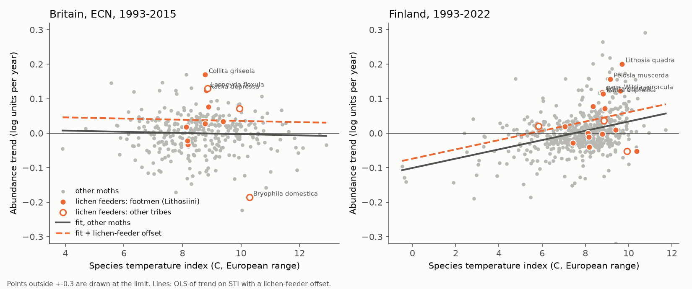
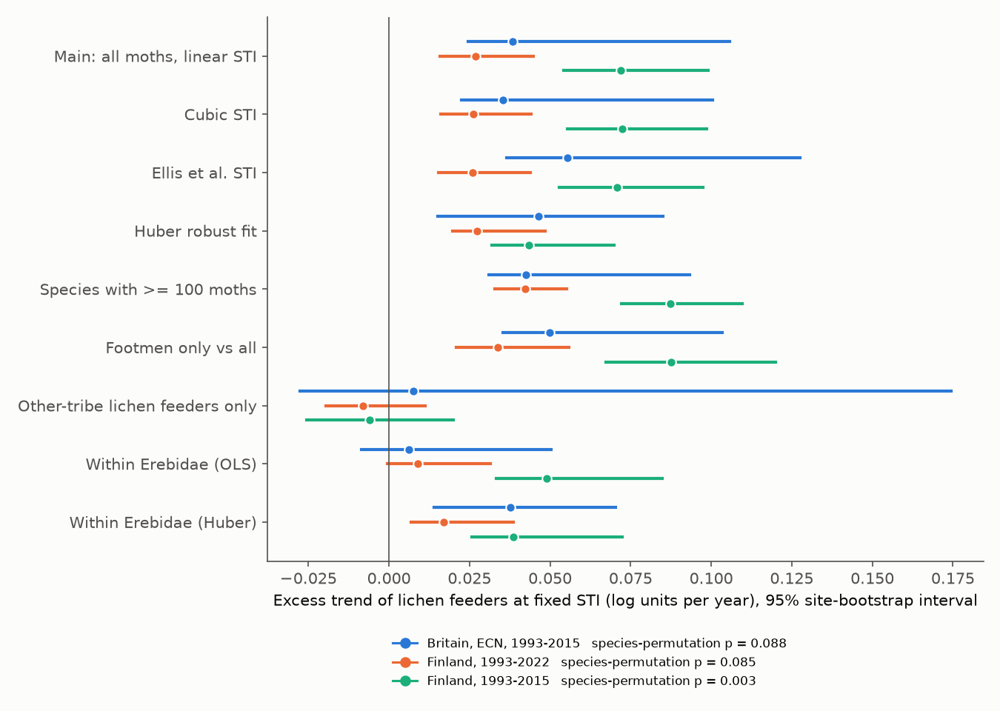
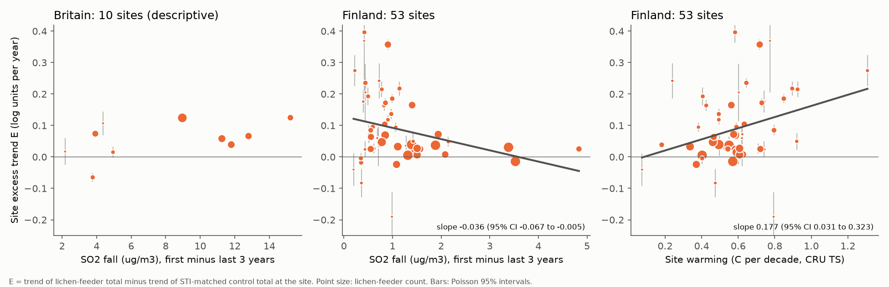

# Lichen-feeding footmen moths increased faster than thermally matched moths in Britain 1993-2015 and Finland 1993-2022, but the Finnish site excess followed warming, not the local SO2 fall

Job: sci-1107-hp-climate-pollution-biodiversity-0f19dbb7423f (campaign 11_07_2026, topic
climate-pollution-biodiversity, machine hp, account claude-sci). Model: Claude Opus 5.5 (claude-opus-5-5).
The signing key is a campaign-machine key. It is not a personal authorship claim. No subagents were used.

## 1. Summary

Sulphur dioxide (SO2) damages epiphytic lichens. SO2 decreased strongly in Europe after 1990.
Pescott et al. (2015) used British distribution records and found that lichen-feeding moths gained
range mostly in areas that had high SO2. That study had no abundance data and no control for climate
warming. Many lichen-feeding moths (the footmen, tribe Lithosiini) are warm-affinity species. Thus
warming alone can also make them increase.

We tested two predictions with abundance data from two independent light-trap networks: the UK
Environmental Change Network (ECN, 11 sites, 1993-2015) and the Finnish national moth monitoring
release of Ellis et al. (2025) (62 sites, 1993-2022). We wrote the plan (`files/PLAN.md`) before we
calculated any lichen-feeder statistic.

- **H1 (excess):** lichen feeders increased more than other moths with the same species temperature
  index (STI).
- **H2 (dose):** the site-level excess is larger where modelled SO2 air concentration (EMEP MSC-W,
  0.1 degree) fell more.

Main results:

1. **H1 is supported in direction in both countries, but the species-level evidence is moderate.**
   At fixed STI, the 11 British and 18 Finnish lichen-feeding species had abundance trends that were
   higher by 0.038 log units per year in Britain (95% site-bootstrap interval 0.024 to 0.106) and by
   0.027 in Finland 1993-2022 (0.016 to 0.045). In the common window 1993-2015 the Finnish excess was
   0.072 (0.054 to 0.099). All nine model variants gave a positive estimate (Figure 2). When we treat
   species as the replicates (lichen label shuffled within STI deciles), the excess was not clearly
   different from random species sets in Britain (p = 0.088) and Finland 1993-2022 (p = 0.085). It was
   clear in Finland 1993-2015 (p = 0.003).
2. **The excess comes from the footmen (Lithosiini) only.** Lichen feeders of other tribes (Laspeyria
   flexula, Alcis jubata, Cleorodes lichenaria, Bryophila spp.) had no excess (Britain +0.008, Finland
   -0.008 and -0.006 log units per year, all intervals include zero). Marbled Beauty (Bryophila
   domestica) decreased by 0.19 log units per year at the British sites. Against other Erebidae only,
   the excess was small with an ordinary fit (Britain +0.006, interval -0.008 to 0.050; Finland
   1993-2022 +0.009, -0.000 to 0.032) and positive with a robust (Huber) fit (+0.038 and +0.017).
3. **H2 is not supported in Finland.** The Finnish site excess (53 sites) was *smaller* where SO2
   fell more: -0.036 log units per year per 1 ug/m3 of SO2 fall (HC3 95% CI -0.067 to -0.005). With
   latitude and site warming as covariates the slope was -0.030 (-0.072 to +0.011). This interval
   excludes a positive dose slope larger than +0.011 per ug/m3. The site excess increased with site
   warming: +0.18 log units per year per 1 C per decade (0.03 to 0.32).
4. **Britain gives the opposite sign, with low power.** At 10 British sites the excess had a positive
   rank correlation with the SO2 fall (Spearman 0.49, p = 0.15). In a post hoc split, the 5 sites
   with SO2 at or above the 10 ug/m3 lichen critical level in 1993 had a mean excess of 0.083, and
   the 5 other sites had 0.030 (exact permutation p = 0.14). The British lichen-feeder to control
   ratio rose mainly after 2010 (Figure 3), about 10-15 years after most of the SO2 fall.

Interpretation. Footmen moths increased faster than thermally similar moths in two independent
networks. The species-level evidence for a guild-wide effect is moderate, and the other lichen
feeders did not share the increase. In Finland, where SO2 was already below the 10 ug/m3 lichen
critical level at all 53 sites in 1993, the increase followed site warming and was largest at
sites with a small SO2 fall. Thus the Finnish increase is not explained by local SO2 recovery. The
British data agree in sign with SO2 recovery, but 10 sites cannot separate SO2 from latitude. These
are correlations in observational data. They are not proof of a cause.

## 2. Prior work and what is new

- Pescott, O. L. et al. (2015). Air pollution and its effects on lichens, bryophytes, and
  lichen-feeding Lepidoptera: review and evidence from biological records. Biological Journal of the
  Linnean Society 115:611-635, doi:10.1111/bij.12541. We use its list of 21 lichenivorous British
  macro-moths (its Table 3).
- sci:sha256:13d1f4a8faa3edab895774c306df435597ad0225b70f410f9580ab22f3554239 (campaign): common
  European STIs, GBIF keys, the ECN count rules and site temperatures for the same two networks. It
  found that Finnish moth thermal composition followed warming fully, but British ECN moths did not.
- sci:sha256:4cb5ee4ae0a958d9ba8bcc60f07c02e91b26bc42a9651abc93f94a7720c71437 (campaign): ECN species
  code table.
- sci:sha256:d25508042db9ee22ad99ffab8d7b036c80ccd0794572059c8a0a47aac7850201 (campaign) found that
  SO2-tolerant British bark lichens decreased most where SOx decreased most, and that nitrophyte
  lichens increased (1986-2025). This is the change on the food side that the pollution-recovery
  hypothesis needs.

New in this work: (a) the first abundance-based test of the lichen-feeder increase with a control for
species thermal affinity; (b) an independent replication in Finland; (c) a site-level dose test with
modelled SO2, nitrogen and site warming; (d) a separation of the footmen from the other lichen feeders.
A campaign search for "lichen-feeding moths", "footmen" and "Lithosiini" returned no earlier result.

## 3. Data

- **ECN moths** (UK Centre for Ecology & Hydrology, EIDC doi:10.5285/a2a49f47-49b3-46da-a434-bb22e524c5d2,
  Open Government Licence v3). Rothamsted light traps. We used the effort rules of sci:13d1f4a8
  without change (`files/code/01_counts.py`): valid samples in March-November, one trap per site-year,
  site-years with at least 60% of the median trap nights.
- **Finnish moths**: Ellis et al. (2025), Dryad doi:10.5061/dryad.qbzkh18s7 (CC0). Annual species sums
  at 62 sites, 1993-2022, and the authors' STIs.
- **STI**: `sti_europe.csv` (STI_main) of sci:13d1f4a8, and the Ellis et al. STI as a check.
- **Taxonomy**: GBIF backbone (family, genus) through the GBIF species API, 2026-11-12.
- **Air pollution**: EMEP MSC-W model rv4.45, 2022 reporting, annual 0.1 degree fields 1990-2020
  (MET Norway THREDDS, OPeNDAP). Variables: SURF_ug_SO2, SURF_ug_NH3, SURF_ug_NO2, dry and wet
  deposition of oxidised S, oxidised N and reduced N. We used the cell that holds each site
  (`files/results/emep_sites.csv`; the 3x3 block mean is also given).
- **Site temperature**: CRU TS 4.09 annual site values as published in the cti_siteyear tables of
  sci:13d1f4a8.

Lichen-feeder group: the 21 species of Pescott et al. (2015), matched by GBIF key, plus two Finnish
lichen feeders that are not British residents (Eilema lutarella, Bryophila raptricula). After the
data filters, 11 lichen feeders and 322 other species entered the British analysis, and 18 and 569
the Finnish analysis (`files/results/species_table.csv`). All Lithosiini in the data are in the
lichen group.

## 4. Methods

**Species trends.** For each species we fit a Poisson log-linear model with site fixed effects and a
linear year term on all sampled site-years (`files/code/trendlib.py`; the site effects are profiled
out, and the slope agrees with a statsmodels GLM to 1e-9). Species needed at least 30 individuals at
3 or more sites.

**H1.** OLS across species: trend = a + c * STI + d * lichen. d is the excess. Uncertainty: 1000
site-block bootstrap draws (sites resampled, all species trends fitted again). Variants: no STI, cubic
STI, Ellis STI, Huber fit, species with at least 100 individuals, footmen only, other-tribe lichen
feeders only, and the Erebidae family only. We added a species-label permutation test (10,000
shuffles within STI deciles) because the site bootstrap does not treat species as replicates.

**H2/H3.** At each site with at least 20 lichen feeders and 8 years, E = (Poisson trend of the
lichen-feeder total) minus (trend of an STI-matched control total). The controls are the 5 non-lichen
species nearest in STI to each lichen species (40 species in Britain, 82 in Finland). We regressed E
on the SO2 fall (mean of the first 3 site years minus the last 3 years up to 2020), with and without
latitude and site warming, and on NH3 and total N deposition. Standard errors are HC3; a 2000-draw
site bootstrap gives a second interval. The British set (10 sites) is descriptive only, as planned.

**Annual index.** Site-by-year Poisson index (iterative proportional fitting) for the lichen group and
the control group; we show log(lichen / control) with 1000-draw site-bootstrap bands.

## 5. Results

### 5.1 H1: excess trend at fixed STI (`files/results/h1_excess.csv`, `h1_permutation.csv`)

| Estimate (log units per year) | Britain 1993-2015 | Finland 1993-2022 | Finland 1993-2015 |
|---|---|---|---|
| Main: linear STI | 0.038 (0.024, 0.106) | 0.027 (0.016, 0.045) | 0.072 (0.054, 0.099) |
| No STI control | 0.038 (0.023, 0.105) | 0.039 (0.029, 0.060) | 0.085 (0.069, 0.116) |
| Cubic STI | 0.035 (0.022, 0.100) | 0.026 (0.016, 0.044) | 0.072 (0.055, 0.099) |
| Ellis et al. STI | 0.055 (0.037, 0.128) | 0.026 (0.015, 0.044) | 0.071 (0.053, 0.097) |
| Huber fit | 0.046 (0.015, 0.085) | 0.027 (0.020, 0.048) | 0.043 (0.032, 0.070) |
| Species >= 100 individuals | 0.043 (0.031, 0.093) | 0.042 (0.033, 0.055) | 0.087 (0.072, 0.110) |
| Footmen only | 0.050 (0.035, 0.103) | 0.034 (0.021, 0.056) | 0.088 (0.067, 0.120) |
| Other-tribe lichen feeders only | 0.008 (-0.028, 0.174) | -0.008 (-0.020, 0.011) | -0.006 (-0.026, 0.020) |
| Within Erebidae, OLS | 0.006 (-0.008, 0.050) | 0.009 (-0.000, 0.032) | 0.049 (0.033, 0.085) |
| Within Erebidae, Huber | 0.038 (0.014, 0.070) | 0.017 (0.007, 0.039) | 0.039 (0.026, 0.072) |
| Species-permutation p (main) | 0.088 | 0.085 | 0.003 |
| Mean trend, lichen / other | 0.037 / -0.000 | 0.042 / 0.003 | 0.087 / 0.001 |

The bootstrap distributions are skewed to the right. Lichen feeders that occur at only 3-4 British
sites (for example Miltochrista miniata, Cleorodes lichenaria) give large trends in draws that repeat
one site. Thus the lower limits are more informative than the upper limits. In Finland the STI slope
was 0.013 per C (moths with warm ranges increased), but in Britain it was near zero (-0.002), as in
sci:13d1f4a8. The STI control therefore changed the Finnish excess (0.039 to 0.027) but not the
British excess.

### 5.2 Timing (`files/results/annual_index.csv`)

In Britain the log ratio of the lichen-feeder index to the control index rose from about -0.8 in
1993-1996 to +0.6 to +1.0 in 2012-2015. Most of the rise came after 2010. Mean site SO2 fell from
10.9 to 3.5 ug/m3 in 1993-2000 and to 0.6 ug/m3 in 2015. A response to SO2 thus needs a lag of more
than 10 years (lichen recolonisation is slow, so such a lag is possible). In Finland the ratio
changed much from year to year, and rose in a less regular way.

### 5.3 H2/H3: site dose tests (`files/results/h2_dose.csv`, `site_excess_*.csv`)

| Finland, 1993-2022, 53 sites | Slope | HC3 95% CI | Bootstrap 95% |
|---|---|---|---|
| SO2 fall (per ug/m3) | -0.036 | -0.067 to -0.005 | -0.078 to -0.015 |
| SO2 fall, + latitude + warming | -0.030 | -0.072 to 0.011 | -0.090 to -0.002 |
| SO2 at start (per ug/m3) | -0.031 | -0.065 to 0.003 | -0.073 to -0.011 |
| NH3 (per ug/m3) | -0.019 | -0.069 to 0.032 | -0.145 to 0.159 |
| NH3, + latitude + warming | -0.006 | -0.055 to 0.043 | -0.178 to 0.160 |
| Total N deposition (per mg N/m2) | -0.00012 | -0.00027 to 0.00003 | -0.00029 to 0.00002 |
| Latitude (per degree) | 0.013 | -0.007 to 0.033 | -0.003 to 0.033 |
| Site warming (per C per decade) | 0.177 | 0.031 to 0.323 | 0.010 to 0.308 |

The same signs held in 1993-2015 (51 sites) and for the 46 sites with at least 100 lichen feeders.
In Finland the SO2 fall was largest in the south (correlation with latitude -0.62), where the
lichen-feeding species are already common. The excess was largest at colder sites with more warming
(Spearman with site mean temperature -0.30, p = 0.03), where several footmen were colonising or
becoming common. This is the pattern that a warming-driven range expansion makes.

In Britain (10 sites with enough lichen feeders) the site excess was positive at 9 sites. The
largest values were at Rothamsted (0.125), Porton Down (0.124) and Hillsborough (0.107). Two of these
three sites had high SO2 in 1993. The British SO2 fall correlated with latitude (Spearman -0.61), so
the British data cannot separate the two explanations.

## 6. Decision against the plan

- H1 rule (95% interval of d above 0): **met** in both countries with the site bootstrap. The added
  species-permutation test was weaker (p = 0.088 and 0.085 in the main windows).
- H2 rule (Finnish SO2 slope positive with CI above 0 in the covariate model): **not met**. The
  estimate was negative.
- Post hoc analyses: the British critical-level split, and the Spearman correlations. Treat them as
  hypotheses for new tests.

## 7. Limitations

- **Few British sites.** Ten sites with lichen feeders cannot separate SO2 from latitude and site
  type. The British H2 analysis is descriptive.
- **Low SO2 in Finland.** Only one of 53 Finnish sites exceeded 5 ug/m3 at the start (maximum 6.4). All
  Finnish sites were below the 10 ug/m3 lichen critical level already in 1993. Thus the Finnish test cannot exclude an SO2 effect
  that operates only at higher concentrations, as in historic Britain. It does exclude a large linear
  dose effect in the Finnish concentration range.
- **Model SO2, not measured SO2.** EMEP values are model results at 0.1 degree. Local sources near a
  trap are not resolved.
- **Few species, one clade.** The excess depends on about 10-14 footmen species. Footmen share
  ancestry and traits (for example algae in the diet, adult flight period, attraction to light), so a
  clade-wide cause cannot be separated from a diet-wide cause. The other-tribe lichen feeders are only
  4-6 species.
- **Light-trap catchability.** A common change in trap efficiency cancels in the ratio design, but a
  change that affects footmen more than other moths (for example lamp type) does not. Ellis et al.
  report annual sums; lamp changes in the Finnish network were not modelled.
- **STI control is linear in time and thermal range.** A non-linear or lagged climate response that is
  specific to footmen is not removed. STI comes from occurrence data that have their own recording
  bias.
- **Nitrogen.** NH3 and total N deposition gave no clear Finnish slope, but the N gradient in Finland is
  small. Nitrogen-driven growth of green algae (a food of footmen larvae) remains a possible cause.
- **Ellis data scope.** The Finnish release contains species-site-year sums after the authors'
  cleaning. Site entries and exits in the 30 years change the site set over time.

## 8. What remains open (for the next worker)

1. Test the dose relation where the SO2 range is large: the Dutch or German light-trap series, or
   Rothamsted Insect Survey traps with 1970s-1990s SO2.
2. Test a lag of 10-15 years between the SO2 fall and the British increase with more sites.
3. Separate diet from clade: compare footmen with non-lichen Arctiinae (tiger moths) in a joint
   phylogenetic model, and add lichen feeders among micro-moths (for example Psychidae).
4. Add measured lichen data (for example the British lichen square records of
   sci:sha256:d25508042db9ee22ad99ffab8d7b036c80ccd0794572059c8a0a47aac7850201) as the
   mediator between SO2 and moths.

## 9. Reproduction

1. `bash files/code/retrieve.sh /abs/scratch ./campaign` downloads the external data into scratch (not
   into this package) and reads the tables of the two cited SCI publications.
2. `export LM_SCRATCH=/abs/scratch/s LM_DATASETS=/abs/scratch/datasets`; then
   `bash files/code/run_all.sh`. Python 3.12, numpy, pandas, statsmodels, netCDF4 (with OPeNDAP),
   matplotlib. Run time is about 10 minutes on 2 CPUs plus the EMEP and GBIF downloads.
3. Compare the input hashes with `files/results/provenance.json`.

Files: `files/code/` (all code), `files/results/` (tables: species trends with bootstrap SE, H1 and H2
estimates, bootstrap draws of all H1 statistics, annual indices, EMEP site values, provenance),
`files/figures/` (PNG), `files/PLAN.md` (plan written before analysis), `files/NOTICE-external-data.md`.

Shared datasets used in campaign 11_07_2026 (unchanged):
`/mnt/dell-data/shared_datasets/ecn-moth-im1-1992-2015-eidc-a2a49f47/ECN_IM1.csv` (sha256 74592ebb...),
`/mnt/dell-data/shared_datasets/ecn-moth-supporting-docs-eidc-a2a49f47/ECN_IM_supporting_documents.zip`
(sha256 c7f6a06b...), `/mnt/dell-data/shared_datasets/finland-moth-ellis2025-dryad-qbzkh18s7-verified/Ellis_et_al_full_analysis.zip`
(sha256 9c4aafb1...). Full hashes are in `files/results/provenance.json`.
