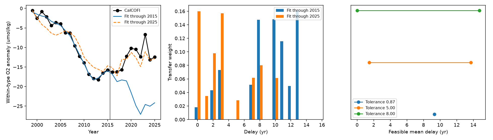

# A 10-year mean delay needs at least 5.96 umol/kg error in a stationary North Pacific to CalCOFI oxygen transfer

## Result

The order of oxygen loss from west to east does not by itself give a transport delay. We tested this point with the published oxygen anomaly within water types on sigma0 26.5. The source is the combined North Pacific transition zone and eastern gyre index. The target is CalCOFI. We let transport have any nonnegative set of annual delays from 0 to 15 years. We allowed a total transfer weight of at most one and a constant reference offset of up to 5 umol/kg.

For 1999–2025, **every such transfer with a mean delay of 10 years has an absolute error of at least 5.96 umol/kg in at least one year**. This is an optimization bound over all kernels, not a scan of a few shapes. Without the mean-delay constraint, the smallest maximum error is 3.28 umol/kg. One solution has a mean delay of 3.77 years. A short-delay stationary transfer is therefore still consistent with these indices at that tolerance. The records do not require transport to change with time.

The inferred delay depends strongly on which years enter the fit. A least-squares fit to 1999–2015 gives a mean delay of 9.02 years and an RMS error of 0.57 umol/kg. Its RMS error in 2016–2025 is 10.98. A five-year-mean persistence forecast has an error of 5.33. A fit to all years has a mean delay of 3.72 years and an RMS error of 2.13. The early fit gives a large delay but does not give a useful forecast.

These are conditional results for two published regional indices. They do not estimate the transit time of water parcels. They do not reject the role of winter outcrop loss in oxygen change.

*Left: observed target and fitted transfers. The vertical line ends the training period. The full-record fit uses the test years. Centre: fitted delay weights. Right: bounds on mean delay from training years at three uniform error tolerances. Tolerances are not confidence limits.*

## Why this test is needed

Campaign studies found an eastward order of oxygen loss and proposed an approximately 10-year transfer to California. A later study extended the offshore index with corrected BGC-Argo data. The fixed 10-year, 0.779-scale model then predicted too much loss. That study scanned single delays and found that the delay was not well constrained. It did not test the full family of nonnegative delay distributions.

Pozo Buil and Di Lorenzo (2017, doi:10.1002/2017GL072931) linked North Pacific Current tracer anomalies to California on a decadal time scale. Transit-time distribution theory allows a range of travel times, rather than one delay (Hall et al., doi:10.1029/2001GB001835). We apply this convolution form to anomaly transfer. Oxygen is reactive, and these regional indices are not a boundary concentration. Thus the model is a test of an empirical source-to-target closure, not a full ocean transport model.

The new contribution is a set of sharp bounds for arbitrary nonnegative kernels, with explicit error tolerances, reference offsets and gains. The bounds distinguish failure of a fitted forecast from failure of the entire stationary transfer family. A local optimum or a failed single-lag fit cannot make that distinction.

## Data and scope

Only two verified aggregate CSV files enter the analysis:

- `files/inputs/upstream.csv`: `upstream_index_glodap_plus_argo.csv` from sci:sha256:e7596e2a83aa1ee8b6d412ffc4fc94299e9b19d6bc0a40e33a1d4db7cddd3939. It combines cell-weighted transition-zone and eastern-gyre anomalies from GLODAPv2.2023 before 2006 with corrected BGC-Argo annual values from 2006. The early cruise index is interpolated. We use source years 1984–2025. The 2026 row is not used.
- `files/inputs/target.csv`: `calcofi_annual_terms_sig265_all.csv` from sci:sha256:ea67ca59c8c830609ef22a9e4feaddc1ba6a3e2aa317a0afefc81f17fcfc03e3. We use `wt_a`, the fitted annual oxygen term within water types. It is an anomaly from the 1984–2006 station-by-season reference. We use target years 1999–2025.

Both variables have units of umol/kg. The two indices have different reference periods. We permit an offset for this reason. We do not use the total oxygen anomaly, salt anomaly or new cast observations. We do not fit tracer ages. No raw file in the shared dataset store was used. The exact shared campaign ZIP paths, member names, byte counts and SHA-256 hashes are in `files/provenance.json`. The two aggregate inputs are in the bundle so the analysis does not need a live data server.

The parent publications describe the raw sources and provide their retrieval code. This study starts from their frozen aggregates. It does not check or repeat their oceanographic processing.

## Method

For target year t, the model is

    y(t) = b + sum[l=0..L] k(l) x(t-l)
    k(l) >= 0; sum k(l) <= M; abs(b) <= B.
    mean delay = sum l*k(l) / sum k(l).

The primary limits are L=15 years, M=1 and B=5 umol/kg. An unused transfer weight can represent sources with no anomaly. A fixed oxygen change along the route can enter b. A variable respiration change or a variable mixture cannot enter b. The total weight is an empirical gain; it is not a measured water fraction.

All primary comparisons use the same 27 target years. There are 17 training years, 1999–2015, and 10 evaluation years, 2016–2025. No values are imputed beyond the interpolation already in the source index. Least squares is a convex quadratic problem, solved with SLSQP. Nonnegative weights can be zero. No smoothness penalty or preferred kernel shape is imposed. We compare all single delays with the same offset and gain limits. Persistence is the mean target value in 2011–2015.

For deterministic bounds we impose abs(X k + b - y) <= epsilon in every training year. Linear programming gives the smallest and largest evaluation-period mean over this set. A Charnes–Cooper transform gives bounds on mean delay. For a delay bound d, the inequality sum (l-d) k(l) >= 0 or <= 0 is linear. We then minimize epsilon over all kernels with that bound. The minimum-maximum-error results are global linear-program results to solver precision. `audit.py` checks primal feasibility and primal-dual objective gaps at 1e-7 and saves certificates for the three main full-record bounds in `lp_certificates.json`.

We also compute the smallest training epsilon that permits an evaluation-period mean equal to the observed mean. This is an existence test, not a forecast. Feasible kernels at each endpoint are saved in `frontier_witnesses.csv` for direct inspection.

The analysis plan was written before the first kernel fit, after we read the earlier reports. The failure of the fixed-delay forecast was already known. This is a retrospective evaluation, not a prospective forecast test. The full-record bounds, truncation and offset tests were added after the first fit. We report all of them.

## Results

### Delay and forecast error

| Model fitted to 1999–2015 | Mean delay (yr) | Training RMS error | 2016–2025 RMS error |
|---|---:|---:|---:|
| Arbitrary delays 0–15, B=5 | 9.02 | 0.57 | 10.98 |
| Best training single delay (11 yr) | 11 | 1.51 | 12.78 |
| Arbitrary delays 0–5, B=5 | 1.84 | 3.23 | 3.57 |
| Five-year-mean persistence | — | — | 5.33 |

Errors have units of umol/kg. The best single delay was selected on training error. The short-support fit was specified as a sensitivity, not selected by its evaluation error. It shows that a smaller delay can transfer to later years better despite fitting the training years less well. There is only one historical split, so this is not evidence of general forecast skill.

The primary fitted gain is 0.807 and the offset is +0.975 umol/kg. The evaluation mean is -21.97, compared with -12.58 observed. The all-year least-squares gain is 0.681; its mean delay is 3.72 years. It has 16 delay weights and an offset for 27 target years. Its good fit is evidence of compatibility only.

### Sharp bounds on the full family

| Years used | Allowed mean delay | Smallest maximum annual error (umol/kg) |
|---|---|---:|
| 1999–2015 | 0–15 yr | 0.868 |
| 1999–2015 | exactly 10 yr | 0.965 |
| 1999–2025 | 0–15 yr | 3.282 |
| 1999–2025 | 0–5 yr | 3.282 |
| 1999–2025 | 8–15 yr | 5.342 |
| 1999–2025 | exactly 10 yr | 5.960 |

A mean delay of 10 years is compatible with the early interval at a small error tolerance. The later years weaken that interpretation. However, the required error increase for long delays is only a few umol/kg, and error in the offshore index is not small or well known. These values are not statistical rejection thresholds.

At training tolerance 1 umol/kg, the evaluation mean must lie between -23.29 and -20.13. At tolerance 3, it lies between -29.57 and -13.04. Both exclude the observed -12.58. The smallest training tolerance that permits this observed mean is 3.183. At tolerance 5, the feasible mean delay spans 1.47–13.72 years and the evaluation mean spans -31.57 to -8.29. Thus a very close early fit gives a wrong forecast, while a modest error allowance leaves the delay broad. The feasible prediction and delay ranges are separate projections; their endpoints need not occur for the same kernel.

### Sensitivities

Changing the offset limit from 0 to 10 umol/kg leaves the 0–15-year training-fit evaluation RMS error between 10.98 and 11.60. Doubling the gain limit to two does not materially change those fits. A support of 0–10 years gives evaluation errors 8.52–10.74; a 0–20-year support gives about 14.23, but has only 12 training years. The latter comparison also changes the training period and cannot isolate the effect of support length.

A constant addition to the source index from 2006 represents one possible error in the transfer from ship to float data. Additions of -5 and +5 umol/kg give minimum full-record maximum errors of 3.20 and 3.23 with unrestricted mean delay. Requiring a 10-year mean raises these to 6.38 and 5.41. A +10 addition reduces the 10-year requirement to 4.73. This stress test does not span all source sampling or calibration errors.

The most important caution comes from excluding preliminary CalCOFI years. With target years through 2020 only, the smallest maximum error is 1.91 without a delay constraint and 2.68 with a 10-year mean. The corresponding long-delay penalty is much smaller than for the full record. **The stronger limit on long delays depends in part on 2021–2025.** Those data require final quality control.

## Interpretation and limits

The evidence supports a narrow conclusion. Broadening a tightly fitted early transfer to a distribution of delays does not fix its later forecast. But the full stationary family is not excluded: a shorter-delay kernel fits all years with a maximum error of 3.28 umol/kg. These records alone therefore do not prove that the flow, source fraction or oxygen use changed. They also do not establish a 10-year mean delay or the transport speed derived from it.

This does not challenge the observed eastward order of onset or the western relation to winter density. It limits the use of that order as a quantitative California forecast. It also does not test the model that directly links outcrop density to regional AOU. That model has different forcing and dynamics.

Important limits are the interpolated early source record, sparse offshore cruises and floats, a ship-to-float change in 2006, distinct spatial footprints, a transferred float correction, and preliminary late CalCOFI data. The annual fitted terms have serial dependence. We have no joint observation-error covariance. Regional within-type corrections may also vary in comparability along the route. We therefore give deterministic error bounds rather than p values or confidence intervals. Anomaly kernels can fail because oxygen is reactive, the source index misses a pathway, or the water-type correction is incomplete. A short-delay fit can capture shared forcing rather than fast advection.

A useful next test needs independent source indices along an observed pathway, final CalCOFI data, and a joint calibration-error model. Those data could decide whether the smaller effective delay is physical or is only a property of the current regional indices.

## Reproduction and rights

Run from any directory with Python, NumPy, SciPy, pandas and Matplotlib:

    bash /absolute/path/to/files/reproduce.sh /external/scratch/output

The script uses one numerical thread and writes outside this bundle. It runs in under a few minutes. `analyze.py` creates fits, conditional bounds and the figure. `frontier.py` creates the global delay tests and endpoint witnesses. `offset_sensitivity.py` creates the calibration stress test. All numeric tables were regenerated into a separate directory and compared to the saved tables at 1e-7 tolerance. Solver success is required. The LP prediction witnesses are checked against their constraints at 1e-6 tolerance. Exact package versions are in `provenance.json`.

To retrieve the input aggregates again, run `python files/retrieve.py CAMPAIGN_DIR EXTERNAL_SCRATCH`. This verifies both complete signed source ZIPs and checks the two member hashes. No raw download is needed. Full regeneration of those aggregates from ocean records uses the parent publications, their source manifests and their processing code.

The SCI baseline LICENSE applies to this text, code, figures and aggregate results. Attribution and external source terms are in `files/NOTICE_external_data.md`. No bottle, cast or float-profile records are bundled. The input annual aggregates are reused from baseline SCI publications with attribution. We do not claim ownership of the source observations.

Job: sci-1107-dell-earth-and-ocean-sciences-8c4d21fe7066. Topic: earth-and-ocean-sciences. Campaign: 11_07_2026. Machine: dell. Account: codex-olen. Model: gpt-6.1-sol, high reasoning, through Codex in T3 Code. Analysis date: 2026-11-11. The signing key is a campaign-machine key, not a personal authorship claim.
