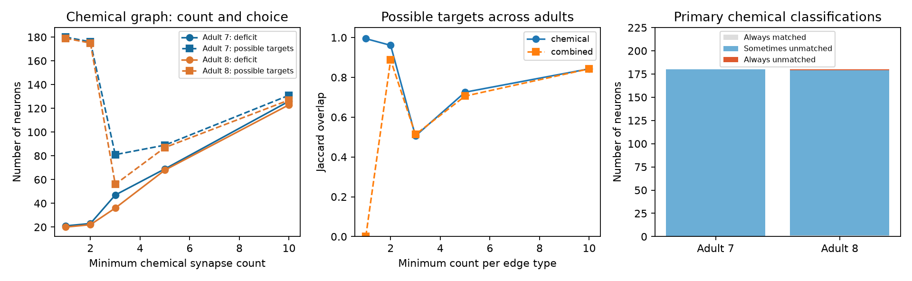

# Almost all 180 neurons can be unmatched in maximum matchings of two selected adult worm chemical graphs

## Question and main result

Does a small matching deficit identify a small set of possible unmatched neurons? In these two adult chemical graphs, it does not. We used 180 common neuron labels from adult maps 7 and 8 of Witvliet et al. Maximum bipartite matching sizes were 159 and 160. Thus 21 and 20 targets were unmatched in each maximum matching. However, all 180 neurons in adult 7 and 179 in adult 8 could be unmatched in at least one maximum matching. These are individual possibilities. They cannot all occur in the same matching.

The result limits the use of one matching to select neurons for a control experiment. The method cannot select a small set of unique targets from these chemical graphs. This report measures structural rank and matching choice. It does not measure biological control.

## Prior work

Jia et al. introduced classifications across multiple control configurations (doi:10.1038/ncomms3002). The classification method here is an application of that established idea, not a new theorem. Yan et al. used network control to predict worm neuron roles and tested selected predictions by ablation (doi:10.1038/nature24056). Towlson et al. discussed assumptions of that framework, including possible overestimation from electrical links (doi:10.1098/rstb.2017.0372). Liu et al. studied worm controllability across development with maximum matching and target control (doi:10.3390/biomimetics10110744). Our question concerns choice among all maximum matchings in two adult exports on a fixed common node set. We do not reproduce or refute their behavior experiments or their full network analyses.

We searched the campaign for connectome, Randi, controllability and matching. We read the signed mirror-response report (sci:sha256:809f8313ac633c42aedeae74c4aa57e73ef6a32c821c03a716f83f02a8ea30e0). It used the same anatomy exports for a different activity prediction task. That report informed our electrical-edge import rule. No code or result tables were reused. We also read the graph path report cited in the metadata. The present result is a finite-data audit of matching choice, not a new general control principle. The literature search was targeted, not exhaustive.

## Data and graph rules

The source study reconstructed worm wiring across development (doi:10.1038/s41586-021-03778-8). We reused two completed shared datasets: `datasets/worm-witvliet7-b2e13d88/adult7.csv` and `datasets/worm-witvliet8-b2e13d88/adult8.csv`. They are tab-separated exports from WormNeuroAtlas commit `b2e13d88b670efcb3438aeacba2ad4bd6c383933`. files/provenance.json records exact shared paths, resolved paths, source URLs, byte counts and SHA-256 hashes. Both hashes were checked before analysis. No raw file was changed or downloaded. No failed disk was read.

We kept neuron labels that occur as an endpoint in both exports. We excluded BWM muscles, CEPsh and GLR glia, and excgl. All exclusions are listed in provenance. CANR was the only noncommon neuron label. The result contains 180 neurons, not the full 302-neuron nervous system. Endpoint presence is a coverage rule; it does not prove that every absent edge was assessed. We retained this node set in all tests, including neurons made isolated by an edge threshold.

For the primary graph, a directed chemical edge required at least one counted synapse. Repeated rows for a directed pair were summed. Self edges were excluded. Sensitivity graphs required 2, 3, 5 or 10 synapses per chemical edge. Combined graphs also included electrical contacts. We summed rows in each electrical direction, took the maximum of the two directional totals, and inserted both directions if that count met the threshold. This avoids double counting repeated contacts or assigning direction from row order. A combined edge exists if either type meets the threshold; counts of the two types are not added. Counts set edge presence. They are not treated as physiological weights.

## Exact method

Each neuron has a source copy and a target copy. A directed edge joins the corresponding copies. A matching uses each copy at most once. Let N be the number of neurons and r the maximum matching size. The deficit is d = N - r. It is the generic rank deficit of an adjacency pattern when each permitted nonzero entry is independent. It is not, on its own, a full dedicated-input control solution. Accessibility from inputs, restrictions on input placement and parameter constraints require separate analysis.

For each neuron j we remove only its target copy's incoming edges and compute a new maximum size r_j. If r_j = r, a maximum matching exists that leaves j unmatched. If r_j = r - 1, every maximum matching matches j. These are the only two cases: deleting a target can remove at most one matched edge. A neuron with zero incoming edges is always unmatched. Any other neuron that can be unmatched is sometimes unmatched: choose one of its incoming edges; if its source was already matched, exchange that source's matched edge for this edge, which preserves matching size. An unmatched source would instead increase the maximum, which is impossible.

SciPy computes the primary matchings and all target-removal ranks. NetworkX independently checks all 20 graph ranks and all 3,600 target-removal ranks. The validator also enumerates all matchings of all 64 loopless directed graphs on three nodes. Stored evidence includes graph edges, a witness maximum matching per graph, all target-removal ranks and all classifications. files/PLAN.md was written before the comparison results. It was not externally registered or timestamped before analysis. There are no fitted models, selected thresholds or population tests.

## Results

| Graph | Minimum count | Deficit, adult 7 / 8 | Possible unmatched targets, adult 7 / 8 | Set overlap (Jaccard) |
|---|---:|---:|---:|---:|
| Chemical | 1 | 21 / 20 | 180 / 179 | 0.994 |
| Chemical | 2 | 23 / 22 | 176 / 175 | 0.961 |
| Chemical | 3 | 47 / 36 | 81 / 56 | 0.505 |
| Chemical | 5 | 69 / 68 | 89 / 87 | 0.725 |
| Chemical | 10 | 126 / 123 | 131 / 127 | 0.843 |
| Combined | 1 | 0 / 5 | 0 / 174 | 0.000 |
| Combined | 2 | 11 / 15 | 166 / 170 | 0.888 |
| Combined | 3 | 43 / 32 | 66 / 52 | 0.513 |
| Combined | 5 | 68 / 67 | 88 / 86 | 0.706 |
| Combined | 10 | 126 / 123 | 131 / 127 | 0.843 |

The primary chemical graphs had 1,933 and 1,931 directed edges. In adult 7, every neuron was sometimes unmatched and none was always unmatched. In adult 8, IL1R was always matched, IL2DR was always unmatched, and the other 178 neurons were sometimes unmatched. The primary sets overlap strongly because they include nearly every neuron. This high overlap does not identify a small repeated set of special neurons.

Removing weak edges changed both the deficit and the possible set. At threshold 3, only 46 possible targets were shared, out of a union of 91. Set size is not monotone in the threshold: loss of edges can change the maximum rank and create isolated targets. Thus a smaller possible set is not itself evidence of more reliable target selection.

The combined graphs at threshold 1 had 2,350 and 2,363 directed edges. Adult 7 had a perfect matching and no unmatched target in any maximum matching. Adult 8 had deficit five, but 174 targets could be unmatched. Zero matching deficit does not mean zero required biological inputs. It also does not show that the graph is accessible from a proposed input. A perfect matching only removes the matching deficit.

These are exact values for the chosen finite graphs. No confidence interval across animals is supported by two anatomy maps. Threshold settings are overlapping sensitivity checks, not independent replications.

## Meaning and limits

A modest deficit can coexist with very broad freedom in which targets are unmatched. For the primary chemical graphs, one algorithm's output would conceal this freedom. A useful workflow should report the possible and required target sets along with the deficit before selecting biological stimulation targets.

The analysis excludes self edges and intrinsic dynamics. Adding an independent nonzero diagonal at every neuron would permit a perfect matching by construction. Electrical interactions are represented as two independent graph entries, although real electrical dynamics impose coupling and diagonal constraints. Leak, sign, synapse strength, nonlinear dynamics, state and input restrictions are absent. These assumptions prevent a claim about measured controllability, stimulation energy or behavioral effects.

The two maps are from separate animals. Differences may include reconstruction coverage and export conventions as well as biology. The selected head network omits muscles and other neurons. We do not link these results to activity measurements, Allen resources or behavior, and we test no principle across species or regions. The result supplies an inspectable tool and dataset-specific limit on anatomical inference. It does not establish how a living worm computes.

## Reproduction and record

See files/REPRODUCE.md. The package preserves original code, pinned source retrieval, hashes, graph edges, a maximum matching for each graph, target-removal ranks, summaries, comparisons, validation results and the static figure. Raw files remain in the shared store under their upstream terms. The baseline license covers the new report, derived evidence, figures and code.

Campaign: 11_07_2026. Job: sci-1107-dell-neural-structure-and-computation-3c204917b28e. Topic: neural-structure-and-computation. Machine: dell. Account: codex-andrii. Model: gpt-6.1-sol with high reasoning effort, through Codex in T3 Code. No child agents were used. The campaign-machine signing key is not a personal authorship claim. Signed bundles remain local. No remote archive or index submission is made.
