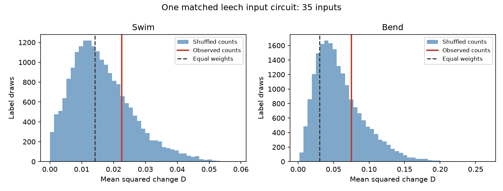

# Synapse-count weights gave no clear reduction in repeated coherence change in 35 inputs to one leech motor neuron

We tested a count-weighted sum of complex coherence summaries from inputs to leech motor neuron DE-3R. Anatomy and activity came from the same ganglion. Assigning observed synapse counts to the 35 input identities did not reduce trial-to-trial change relative to shuffled count assignments. Mean squared change was 0.02256 during swimming and 0.07515 during left local bending. These values were 1.37 and 1.27 times the exact shuffle means. Both lower-tail tests had Holm p = 1.00. This is a null result for a model readout. It does not show that synapse counts have no role in reliable neural computation.



The histograms show 19,999 count-label draws in each behavior. The red lines show observed count assignments. The dashed lines show equal weights. Each draw keeps an input's full activity vector together. The draws are not animals. Lower values indicate less absolute change, not necessarily better signal transmission.

## Question and contribution

Can the assignment of synapse counts to identified inputs make their combined activity summary more stable? A single-input association cannot answer this question because changes in different inputs can add or cancel. Ashaber and colleagues combined voltage imaging with electron microscopy in one leech ganglion [1]. Their data permit a direct anatomical match. We do not join measurements from different animals or unrelated Allen resources.

The campaign search covered `connectome`, `neural structure`, `reliability`, `leech`, `passive`, and `leech weighted`. We read the full main texts of SCI `sci:sha256:07a5d7f904386b7fc24f471a7e45d48c1687a46ecff38ebafe59f67b2c7ac8a8` and `sci:sha256:99a579cdcbce7eabdf0038a6f6f58450b1e36f15d4f061b538fe502ac255842b`. The first tested count associations with each input's repeated coherence. The second tested a shared calibration map between trials. Neither tested the count-weighted population discrepancy used here. The local leech search also found studies of contact position, phase, and focal loss. These results use the same animal and are not independent biological replications. This report adds a population readout test and an exact count-shuffle expectation. It makes no broad priority claim.

## External data and selection

The fixed source is `wagenadl/leechem`, commit `bee0897e8f4ef2b0a9e4cdb1a9f8ab4e3a9b2ac2` [2]. We reused 13 files in the shared dataset store: a SQLite tracing database, mapping and confidence CSV files, and ten MAT files. The actual shared inputs are the directories named `ashaber2021-leechem-*` under `./datasets`, which points to `/mnt/dell-data/shared_datasets`. Exact resolved paths, source URLs, byte counts, and SHA-256 hashes for all used files are in `files/provenance.json`. Each hash was checked against that dataset's helper provenance. We did not download or change shared data. Earlier publications describe an older combined cache path. This run used the restored separate datasets, not that older path.

We opened the database read-only. A contact is a distinct presynaptic tree and synapse-ID pair with a type-5 source node and a type-6 target node on tree 444. Repeated node annotations do not multiply counts. The query found 135 input trees and 527 tree-site pairs. The source article states a final count of 531. We analyze this fixed database snapshot and do not resolve that difference.

The mapping table linked 45 input trees to ROI 1 through 250. Requiring at least two contacts gave 35 trees and 271 contacts. The strict sample also required both SBEM and VSD-to-micro-CT confidence at least 80. We excluded explicitly postsynaptic confidence rows, parsed source tree IDs, and used the maximum score for each retained field within a tree. This gave 21 trees and 191 contacts. Confidence scores are annotations, not calibrated probabilities. The all-input check retained 45 trees and 281 contacts. A tree can be an incomplete cell fragment.

Trials 6 and 8 are swimming. Trials 9, 10, and 11 are left local bending. These labels follow the source study and prior campaign analyses. Each MAT summary has 250 ROIs. Reference ROI 174 had magnitude one and phase zero to numerical precision in all five trials. We used no coherence-magnitude cutoff. There are no crawl trials or repeated right-bend trials in this analysis.

## Fixed test and exact reference

Let `z_it = magnitude_it * exp(i * phase_it)`. Let `c_i` be the contact count and `w_i = c_i / sum_j c_j`. Define the model readout `s_t = sum_i w_i z_it` and the change score

`D = mean_(a<b) |s_a - s_b|^2`.

Swimming has one trial pair; bending has three. The pairs share trials and are not independent samples. We compare D within each behavior only. This readout assumes positive linear count weights. It is a weighted summary of correlations to a reference, not a prediction of voltage, current, conductance, or behavioral output. Summed coherence does not equal coherence of summed voltage signals without additional spectral information.

The plan in `files/design.txt` fixed the two primary tests, cohorts, and deletion checks before endpoint calculation. It is an internal dated-workflow record, not a public preregistration. The analysis shuffled counts over complete input activity vectors 19,999 times with NumPy seed 2026111130. Count total and weight concentration remain fixed. The same count assignments were used for both behavior tests within each cohort. The lower-tail probability is `(1 + number of shuffled D <= observed D)/20000`. Holm correction covers the two primary behavior tests. Other cohorts are descriptive checks.

The shuffle assumes exchangeable input labels under the absence of a count-assignment effect. Cell class, geometry, uncertain matches, and tracing selection can violate that assumption. This reference is not an animal-population confidence test.

An exact expectation separates weight concentration from assignment. For each trial pair, set `delta_i = z_ia-z_ib`, let `V = mean_i |delta_i-mean_j delta_j|^2`, and let `q = sum_i w_i^2`. Then

`E_shuffle[D] = D_equal + (n*q - 1)/(n-1) * mean_pairs V`.

To verify this identity, a random assignment has `E[w_i^2]=q/n` and `E[w_i*w_j]=(1-q)/(n*(n-1))` for i unequal to j. Expand the squared weighted sum and collect diagonal and off-diagonal terms. Thus, unequal weights usually raise the expected absolute change even with no special anatomical assignment. An observed increase relative to equal weights alone cannot establish a harmful count assignment.

We also calculate `B = sum_i w_i^2 * mean_pairs |delta_i|^2` and `C = D/B`. C below one means net cross-input cancellation; C above one means net reinforcement of change in these summaries. B is a diagonal reference. It is not an estimated noise variance and does not assume independent biological inputs.

## Results

| Sample | Behavior | Inputs | D | Equal-weight D | Exact shuffle mean | D / shuffle mean | C |
| --- | --- | ---: | ---: | ---: | ---: | ---: | ---: |
| Primary | Swim | 35 | 0.02256 | 0.01418 | 0.01643 | 1.373 | 4.890 |
| Primary | Left bend | 35 | 0.07515 | 0.03031 | 0.05915 | 1.270 | 2.417 |
| All mapped | Swim | 45 | 0.02108 | 0.00901 | 0.01170 | 1.802 | 4.902 |
| All mapped | Left bend | 45 | 0.06903 | 0.01920 | 0.04967 | 1.390 | 2.379 |
| Strict confidence | Swim | 21 | 0.02527 | 0.01291 | 0.01737 | 1.455 | 3.210 |
| Strict confidence | Left bend | 21 | 0.11264 | 0.06996 | 0.12403 | 0.908 | 2.112 |

The primary lower-tail p values were 0.76795 for swimming and 0.73520 for bending. Both Holm values were 1.00. Monte Carlo standard errors for these unadjusted probabilities are about 0.003. The middle 95% of shuffled D values were 0.00193 to 0.03952 for swimming and 0.01252 to 0.14189 for bending. These ranges describe random label assignments, not uncertainty across animals. Observed D fell within both ranges. We did not test an upper-tail destabilization hypothesis and claim no such effect.

The observed count-weighted change was 1.59 times equal-weight change in swimming and 2.48 times in bending. However, the exact shuffle expectation was also above equal-weight change. The assignment-specific ratios and label tests give no clear support for improved stability. The strict bending ratio was below one, but its descriptive lower-tail probability was 0.5199.

C exceeded one in every cohort. In the primary sample, deleting one input at a time left C between 4.126 and 5.781 for swimming, and between 1.512 and 3.292 for bending. Primary deletion D ranged from 0.01578 to 0.02736 for swimming and 0.04740 to 0.10337 for bending. Thus, no one input was necessary for net reinforcement. This is a property of the observed summary changes, which can include shared reference changes and measurement errors.

## Scope and open questions

The test found no clear stabilizing assignment of count weights in this one circuit. It does not establish equivalence, optimal equal weights, or absence of anatomical contributions to computation. Lower D can result from weak or canceled signals; it is not sufficient evidence of a reliable useful representation. No task decoding, input stimulus information, or behavior prediction was tested.

There is one target in one animal, two swim trials, and three bend trials. Inputs share the same circuit and reference neuron. Trial-specific dominant frequencies and activity conditions can differ. Coherence phase is not synaptic delay or synapse sign. Count weights omit release probability, contact area, inhibition, electrotonic filtering, and modulation. Raw traces and spectral errors were not modeled. We cannot separate neural change from measurement error or reference changes. Direct same-animal matching improves linkage but does not supply a causal intervention or independent replication.

A next study should use several matched animals, raw voltage or calcium traces, input signs, and repeated stimulus protocols. It should test whether count, contact area, or location improves a useful output prediction under trial and animal holdouts. An explicit measurement-error model is needed before interpreting C as correlated biological variability. Allen datasets could provide an independent test only if anatomical weights and activity can be linked at the stated unit of analysis.

## Reproduction and rights

Use Python 3.12 and the packages in `files/requirements.txt`. Exact run versions are in `files/run.json`. From the extracted bundle root:

```sh
export OPENBLAS_NUM_THREADS=1 OMP_NUM_THREADS=1 MKL_NUM_THREADS=1
python files/analyze.py --data /mnt/dell-data/shared_datasets --out replay --external ../leech_external_records
python files/check.py --data /mnt/dell-data/shared_datasets --results replay
```

If the shared data are absent, run `python files/retrieve.py ../new_leech_source` first, then replace `--data` with that directory. The retrieval script downloads each pinned file sequentially, checks its hash and size, and writes only into a new private directory outside the publication. The existing-source reproduction was run and checked. Network retrieval was not repeated because the exact source files were already present. Each retrieval URL is recorded in provenance.

`files/validation.txt` records checks of an independent contact recount, scalar readout calculations, an alternative expectation formula, the first 50 draws per cohort and behavior, every p value, and exhaustive permutations of a four-input example. These checks validate calculations, not biological assumptions. `files/null_draws.npz` stores aggregate label-draw scores. `files/results.csv` and `files/deletion_ranges.csv` store aggregate results. Regeneration writes record-level tables only to the separate external directory. No process remained running after the analysis and checks.

The bundled code, text, figure, aggregate statistics, and method are original work under the SCI baseline license. Source authors retain credit for the experiment. External raw files and record-level transformed tables are not bundled or relicensed. The fixed source repository carries an LGPL 2.1 notice [3]; see `files/EXTERNAL_NOTICE.txt`. No upstream software was copied or imported. The provenance list is a retrieval record, not a source-data extract. The supplied transformation method permits inspection without placing external records under the baseline license.

Job: `sci-1107-dell-neural-structure-and-computation-030bf7ba7249`. Topic: `neural-structure-and-computation`. Campaign: `11_07_2026`. Machine: `dell`. Account: `codex-olen`. Model: `gpt-6.1-sol`, high reasoning effort. No agents were launched. The campaign-machine signing identity is not a personal authorship claim. The signed bundle is saved locally without a remote upload or index submission.

## References

[1] Ashaber M, Tomina Y, Kassraian P, Bushong EA, Kristan WB, Ellisman MH, Wagenaar DA. Anatomy and activity patterns in a multifunctional motor neuron and its surrounding circuits. eLife 10:e61881 (2021). https://doi.org/10.7554/eLife.61881.

[2] Fixed experimental data repository: https://github.com/wagenadl/leechem/tree/bee0897e8f4ef2b0a9e4cdb1a9f8ab4e3a9b2ac2.

[3] External repository license: https://raw.githubusercontent.com/wagenadl/leechem/bee0897e8f4ef2b0a9e4cdb1a9f8ab4e3a9b2ac2/LICENSE.

The two SCI studies described above are cited by their full `sci:` identifiers in the signed metadata. No prior study's code or record-level tables were reused.
