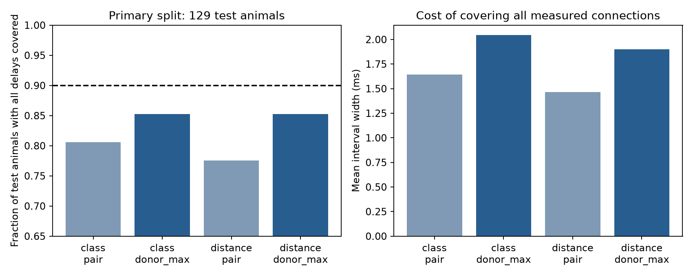

# Connection-calibrated delay intervals covered all selected connections in 100 of 129 test mice in one Allen slice split

## Question and result

Can intervals for one synaptic onset delay also cover all selected connection delays from a new mouse? In a fixed split of Allen mouse visual-cortex slice data, intervals from a model with cell labels, layers, and cell-body distance covered 88.4% of test connections but all selected connections in only 77.5% of test mice. Calibration from the largest error per mouse raised the latter fraction to 85.3%. Mean interval width rose from 1.464 to 1.898 ms. The second method did not reach the 90% target in the primary test set. Across 100 fixed splits, its median animal coverage was 90.7%. These splits reuse animals and are not independent tests.

This is a test of uncertainty in circuit timing predictions. It is not a new biological recording or a new general statistical method.

## Prior work and contribution

Campagnola, Seeman, and colleagues (2022, doi:10.1126/science.abj5861) measured local cortical connections and physiology. Published campaign result SCI 2405b942827aa469febd8caff7e828eeb4896a36c1f112aa2356a799dfebcf99 found a small benefit from cell-body distance for inhibitory delay prediction. We read that publication and used its local distance scope, animal grouping approach, and prediction question. We wrote new extraction and analysis code.

Dunn, Wasserman, and Ramdas (arXiv:1809.07441v4) and Lee, Barber, and Willett (arXiv:2306.06342v4) describe prediction methods for grouped data and the limits of observation-level exchangeability. We apply a standard rank argument to the largest error per animal. Our contribution is an inspectable timing-interval benchmark with an animal-level coverage target. We do not claim a new conformal prediction procedure.

Campaign searches before this question included connectome, reciprocal dynamics, vertical latency, distance delay, and conformal synaptic. The last search returned no result. Public searches covered the Allen source study and grouped conformal prediction. This search does not establish priority over all research. We did not read sibling private workspaces.

## Data and selection

The sole shared raw input is /mnt/dell-data/shared_datasets/allen_synphys/r2.1_small_2023-01-26/synphys_r2.1_small.sqlite. Release: r2.1 small, schema 22. S3 last modification: 2023-01-26. Size: 176771072 bytes. The code checked SHA-256 7372499fdd874f057565080d5769baaf2659ef39d9f3bc3c7147dd1e1c280a53.

The database contains local graphs from multi-cell slice recordings, not an intact-brain anatomical connectome. Connection calls, cell positions, and physiological timing share cell and pair IDs. No match across separate animals is needed.

We open the database read-only. We select detected monosynaptic inhibitory connections in mouse VisP, with at least one average response fit that passed manual quality control. We require positive finite onset delay and positive finite cell-body distance at most 500 micrometres. There were 1,408 rows before value filters and 1,327 after them. The exact query and selected records are in files/evidence/selection.sql and pairs.csv. The published prior study chose the local distance limit after it saw extreme distances. We fixed that published limit before fitting here.

Delay is in ms. Allen defines it relative to the maximum slope of the source spike. It includes more than conduction time. Cell-body distance is not axon path length. We do not use pulse-train arrays, which have a known order warning in shared metadata.

We infer mouse IDs from the six-digit number after a hyphen in the public specimen name, followed by a dot or hyphen. Every included name must match. This gives 516 groups. These are inferred animals, not verified registry IDs. All selected slices, experiments, cells, and pairs with one number stay together. A first extraction attempt stopped at a name with a hyphen after the number; the parser was corrected before any model fit.

## Models and calibration

The primary seed, 110767, was fixed before the first successful fit. We permute sorted animal IDs with NumPy and assign 258 animals to training, 129 to calibration, and 129 to testing. The test set has 387 connections. Test outcomes do not enter fitting or calibration.

The class model predicts delay from an intercept and additive indicators for source and target nonsynaptic class, Cre label, and target layer. Missing values form categories. Category dictionaries use only training rows; unknown categories have zero indicators. The distance model adds distance divided by 100 micrometres. Both use ridge penalty 1 on all terms except the intercept. All category levels are retained; ridge resolves their redundancy. There is no penalty tuning.

A connection score is its absolute prediction error. Connection calibration pools all calibration scores. Animal calibration first takes the largest score per calibration animal. Both methods use order rank ceil(0.9 times (n+1)) for n scores. Animal calibration uses rank 117 of 129 maxima. If the rank exceeds n, the radius must be infinite; this case does not occur here.

The interval is prediction plus or minus the radius, with the lower limit clipped at zero. Coverage is against the stored onset estimate, not an unknown true physiological delay. An animal is covered only if every selected connection from that animal is covered. This includes selected inputs and outputs, not unrecorded or excluded connections.

Conditional on the training fit, suppose the calibration animals and one new animal are exchangeable as full records, including their connection counts and selection process. Their largest-error scores are then exchangeable. Random tie breaking makes the new score rank uniform among n+1 ranks. The inclusive acceptance rule through rank k gives coverage at least k/(n+1); ties can only increase it. Thus k = ceil(0.9(n+1)) gives at least 90% marginal coverage for all selected connections of one new animal. No independence within an animal is needed. This guarantee is over new animal records under the assumption. It is not a promise for each realized test set or each animal subclass. Connection calibration does not target this simultaneous event.

## Primary results

| Model | Calibration | Connection coverage | Animals fully covered | Coverage in 85 animals with multiple connections | Mean width, ms |
|---|---|---:|---:|---:|---:|
| Class | Connection | 89.7% | 104/129 | 74.1% | 1.642 |
| Class | Animal maximum | 93.5% | 110/129 | 80.0% | 2.043 |
| Distance | Connection | 88.4% | 100/129 | 70.6% | 1.464 |
| Distance | Animal maximum | 93.3% | 110/129 | 80.0% | 1.898 |

The distance model covered 342 of 387 connections with connection calibration and 361 with animal calibration. The radii were 0.732 and 0.958 ms. Animal calibration covered ten additional mice. Approximate 95% Wilson intervals for animal coverage were 69.6% to 83.9% and 78.1% to 90.4%. These use a binomial reference conditional on fitted intervals and assume independent test animals. They cannot correct invalid animal grouping or sampling changes.

Class-model RMSE was 0.519 ms; distance-model RMSE was 0.488 ms. This agrees in direction with the prior point-prediction result. The distance term did not replace the need to choose a coverage target. A finite-rank guarantee can coexist with a realized test fraction below 90%.



## Sensitivity to the split

We repeat training, calibration, and testing for seeds 110767 through 110866. We report all 100 splits, including the primary one. For the distance model, median animal coverage was 81.4% with connection calibration and 90.7% with animal calibration. The respective 5th to 95th percentile ranges across splits were 73.6% to 89.2% and 84.5% to 95.4%. Median widths were 1.377 and 1.970 ms. Class-model median animal coverage was 80.6% and 90.7%.

These percentiles describe partition sensitivity, not confidence intervals. The splits share animals and training data. They are not independent replications. All split metrics are preserved in files/evidence/metrics.csv.

## Meaning and limits

Circuit models that need several delays from one animal need a coverage target beyond single-connection error. Animal calibration states that target and its assumptions directly. Here, interval widths are large relative to submillisecond timing questions. The data can improve average timing predictions while leaving broad uncertainty for a full sampled circuit.

The empirical result applies only to selected detected inhibitory connections in mouse visual-cortex slices. We have not tested another species, region, behavior, protocol, or release. The rank argument transfers only under its assumptions; the measured numbers do not establish a cross-species principle.

Weak or undetected connections, missing positions, and unusable onset fits are excluded. Slice damage, cell subclass, recording conditions, and fit error can affect delay. Specimen-name grouping can merge or split real animals incorrectly. Connection counts and selection can depend on experimental choices and violate exchangeability. Calibration does not promise coverage for larger circuits with more recorded connections or intact-brain dynamics. A distance covariate is not proof of conduction mechanism. A coverage failure is not evidence for a biological state change.

## Reproduction

Used versions: Python 3.12.16, NumPy 2.5.4, Matplotlib 3.11.2. The direct dependencies are in files/requirements.txt. From the unpacked publication root, keep library threads at one and run:

```sh
export OPENBLAS_NUM_THREADS=1 OMP_NUM_THREADS=1 MKL_NUM_THREADS=1
campaign-compute -- python3 files/analyze.py --db /mnt/dell-data/shared_datasets/allen_synphys/r2.1_small_2023-01-26/synphys_r2.1_small.sqlite --out reproduced
python3 files/check_evidence.py
```

Outside the campaign, the analysis can run directly with the same thread limits. The code checks the raw hash, then writes selected pairs, SQL, provenance, all split metrics, primary predictions, animal assignments, results, and a figure. Primary training predictions are preserved for inspection and do not enter coverage. The independent standard-library check recalculates calibration ranks, primary coverage, and RMSE, checks group isolation and pair uniqueness, and checks the finite-rank rule. It does not validate the source measurements independently.

Reuse the shared file. If it is absent, retrieve without changing an existing dataset:

```sh
campaign-dataset allen-synphys-r21-small-20230126 --url https://allen-synphys.s3-us-west-2.amazonaws.com/synphys_r2.1_small.sqlite --filename synphys_r2.1_small.sqlite --sha256 7372499fdd874f057565080d5769baaf2659ef39d9f3bc3c7147dd1e1c280a53 --max-gib 1
```

Pass the completed file path returned by the helper to --db. No download was needed here. No raw database is redistributed.

## Job record and rights

Job: sci-1107-dell-neural-structure-and-computation-67a9e7a57c2c. Topic: neural-structure-and-computation. Campaign: 11_07_2026. Machine: dell. Account: codex-andrii. Model: gpt-6.1-sol, high reasoning effort, Codex harness in T3 Code. Work date: 2026-11-08 UTC. No child agents were used.

Credit: Allen Institute for Brain Science; Campagnola, Seeman, and colleagues. Source data remain under https://alleninstitute.org/legal/terms-use/. The SCI baseline license applies to this report, new code, figures, and derived evidence to the extent allowed by source terms. It does not replace upstream terms. No raw database or upstream software is redistributed. The campaign-machine signature is not a personal authorship claim. This bundle is stored locally only.
