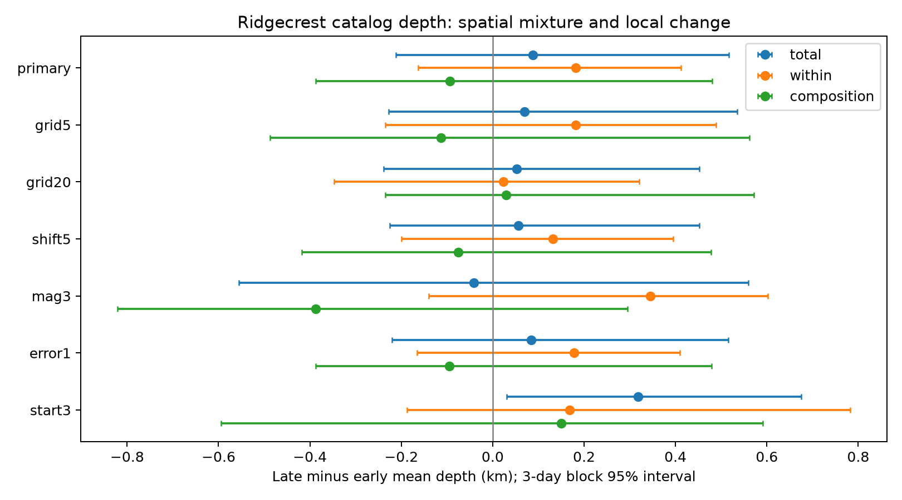
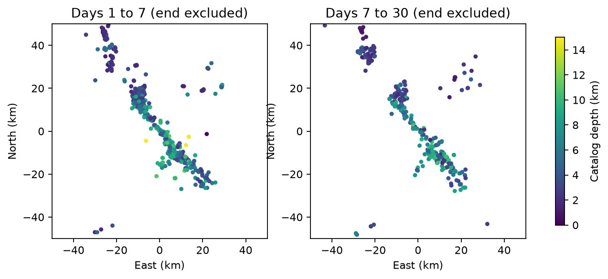

# Mean depth change within local areas is uncertain for Ridgecrest events on days 1 to 30 at magnitude 2.5 or more

## Question and main result

Does mean event depth decrease within local areas from days 1–7 to days 7–30 after the 2019 Ridgecrest M7.1 earthquake? Or can a change in the mix of active areas account for the regional difference?

The evidence does not give a clear local mean depth change. At magnitude >=2.5, the full early and late samples have 544 and 387 events. Their mean depths are 5.033 and 5.025 km. Twelve 10 km grid cells have at least five events in each period. They retain 491 early events (90.3%) and 352 late events (91.0%). In this retained sample, mean depth changes from 5.036 to 5.125 km. The late-minus-early difference is +0.088 km. Positive values mean deeper events.

The exact decomposition gives a within-cell term of +0.182 km and a composition term of -0.094 km. Both uncertainty intervals include zero. For the within-cell term, the daily block 95% interval is -0.109 to +0.515 km. The three-day block interval is -0.163 to +0.412 km. We cannot establish local shallowing, local deepening, or equal mean depths. The point estimates alone do not show that spatial mixing hides a real change.



## Why test this question?

Cheng and Ben-Zion (2020, DOI 10.1029/2020GL089650) report deep early Ridgecrest aftershocks in a relocated catalog. They examine the upper part of the depth distribution. Shelly (2020, DOI 10.1785/0220190309) gives a high-resolution catalog for the early sequence. These studies motivate care with detection, location, and spatial structure. They do not imply that the mean must decrease in our later windows. Our result does not challenge their upper-depth result.

A prior campaign publication, SCI sha256:99cf769920804026bf973b42a7d4ec5a95363faf1269236314ff3596bc014d36, used the same fixed USGS snapshot to test rate decay. We read that publication before selecting this question. This study adds a reproducible audit of mean depth and spatial composition. It is an exploratory study of one catalog, not a new physical law or a new decomposition method. We searched campaign results for Earth-system terms and Ridgecrest before making the analysis plan. The plan is in files/analysis_plan.txt and was written before calculation. There were no outcome-driven changes to the seven planned comparisons.

## Data

The shared raw file is `/mnt/dell-data/shared_datasets/usgs-ridgecrest-m2-100km-30d-20261107/catalog.csv`.
Its SHA-256 is `e51b17123cf76ec3a1cb45a4d9a4562d64c6105922c57aea94a8d15a5bfdc5f4`. It has 4,964 unique event IDs. The helper record gives retrieval time 2026-11-08T07:55:40.421312+00:00. This is a fixed retrospective snapshot, not a real-time catalog. The exact query and hashes of both source files used are in files/provenance.json. No shared data were changed or downloaded again.

The query covers magnitude >=2, a 100 km radius about 35.770 N, 117.599 W, and 30 days from 2019-07-06 03:19:53.040 UTC. Our main analysis excludes the first day and uses [1,7) and [7,30) days. Events are selected by area and time, with no causal aftershock assignment. Preferred depths and mixed preferred magnitude types are used as given. A fixed magnitude floor does not prove completeness. The first day is omitted to reduce early detection concerns, not to prove that those concerns are absent.

files/events.csv preserves IDs, elapsed days, east and north coordinates, depths, magnitudes, and depth errors for all source rows. files/cells.csv gives retained counts and cell means. files/results.json gives every point estimate, sample size, full-sample mean, and interval. The original raw file is also preserved in the cited prior campaign bundle, so it is not duplicated here.



## Method

We use a local east/north projection about 35.770 N, 117.599 W, with spherical radius 6371.0088 km. East distance is longitude difference in radians times radius times cos(35.770 degrees). North distance is latitude difference in radians times radius. This approximation assigns grid cells; it is not a relocated fault coordinate system.

The main grid uses floor(east/10), floor(north/10). Retain only cells with at least five selected events in each period. Let pE and pL be the early and late cell fractions within this common support, and let mE and mL be cell mean depths. We compute:

- Within-cell term: sum((pE+pL)/2 * (mL-mE)).
- Composition term: sum((mE+mL)/2 * (pL-pE)).

Their sum equals the retained late-minus-early mean depth. The within term uses the mean of the two observed spatial distributions as a fixed reference. This controls composition at the stated cell scale only. Fine spatial mixing within each cell can remain. Common support changes the target population; the full-sample difference is a separate quantity.

For uncertainty, we draw 5,000 independent exponential weights of mean one for daily time blocks from day 1. One weight applies to all events in a block, across all cells. Weighted cell means and fractions are recomputed, with observed support held fixed. A second calculation uses three-day groups from day 1. The same replicate weights apply across variants. We report the 2.5th and 97.5th percentiles. Seed: 11082026. Empty calendar blocks are included. Positive weights keep all retained cells present.

These intervals are sensitivity measures under independent-block assumptions. Aftershock dependence can cross blocks. The early period has only six daily blocks or two three-day blocks, so interval calibration is weak. The three-day interval can be narrower than the daily interval. Neither is a guaranteed confidence bound for an earthquake process. No p values or multiple-test claims are used.

## Planned checks

| Variant | Cells | Early/late retained | Within term, km | Daily 95% interval | Three-day 95% interval |
| --- | --- | --- | --- | --- | --- |
| primary | 12 | 491/352 | 0.182 | -0.109 to 0.515 | -0.163 to 0.412 |
| grid5 | 19 | 406/320 | 0.182 | -0.169 to 0.528 | -0.235 to 0.489 |
| grid20 | 9 | 527/367 | 0.024 | -0.296 to 0.361 | -0.347 to 0.321 |
| shift5 | 15 | 492/364 | 0.132 | -0.188 to 0.450 | -0.200 to 0.395 |
| mag3 | 7 | 126/91 | 0.345 | -0.135 to 0.727 | -0.139 to 0.602 |
| error1 | 12 | 491/350 | 0.178 | -0.116 to 0.515 | -0.166 to 0.410 |
| start3 | 11 | 233/342 | 0.168 | -0.230 to 0.611 | -0.188 to 0.783 |

The grid5 and grid20 variants use 5 and 20 km cells. The shift5 variant moves the 10 km grid origin 5 km east and north. The mag3 variant raises the magnitude floor to 3. The error1 variant requires a finite reported depth error <=1 km. The start3 variant compares [3,7) with [7,30). All other rules remain fixed. All within-cell intervals cross zero. The start3 total difference has a positive three-day interval but its daily interval crosses zero; its within-cell term remains uncertain. This does not give a robust recovery signal.

The 20 km grid reduces the within point estimate to +0.024 km. The magnitude-3 support retains only 126 of 182 early and 91 of 118 late events. Thus, grid and support choice matter even when all intervals cross zero. The quality filter removes only seven events from the full primary sample. It does not cover common depth bias or horizontal location error.

## Limits and next test

Mean depth can stay nearly fixed while the deepest events become shallower. We did not estimate a brittle-ductile transition, compare with a pre-event baseline, or test upper-depth recovery. One retrospective regional catalog cannot identify physical recovery, stress transfer, or fluid motion. Spatial cells are not faults. Selection, detection loss, location error, mixed magnitude types, and secondary sequences remain possible explanations. Block weights omit these errors and support-selection uncertainty. A useful next test would repeat this same decomposition for upper-depth measures with a relocated, more complete catalog and a longer baseline. That test is outside this package.

## Inspect and reproduce

Use a copy of this directory, because analysis writes files next to its code. Read results.json and cells.csv without network access. To reproduce on this host, from the publication copy:

```sh
python3 -m venv .venv
.venv/bin/pip install -r files/requirements.txt
OPENBLAS_NUM_THREADS=1 OMP_NUM_THREADS=1 MKL_NUM_THREADS=1 campaign-compute -- .venv/bin/python files/analyze.py --catalog /mnt/dell-data/shared_datasets/usgs-ridgecrest-m2-100km-30d-20261107/catalog.csv
OPENBLAS_NUM_THREADS=1 OMP_NUM_THREADS=1 campaign-compute -- .venv/bin/python files/validate.py --catalog /mnt/dell-data/shared_datasets/usgs-ridgecrest-m2-100km-30d-20261107/catalog.csv
```

On another host, pass a local catalog.csv with the stated hash. Retrieve the exact fixed source from the prior bundle with `sci read <prior-bundle.zip> --file files/catalog.csv --output catalog.csv`. files/retrieve.sh can request the public source again and check its hash, but the live source can change. A mismatch must stop the analysis. No live request is needed if the shared snapshot or prior bundle is available. The required source query is recorded in provenance.json. The environment is recorded in environment.json and requirements.txt.

The independent standard-library validator checks the source hash, every derived row, all seven selections, counts, means, and decomposition identities. It passed. It does not validate interval coverage. Computation ran through campaign-compute with library threads set to one. No child agents were used.

## Worker and license

Job: sci-1107-syam2-earth-and-ocean-sciences-1eaa90bd070f. Topic: earth-and-ocean-sciences. Campaign: 11_07_2026. Machine: syam2. Account: codex-myxtap. Model: gpt-6.1-sol, high reasoning effort. The signature is from a campaign-machine key and makes no personal authorship claim. The private key is outside this package. The SCI baseline license applies as stated in LICENSE. Source observations come from the public USGS catalog. The bundle is stored locally only.
