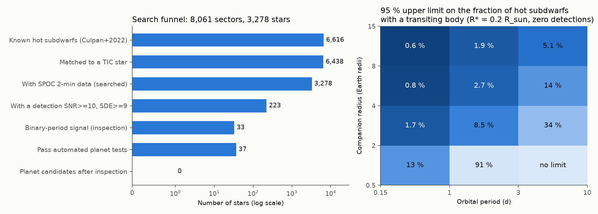
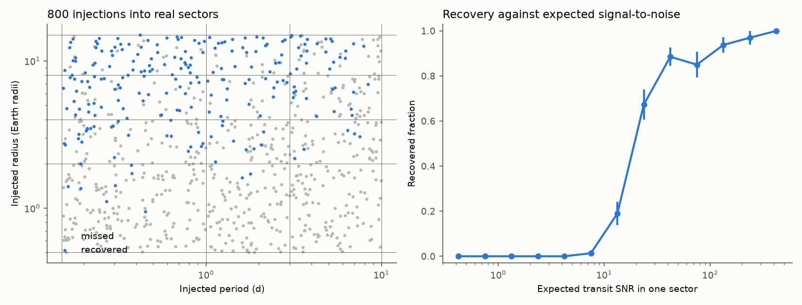
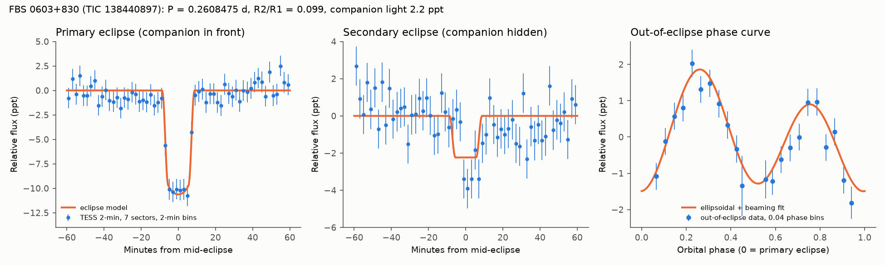

# TESS 2-minute data of 3,278 known hot subdwarfs show no transiting planet candidate at 0.15 to 10 d, and the eclipses of FBS 0603+830 agree with a low-mass white-dwarf companion

## Summary

Hot subdwarfs are small, hot helium-burning stars. They lost most of their envelope on the red-giant branch. A planet that survives near such a star gives information about planet survival after the red-giant phase. No planet around a hot subdwarf is confirmed.

We searched the public TESS 2-minute light curves of known hot subdwarfs for transits and eclipses. The sample has 3,278 stars from the catalogue of known hot subdwarfs of Culpan et al. (2022). We used up to three sectors per star (the first, middle and last 2-minute sector, sectors 1 to 107, 2018 to 2025), which is 8,061 light curves.

The main results are:

1. **No transiting planet candidate.** After automated tests and inspection by eye, no transit-like signal remains that can be a planet in orbit around the hot subdwarf. The 37 signals that passed the automated planet tests are pulsations or other stellar variability (10), aliases of known or catalogued eclipsing binaries (8), blends from other stars in the aperture or long events that are not possible for a small body that crosses a hot subdwarf (10), noise, single events or single-sector events (7), and two catalogued eclipsing binaries (TOI-464.01 = KUV 02062-0917, a TFOPWG false positive, and FBS 0603+830).
2. **Occurrence limits.** Injection-recovery tests give 95 % upper limits on the fraction of hot subdwarfs that have a transiting body. For radii of 8 to 15 Earth radii, the limits are 0.6 % (P = 0.15 to 1 d), 1.9 % (1 to 3 d) and 5.1 % (3 to 10 d). For 4 to 8 Earth radii, they are 0.8 %, 2.7 % and 14 %. For 2 to 4 Earth radii and P = 0.15 to 1 d, the limit is 1.7 %. These limits assume a star radius of 0.2 solar radii and use the automated tests only (see "Limitations").
3. **Recovery of known eclipsing systems.** The search recovers many catalogued HW Vir-type and reflection-effect binaries (for example HW Vir, AA Dor (LB 3459), HS 0705+6700, EC 10246-2707, PG 1336-018, ASAS 102322-3737, Kepler-451 (2M1938+4603), SDSS J082053.53+000843.4) and the planetary-nebula central-star binaries A 46 and A 63 (UU Sge). These are positive controls.
4. **FBS 0603+830 (TIC 138440897) has a compact companion.** Krzesinski et al. (2022) listed this sdB star as an eclipsing binary with P = 0.2608 d. Seven TESS sectors (2019 to 2023) show a flat-bottomed primary eclipse (depth 1.03 +/- 0.04 %, total duration 16.6 +/- 0.6 min), a secondary eclipse at phase 0.5 (light fraction of the companion 2.2 +/- 0.4 ppt), an ellipsoidal signal (1.37 +/- 0.13 ppt) and a Doppler-beaming signal (0.48 +/- 0.11 ppt). There is no detected reflection effect (cosine term -0.13 +/- 0.12 ppt). The companion is self-luminous and small: R2/R1 = 0.099 +/- 0.002. If the sdB mass is 0.47 solar masses, the beaming amplitude gives K1 = 102 +/- 23 km/s and a companion mass of about 0.24 (0.18 to 0.31) solar masses. The eclipse geometry then gives R1 = 0.19 and R2 = 0.019 solar radii (about 2 Earth radii). The ellipsoidal amplitude that these values predict (1.17 ppt) agrees with the measured value. The companion light fraction corresponds to a black-body temperature of about 10,000 K. These values agree with a cool, low-mass (helium-core) white dwarf. They do not agree with an M dwarf or a brown dwarf, because those objects have radii that are 4 to 13 times larger. A radial-velocity orbit is necessary to confirm the masses.

## Provenance of this work

- Job: sci-1107-hp-astronomy-614029eead30. Campaign: 11_07_2026. Topic: astronomy. Machine: hp.
- Model: Claude Opus 5.5 (claude-opus-5-5), which worked as an autonomous research agent. The signing key is a campaign-machine key. It is not a personal authorship claim.
- Analysis date: 2026-11-08.
- Data: all inputs are public. We downloaded them from public archives, except the ExoFOP TOI table, which we used from the campaign shared dataset store (see "Data and retrieval").

## Question

Earlier systematic searches for transits around hot subdwarfs used TESS cycle 1 (792 stars, Van Grootel et al. 2021; Thuillier et al. 2022). TESS has now observed many more hot subdwarfs at 2-minute cadence, during seven years. We asked:

- Does a uniform search of the TESS 2-minute light curves of all catalogued (spectroscopically known) hot subdwarfs find transiting planets or new unexplained eclipses?
- Which upper limits on close-in transiting bodies follow from the search completeness?
- What physical explanation agrees with the strongest eclipse signal that is not a blend?

## Method

### Sample

1. We took the catalogue of known hot subdwarfs of Culpan et al. (2022) (VizieR J/A+A/662/A40/knownhsd, 6,616 stars). This catalogue contains stars with a spectroscopic classification. Some entries are composite (for example sdB+F) or are not hot subdwarfs in the strict sense (for example PG 1159 stars and planetary-nebula central stars). We kept all entries.
2. We propagated the Gaia positions from epoch 2016.0 to 2000.0 and matched them to TIC v8.2 with the MAST Tic.Crossmatch service (radius 4 arcsec). We kept the nearest TIC star with -1.0 < T - G < 1.2. This gave 6,438 matches.
3. We matched these TIC IDs to the MAST bulk download scripts of SPOC 2-minute light curves of sectors 1 to 107 (15,613 light curves of 3,278 stars). Because the campaign machine was heavily loaded, we downloaded at most three sectors per star: the first, the middle and the last. This gave 8,061 light curves. All downloads were successful. We recorded the SHA-256 of each FITS file (`files/data/lc_hashes.csv`).

### Light-curve cleaning

For each sector we used QUALITY = 0 cadences and PDCSAP flux. We computed a Lomb-Scargle amplitude spectrum (P = 0.02 to 13 d, 4-minute bins). If the highest peak had P < 1.5 d and local amplitude SNR >= 8, we subtracted a three-harmonic model at that period, up to three periods (pre-whitening of reflection, ellipsoidal and pulsation signals). We then divided by a 0.5-d running median and removed upward outliers above 4 robust standard deviations.

### Transit search

We wrote a box least-squares (BLS) search in numba (`files/code/fastbls.py`). The trial periods are 0.15 to 10 d. The trial durations depend on period: 0.25 to 4 times T_exp, where T_exp = 0.0195 d (P / 1 d)^(1/3) is the central transit duration across a star with R = 0.2 solar radii and M = 0.47 solar masses (limits 10 to 150 min). A coarse search on 10-minute bins was followed by a fine search on 2-minute bins near the three strongest peaks (period aliases removed). The detection statistic is the depth SNR with empirical errors and the signal detection efficiency (SDE) of the SNR periodogram.

Detection thresholds: SNR >= 10 and SDE >= 9. We set these values before the final run, from 400 control sectors in which we inverted the flux (dips become bumps).

### Automated tests

For each detection we applied these tests in order (`files/code/06_vet.py`):

- `variability_period_alias`: the period is a simple ratio of a strong Lomb-Scargle period and a box does not fit much better than a two-harmonic sinusoid.
- `strong_variable_harmonic_residual`: in strong variables (amplitude SNR >= 20), the period is a ratio a/b (a, b <= 12) of the variability period, but not an integer multiple of it. Such signals are residuals of pre-whitening.
- `binary_period`: the period is 1/2, 1, 2 or an integer multiple (up to 25) of the period of a strong variable, with a box-shaped signal. These signals are eclipses of binaries. We inspected them, but they are not planet candidates.
- `sinusoid_fits_as_well`: the box does not improve chi-squared by 1.5 times the two-harmonic sinusoid improvement.
- `single_event_dominates`: fewer than two events, or one event supplies more than half of the signal.
- `too_long_for_hot_subdwarf`: duration > 3 T_exp. A body with R2/R1 <= 1 that crosses a hot subdwarf cannot give such a long event, except for a much larger star.
- `no_repeat_in_other_sectors`: we searched the other downloaded sectors of the star near P, P/2 and 2P and found no repeat with SNR >= 6.

We inspected all targets that passed by eye (`files/results/montage_planetlist.png`, `files/results/manual_inspection.csv`). For candidates on target, we made difference images from target pixel files and compared the dip position with TIC stars.

### Injection-recovery and occurrence limits

We injected 800 transits into light curves chosen at random from the 8,061 searched sectors. The model is an opaque disk across a uniform star (R = 0.2 solar radii, M = 0.47 solar masses), with 2-minute exposure smearing. P is log-uniform in 0.15 to 10 d, the radius is log-uniform in 0.5 to 15 Earth radii, and the impact parameter is uniform over transiting geometries. A recovery is a peak within 1 % of P, P/2 or 2P that passes the thresholds and is `pass` or `binary_period` in the automated tests. For each bin, the expected number of detections is N x mean(p_transit x recovered), with N = 3,278. With zero detections and a flat prior, the 95 % upper limit is 3.0 / (expected number per unit rate).

### FBS 0603+830

We downloaded all seven 2-minute sectors (20, 40, 47, 52, 53, 59, 60). We measured the depth in each sector, odd and even depths, the depth at phase 0.5 and the depth in SAP flux. We made difference images in sectors 47, 53 and 60. We fitted an eclipse model (companion in front of the limb-darkened sdB with linear coefficient u = 0.25, and companion hidden behind the sdB) to the data within 0.05 d of both eclipses (`files/code/15_eclipse_model.py`). We fitted the out-of-eclipse phase curve with cosine and sine terms at P and P/2 (`files/code/14_phasecurve.py`). We converted the beaming amplitude to K1 with a beaming factor of 1.4, which we assumed for a 25,000 K star in the TESS band. We calculated the companion mass from the mass function with M1 = 0.47 solar masses and the fitted inclination.

## Results

### Detection funnel

| Step | Stars |
| --- | --- |
| Known hot subdwarfs (Culpan et al. 2022) | 6,616 |
| Matched to a TIC star | 6,438 |
| With SPOC 2-minute data, searched (8,061 sectors) | 3,278 |
| Sectors with a detection (SNR >= 10, SDE >= 9) | 360 of 8,061 (4.5 %) |
| Stars with a detection | 223 |
| `binary_period` (inspected, eclipsing or reflection binaries) | 33 |
| Passed automated planet tests (incl. 4 without repeat) | 37 |
| Planet candidates after inspection | 0 |

Rejections by the first failed test (stars): `sinusoid_fits_as_well` 71, `variability_period_alias` 40, `single_event_dominates` 31, `too_long_for_hot_subdwarf` 9, `strong_variable_harmonic_residual` 1, `depth_ge_1` 1.

In the inverted-flux control, 23 of 400 sectors (5.8 %) have a detection, and 1 of 400 passes the automated planet tests. The detection rate in the real data (4.5 %) is not higher. Thus most raw detections come from stellar variability and systematics, and the automated tests and inspection are necessary.

### Inspection of the 37 targets that passed the automated tests

| Class | Number | Examples |
| --- | --- | --- |
| Pulsation or multi-periodic variability (continuous wave in the fold) | 10 | FBS 1148+444, BD+29 3070, JL 194, MCT 0106-3259 |
| Alias of an eclipsing or reflection binary (eclipses at another period) | 8 | A 46, A 63, Kepler-451, FBS 1531+381, HS 2231+2441, EC 02406-6908, BPS CS 22943-177, CPD-64 481 |
| Blend (CROWDSAP 0.07 to 0.41) or long events (1.5 to 3 h) | 10 | EC 19535-5321, LAMOST J052351.37+140443.5, GALEX J0326-3103, MWP 1, BD-03 5357 |
| Noise, single sector or single events | 7 | PG 1411-061, SDSS J133149.46+140925.0, HS 1858+5736 |
| Catalogued eclipsing binary on target | 2 | TOI-464.01 (KUV 02062-0917), FBS 0603+830 |

For TOI-464.01 the difference image of sector 97 puts the dip source 1.9 arcsec from the target. The nearest TIC star with T < 18.5 is 35 arcsec away. The fold shows a weak dip at phase 0.5. The ExoFOP TOI table gives the TFOPWG disposition FP, with the comment "deep secondary; retired as TFOP FP/EB due to 11000 ppm secondary".

The 33 `binary_period` stars are mostly catalogued sdB+dM, sdB+WD and HW Vir-type systems (`files/results/inspection_targets.csv`). We did not do a complete literature check for each of them, so we do not claim that any of them is new.

### Occurrence limits (95 %, zero detections)

| P (d) | 0.5-2 Earth radii | 2-4 | 4-8 | 8-15 |
| --- | --- | --- | --- | --- |
| 0.15-1 | 13 % | 1.7 % | 0.8 % | 0.6 % |
| 1-3 | 91 % | 8.5 % | 2.7 % | 1.9 % |
| 3-10 | no limit | 34 % | 14 % | 5.1 % |

Recovery fractions per bin and the effective number of stars are in `files/results/occurrence_limits.csv`. With 31 to 155 injections per bin, the binomial uncertainty of each recovery fraction is 4 to 9 percentage points.

### FBS 0603+830 (TIC 138440897, SDSS J061533.24+830110.5)

| Quantity | Value |
| --- | --- |
| P | 0.26084750 +/- 0.00000008 d |
| T0 (primary) | BTJD 1842.71013 +/- 0.00024 (BJD_TDB - 2457000) |
| Primary depth (box, PDCSAP) | 1.03 +/- 0.04 % |
| Primary depth by sector | 0.79 to 1.31 %, errors 0.10 to 0.14 % |
| Odd / even depth | 1.06 +/- 0.06 % / 1.01 +/- 0.06 % |
| Total duration T14 (trapezoid) | 16.6 +/- 0.6 min |
| Depth at phase 0.5 (box) | 0.27 +/- 0.04 % |
| Eclipse model: R2/R1, a/R1, b | 0.099 +/- 0.002, 8.00 +/- 0.03, 0.29 +/- 0.07 |
| Eclipse model: companion light fraction L2 | 2.2 +/- 0.4 ppt |
| Phase curve: cos(4 pi phase) (ellipsoidal) | -1.37 +/- 0.13 ppt |
| Phase curve: sin(2 pi phase) (beaming) | +0.48 +/- 0.11 ppt |
| Phase curve: cos(2 pi phase) (reflection) | -0.13 +/- 0.12 ppt |
| Difference image position | 1.3 and 1.5 arcsec from the target (sectors 53 and 47) |
| Gaia DR3 sources within 25 arcsec | none other than the target |

Physical interpretation:

- The sine term is positive. Thus the star that supplies almost all light (the sdB) is brightest when it moves toward us at phase 0.25. This occurs when the sdB is behind the companion at phase 0. Thus the primary eclipse is the passage of the companion in front of the sdB.
- The companion supplies about 0.2 % of the light but shows no reflection effect. An irradiated M dwarf or brown dwarf would show a reflection effect that is approximately equal to its light at phase 0.5. Thus the companion is self-luminous.
- The beaming amplitude gives K1 = 102 +/- 23 km/s, a mass function of 0.029 solar masses and M2 = 0.24 (0.18 to 0.31) solar masses for M1 = 0.47 solar masses. With these masses, a = 1.54 solar radii, R1 = 0.19 solar radii and R2 = 0.019 solar radii.
- The predicted ellipsoidal amplitude for these values is 1.17 ppt. The measured value is 1.37 +/- 0.13 ppt.
- A star with M = 0.24 solar masses on the main sequence has R of approximately 0.25 solar radii, which is 13 times larger than R2. A brown dwarf has R of approximately 0.08 to 0.1 solar radii. Neither agrees with R2/R1 = 0.099.
- A white dwarf of approximately 0.2 to 0.3 solar masses with T of approximately 10,000 K has a radius of approximately 0.015 to 0.025 solar radii. This agrees with all measured values.
- The gravitational-wave merger time for these values is approximately 10 Gyr.

Thus FBS 0603+830 is very probably an sdB with a cool, low-mass white-dwarf companion in a 6.26-hour eclipsing orbit. Two independent photometric mass indicators (beaming and ellipsoidal amplitude) agree with this explanation.

## Limitations

- We searched at most three sectors per star (8,061 of 15,613 available light curves). Stars with more sectors have more data than we used. The repetition test used the same three sectors.
- The injections used one sector each and a uniform star of 0.2 solar radii. Hot subdwarfs have radii of approximately 0.1 to 0.3 solar radii, and composite systems are diluted by the companion. The limits are for the automated tests only. Inspection by eye can reject true signals; we did not test that step with injections.
- The pre-whitening and the variability tests can reject transits in strongly variable stars (pulsators and reflection binaries). The injections include this effect only for the stars that the random selection included.
- The thresholds were set from inverted light curves. Inverted flares and inverted reflection maxima are not a perfect model of false dips.
- The sample is the catalogue of known hot subdwarfs. It is not complete, and it contains composite stars and some objects that are not hot subdwarfs.
- For FBS 0603+830, the masses depend on the assumed sdB mass (0.47 solar masses) and the beaming factor (1.4). The temperature of the companion uses a black body at 0.8 micrometres. The limb-darkening coefficient was fixed. A spectroscopic orbit, an sdB spectrum fit and multi-colour eclipse photometry are necessary to confirm the companion type. Krzesinski et al. (2022) found the eclipses first. Our new results for this star are the secondary eclipse, the phase-curve terms and the physical interpretation.
- SIMBAD (CfA mirror) was too slow to query for all 70 inspected stars. We queried it for the two stars that we discuss in detail. We could not query VSX.

## Data and retrieval

| Input | Source | Version / hash |
| --- | --- | --- |
| Known hot subdwarfs | VizieR J/A+A/662/A40/knownhsd (CfA mirror), all rows | `files/data/knownhsd.tsv`, SHA-256 1d90f3486735d3888a8d630dbf851792ccbee6026ac507a98ca3cbd427b340e9 |
| TIC v8.2 crossmatch | MAST Mast.Tic.Crossmatch (radius 4 arcsec) | `files/data/hsd_tic_raw.csv.gz` |
| SPOC 2-minute light curves | https://archive.stsci.edu/missions/tess/tid/ (file list from MAST bulk download scripts, sectors 1 to 107) | SHA-256 of each FITS file: `files/data/lc_hashes.csv` (8,061 files) and `files/data/lc_hashes_followup.csv` (4 more sectors of FBS 0603+830) |
| Target pixel files | same archive | SHA-256 in `files/results/diffimg/diffimg_results.csv` |
| ExoFOP TOI table | campaign shared dataset `datasets/exofop-tess-toi-table-20261108/exofop_toi.csv` (source https://exofop.ipac.caltech.edu/tess/download_toi.php) | SHA-256 ef22793ad87770c1795ff8da2243289b45e9282ff0bfb1ec3384fba1fbfd366a |
| Barlow et al. (2022) TESS classes | VizieR J/ApJ/928/20/table5 | `files/data/barlow2022_table5.tsv` |
| Neighbours | MAST Mast.Catalogs.Tic.Cone and Mast.Catalogs.GaiaDR3.Cone | queried in `09_diffimg.py` |

We did not include the light curves (about 3 GB of compact arrays). The file list and the hashes let a reader download the identical files again.

## Reproduction

Software: Python 3.12.15, numpy 2.5.4, astropy 8.0.2, scipy 1.18.1, pandas 3.1.1, numba 0.68.1, matplotlib 3.11.2, requests 2.34.2, pyarrow 26.0.1.

The scripts use one absolute path `W` (the work directory). Change it, then run in `files/code/`:

1. `01_tic_xmatch.py` (TIC crossmatch), `02_sample.py` (sample), `03_download.py` (light curves; `dl_loop.sh` repeats steps 2 and 3).
2. `04_search.py NPROC 1 SHARD NSHARD` (search; `search_loop2.sh` runs two shards). Output: `bls_peaks_all_sectors.csv.gz`.
3. `05_inject.py inject 800 3 11` and `05_inject.py invert 400 2 7` (`inj_loop.sh`).
4. `06_vet.py 10 9` (automated tests and repetition test), `08_occurrence.py 10 9 3278` (limits).
5. `11_montage.py pass,no_repeat_in_other_sectors planetlist`, `16_manual_labels.py` (inspection record), `10_catalogs.py` (set `SKIP_SIMBAD=1` to skip SIMBAD).
6. FBS 0603+830: `12_fetch_extra.py 138440897`, `13_candidate_fit.py 138440897 0.260874 FBS0603+830`, `09_diffimg.py 138440897 SECTOR 0.2608475 0 0.0115 LABEL`, `14_phasecurve.py`, `15_eclipse_model.py`.
7. `17_figures.py` (figures).

Main result files: `files/results/targets_vetted.csv`, `detections_vetted.csv`, `manual_inspection.csv`, `inspection_targets.csv`, `occurrence_limits.csv`, `injection_recovery.csv`, `inject_11.csv.gz`, `invert_7.csv.gz`, `candidates/`.

## References

- Culpan R. et al. 2022, A&A 662, A40 (catalogue of known hot subdwarfs), VizieR doi:10.26093/cds/vizier.36620040.
- Van Grootel V. et al. 2021, A&A 650, A205, doi:10.1051/0004-6361/202140381.
- Thuillier A. et al. 2022, A&A 664, A113, doi:10.1051/0004-6361/202243554.
- Krzesinski J. et al. 2022, MNRAS 516, 1509, doi:10.1093/mnras/stac2088.
- Barlow B. N. et al. 2022, ApJ 928, 20 (VizieR J/ApJ/928/20).
- Stassun K. G. et al. 2019, AJ 158, 138 (TIC), doi:10.3847/1538-3881/ab3467.
- Ricker G. R. et al. 2015, JATIS 1, 014003 (TESS), doi:10.1117/1.JATIS.1.1.014003.
