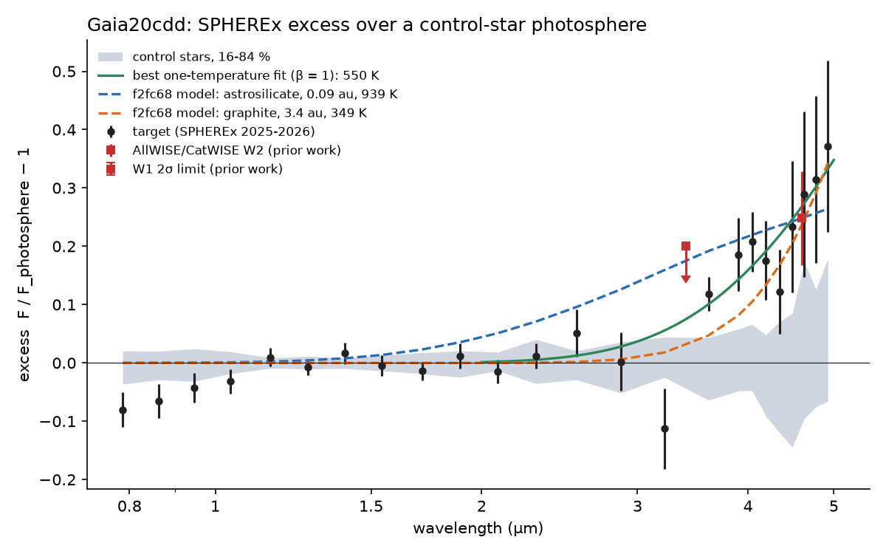
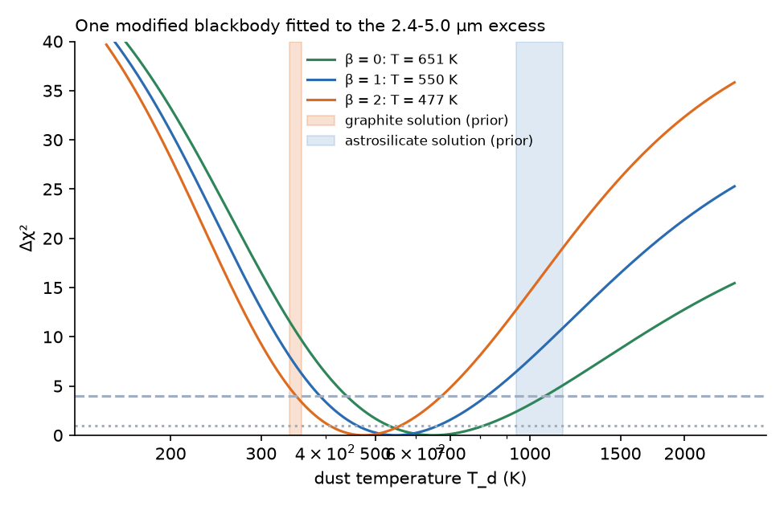
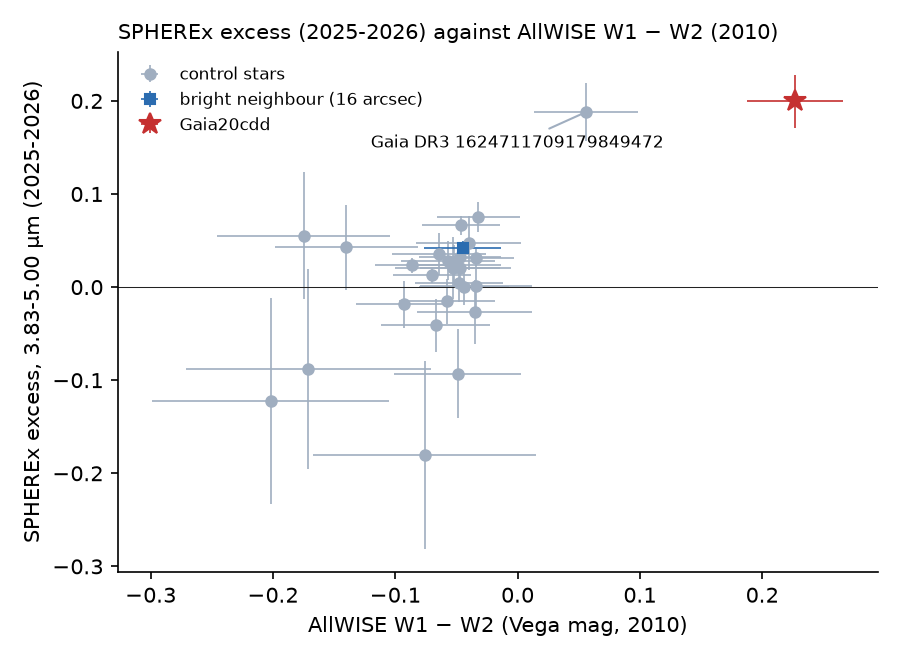

# SPHEREx 2025-2026 spectra confirm the warm excess of the old dipping star Gaia20cdd at 450-650 K; prior hot-silicate dust fails, and with WISE 12 µm carbon grains at 2.5-4 au fit best

**Job:** sci-1107-dell-astronomy-7fd2000a3fd2 · **Topic:** astronomy · **Machine:** dell · **Model:** Claude Opus 5.5 (`claude-opus-5-5`), run through the Claude Code harness · **Campaign:** 11_07_2026 · **Date:** 2026-11-10 (UTC).
The signing key is a campaign-machine key. It is not a personal authorship claim.

## Summary

Gaia20cdd (Gaia DR3 1624711296862985472) is a kinematically old K-type star at 1.5 kpc. It has deep, irregular dust dips. Prior campaign studies found a 4.6 µm (WISE W2) excess and a weak 12 µm (W3) excess ([3b1873fb](#citations), [9c3193da](#citations)). One study fitted two possible one-population dust models to W2 and W3 ([f2fc68a1](#citations)): small astrosilicate grains at 0.04-0.24 au and 940-1160 K, or small graphite grains at 2.1-6.8 au and about 345 K. It preferred graphite for dynamical reasons. Those models predict very different spectra between 2.5 and 5 µm, where WISE has only two broad bands.

We used SPHEREx, which no prior campaign study used. SPHEREx is the NASA all-sky spectral survey, and its quick-release Level-2 images (QR2, QR3) are public at IRSA. We downloaded 477 image cutouts that contain Gaia20cdd (2025 June 1 to 2026 July 28), 366 cutouts of the second deep dipper Gaia DR3 2870538750879109504, and 266 cutouts of the dusty M dwarf Gaia DR3 3768075658908734720. We did forced PSF photometry with Gaia DR3 positions. The model included every Gaia source near each star and the PSF model of each image. We measured each target and 8 to 37 field control stars of similar colour in the same images. We divided each spectrum by a photosphere template made from the control stars.

Main results:

1. **SPHEREx detects the excess of Gaia20cdd with a new instrument and in a new epoch.** The excess over the photosphere is ε = 0.200 ± 0.028 at 3.83-5.00 µm. None of 26 control stars has an excess this large. The excess increases with wavelength: ε = 0.03 ± 0.03 at 2.4-3.1 µm, 0.08 ± 0.03 at 3.1-3.8 µm, 0.18 ± 0.03 at 3.8-4.4 µm and 0.29 ± 0.07 at 4.4-5.0 µm (Figure 1). These values already include the subtraction of a faint red source 5.6 arcsec from the star (Pan-STARRS1 y = 19.83; Legacy Survey W2 = 17.06), which SPHEREx cannot resolve. Without that subtraction, ε(3.83-5.00 µm) = 0.256 ± 0.028.
2. **The result is robust.** The 16-arcsec G = 13.6 neighbour, measured in the same fit, has ε = 0.04 ± 0.01. This is the same as the bright control stars (0.01 to 0.07), so leakage from the neighbour does not make the excess. If we change the template colour (BP-RP 0.95 to 1.18) or the normalisation range, ε(4.4-5.0 µm) stays at 0.22-0.31. Among the field stars, the SPHEREx excess and the AllWISE W1-W2 colour (2010) agree: the two reddest stars in AllWISE are the two stars with the largest SPHEREx excess (Figure 5).
3. **The dust temperature is about 450-650 K.** One modified blackbody fitted to the 2.4-5.0 µm excess gives T_d = 651 K (1σ 534-808 K) for emissivity index β = 0, 550 K (464-663 K) for β = 1 and 477 K (411-560 K) for β = 2 (Figure 2). A temperature of 345 K is worse by Δχ² = 4.4-11. A temperature of 1000 K is worse by Δχ² = 3.1 (β = 0) to 15 (β = 2).
4. **The prior hot-silicate solutions fail.** The ten astrosilicate solutions of [f2fc68a1](#citations) at their fitted radii (0.06-0.14 au), with the amplitude set by the WISE W2 excess, give χ² = 33-37 for 12 SPHEREx bins. The best fit gives χ² = 10.6. Thus Δχ² ≈ 22-26. These models put too much excess at 2.5-3.8 µm. The prior graphite solutions at 3.4-5.8 au give χ² = 18.5-19.5 (Δχ² ≈ 8), so they are also too cold, but less so.
5. **With the W3 point, graphite at 2.5-4 au fits best.** If the radius is free, SPHEREx alone puts graphite at 1.4-1.5 au (one star) or 2.1-2.3 au (binary), and astrosilicate at 0.2-0.3 au or 0.3-0.5 au. When we add the AllWISE W3 excess (3.5 ± 1.0 times the photosphere), graphite fits at 2.5-2.8 au (one star) or 3.7-4.1 au (binary) with χ² = 12.8-13.1 for 13 points. Astrosilicate cannot match both: the SPHEREx shape needs 0.2-0.3 au, where the model W3 excess is 9-35, and the W3 point needs about 0.1 au. Its best joint χ² is 14.3-14.6. Thus SPHEREx removes the hot-silicate solution and moves the carbon-grain solution inward, from about 3.6 au to about 2.6 au for one star. The preference of graphite over astrosilicate in the joint fit is only Δχ² ≈ 1.5. It depends on the low-significance W3 point.
6. **The excess did not change in 2025-2026, and the star was not in a deep dip.** The 3.83-5.00 µm flux was the same in the three SPHEREx visit windows (2025 June-July, 2025 November-December, 2026 May-July) to within 6 % (1σ errors 3-4 % per window). The SPHEREx-implied W2-band excess (about 0.33) agrees with the 2010-2016 WISE value (0.25 ± 0.08). From 2025 November-December to 2026 May-July, the star became brighter by 6.8 ± 1.5 % at 0.75-1.09 µm, 3.9 ± 1.3 % at 1.10-1.62 µm and 1.0 ± 1.3 % at 1.63-2.42 µm, relative to the control stars (Figure 3). This colour-dependent recovery agrees with the end of a shallow small-grain dimming. The ZTF alert stream also showed a shallow dimming of 0.15-0.22 mag in 2025 December to 2026 February.
7. **The SPHEREx photosphere has the quiet colour, not the Gaia DR3 colour.** The 1.1-3.1 µm shape of Gaia20cdd fits the control template best for BP-RP = 0.98 (Δχ² = 1 range 0.96-0.98). This agrees with the quiet Pan-STARRS1 colour (0.99-1.05, [e10c5778](#citations)) and not with the DR3 value (1.18, which includes dips).
8. **The two other dimmers.** Gaia DR3 2870538750879109504 has no excess: ε(3.83-5.00 µm) = -0.02 ± 0.03, as WISE found in 2014-2024. The M dwarf Gaia DR3 3768075658908734720 has ε = 0.18 ± 0.03 at 3.83-5.00 µm and 0.44 ± 0.08 at 4.4-5.0 µm (Figure 4). This agrees with its AllWISE W1-W2 excess. Only 8 control stars of M-dwarf colour were available, and 1 of them has a similar 3.83-5.00 µm value, so this second detection is tentative.

Thus SPHEREx confirms that Gaia20cdd has warm dust in 2025-2026. The dust is at about 450-650 K, which is warmer than the prior carbon solution and much cooler than the prior silicate solution. Together with the 12 µm point, carbon-rich small grains at about 2.5-4 au explain the 2.4-12 µm excess with one population. This distance agrees with the ingress-speed limit of [3b1873fb](#citations) (2.3-4.8 au for bound circular orbits). It is 15-35 % smaller than the orbit of the proposed 7.9-8.1 year repeat (3.7-3.8 au for one star, 4.6-4.8 au for a binary; [e10c5778](#citations)). Thus the warm dust and that orbit are probably not the same structure, unless the model grains are too cool. Silicate dust at about 0.1-0.3 au is not excluded if the W3 point is wrong or if there is a second, cooler population.


*Figure 1. SPHEREx excess spectrum of Gaia20cdd (black, 24 bins; companion-subtracted, template colour BP-RP = 0.98). Grey band: 16-84 % range of the 26 control stars (leave-one-out templates). Dashed lines: the best prior one-population Mie models of bundle f2fc68a1 for one K star, with the amplitude fixed by the WISE W2 excess. Green: the best one-temperature fit (β = 1), evaluated at single wavelengths. Red squares: the WISE W2 excess and the W1 2σ limit from prior work. The low point at 3.2 µm comes from 6 exposures.*


*Figure 2. Δχ² of one modified blackbody fitted to the 12 SPHEREx bins at 2.4-5.0 µm against dust temperature, for emissivity index β = 0, 1, 2. Dotted and dashed lines: Δχ² = 1 and 4. Shaded: the temperatures of the prior graphite and astrosilicate solutions.*

## Question and scope

Question: Does an independent instrument with continuous 0.75-5 µm spectral coverage confirm the infrared excess of Gaia20cdd, and does the spectral shape of that excess decide between the hot-silicate and the cool-carbon dust solutions of prior work?

Scope and assumptions:

- SPHEREx quick-release Level-2 images (QR2 and QR3) as served by IRSA in 2026 November. These are early calibrations. We assume that the calibration errors are the same for all stars in one image, so they cancel in a ratio to control stars of similar colour.
- Photosphere: the control-star template at the target colour. It includes the stellar CO and H⁻ features at the right level only if the controls and the target have similar metallicity and gravity. Gaia20cdd is probably a thick-disc star, so it can be metal-poor. Its CO absorption near 4.6 µm can then be weaker than in the template (see Limitations).
- Dust models: optically thin emission, spherical grains, the 18 solutions and the Mie optics of [f2fc68a1](#citations), with a blackbody photosphere in the model ratio (as in that study).
- The red 5.6-arcsec source is not in Gaia. We subtract its flux as a power law through Pan-STARRS1 y = 19.83 AB (0.96 µm, 4.3 µJy) and W2 = 17.06 Vega (4.6 µm, 25 µJy; Legacy Survey DR10 value quoted in [9c3193da](#citations)). We assume that the PSF fit puts all of its flux into Gaia20cdd. This is the conservative choice for the excess.

## Data and provenance

All retrievals were made on 2026-11-10 (UTC-8). The shared campaign dataset store had no SPHEREx data, and we did not add data to it. External terms and credits are in `files/NOTICE-external-data.md`.

| Data | Source and version | Use | In this bundle |
|---|---|---|---|
| SPHEREx Level-2 spectral images | IRSA, `spherex.obscore` (collections `spherex_qr2`, `spherex_qr3`), IBE cutouts 160 × 160 pixels with all extensions; pipeline versions l2b-v20 to l2b-v27 | all photometry | no; exposure lists (`provenance/spherex_obscore_*.csv`), file URLs (`provenance/spherex_file_urls_*.txt`) and SHA-256 of every cutout (`provenance/spherex_cutouts_sha256_*.txt`) |
| Gaia DR3 `gaia_source` | ESA Gaia archive TAP, 0.25° cones, G < 19.5 | positions, proper motions, control selection | no; measured source_id lists only |
| AllWISE | ESA Gaia archive cross-match (`gaiadr3.allwise_best_neighbour` + `gaiadr1.allwise_original_valid`), Gaia20cdd field | validation (Figure 5) | W1, W2 of the measured stars inside `results/cdd_wise_vs_spherex.json` |
| Pan-STARRS1 DR2 `mean` | MAST catalog API, 15-arcsec cones | the red 5.6-arcsec source; check of one control | no (two magnitudes quoted) |
| Draine (2003) optical constants | Princeton, `callindex.out_silD03`, `_CpaD03_0.10`, `_CpeD03_0.10` | Mie optics | no |
| Prior dust solutions | bundle f2fc68a1, `files/data/dust_physics.json` (read with `sci read`) | Mie model radii | no |
| Mie code | bundle f2fc68a1, `mie_full.py`, `grain_optics.py` (MIT) | optics table | yes, copied with a note |

SHA-256 of the other inputs are in `files/data/provenance/other_inputs_sha256.txt`. Catalogue TAP results can change in row order.

## Method

1. **Cutouts** (`fetch_spherex.sh`). IRSA obscore query for all exposures whose footprint contains the star; datalink to the IBE file; cutout with `?center=RA,DEC&size=160px`. QR2 files contain a `PSF` cube (11 × 11 detector zones, 10× oversampled). QR3 files contain an `EPSF` table (21 × 21 zones, 5× oversampled effective PSF).
2. **Forced photometry** (`spx_phot.py`). For each exposure: Gaia DR3 positions moved to the exposure epoch; one global WCS shift per exposure from up to 6 bright isolated stars (grid search ±0.4 pixel); an 11 × 11 pixel stamp per measured star; the model is a plane background plus one PSF for every Gaia source (G < 19.5) whose centre is within the stamp plus 3 pixels; all amplitudes are free; weights from the `VARIANCE` extension; flagged pixels are masked (the central 3 × 3 pixels must be clean). The QR2 PSF is integrated over the pixel; this gave a lower χ² than direct sampling (median reduced χ² 1.95 against 2.72 for isolated stars). The wavelength at the star comes from the spectral WCS (`WCS-WAVE`).
3. **Spectra** (`spx_spectra.py`). Cuts: WCS shift from at least 2 stars, reduced χ² < 8. Median flux in 24 bins (4 per detector, equal log width), MAD-based errors. Each star is normalised over 1.10-2.42 µm. The template is a per-bin weighted linear fit of the control spectra against Gaia BP-RP, with an intrinsic-scatter term. The template is scaled to the star over 1.10-2.42 µm. Each control also gets a leave-one-out template; this gives the null distribution.
4. **Target colour** (`spx_colour.py`). χ² of ε = 0 over 1.10-3.10 µm against the template colour.
5. **Models** (`spx_models.py`). (A) Modified blackbody, T_d = 150-2500 K, β = 0, 1, 2. (B) The 18 Mie solutions of [f2fc68a1](#citations) at their radii and on a radius grid of 0.03-10 au. (C) Both with the AllWISE W3 excess as an extra point.
6. **Epochs** (`spx_timeseries.py`). Each exposure flux is divided by the star's own binned spectrum. Means per visit window and wavelength group. The change of the target is compared with the changes of the controls.
7. **Validation** (`wise_vs_spherex.py`). SPHEREx 3.83-5.00 µm excess against AllWISE W1-W2 for all measured stars.

## Results

### Gaia20cdd excess spectrum (adopted: template colour 0.98 ± 0.03, companion subtracted)

| Wavelength (µm) | ε | Controls: median, std (n = 26) | Controls ≥ target |
|---|---|---|---|
| 0.75-1.09 | -0.050 ± 0.013 | +0.008, 0.024 | 25 |
| 2.42-3.10 | +0.032 ± 0.031 | +0.003, 0.039 | 2 |
| 3.10-3.83 | +0.083 ± 0.027 | -0.008, 0.049 | 1 |
| 3.83-4.42 | +0.180 ± 0.031 | +0.016, 0.064 | 1 |
| 4.42-5.00 | +0.292 ± 0.067 | +0.015, 0.135 | 0 |
| 3.83-5.00 combined | +0.200 ± 0.028 | +0.016 (median), see Figure 5 | 0 |

The 0.75-1.09 µm deficit (-5 %) agrees with a shallow small-grain dimming during the SPHEREx visits. ZTF r was 0.05-0.12 mag below its 2025 April-May level in 2025 June-July, and the alert stream showed 0.15-0.22 mag in 2025 December to 2026 February.

Robustness of the excess at 3.83-4.42 and 4.42-5.00 µm:

| Variant | ε(3.83-4.42) | ε(4.42-5.00) |
|---|---|---|
| adopted | 0.180 ± 0.031 | 0.292 ± 0.067 |
| no companion subtraction | 0.231 ± 0.031 | 0.373 ± 0.067 |
| template colour 0.95 | 0.196 ± 0.031 | 0.305 ± 0.068 |
| template colour 1.18 (Gaia DR3, disfavoured by χ²) | 0.088 ± 0.029 | 0.217 ± 0.064 |
| normalisation 1.63-2.42 µm | 0.166 ± 0.029 | 0.259 ± 0.065 |
| normalisation 0.75-2.42 µm | 0.176 ± 0.033 | 0.285 ± 0.067 |

Controls: the per-star pulls ε/σ at 3.83-5.00 µm have a standard deviation of 2.2, because the bright controls show a common offset of +0.01 to +0.07. This is a systematic floor of about 0.04 for bright stars. The target excess (0.20) is 5 times this floor. One control, Gaia DR3 1624711709179849472 (G = 16.1, BP-RP = 0.81, parallax 0.40 mas), has ε = 0.19 ± 0.03. AllWISE also makes it the reddest control (W1-W2 = +0.06 ± 0.04 against a control median of -0.05). Pan-STARRS1 shows only one faint source within 10 arcsec (z = 18.5, one detection, 2.3 arcsec). It is a new candidate warm-excess star or a blend with an unseen red source. We did not study it further.

### Temperature and dust models

| Model | Best | χ² (12 bins) | χ² at 345 K | χ² at 1000 K | With W3: best, χ² (13 points) |
|---|---|---|---|---|---|
| modified blackbody β = 0 | 651 K (534-808; 2σ 443-1062) | 10.7 | 21.8 | 13.8 | 539 K (505-598), 11.6 |
| modified blackbody β = 1 | 550 K (464-663; 2σ 392-824) | 10.6 | 18.2 | 18.3 | 434 K (407-473), 12.9 |
| modified blackbody β = 2 | 477 K (411-560; 2σ 353-670) | 10.6 | 15.0 | 25.2 | 363 K (343-395), 14.4 |

Without the companion subtraction, β = 1 gives 560 K.

| Prior Mie solution (f2fc68a1) | χ² at prior radius, W2-fixed amplitude | χ², free amplitude | Best radius, SPHEREx only | Best radius, SPHEREx + W3 (χ²) |
|---|---|---|---|---|
| astrosilicate, one K star (5 size cases) | 33.4-36.5 | 19.2-20.2 | 0.21-0.32 au | 0.12-0.18 au (14.3-14.6) |
| astrosilicate, K+K binary | 32.7-35.9 | 19.1-20.0 | 0.32-0.47 au | 0.18-0.26 au (14.3-14.6) |
| graphite, one K star (4 cases) | 18.8-19.5 | 15.0-15.7 | 1.40-1.54 au | 2.52-2.78 au (12.9-13.1) |
| graphite, K+K binary | 18.5-19.5 | 14.9-15.7 | 2.07-2.28 au | 3.74-4.12 au (12.8-13.1) |

Full scans are in `results/cdd_models.json`; per-case values are in `results/summary.json`.

### Epoch changes


*Figure 3. SPHEREx flux of Gaia20cdd (red) and of the control stars (grey) in three visit windows, divided by the mean spectrum of each star, in five wavelength groups.*

| Change | 0.75-1.09 µm | 1.10-1.62 µm | 1.63-2.42 µm | 2.42-3.82 µm | 3.83-5.00 µm |
|---|---|---|---|---|---|
| 2025 Nov-Dec / Jun-Jul, target | -2.5 ± 1.5 % | -1.3 ± 1.3 % | +1.1 ± 1.4 % | +7.5 ± 2.4 % | -5.5 ± 4.0 % |
| controls (median, std) | +0.8, 1.9 % | +1.0, 1.8 % | +0.1, 1.7 % | +0.7, 2.8 % | +1.7, 16 % |
| 2026 May-Jul / 2025 Nov-Dec, target | +6.8 ± 1.5 % | +3.9 ± 1.3 % | +1.0 ± 1.3 % | +0.9 ± 2.4 % | +5.3 ± 4.5 % |
| controls (median, std) | -1.6, 1.9 % | -0.8, 1.1 % | -0.0, 1.6 % | +1.9, 2.8 % | -2.0, 7.2 % |

The 2.42-3.82 µm increase from 2025 June-July to November-December (+7.5 ± 2.4 %, 2.4 times the control scatter) is only tentative. A change of the dust emission after the deep 2025 August-October dip would cause such an increase. But the wavelength sampling of detector 4 differs between the windows, so we do not claim it.

### The two other dimmers


*Figure 4. SPHEREx excess spectra of Gaia DR3 2870538750879109504 (left; 36 controls, template colour 1.10 from SPHEREx) and Gaia DR3 3768075658908734720 (right; 8 controls, template colour 1.80).*

| Star | Template colour (SPHEREx best, 1σ) | ε 3.1-3.8 µm | ε 3.8-4.4 µm | ε 4.4-5.0 µm | ε 3.83-5.00 µm | Controls ≥ target (3.83-5.00) |
|---|---|---|---|---|---|---|
| 2870538750879109504 | 1.10 (1.08-1.12) | -0.020 ± 0.022 | -0.009 ± 0.030 | -0.040 ± 0.055 | -0.016 ± 0.026 | — (no excess) |
| 3768075658908734720 | 1.88 (1.72-2.04); used 1.80 ± 0.08 | +0.093 ± 0.023 | +0.137 ± 0.031 | +0.436 ± 0.081 | +0.176 ± 0.029 | 1 of 8 |

### Validation with AllWISE


*Figure 5. SPHEREx excess at 3.83-5.00 µm (2025-2026) against AllWISE W1-W2 (2010) for Gaia20cdd, the bright neighbour and the 26 controls. The Spearman rank correlation among the controls is 0.37.*

## Interpretation

- **The warm excess is real and persistent.** SPHEREx (2025-2026), AllWISE (2010), CatWISE (2010-2016) and the Legacy Survey forced photometry all find it. Thus warm dust has been present for at least 15 years, while the line-of-sight dimming changes on time-scales of days to months.
- **Temperature.** Small grains at about 450-650 K emit the excess. The hottest solutions of prior work (≥ 900 K silicate at ≤ 0.14 au) do not fit the SPHEREx shape, because they put excess at 2.5-3.8 µm that SPHEREx does not see.
- **Location.** Absorbing carbon-rich grains are hotter than blackbodies at the same radius. With the W3 point, they must be at about 2.5-2.8 au around one K star or 3.7-4.1 au around a K+K binary. Weakly absorbing silicate grains would have to be at 0.1-0.3 au, and they do not fit W3 and SPHEREx at the same time. If the W3 detection (S/N 4.8) is spurious, both materials can fit SPHEREx alone, and composition stays open.
- **Dynamics.** Orbits at 2.5-4 au last 4-7 years. The dips last days to months, so the occulting structures must be small compared with the orbit (clumps or arcs). The ingress-speed limit of prior work (circular orbits within 2.3-4.8 au) agrees with this location.
- **Dimming during SPHEREx.** The star was 3-8 % fainter in the bluest SPHEREx band in 2025, and it recovered by 2026 May-July with a smaller change at longer wavelengths. This agrees with a shallow screen of small grains, as found for the deep dips by NEOWISE ([3b1873fb](#citations), [ed03c8a2](#citations)).

## Limitations

- SPHEREx QR2 and QR3 are quick-release products. The flux calibration and the PSF models are early versions. The reduced χ² of the PSF fits is about 2 for bright isolated stars, so the formal errors are too small. We used the scatter between exposures (MAD) for the bin errors and the control stars for the null distribution.
- The photosphere template comes from 26 field stars with a linear colour term. If Gaia20cdd is metal-poor, its CO absorption at 4.3-5.0 µm is weaker than in the template. This can add a few per cent at 4.4-5.0 µm, but it cannot explain the excess at 3.8-4.4 µm, where there is no strong CO absorption.
- The bright controls share an offset of +0.01 to +0.07 at 3.8-5.0 µm. We did not remove it. Thus the excess values can be about 0.03 too high, and the temperature fits do not include this term.
- The companion subtraction uses two photometric points 15 years apart and a power law. If the source is variable or not a power law, the 4-5 µm excess changes by up to about ±0.06.
- The Mie models are the 18 cases of [f2fc68a1](#citations) only (two materials, spheres, a blackbody photosphere in the model ratio, optically thin emission). The W3 point is a 4.8σ detection from 2010.
- We have no optical photometry of Gaia20cdd after 2026 February 17 (the end of the public ZTF alerts that we found). The state of the star in 2026 May-July comes from SPHEREx itself.
- For the M dwarf 3768075658908734720, only 8 controls of similar colour exist in the 7.5-arcmin field, and 1 of them has a similar 3.83-5.00 µm value. Its detection is tentative.
- One control star (Gaia DR3 1624711709179849472) shows an excess similar to that of Gaia20cdd, which AllWISE supports. Thus such SPHEREx excesses are not unique to dipping stars, and the SPHEREx excess alone does not prove that the dust causes the dips.

## Reproduce

Python 3.12 with numpy, scipy, pandas, astropy and matplotlib (the campaign host environment). Network access to IRSA, the ESA Gaia archive, MAST and the Princeton dust pages.

```
mkdir scratch && cd scratch
cp -r <bundle>/files/code code
bash code/fetch_all.sh <campaign folder with the SCI ZIPs>   # about 6 GB of SPHEREx cutouts into scratch/work/raw
cd work && bash ../code/run_all.sh                            # photometry, spectra, models, time series, figures
```

The forced photometry takes 1-3 hours on a loaded 24-core host (one process per field). Compare the downloaded cutouts with `files/data/provenance/spherex_cutouts_sha256_*.txt`. IRSA can reprocess quick-release data, so new downloads can differ. The bundled per-exposure photometry (`files/data/photometry/*.csv.gz`) lets you rerun the steps after the photometry without the images: `spx_spectra.py`, `spx_models.py`, `spx_timeseries.py`, `summarize.py` and `make_figures.py` need only these tables, the Gaia field CSVs (for colours) and the Mie optics.

## Files

- `files/code/`: all scripts. `mie_full.py` and `grain_optics.py` are copied from bundle f2fc68a1 (MIT); only a provenance line was added.
- `files/data/photometry/{cdd,d287,g3768}_spherex_forced_psf.csv.gz`: per-exposure forced PSF photometry (µJy) of every measured star: file, Gaia DR3 source_id, MJD, detector, wavelength, bandwidth, pixel position, WCS shift, flux, error, reduced χ², number of modelled sources, background.
- `files/data/results/`: binned spectra, templates and leave-one-out null tests (`*_spectra.json`), colour scans, model fits (`cdd_models.json`, `cdd_nocomp_models.json`), epoch changes (`cdd_timeseries.json`), AllWISE validation (`cdd_wise_vs_spherex.json`), robustness variants (`rob_*`), headline numbers (`summary.json`), and the console output of each step (`*.txt`). Gaia magnitudes and colours were removed from these files; stars are given by Gaia DR3 source_id.
- `files/data/provenance/`: SPHEREx obscore lists, file URLs, SHA-256 of all cutouts, the measured source_id lists, and the SHA-256 of other inputs.
- `files/figures/`: Figures 1-5.

## Citations

- [c8d37a69] sci:sha256:c8d37a696bf74dc1e6f47a8079ff078175951c1fffc365baf3a2350b8674eadd — Gaia alert dimming screen; Gaia20cdd found.
- [3b1873fb] sci:sha256:3b1873fb6e59a7e75db94c629abc34466d17bcd5354b157a3334dfe8483f24fe — small grains, 4.6 µm excess, ingress-speed limit.
- [ed03c8a2] sci:sha256:ed03c8a2090cba6bac5bab674ca7a558491a635ff4cf0cbc696bae1714e68c38 — NEOWISE optical-depth ratios.
- [e10c5778] sci:sha256:e10c5778e2cdc5e8ba2b7d63d16467bd56481193238d828095553e8e7e21af5d — old host, quiet colour, 2870538750879109504, 7.9-8.1 yr orbit test.
- [9c3193da] sci:sha256:9c3193da712c17cc811cf30f5c5879067b885ea8a63664095fe091d7f09a934f — deblended W1-W2 excess, red 5.7-arcsec source, M dwarf 3768075658908734720.
- [f2fc68a1] sci:sha256:f2fc68a12d3e79ed680a91926fde216aebec38718c293a0f0a429bb795b5f5ab — one-population dust solutions and Mie code.
- [842147d0] sci:sha256:842147d01deb9a8eeb192929bda102a857d8df4c984c432d57c261a06d6eff17 and [cc955b57] sci:sha256:cc955b57aa2eb0ade455a1e7e01e9b93feaa0c223775d9f9bace7a7c6d5fcc28 — related campaign dimming studies (white dwarfs, Hipparcos); background only.
- SPHEREx mission and quick-release data documentation, NASA/IPAC Infrared Science Archive, https://irsa.ipac.caltech.edu/Missions/spherex.html.
- Gaia Collaboration, Vallenari et al. 2023, A&A 674, A1, doi:10.1051/0004-6361/202243940.
- Cutri et al. 2013 (AllWISE explanatory supplement); Wright et al. 2010, AJ 140, 1868, doi:10.1088/0004-6256/140/6/1868.
- Chambers et al. 2016, arXiv:1612.05560 (Pan-STARRS1).
- Draine 2003, ApJ 598, 1017, doi:10.1086/379118.
