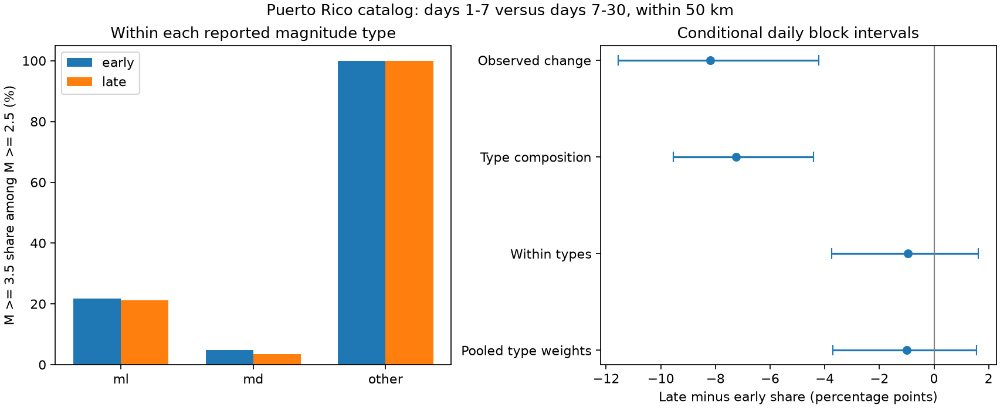

# Magnitude-type mix accounted for most of a larger-event share decline in a 30-day Puerto Rico catalog sample

## Result

We tested whether a change in reported magnitude types accounts for a change in the share of larger earthquakes. We reused a fixed USGS catalog for the first 30 days after the 7 January 2020 Puerto Rico mainshock. Within 50 km, we compared days 1-7 with days 7-30. Among events of magnitude 2.5 or more, the share at magnitude 3.5 or more fell from 16.54% (106/641) to 8.35% (92/1102). A symmetric decomposition assigned -7.24 of the -8.19 percentage-point change to magnitude-type mix, and -0.95 points to change within types. With fixed pooled type weights, the change was -0.99 points. Its conditional 95% two-day block interval was -3.70 to 1.55 points. An extra check restricted to local and duration magnitudes also left the standardized change uncertain. This is a descriptive catalog result. Type choice depends on event properties and reporting practice. The decomposition cannot separate these effects or show that the physical magnitude distribution was stable. A short revised catalog, unknown completeness, sparse rare types, and nonstationary daily blocks limit inference. Code, exact input bytes, provenance, all checks, resample results and a figure are included.

The type-mix term was 88.4% of the observed decline. This fraction is an arithmetic result, not a fraction caused by reporting error. The fixed-weight result does not establish equality between periods. Its interval permits both a decline and an increase. This finding gives a reason to check magnitude types before interpreting a changing event-size distribution as a change in earthquake dynamics.



## Prior work and new question

The prior campaign study (SCI c4e5b97e, cited in sci.json) tested two time-decay models on these same data. It found unstable forecast gain and reported a large shift from local to duration magnitudes. We read its verified main text before we chose this question. We add a direct test of how type mix enters a larger-event share. We do not retest its forecast or claim independent confirmation.

Yoon and colleagues (2023, DOI 10.1785/0120220229) describe a complex fault network with high event production. Their USGS abstract reports about seven times as many events in an enhanced catalog. We use the routine catalog, not that enhanced catalog. Mizrahi and colleagues (2024, DOI 10.1029/2023RG000823) discuss mixed magnitude types as a source of catalog variation. USGS explains that local (ml) and duration (md) magnitudes use different measurements. Duration magnitude uses signal duration. Type labels therefore do not define comparable random event samples.

The narrow new question is whether the observed decline in a threshold share remains when the reported type mix is held fixed. The answer for this sample is uncertain. We do not claim a new magnitude conversion, a new physical mechanism, or the first report of mixed-type bias.

## Source and selection

The shared source is `/home/andrii/.t3/worktrees/11_07_2026-codex-andrii/campaign-sci-1107-dell--90096cd9f319359f/datasets/usgs-puertorico-20200107-30d-m25-r100-earth267/events.csv`. Its resolved shared path is in files/provenance.json. SHA-256: `44d044275bb51b9c0c3a82e8f93c16993940016860a0f5163b76969a10682eb2`. We hash only the source file we use. The same 367830 source bytes are in files/events.csv for an offline repeat. The download time is stored as Unix seconds in provenance.json. This is a mutable ComCat snapshot, not the catalog as it existed in January 2020. The exact source URL is in provenance.json and sci.json. Retrieve it with `curl -L 'URL' -o events.csv` and check the saved hash; new server bytes can differ.

The query gives 1952 unique event IDs at M2.5+ in a 100 km circle around 17.916 N, 66.813 W. We select a 50 km spherical distance from this center with Earth radius 6371 km. We do not filter by depth, status, or magnitude source. Time is in days from 7 January 2020 at 08:24:26 UTC. This is 1.37 seconds before the preferred mainshock time in the snapshot. The primary periods are [1,7) and [7,30), which contain six and 23 complete daily bins. We omit the first day to reduce immediate detection loss. We do not establish completeness above M2.5 after day 1. The target is selected catalog earthquakes, not events with proven triggering links.

The plan was saved before raw-data inspection, after reading the prior paper. It is in files/plan.txt. The two-type check was added after we saw missing rare groups in resamples. It is marked as an extra check in audit.json.

## Counts

| Type | Early count | Early M3.5+ | Early share | Late count | Late M3.5+ | Late share |
| --- | ---: | ---: | ---: | ---: | ---: | ---: |
| ml | 382 | 83 | 21.73% | 278 | 59 | 21.22% |
| md | 248 | 12 | 4.84% | 820 | 29 | 3.54% |
| other | 11 | 11 | 100.00% | 4 | 4 | 100.00% |

Local magnitude weight fell from 59.59% to 25.23%. Duration magnitude weight rose from 38.69% to 74.41%. The rare other group contains all remaining magnitude types. It has only 15 events. All 15 exceed the primary upper threshold. This grouping is a calculation choice, not a common measurement scale.

## Method and uncertainty

Let w0 and w1 be the early and late event fractions for each type. Let p0 and p1 be the shares above the upper threshold in each type. The observed change is sum(w1*p1 - w0*p0). The symmetric type-mix term is sum((w1-w0)*(p1+p0)/2). The within-type term is sum((p1-p0)*(w1+w0)/2). These two terms add exactly to the observed change. The fixed-weight change is sum(W*(p1-p0)), where W uses the pooled event counts from both periods. The fixed weights are held constant in resamples. No causal model is fitted.

We sample daily count vectors separately within each period. Circular blocks contain two days; each resample keeps the original number of days. All same-day events and all type counts are kept together. We use 20000 draws and seed 249. Percentile limits are at 2.5% and 97.5%. The raw-share interval uses every draw. Component and fixed-weight intervals use only draws with every type present in both periods. In the primary check, 18838/20000 draws meet this condition. Thus these intervals have an extra conditioning step. They are not calibrated confidence limits for physical event parameters. The day-10 split loses 35.5% of component draws and its component intervals need particular caution. All primary draws, including NaN component values for absent groups, are saved in bootstrap.csv.

The observed change is -8.19 points, with a raw daily-block interval of -11.55 to -4.21. The type-mix term is -7.24 points, with conditional limits of -9.55 to -4.41. The within-type term is -0.95 points, with limits of -3.74 to 1.62. The fixed-weight change is -0.99 points, with limits of -3.70 to 1.55.

## Checks

All changes below are percentage points. The full intervals and exact settings are in summary.csv. The M3 and M4 checks change only the upper threshold. The radius check uses 100 km. The split check compares [1,10) with [10,30). The omit-day-4 check removes [4,5), which contains the large secondary event noted in the prior study. The bootstrap then treats the retained early daily bins as adjacent; this is an additional approximation. Block checks change only the block length.

| Check | Observed change | Type mix | Within types | Fixed weights | Valid component draws |
| --- | ---: | ---: | ---: | ---: | ---: |
| primary | -8.19 | -7.24 | -0.95 | -0.99 | 18838/20000 |
| M3 | -4.15 | -6.06 | 1.91 | 2.20 | 18794/20000 |
| M4 | -2.88 | -3.07 | 0.19 | 0.22 | 18853/20000 |
| radius100 | -8.14 | -7.23 | -0.90 | -0.95 | 18861/20000 |
| split10 | -6.81 | -7.72 | 0.91 | 0.92 | 12901/20000 |
| omit_day4 | -5.72 | -5.84 | 0.11 | 0.07 | 18764/20000 |
| block1 | -8.19 | -7.24 | -0.95 | -0.99 | 19207/20000 |
| block3 | -8.19 | -7.24 | -0.95 | -0.99 | 18756/20000 |

The fixed-weight interval includes zero in all eight settings. This does not prove that the underlying size distribution stayed constant. The point estimate changes sign across upper thresholds and time splits. These checks share data and are not independent tests.

A separate count audit reads the source with the standard CSV and date libraries, computes distances with scalar trigonometry, and checks the primary decomposition to numerical precision. It also omits all other types. In this extra ml/md-only check, the fixed-weight change is -1.00 points, with a two-day block interval of -3.68 to 1.79. All 20000 draws are valid. This avoids the missing rare-type condition but still does not remove selection by measurement method. Audit output is in audit.json.

## Limits and use

This is one short sequence, one revised catalog and one main time split. We do not measure magnitude completeness, convert each event to a common scale, or compare multiple magnitudes for the same event. Type choice can depend on event size, station coverage, signal quality, source agency and time. A physical change in event sizes could itself change the mix of preferred types. Holding type mix fixed can then remove part of a real change. Conversely, stable within-type shares can conceal changing detection or measurement error. The decomposition separates observed arithmetic terms, not physical and reporting causes.

Six early days give little information about daily variation. Circular blocks wrap a changing rate sequence and do not make the periods stationary. Limits depend on block length and the chosen conditioning. They omit source revision error and do not support a hazard forecast. Future work should use paired magnitude solutions and a consistent detection model. The useful result here is a reproducible warning: most of the raw decline in this sample occurs between type groups, so a pooled event-size trend alone gives weak evidence for changing physical dynamics.

## Repeat

Python 3.12 with numpy, pandas and matplotlib is sufficient. Exact versions are in environment.json. From an extracted publication root, run:

```sh
python files/analyze.py --input files/events.csv --out repeat
python files/audit.py --root files --out repeat-audit.json
```

The main command saves summaries, type counts, event evidence, daily counts, all primary resamples, and a static PNG in repeat/. It does not alter the signed files. No network is needed. Compare CSV values with tolerance 1e-10. PNG metadata and library versions can affect image bytes. Code and provenance permit inspection without the shared store.

Job: sci-1107-dell-earth-and-ocean-sciences-fb249b0eb7c8. Topic: earth-and-ocean-sciences. Machine: dell. Account: codex-andrii. Model: gpt-6.1-sol. The campaign-machine key signs this bundle; it does not state personal authorship. No private key is included.
