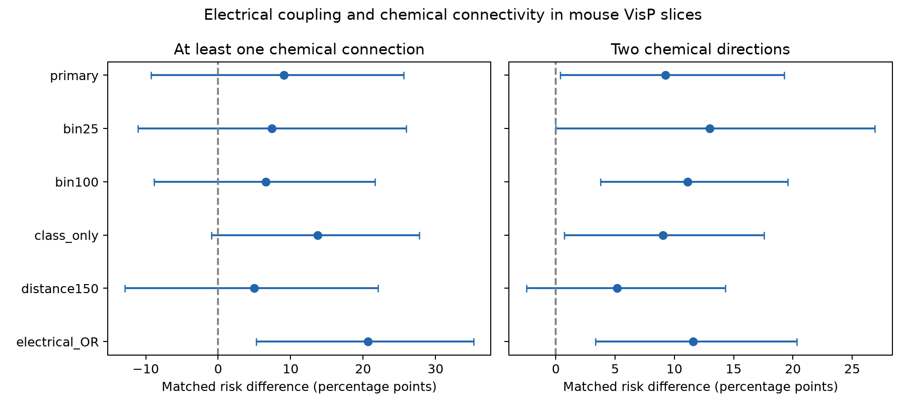

# Matched Allen mouse slice pairs give uncertain chemical enrichment when both electrical calls must agree

## Main result

The primary test did not resolve an increase in chemical connectivity among electrically coupled inhibitory cell pairs. After matching within recording, cell labels, and distance bins, the increase was 9.1 percentage points. The 95% animal-cluster bootstrap interval was -9.3 to 25.6 points. This interval allows a decrease or a substantial increase. It does not show equal connectivity.

Only 45 of 151 eligible coupled pairs had matched controls. The estimate therefore describes a selected subset. When a positive electrical call in either direction was sufficient, the estimate was 20.7 points, with an interval of 5.2 to 35.2. This rule also changed the matched sample. The electrical-call rule and comparison support must be reported when this data set is used to assess combined wiring.

## Question and prior work

Do electrical and chemical connections occur together more often than expected from recording, cell labels, and soma distance? Combined wiring can affect how inhibition and rapid voltage spread act in a local circuit. We test the wiring association. We do not measure synchrony, computation, or behavior.

Galarreta and Hestrin (2002, doi:10.1073/pnas.192159599) found frequent electrical and chemical connections among adult mouse PV fast-spiking cells. Prior work on precise firing synchrony also reported enrichment of electrical coupling among chemically connected interneurons (doi:10.1152/jn.00304.2015). Co-occurrence itself is not a new hypothesis. The present contribution is a matched reanalysis of a larger public resource, with explicit call rules, sample support, and uncertainty.

Campagnola, Seeman and colleagues (2022, doi:10.1126/science.abj5861) provide local connection tests in mouse and human cortex. These are small recorded circuits, not a full anatomical connectome. Structure and function are linked by the identities of the same recorded cells.

Before selection, campaign searches used connectome, reciprocal latency, convergent latency, electrical chemical, and electrical. Relevant results concerned chemical strength and timing. The campaign delay comparison (SCI d7a654bb28eadf49cdc150cf39cd9f7fc586ef72ed661a7eaff1b7a08e6d6a37) described the source and donor-label limits. It did not test electrical and chemical co-occurrence. No sibling private workspace was used. Search records are in files/campaign_search.json. Some full-text web requests failed. Abstract records and source code supplied the statements used here.

## Source and selection

The source is the Allen Synaptic Physiology r2.1 small database, schema 22, S3 modification date 2023-01-26. Exact shared path:

    /mnt/dell-data/shared_datasets/allen_synphys/r2.1_small_2023-01-26/synphys_r2.1_small.sqlite

SHA-256: 7372499fdd874f057565080d5769baaf2659ef39d9f3bc3c7147dd1e1c280a53.

The code opens this file read-only and checks its hash. The database is not redistributed. File hashes and retrieval URLs are in files/provenance.json.

The database represents a cell pair in each direction. We join these rows by cell identity and count each unordered pair once. Both cells must have nonsynaptic cell class in (inhibitory). This avoids using chemical response evidence to set the broad class. We require mouse primary visual cortex (VisP), known chemical and electrical calls in both directions, and mean soma distance above zero and at most 300 micrometres. Unknown calls are never treated as absence. The primary electrical definition requires agreement between directions. Both true means coupled; both false means uncoupled. Discordant calls are excluded. These rules use curated database calls, not new tests on raw traces.

Selection counts: 61,753 unordered recorded pairs; 9,282 with two inhibitory cells; 9,101 in mouse VisP; 8,416 with complete calls; 8,052 with eligible distance. Of these, 31 had discordant electrical calls. The primary cohort had 8,021 pairs: 151 coupled and 7,870 uncoupled. Equivalent inhibitory human eligibility rules gave only 17 pairs across human regions. We did not fit a human comparison or pool species.

No pulse train arrays, fitted chemical amplitudes, or electrical conductance estimates were used. We did not apply an additional spike-count threshold. Chemical test sensitivity can differ with recording quality. A negative call is not proof of no anatomical contact.

## Method

The plan in files/PLAN.md was saved before chemical outcomes were compared. A matching stratum contains one recording, one unordered pair of cell labels, and one distance bin. Each cell label is its Cre label and target layer. Missing labels form explicit categories. Pairing Cre and layer before sorting preserves their relation. Distance bins have width 50 micrometres and begin at zero. Retain only strata with both coupled and uncoupled pairs.

The primary outcome is at least one chemical connection. The secondary outcome is a chemical connection in both directions. Within each stratum, subtract the uncoupled outcome fraction from the coupled fraction. Weight this difference by the number of coupled pairs. This gives a descriptive risk difference for coupled pairs with comparison support. Control rates use these same weights. They need not equal the simple fraction across control pairs.

Animal labels use the six-digit number after a hyphen in the public specimen name. When parsing fails, slice ID is the cluster. Only hashed cluster labels are saved. Seven primary strata use fallback clusters. This can split a true animal and make intervals too narrow. We resample inferred animal clusters 10,000 times, carrying all their strata together. The interval is the 2.5th to 97.5th percentile. No model is fitted. Matching is held fixed, so uncertainty is conditional on the observed sample and matching rule. Edges can share cells; cluster resampling preserves this dependence within inferred animals. It does not correct wrong animal labels or selection bias.

Prespecified sensitivity checks change bin width to 25 or 100 micrometres, omit Cre and layer matching, cap distance at 150 micrometres, or use a positive electrical call in either direction. These checks change the target sample. They are not independent replications. The secondary outcome and sensitivity intervals have no multiplicity correction and are descriptive.

## Results

| Rule | Coupled pairs | Controls | Inferred animals | Any chemical difference, points (95% interval) | Both directions difference, points (95% interval) |
| --- | ---: | ---: | ---: | --- | --- |
| Primary | 45 | 78 | 41 | 9.1 (-9.3 to 25.6) | 9.3 (0.4 to 19.3) |
| 25 micrometre bins | 27 | 38 | 26 | 7.4 (-11.1 to 25.9) | 13.0 (0.0 to 26.9) |
| 100 micrometre bins | 66 | 130 | 60 | 6.6 (-8.9 to 21.7) | 11.1 (3.8 to 19.6) |
| No Cre or layer match | 68 | 157 | 62 | 13.7 (-0.9 to 27.8) | 9.0 (0.7 to 17.6) |
| Distance at most 150 micrometres | 42 | 74 | 39 | 5.0 (-12.9 to 22.1) | 5.2 (-2.5 to 14.3) |
| Either electrical direction positive | 62 | 107 | 52 | 20.7 (5.2 to 35.2) | 11.6 (3.3 to 20.3) |

The primary sample has 43 strata in 43 recordings. Its coupled chemical rate is 33.3%, and its weighted control rate is 24.3%. Mean distances are 85.2 and 87.0 micrometres. Within-bin distance differences remain possible. Only 29.8% of eligible coupled pairs have primary comparison support.

In the unmatched eligible cohort, 66/151 coupled pairs (43.7%) and 745/7,870 uncoupled pairs (9.5%) have any chemical connection. This pooled difference is not adjusted. Matching also selects a different sample, so adjustment alone does not explain the difference from the primary estimate.

Of the 31 discordant pairs, 17 have any chemical connection and five have both directions. Including these pairs changes membership and estimates. We cannot determine whether directional disagreement reflects measurement sensitivity, curation, or other causes. We do not infer one-way gap junction anatomy.

The primary secondary-outcome result rests on five coupled pairs with two chemical directions. Its small positive lower interval bound is fragile: the 25 micrometre interval reaches zero, and the 150 micrometre interval crosses zero. It does not establish a robust reciprocal-wiring principle.

Removing one primary inferred animal at a time gives any-chemical differences from 7.0 to 16.3 points. A post-result diagnostic that removes fallback clusters retains 38 coupled pairs in 36 strata and gives 10.7 points. This diagnostic has no uncertainty interval and does not repair animal identity.

## Limits and next test

These data neither reject combined wiring nor establish its enrichment under all reasonable call rules. The main interval is wide, matched support is low, and cell labels are broad. Electrical and chemical detection may share recording-quality effects. Slice preparation can remove processes. The database lacks anatomical proof of a gap junction for each call. The two electrical rules define different samples; their different estimates are not a formal test of an interaction.

This study concerns mouse visual cortex slices. It does not establish transfer across species, regions, or behavioral states. A useful next test would verify electrical calls from traces, use direct animal identifiers, and record enough same-label pairs in each local circuit to give comparison support. Circuit models should vary these uncertain associations instead of treating the pooled rate as a general rule.

## Reproduction and campaign record

See files/REPRODUCE.md. The package has code, a plan, cohort IDs and calls, matched strata, all bootstrap draws, results, provenance, and a figure. An independent standard-library audit reconstructs the primary match and reproduces both point estimates to 1e-12. A second full run checks exact reproducibility. Substantial runs use campaign-compute and one library thread.

Job: sci-1107-syam2-neural-structure-and-computation-ecb700f803d5.
Topic: neural-structure-and-computation. Campaign: 11_07_2026.
Machine: syam2. Account: codex-myxtap.
Model: gpt-6.1-sol, high reasoning effort, through T3 Code.
No agents were launched. The campaign-machine signature is not a personal authorship claim.
The bundle is saved locally without remote submission.

The baseline license covers original text, figures, derived summaries, and code. It does not change the separate source database or Allen code licenses.
