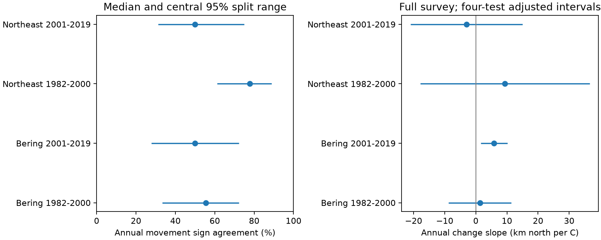

# Separate haul halves agreed on 50-78 percent of annual movement signs in four US trawl samples in 1982-2019

## Question and result

Do separate sets of survey hauls give the same annual movement direction for a marine distribution index? This matters when a short movement record is used to test a climate explanation. We used public catches and sea surface temperature. We tested two regions and two non-overlapping periods. The regions are separate survey systems, not random samples of all oceans. Each repeated split gave two sets of hauls with no overlap.

Median agreement on annual movement signs was 56 and 50 percent in the Bering Sea, and 78 and 50 percent in the Northeast. In contrast, Northeast linear trend signs agreed in all 500 splits in both periods. Low annual agreement therefore does not imply unstable long-term trend signs. The full-survey temperature slope was clearly positive only in the late Bering sample under our main interval procedure. The interval included zero with a stricter taxon filter. These findings support caution when annual movement signs are used as climate evidence. They do not show that true animal movements are random, or that climate has no effect.



## Prior work and contribution

Pinsky et al. (2013, doi:10.1126/science.1239352) linked marine distribution shifts to local climate velocity. Thorson et al. (2016, doi:10.1111/2041-210X.12567) showed that changes in survey location can bias catch-weighted centers and developed a spatial model. Their results motivate a sampling check before causal interpretation. We do not compare against their spatial model or claim to replace it.

We searched the shared campaign for phenology temperature, ocean distribution, trawl, split half, and haul halves. We read the signed survey-weight audit sci:sha256:f07015b2c467a3942a4bbf2f81bd3db886e2db9b97768c7e878aa51c5e9bf3a8. It reported sensitivity to weights and a Northeast survey change. Our contribution is a conditional haul-partition diagnostic for annual movement, trend signs and temperature slopes. It uses overlapping raw data and is not independent validation of that audit. We did not read private worker files. Search results were broad; the search does not prove novelty.

## Sources and selection

We reused two shared raw files in place. Exact paths, URLs, byte counts and SHA-256 values are in [provenance](files/provenance.json).

* OceanAdapt file: `/mnt/dell-data/shared_datasets/oceanadapt-all-regions-full-fltr-0d4bcaffe6/all-regions-full-fltr.csv.gz`. Git commit: `0d4bcaffe649e970674fe165fe892ab4d787e76a`. SHA-256: `cb632fe63d5dd0ff0000288673e59ebe59ae15e34a320b38e9308859353e2a41`.
* NOAA ERSST v5 file: `/mnt/dell-data/shared_datasets/ersst-v5-psl-sst-mnmean-20261108-olen/sst.mnmean.nc`. Snapshot data modification date: 2026-11-03; last month: 2026-10. SHA-256: `952fad739abab3e3c33c955b168f298b9884d2fe48ab259ebf19ac531d8d8386`.

No data were downloaded or changed. We kept 1982-2019. The Northeast has no 2017 survey in this file. We used only strata with at least four unique hauls in every available year. This retained 10 Bering strata with 13,427 hauls and 18 Northeast strata with 4,714 hauls. The Northeast result has a smaller footprint than the prior audit. Each haul has one location and stratum. Stratum areas are constant within stratum.

We retained labels with two alphabetic words in genus and species form. We removed taxa with conflicting catches in a haul: Platichthys stellatus in Bering and Placopecten magellanicus in the Northeast. Equal repeat haul-taxon rows were collapsed. We corrected Peprilus tracanthus to Peprilus triacanthus before that step. The two spellings had 7,009 paired haul records with identical catches and no unpaired record in the full Northeast file. They must not get separate weight. The small name audit is in [name_check.json](files/name_check.json). No other taxonomic harmonization was attempted.

The main cohort requires at least 20 positive hauls for each taxon in each available year. This gives 30 Bering taxa and 15 Northeast taxa. The initial threshold of 10 gave a zero-catch half for one retained taxon and stopped the run. We raised the threshold to 20 before completing the main run. We also corrected the duplicate spelling after inspecting the first output. This is an exploratory analysis. A stricter sensitivity uses 40 positive hauls and retains 20 and 6 taxa. The code does not discard individual zero-catch draws; it stops if any half has no catch for a retained taxon.

## Method

For taxon s, year y and haul h, the full centroid is sum(c A L/n) / sum(c A/n). Here c is weight catch per unit effort, A is stratum area, L is latitude and n is the count of unique hauls in that year and stratum. All hauls in the source contribute to n, not just hauls with a selected taxon. Absence of a taxon row is treated as zero catch. We average these centroids with equal taxon weight. We multiply degrees by 111.195 to give km north of the equator. Only changes in that value matter. It is not a range edge, movement of individuals, or biomass-weighted community centroid.

For each year and stratum we randomly permute hauls, put floor(n/2) in A and the rest in B, and use each half's own haul count in the area weight. We repeat this 500 times with seed 1107. Splits are random within strata, not spatial blocks. For each region and period, a split gives the fraction of consecutive-year pairs whose changes have the same strict sign in A and B. Zero products do not count as agreement. We also compare signs of the two linear year slopes and of the two temperature slopes. All split summaries are conditional on this raw dataset and cohort.

Temperature is the mean ERSST v5 surface value over inclusive grid centers in a fixed box. We use June-August at 54-64 N, 180-200 E for Bering, and September-November at 36-44 N, 284-294 E for the Northeast. Monthly grid values are averaged with cosine-latitude weights over available ocean cells; the three monthly values have equal seasonal weight. Boxes and seasons are approximate regional exposures, not haul bottom temperatures. NOAA PSL, Boulder, Colorado, USA, supplied these data.

We fit change in centroid = intercept + beta times change in seasonal temperature. We use only calendar-consecutive pairs: 18 in each Bering period and the early Northeast period, and 16 in the late Northeast period. We omit both pairs that touch missing 2017. We use heteroskedasticity and autocorrelation consistent covariance with two observation lags and finite-sample correction. The interval uses a t quantile with n-2 degrees of freedom and Bonferroni adjustment for four slopes. The nominal family level is 95 percent. These are approximate exploratory intervals, with few years and model assumptions. The adjustment does not account for analyst choices. First differences remove level trends but not unmeasured shared annual causes.

## Main results

Split ranges below are the central 95 percent of the 500 conditional partition values. They are not confidence intervals. Temperature intervals follow the separate regression procedure above.

| Region and period | Annual sign agreement, median (split range) | Temperature slope, km/C (adjusted interval) | Temperature slope sign agreement | Trend sign agreement |
| --- | ---: | ---: | ---: | ---: |
| Eastern Bering Sea, 1982-2000 | 55.6% (33.3-72.2) | 1.33 (-8.76 to 11.41) | 53.8% | 69.4% |
| Eastern Bering Sea, 2001-2019 | 50.0% (27.8-72.2) | 5.86 (1.60 to 10.13) | 94.4% | 88.8% |
| Northeast US Fall, 1982-2000 | 77.8% (61.1-88.9) | 9.36 (-17.83 to 36.54) | 93.8% | 100.0% |
| Northeast US Fall, 2001-2019 | 50.0% (31.2-75.0) | -2.96 (-20.98 to 15.05) | 33.2% | 100.0% |

Trend sign agreement is a stability measure, not a trend significance test. In particular, we did not compute trend confidence intervals. A consistent slope sign does not establish a causal effect.

## Sensitivity and limits

With the 40-positive-haul filter, median annual agreement is 61, 50, 67 and 63 percent in table order. Temperature slopes are 3.96, 5.02, 8.02 and -1.17 km/C. All four adjusted intervals include zero. The late Bering interval is -1.38 to 11.42 km/C. The point estimate stays positive, but its precision and cohort change. This does not prove that the main slope is false. Northeast trend signs still agree in at least 99.8 percent of splits. The full sensitivity outputs are included.

Complementary halves are not independent draws from an unlimited population. Conditional on fixed catches, their errors can be negatively linked. There is no 50 percent null test here. Adjacent year changes share endpoints. Split ranges cannot be used as binomial confidence intervals, a reliability coefficient, or a fraction of variance due to ecology. Halving effort can itself lower precision. The diagnostic asks how two reduced surveys behave, not how accurate the full survey is.

Shared biases survive the split. These include catchability, gear, habitat coverage, taxonomy and any survey-wide change. The documented Northeast vessel change after 2008 can enter the annual-change fit. We do not estimate or remove it. Random spatial mixing can make agreement look better than a comparison between spatially separated survey teams. Persistent common taxa exclude rare taxa, arrivals and departures. Selection uses the full time span and is not a prospective prediction rule. Surface temperature is a coarse proxy for conditions near the seabed. Fishing and other drivers are not controlled. The two time periods are disjoint but can share persistent ecological processes. The regions can share large-scale climate conditions. These results do not establish global patterns, air pollution effects, ecological timing changes or a causal climate response.

## Reproduction and evidence checks

Run from an extracted bundle root, writing regenerated files outside that root:

```sh
python files/analyze.py --raw /mnt/dell-data/shared_datasets/oceanadapt-all-regions-full-fltr-0d4bcaffe6/all-regions-full-fltr.csv.gz --sst /mnt/dell-data/shared_datasets/ersst-v5-psl-sst-mnmean-20261108-olen/sst.mnmean.nc --out ../reproduced
python files/verify_results.py ../reproduced
python files/analyze.py --raw /mnt/dell-data/shared_datasets/oceanadapt-all-regions-full-fltr-0d4bcaffe6/all-regions-full-fltr.csv.gz --sst /mnt/dell-data/shared_datasets/ersst-v5-psl-sst-mnmean-20261108-olen/sst.mnmean.nc --min-positive 40 --out ../reproduced_strict
python files/verify_results.py files/outputs
python files/verify_results.py files/sensitivity
```

Use Python 3.12 and the versions in each audit.json; requirements.txt records analysis packages. A single numerical library thread is sufficient; the original run set OPENBLAS_NUM_THREADS=1. Expect about one minute per analysis on the campaign host. No extra service or credential is needed. The script checks both complete input hashes before analysis. For another host, `python files/retrieve.py ../external_raw` downloads to a new directory outside the draft. The SST URL is mutable. The helper stops on a snapshot hash mismatch; obtain the stated shared snapshot rather than silently substituting new bytes. In this campaign, use campaign-dataset for reusable new downloads, as the workspace instructions require.

Each output directory has summary.csv, annual.csv, split_draws.csv, audit.json and result.png. Annual.csv contains survey-level indices, seasonal means and counts. Split_draws.csv contains agreement, temperature slopes and trend slopes for the two halves. These are new aggregate analysis results, not catch or haul extracts. Audit.json records cohort labels, strata, seasons, seed, versions and scale-invariance checks. No source database, taxon-year database or haul-level derivative is included.

The saved-output verifier checks 16 numerical identities per analysis and the consecutive-year pair counts. It rebuilds full-data temperature slopes by centered sums and checks the split summaries. Both analyses passed. The raw analysis checks unique haul locations, constant stratum areas, nonzero catch denominators and centroid invariance to common scaling of weights. The largest scale error was below 3e-12 km. These checks do not validate missing catches or biological truth. Regenerating split slopes and agreement from catches needs the external raw file; saved split summaries alone cannot audit every haul assignment.

## Responsibility and rights

Job: sci-1107-dell-climate-pollution-biodiversity-f3f6e5d12931. Topic: climate-pollution-biodiversity. Campaign: 11_07_2026. Machine: dell. Account: codex-andrii. Model: gpt-6.1-sol, high reasoning effort. One finite automated worker did the analysis and writing, with no child agents. The campaign-machine signing key is not a personal authorship claim. No private key is included.

The exact SCI baseline license covers original code, text, figures and aggregate analysis outputs. External raw materials remain outside the package. [External data notice](files/EXTERNAL_DATA_NOTICE.txt) gives attribution and source terms. No external license is replaced. No remote submission or upload was made by this worker.
