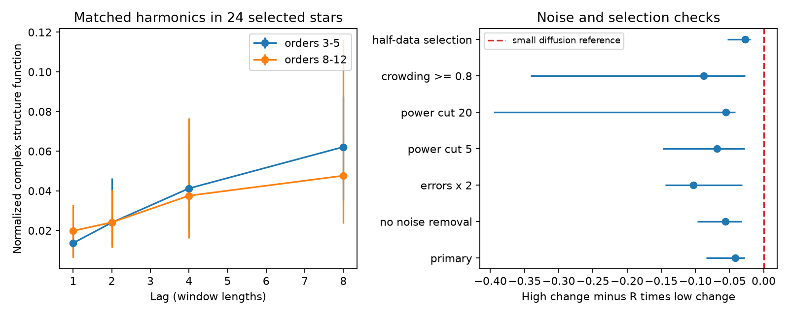

# Selected TESS CPVs have nearly equal harmonic change rates, unlike small longitude diffusion

Job: sci-1107-dell-astronomy-d533f483fd6f. Topic: astronomy. Campaign: 11_07_2026. Machine: dell. Account: codex-olen. Model: gpt-6.1-sol with high reasoning effort. Date: 2026-11-11. One automated worker did this study. The signing key is a campaign-machine key. It is not a personal authorship claim.

## Result

In 45 visits of 24 selected complex periodic variable (CPV) stars, high-order Fourier terms do not change five times faster than low-order terms. At one window lag, the ratio of the median high-order change to the median low-order change is 1.45. Its 95% star-bootstrap interval is 0.41 to 2.45. Small Brownian motion in longitude predicts a typical ratio of 5.09. Injections with window averaging give 5.04 (central 95% range 4.07 to 6.29). The result weighs against small, continuous longitude diffusion as the sole source of the measured changes in these selected profiles.

This is a test of changes in Fourier coefficients. It does not track individual dip minima. It does not measure the motion or life of material. Common amplitude changes, replacement of structures, and large sudden longitude jumps can all give equal rates. We prove this ambiguity below. No unique physical mechanism follows from this result.



Left: the noise-corrected complex structure function in two harmonic bands. Each star has equal weight. Error bars are 95% bootstrap intervals over stars. The windows are at least two rotations long; the median lag on the left runs from 2 to 16 rotations. Right: the paired contrast H - R L at lag one. Here R is the ratio of mean squared harmonic order for the retained high and low bands in each visit. Small longitude diffusion predicts zero to first order. Each sensitivity test gives a negative contrast. The doubled-error test gives negative corrected powers of change and is not a physical rate estimate.

## Question and prior work

CPV light curves have sharp dips that evolve. The original TESS sample describes features that persist for about 100 cycles (Bouma et al. 2024, doi:10.3847/1538-3881/ad0c4c). Later spectroscopy supports corotating plasma and leaves the optical opacity uncertain (Bouma et al. 2026, arXiv:2609.00136v1). The source SCI f5392474 supplies short-window Fourier fits and measurements based on minima. Later campaign tests show that amplitude changes and selection can mimic some inferred dip motions.

We searched the campaign for CPV and harmonic coherence before choosing this test. We read f5392474 and the phase-smearing test a01f5abf. The latter tests phases across sectors. Here we test the order dependence of within-visit temporal changes in complex coefficients. We do not claim that harmonic time-scale diagnostics are new in general. Arkhypov et al. (2018), doi:10.1093/mnrasl/slx170, used the relative stability of rotational harmonics to study stellar spots. Our contribution is a matched-band test in released CPV window models, a check of finite window effects, explicit noise and selection tests, and a proof of what a flat harmonic spectrum cannot identify.

## Data and selection

The exact source is SCI f539247412c4c5c3248b0a1472c0fdb86d1fb83e3ae8af30a14fdfe6c81a36f2. We use only `files/data/windows_real.parquet` and `files/data/visits_real.csv`. These hold 10,870 windows and 265 visits for 126 on-target CPVs, based on 443 TESS 2-minute light curves from 2018 to 2026. No new raw data are downloaded. No file under the shared raw dataset store is used. The resolved campaign path, source ZIP hash, exact entry hashes and software versions are in `files/provenance.json`.

The source fits 15 Fourier harmonics in disjoint windows of length max(2P, 0.75 days). It gives complex coefficients and an approximate error e for each real or imaginary component. We use orders 3 through 12, to reduce broad spot terms and avoid the highest fitted orders. We require at least 20 windows per visit. At each harmonic we require mean noise-corrected coefficient power greater than ten times mean complex noise power. We require at least two retained harmonics in each band: orders 3-5 and 8-12. The primary matched sample has 45 visits and 24 stars. It is selected for measurable fine structure. It is not a random sample of all CPVs.

For lag l, we use window pairs whose midpoint separation is within 0.2 window lengths of l, and require at least eight such pairs. Lags are 1, 2, 4 and 8 window lengths. One lag spans a median of two rotations in the primary sample. Gaps are not treated as adjacent data. At lag eight there are 42 usable visits, still from 24 stars.

## Estimator and predictions

Let c_n(t) be a complex Fourier coefficient. Let e_n(t) be its component error. Independent, zero-mean component errors have expected squared complex norm 2 e_n(t)^2. Define

    P_n = mean_t { |c_n(t)|^2 - 2 e_n(t)^2 }
    S_n(l) = mean_pairs { |c_n(t+l)-c_n(t)|^2
                         - 2[e_n(t+l)^2+e_n(t)^2] } / (2 P_n).

We do not clip negative estimates. Each band is the arithmetic mean of S_n over retained harmonics. For each star, we first average its visits at a given lag. We then take medians over stars. The ratio in the result is the ratio of these two medians, not the median of individual ratios. For the paired test, each visit has R = mean_high(n^2)/mean_low(n^2). We average its contrast H-R L over visits of each star and take the median over stars. Resampling the stars 4,000 times keeps all visits and harmonics of each selected star together. These intervals describe variation among selected stars. They are not calibrated physical-model rejection probabilities.

For a fixed template with angular Brownian shift theta, c_n(t)=a_n exp(i n theta(t)). If Var[theta(t+tau)-theta(t)]=2 D tau, then

    E S_n(tau) = 1 - exp(-n^2 D tau).

For small n^2 D tau, this is n^2 D tau. The predicted high/low ratio is then R. Window averaging changes the absolute short-lag scale. In the weak-diffusion limit it does not remove the n^2 factor. At large diffusion, saturation can flatten the ratio, but it also gives large changes in the low orders. The observed primary low-band change at lag one is only 0.0137.

This prediction applies to a whole template that moves, or to a stationary sum of independent fixed-shape clumps whose longitude has the same diffusion coefficient. For the sum, uniform independent longitudes remove cross terms. It does not apply without change to harmonic-dependent diffusivities, correlated birth and motion, or fixed stationary light plus a small mobile component with a different spectrum.

## Aggregate results

| Lag (windows) | Visits / stars | Low-band change | High-band change | High / low ratio (95% interval) |
|---|---:|---:|---:|---:|
| 1 | 45 / 24 | 0.0137 | 0.0199 | 1.45 (0.41-2.45) |
| 2 | 45 / 24 | 0.0240 | 0.0241 | 1.00 (0.52-2.10) |
| 4 | 45 / 24 | 0.0413 | 0.0376 | 0.91 (0.54-1.56) |
| 8 | 42 / 24 | 0.0622 | 0.0477 | 0.77 (0.50-1.37) |

At lag one the paired contrast is -0.0418 (-0.0840 to -0.0276). The typical R is 5.09. Higher lags are supporting descriptions, not independent tests.

| Lag-one variant | Visits / stars | High / low ratio | Paired contrast (95% interval) |
|---|---:|---:|---:|
| Primary | 45 / 24 | 1.45 | -0.0418 (-0.0840 to -0.0276) |
| No noise subtraction | 45 / 24 | 2.71 | -0.0559 (-0.0970 to -0.0322) |
| Component errors times two | 45 / 24 | undefined | -0.1032 (-0.1441 to -0.0317) |
| Power cut 5 | 67 / 37 | 1.31 | -0.0682 (-0.1475 to -0.0279) |
| Power cut 20 | 23 / 14 | 0.65 | -0.0556 (-0.3955 to -0.0413) |
| Mean CROWDSAP at least 0.8 | 29 / 12 | 1.54 | -0.0879 (-0.3414 to -0.0268) |
| Select in first half, increments in second half | 46 / 25 | 2.86 | -0.0271 (-0.0530 to -0.0193) |

The no-subtraction result shows that the negative paired contrast does not require the nominal correction. It does not prove that all errors are negligible. Doubling the formal errors makes the median corrected low and high changes negative. A ratio of those two negative numbers has no physical meaning and is suppressed in the output. The first-half test reduces direct selection on the tested increments. Its normalization still uses full-visit power, and it is not fully independent validation. These checks limit the result to a spectral deficit relative to the simple diffusion law; they do not set an error-independent diffusion fraction.

`results.json` also retains an exploratory linear moment ratio under S_n approximately a + b n^2. Its name is `diffusion_fraction_moment`. Negative estimates, finite-lag effects and violations of the two-component model prevent use as a physical confidence bound. We report no material fraction from it.

## Simulation and arithmetic checks

`calibrate.py` runs 300 realizations per model at the selected visit lengths and error scales, with the observed harmonic masks held fixed. Brownian steps have 32 samples per source window; the simulated coefficient is the mean of exp(i n theta) in that window, followed by component Gaussian noise. The phase diffusion strength is set per visit from the observed low-band lag-one change, using the weak-diffusion window correction. The Brownian median low change is 0.01345, close to the observed 0.01370. Its median high change is 0.06819. The ratio distribution is 5.04 (4.07-6.29).

Common-amplitude simulations multiply all harmonics by the same Gaussian AR(1) factor, with correlation 0.95 per window and scale set from the low change. They give low 0.01260, high 0.01348 and ratio 1.05 (0.64-1.68). This is an existence check, not a fit of a physical amplitude process. Fixed-template simulations give corrected median changes near zero: -0.000106 and -0.000581. A ratio near zero divided by zero is suppressed. An independent 200,000-sample moment check recovers 1-exp(-n^2 D tau) and verifies the complex noise subtraction; see `validation.json`.

These simulations operate on coefficients. They do not inject flux into raw TESS cadences, repeat flare clipping, refit periods, or estimate the full covariance of the harmonic fits. They therefore test the estimator and window averaging, not the full data reduction. The fixed masks also omit selection variability in the simulations. We do not turn their central ranges into a p value. The source data and first-half check remain necessary cautions.

## Why a flat spectrum does not measure replacement

Consider a stationary shot-noise field made of fixed-shape clumps with independent uniform longitudes. Let each clump survive a lag tau with probability exp(-lambda tau), with new clumps independent of old ones. For nonzero n, all contributions except surviving clumps have zero cross-covariance. Thus

    C_n(tau)/C_n(0) = exp(-lambda tau)
    S_n(tau) = 1-exp(-lambda tau),

independent of n, if the lifetime law is independent of shape and order.

Now keep the entire template intact. At Poisson times of rate lambda, give it a fresh uniform longitude. If there is no jump, its Fourier multiplier is unchanged. If there is at least one jump, the mean of exp(i n Delta theta) is zero for every nonzero integer n. The covariance is exactly the same exp(-lambda tau) for every n. Replacement and rigid, large phase resets have identical second-order harmonic statistics in this example. Window integration preserves this equality because both have the same complete time covariance kernel. No estimate based only on these second-order functions can tell them apart.

A common real amplitude A(t) multiplying a fixed template also gives S_n=[E A^2 - E A(t)A(t+tau)]/E A^2 for all nonzero n. It can give a plateau below one from its nonzero mean. Thus a near-flat spectrum supports non-diffusive change in the stated simple comparison, but it cannot determine material supply, a clump count, a replacement time or a reservoir mass. To distinguish these cases, a next test needs joint phase relations or an independent spectral tracer, with raw-cadence injections.

## Limits

Only 24 of 126 stars enter the primary test. Broad modulation can leak above harmonic two. Different clump sizes can have different dynamics. A mixture of fixed and mobile structures can violate the simple diffusion spectrum. A reference-period error can add an n-dependent term; we do not refit the period and do not measure absolute stellar longitude. Systematic errors, finite visits, nonstationarity and source processing can change both the signal and the formal errors. The nominal noise model has no cross-window correlation. No raw data vetting or independent CPV classification is done. The bootstrap does not cover population selection or all processing errors. The data weigh against sole small-angle diffusion in the selected released products. They do not exclude small grain diffusion as one part of a more complex model.

## Reproduction and rights

From an unpacked publication, use Python 3.12 and the versions in `files/provenance.json`, plus the SCI CLI. With an absolute path to the source ZIP and scratch outside the publication, run:

```sh
python files/analyze.py SOURCE_ZIP SEPARATE_SCRATCH
python files/calibrate.py SEPARATE_SCRATCH
```

The first command verifies the full input ZIP and its SCI identity before reading it. Both commands use one numerical library thread. They can run in sequence on one CPU and require no private scratch. The source is a signed local campaign publication. Its identifier and hashes locate the exact files if the campaign path changes. No shared raw dataset is required. Both scripts write external record audit tables only to separate scratch. Do not add those tables to the signed package.

The package includes original code, aggregate results, the figure, input hashes, and these arguments. It excludes source record tables and derivative per-star audit tables. Source attribution and external terms are in `files/EXTERNAL_DATA.md`. Numerical output differences at the final floating-point digit can follow from library versions.
