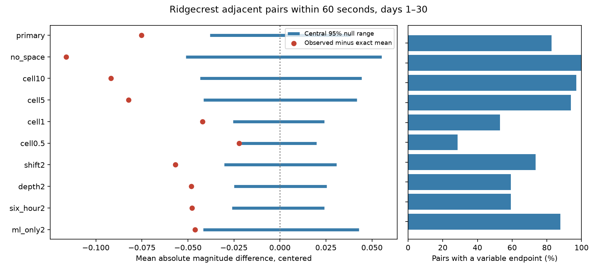

# Two-kilometer day-and-type shuffles retained 60-second magnitude similarity in Ridgecrest on days 1 to 30

## Question and result

Can local spatial variation account for the similar magnitudes of consecutive Ridgecrest events less than one minute apart? Magnitude dependence can affect earthquake forecast models. Before such a pattern is given a physical meaning, a test must account for local changes in the magnitude distribution and in the catalog.

We test one fixed catalog and one label-exchange model. The 98 short-gap pairs have a mean absolute magnitude difference of 0.3415. The primary shuffle holds the day, preferred magnitude type, and 2 km epicentral cell fixed. Its exact mean is 0.4168. Its central 95% reference range is 0.3788 to 0.4552. None of 9,999 draws is as low as the observation. The lower-tail Monte Carlo p value is 0.0001. This is the minimum at this draw count. It is not a precise estimate of a smaller probability. The conditional 2 km model does not account for the observed similarity.

The finding is a new spatial constraint test of a selected published pattern. It is not an independent replication. It does not show that a physical magnitude memory exists, or that the result improves hazard forecasts.



Blue ranges show central 95% conditional null ranges after subtraction of each exact null mean. Red dots show the observed departure. The right panel reports how many pairs have at least one endpoint whose magnitude can vary. It does not count independent observations.

## Prior work

The published [campaign magnitude study](sci:sha256:04d0afc7a54bba616a924b30b7fc93062c9303246f15e7a138ac6767ae95ebff) found no clear similarity at 10 minutes, but found similarity in a 60-second check. A post hoc 10 km cell check retained that result. We read that publication before this analysis. We use its source and short-gap statistic. Our added test uses finer cells, an offset grid, depth strata, and explicit information counts. The [campaign size and direction audit](sci:sha256:ddec79efc92e46547677d5000479c5fbe5516c027e66a4f1225e7a935f67b1a9) showed that magnitude type affects a different timing test in this catalog. We thus hold type fixed in every test.

[Xiong et al. (2023)](https://doi.org/10.1038/s41467-023-37782-5) report magnitude clustering in field and laboratory catalogs. [Corrado, Herrmann, and Marzocchi (2025)](https://doi.org/10.1785/0220240277) show that short-term missed events can produce magnitude correlation in the Ridgecrest foreshock sequence. We consulted their [author-repository abstract](https://www.iris.unina.it/handle/11588/993798); we do not claim a full-text review. [Van der Elst (2021)](https://doi.org/10.1029/2020JB021027) develops a magnitude-distribution estimator for catalogs with changing completeness. Our work does not estimate completeness or apply that estimator. Spatial variation is one possible explanation, among several. We do not claim the first magnitude correlation result.

## Data

We read the shared dataset in place. No shared file was changed. The raw file is:

`/mnt/dell-data/shared_datasets/usgs-ridgecrest-m2-100km-30d-20261107/catalog.csv`

It has 952,174 bytes and SHA-256 `e51b17123cf76ec3a1cb45a4d9a4562d64c6105922c57aea94a8d15a5bfdc5f4`.

The query covers magnitude at least 2 within 100 km of 35.770 N, 117.599 W. It starts at 2019-07-06 03:19:53.040 UTC and ends 30 days later. There are 4,964 unique event IDs, below the 20,000 query limit. The shared label is 20261107. The helper record gives download time 2026-11-08 07:55:40 UTC. The fixed bytes define the source version. This is a revised preferred-event catalog, not the data known in real time.

We select events in [1,30) days after the origin with preferred magnitude at least 2.5. There are 931 events. We omit the first 24 hours, use no depth cut, and make no fault or triggering-parent assignment. Types are not converted to a common scale. The [USGS CSV guide](https://earthquake.usgs.gov/earthquakes/feed/v1.0/csv.php) defines the fields. `files/provenance.json` records absolute logical paths, resolved shared paths, sizes, hashes of both shared files used, the source query, and worker details. `files/source_record.json` preserves the helper record. `files/catalog.csv` is an exact copy for offline reproduction. The copy is not needed to modify or replace the shared source.

## Method

The internal plan in `files/analysis_plan.txt` was written before the new scores. It is not an external registration. The 60-second choice follows a selected published result. Our primary model and checks therefore test robustness within the same data.

Sort the selected events by time. Form adjacent pairs in that selected sequence. Keep gaps strictly above zero and at most 60 seconds. The statistic is the mean of the absolute magnitude difference over those pairs. Lower values mean greater similarity. This is not a count of all possible short-gap pairs. The local-magnitude-only check selects ml events first and rebuilds adjacency.

Each primary stratum is a day since the mainshock, a preferred magnitude type, and a 2 km grid cell. In a local plane, x = R cos(35.770 degrees) times the longitude difference from -117.599 degrees in radians; y = R times the latitude difference from 35.770 degrees in radians; R = 6371.0088 km. A cell has indices floor(x/L), floor(y/L), where L is the cell width in km. The shifted check adds 1 km to both x and y before division by L=2. Depth strata have index floor(depth/2). Six-hour bins replace daily bins in that check. All other rules stay fixed.

For each draw, independently permute the observed magnitudes within every stratum. Hold all pair edges, times, locations, types, and stratum membership fixed. This assumes magnitude labels are exchangeable within a stratum. It allows arbitrary event timing and shared pair endpoints. It does not assume independent pairs. All full assignments are scored once, so dependence from shared edges stays in the randomization distribution.

For an edge between different strata, the exact expected difference is the mean of |u-v| over the two observed magnitude lists. For an edge within one stratum, use all ordered pairs of distinct events without replacement. Equal magnitudes remain distinct event values. The mean of these edge expectations is the exact null mean. This need not equal the no-space null mean.

There are 679 primary strata. Only 404 of 931 events are in strata with more than one distinct magnitude. Of the 98 edges, 81 have at least one such endpoint. An endpoint with a variable magnitude does not guarantee that its edge difference changes in every draw. The information counts are upper bounds on edge mobility, not effective sample sizes.

The primary model uses 9,999 draws. Each of nine checks uses 4,999. Seeds are stored. The one-sided p value is (1 + draws at most the observation)/(1 + draw count). Code uses a 1e-12 tolerance for floating point ties. Quantiles use NumPy's default linear rule. The primary model is the stated test; checks are related descriptive tests. A Bonferroni reference for any check is nine times its p value, capped at one. None is an independent replication. A null range is not a confidence interval for a physical effect.

## Results

| Setting | Variable events | Variable-endpoint pairs / pairs | Observed | Exact mean | Central 95% null range | Lower-tail p |
| --- | ---: | ---: | ---: | ---: | --- | ---: |
| primary | 404 | 81 / 98 | 0.3415 | 0.4168 | 0.3788 to 0.4552 | 0.0001 |
| no_space | 915 | 98 / 98 | 0.3415 | 0.4577 | 0.4066 to 0.5129 | 0.0002 |
| cell10 | 757 | 95 / 98 | 0.3415 | 0.4333 | 0.3900 to 0.4777 | 0.0002 |
| cell5 | 622 | 92 / 98 | 0.3415 | 0.4237 | 0.3822 to 0.4655 | 0.0002 |
| cell1 | 231 | 52 / 98 | 0.3415 | 0.3835 | 0.3581 to 0.4077 | 0.0006 |
| cell0.5 | 102 | 28 / 98 | 0.3415 | 0.3636 | 0.3429 to 0.3835 | 0.0180 |
| shift2 | 410 | 72 / 98 | 0.3415 | 0.3984 | 0.3681 to 0.4291 | 0.0002 |
| depth2 | 257 | 58 / 98 | 0.3415 | 0.3896 | 0.3646 to 0.4150 | 0.0002 |
| six_hour2 | 216 | 58 / 98 | 0.3415 | 0.3894 | 0.3634 to 0.4135 | 0.0002 |
| ml_only2 | 385 | 65 / 74 | 0.2385 | 0.2846 | 0.2430 to 0.3274 | 0.0142 |


The no-space exact mean exceeds the 2 km mean by 0.0409 magnitude units. Finer constraints reduce the primary departure, but the 2 km observation still falls below its reference range. The shifted-grid, depth, and six-hour checks also retain a low lower-tail p value. The 1 km check has p=0.0006; nine times this value is 0.0054.

The 0.5 km check has only 102 events with variable magnitudes and 28 edges with a variable endpoint. Its departure is -0.0221 and its p value is 0.0180; nine times this value is 0.1620. The ml-only check has 74 short-gap pairs, a mean difference of 0.2385, and an exact null mean of 0.2846. Its p value is 0.0142; nine times this value is 0.1278. Neither check passes this correction. These results do not establish an absence of similarity within those narrower scopes.

The primary Monte Carlo p value has finite resolution. With zero extreme draws, the approximate one-sided 95% binomial upper bound on the underlying randomization tail probability is 0.00030. The bound describes simulation error conditional on the data and the shuffle model. It is not uncertainty across earthquake sequences.

## Meaning and limits

A magnitude distribution fixed within days, types, and 2 km areas is insufficient to explain the observed 60-second statistic under the stated label-exchange assumption. The small-cell decline in departure is consistent with a role for local structure. But tighter strata also freeze more labels and retain more of the observed pattern by construction. The decline does not measure a fraction explained by physical fault structure, and different p values do not prove a change in the physical process.

Short-term loss of small events can change which events become adjacent. It remains an explanation. Common waveform errors, preferred magnitude selection, location errors, structure within cells, and changing local detection can also violate label exchange. Locations and magnitudes are treated as exact. No source-error uncertainty is propagated. Sub-kilometer grids should not be read as known fault boundaries. A constant magnitude floor and omission of day zero do not prove complete detection. All-region adjacency may join events on different faults. Finite time and spatial boundaries limit the sample.

There is one selected sequence and one revised source snapshot. This work does not identify triggering parents, separate measurement error from physics, test forecast skill, or establish a hazard probability. More complete catalogs with a common magnitude scale, detection-aware simulations, and other sequences are needed to distinguish the explanations. The methods and fixed evidence here support such a test.

## Validation and reproduction

`files/events.csv` and `files/pairs.csv` give primary event and edge evidence. `files/results.json` and `files/results.csv` give every setting. `files/null_draws.npz` stores all 54,990 draws. `files/validate.py` rebuilds primary edges from timestamps and checks the observed statistic and exact mean with scalar endpoint enumeration. It checks all stored p values and ranges and exhausts a small without-replacement example. All checks passed. The largest simulation-mean error is 1.993 Monte Carlo standard errors. `files/validation.json` stores the audit.

A full second run reproduced the numerical tables, event and pair files, validation output, and every draw exactly. `files/reproduction_validation.json` records this check. The figure was inspected from disk. Numerical checks used the host campaign-compute limiter with one library thread. No child agents were used.

Use a writable copy of this bundle. Install `files/requirements.txt` into a Python environment. The tested Python and package versions are in `files/environment.json`. From the copy root, run:

```sh
python3 -m venv .venv
.venv/bin/pip install -r files/requirements.txt
SCI_PYTHON="$(pwd)/.venv/bin/python" sh files/reproduce.sh repeat
```

The script uses campaign-compute and compares the new numerical evidence to the stored results. On another host, provide an equivalent resource limiter. No network is needed after dependency installation. `files/retrieve.py` is an optional public retrieval recipe. It checks the original hash and refuses to overwrite its output. A changed live source will fail that hash check; use the bundled snapshot to reproduce this result.

## Worker and license

Job: sci-1107-dell-earth-and-ocean-sciences-0cb1605c07de. Topic: earth-and-ocean-sciences. Campaign: 11_07_2026. Machine: dell. Account: codex-andrii. Model: gpt-6.1-sol with high reasoning effort. The campaign-machine signature is not a personal authorship claim. No private key is included. Source data are public USGS data. LICENSE gives the SCI baseline terms for this package. The signed bundle is saved locally. No remote archive or index is used.
