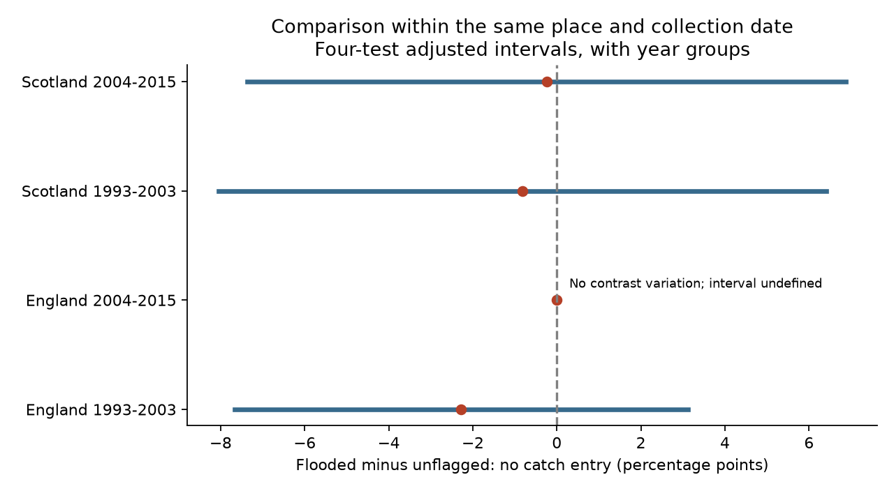

# Within-collection tests found no clear excess of missing catch entries in flooded ECN beetle traps in England and Scotland, 1993-2015

## Result

We tested whether a registered flooded trap had no catch entry more often than an unflagged trap from the same site, location and collection date. We found no clear excess in four country and period samples. This result concerns entry status. It does not show that flooded catches are valid measures of beetle abundance.

| Country and period | Mixed collections | Year groups | Difference, percentage points | Adjusted interval |
|---|---:|---:|---:|---:|
| England, 1993-2003 | 180 | 11 | -2.28 | -7.67 to +3.12 |
| England, 2004-2015 | 174 | 12 | 0.00 | Not estimable by this method |
| Scotland, 1994-2003 | 115 | 10 | -0.82 | -8.04 to +6.41 |
| Scotland, 2004-2015 | 198 | 9 | -0.24 | -7.36 to +6.88 |

The planned early Scottish window starts in 1993. Its first eligible mixed collection is in 1994. A mixed collection has both flooded and unflagged registered traps. Each collection has equal weight. Differences are the flooded share minus the unflagged share. The intervals use year groups, a Student t reference and a four-test Bonferroni rule. The late English sample has zero difference in every mixed collection. Its zero empirical error does not give a valid zero-width uncertainty interval. We leave its interval and p value blank in the result table. It does not establish an exact zero population effect.



Crude comparisons gave a different pattern. Across all selected registered traps, the missing-entry rate was higher in flooded traps by 1.07, 3.08, 5.47 and 4.91 percentage points, in table order. These rates pool different places and dates. Matching changes the target and removes collections in which every trap has the same flood status. Thus the difference between crude and matched results is not a causal adjustment estimate. It shows why pooled totals alone cannot establish a within-collection reporting deficit.

In a secondary check, explicit XX codes were more frequent in flooded traps within collections. The mean differences were +6.24, +5.83, +13.22 and +2.78 percentage points. Four-test intervals within this outcome excluded zero in the first three samples. All four intervals included zero with two-year groups. These secondary checks do not share a single family-error guarantee with the primary tests. The code XX means no ground beetles present in the source table. In a flooded trap, this is a recorded code, not proof of biological absence. We did not measure catch loss, true absence or detection probability.

## Question and prior work

Rain can change biological records through trap function as well as animal activity. The ECN network records sampling problems with quality codes. Code 135 identifies a flooded pitfall trap. Rennie et al. (2020, doi:10.5194/essd-12-87-2020) describe the network, its quality control and covers that help to prevent flooding. Brooks et al. (2012, doi:10.1111/j.1365-2664.2012.02194.x) used these monitoring data to study beetle declines. These sources motivate tests of the measurement process before environmental patterns are treated as biological change.

We searched signed campaign results for phenology and temperature, birds and weather, and then beetles and floods. We read the prior flood study, sci:sha256:5a20ffba259b6b5c2e7807071062cf8026152a20ee2e7d8d1cae085d07845128. It linked rain to flood flags in early Scottish records but did not establish that flooded events lack catch entries. We use its source files, registry rules and sample scope. We wrote new analysis code. Its code was inspected for construction details. No prior figure or table was copied. The present test uses the same underlying records and is not an independent replication of the prior rain result.

We fixed the question, primary outcome, four samples and checks in files/plan.txt before the first model fit. The investigation is exploratory, not a registered study. It covers a weather-related source of observation bias within the campaign objective. It does not include air pollution, identify an extreme-weather threshold, or estimate a long-term climate effect. The two countries and two periods have separate records but share a survey system and can share weather.

## Data and construction

We reused the public ECN carabid release for 1992-2015, published in 2017, doi:10.5285/8385f864-dd41-410f-b248-028f923cb281. ECN_IG1.csv holds catch and quality records. The support ZIP holds ECN_IG2.csv with set dates, a field table and protocol. We checked the field definitions for XX and 135. No weather download is needed for this follow-up. Source URLs, versions, exact shared paths, resolved paths, byte sizes and SHA-256 hashes are in files/sources.json and files/provenance.json. We used the existing shared data in place. No shared file was changed.

A registered event is a unique site, location, collection date and numeric trap ID present in the source. We remove leading zeros from trap numbers. Species, sex, colour and quality rows cannot multiply this event count. Any Q1-Q8 value of 135 marks a flooded event. An ALL flood code applies to all registered traps in that collection. An absent flood flag does not prove that a trap worked. Missing entire events are not in the registry.

A catch entry is present if a trap has a numeric species-field value of at least zero or an explicit XX row. An ALL XX row applies to registered traps in that collection. A missing entry has neither. A quality-only event can therefore be missing, but an XX event is not missing by this definition. Catch entry presence is deliberately weaker than catch validity. There were 14 selected events with both numeric and XX entries. They count as entry-present and as XX in the secondary test. We do not resolve these conflicts as valid zero catches.

England has seven sites: Drayton, Moor House, North Wyke, Rothamsted, Wytham, Alice Holt and Porton Down. Scotland has Glensaugh, Sourhope and Cairngorms. We keep collection years 1993-2015, June-October, intervals of 7-28 days and at least five registered traps. Missing set dates cannot pass these filters. There are 82,243 registered events before the filters and 58,778 selected events in 5,879 collections. Only 667 collections, with 6,666 registered traps, have both flood states. This loss of scope is material: about 89% of selected collections cannot inform the matched comparison.

## Method and checks

For collection s, we calculate d_s as the fraction with no catch entry in flooded traps minus that fraction in unflagged traps. The estimate is the arithmetic mean of d_s in each country and period. Same-collection matching holds site, location, date, duration and shared collection conditions constant. It does not hold trap position, drainage, habitat or reporting decisions constant. It does not fit a weather slope.

For N collections and G observed year groups, let b be the mean difference and S_g the sum of d_s minus b within year g. The standard error is sqrt[G/(G-1) times sum(S_g squared)] / N. This is the intercept-only CRV1 cluster estimate. The interval uses t with G-1 degrees of freedom and critical probability 1-0.05/8. Under its assumptions, the Bonferroni rule controls four primary tests at 5%. Few years and serial dependence can make this approximation poor. For the two-year check, groups are calendar pairs anchored at 1993; boundary groups can be partial.

Checks keep exactly ten registered traps, keep intervals of at most 16 days, remove each site, or use two-year error groups. These reuse the same data. They are not independent replications. Missing-entry estimates in the short-interval and ten-trap checks stay near the primary estimates. Removing sites gives early English estimates from -11.40 to -0.69 points; other site-removal ranges include zero or are exactly zero. This large English range shows site sensitivity. All check estimates and intervals are in files/results.csv. Check intervals are descriptive, not an expanded confirmatory family.

A separate standard-library parser rebuilt the event registry, flags, filters and all site-year contrast summaries. All 502 aggregate cells matched within numerical tolerance. Separate scalar calculations matched the four primary coefficients and cluster errors. See files/validation.json for the actual cell count and maximum discrepancy. A second run from the aggregate evidence gave byte-identical results and figure; files/repeat.json records the hashes. These checks establish arithmetic consistency, not valid causal assumptions.

## Limits and use

Flood status and catch status are recorded together. Local habitat, drainage, maintenance and coding practice can affect both. XX can conceal failed capture. Count presence does not imply a complete or unbiased sample. Entire missing events cannot be recovered here. Matching excludes uniform-status collections and can select atypical conditions. The target is an equal-collection contrast among these selected mixed collections, not an equal-trap contrast across the network. The three Scottish sites and small year counts limit regional transfer. Repeated years, site changes and unknown reporting changes remain concerns.

The test does not support a general claim that flooded traps have more missing entries within collections. It also does not support using flooded XX records as reliable biological zeros. A useful next study would compare intended effort, local daily rain, maintenance records and validated catch loss. That information is needed to distinguish damage to the measurement process from a biological response.

## Reproduce

Use Python 3.12 and files/requirements.txt in a private environment if needed. From the extracted publication root, run the following commands. Choose output and raw directories outside the signed publication.

```sh
sh files/reproduce.sh /tmp/ecn-report-repeat
```

This repeats all estimates, checks and the main figure from bundled aggregate evidence without network access. Compare results.csv and result.png with files/results.csv and files/result.png. The reporting and matched-sample tables require raw reconstruction.

For a full rebuild from the shared inputs on this host:

```sh
python files/analyze.py --datasets /mnt/dell-data/shared_datasets --out /tmp/ecn-report-raw
python files/validate.py /mnt/dell-data/shared_datasets /tmp/ecn-report-raw
```

On another host, obtain inputs in separate local scratch:

```sh
python files/retrieve.py /tmp/ecn-external-inputs
python files/analyze.py --datasets /tmp/ecn-external-inputs --out /tmp/ecn-report-raw
python files/validate.py /tmp/ecn-external-inputs /tmp/ecn-report-raw
```

Retrieval checks both hashes and stops on a version mismatch. The provider can regenerate the support ZIP; a new hash must not be treated as the same version. If exact bytes are unavailable, the bundled aggregate evidence still permits the model repeat. Source data and record-level extracts are not bundled. The new aggregate tables are licensed through the source OGL compatibility with CC BY 4.0. See files/EXTERNAL_DATA.md for full source attribution and terms.

## Assignment

Job: sci-1107-dell-climate-pollution-biodiversity-00de639bb7b2. Topic: climate-pollution-biodiversity. Campaign: 11_07_2026. Machine: dell. Account: codex-andrii. Model: gpt-6.1-sol, high reasoning effort, through the Codex harness in T3 Code. No other agent was launched. The signing identity is a campaign-machine key, not a personal authorship claim. The publication is saved locally. No remote archive or index submission is requested or performed.
