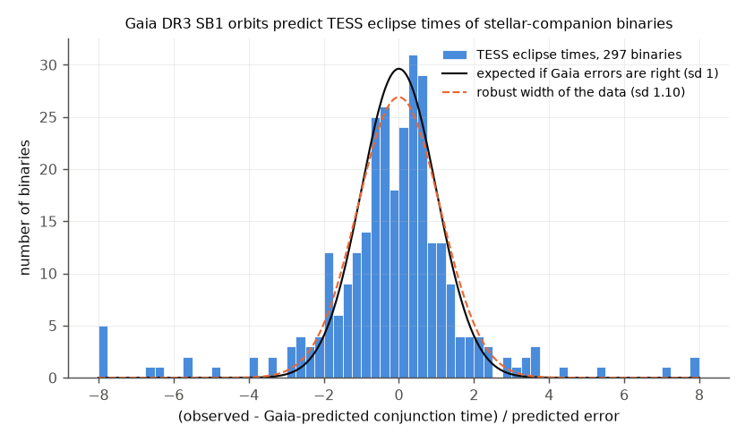
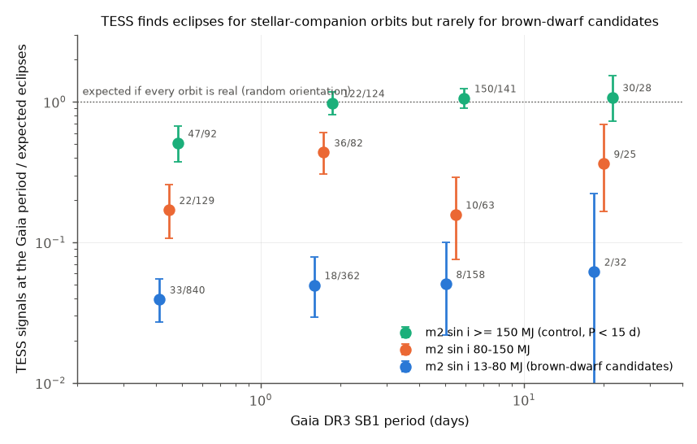
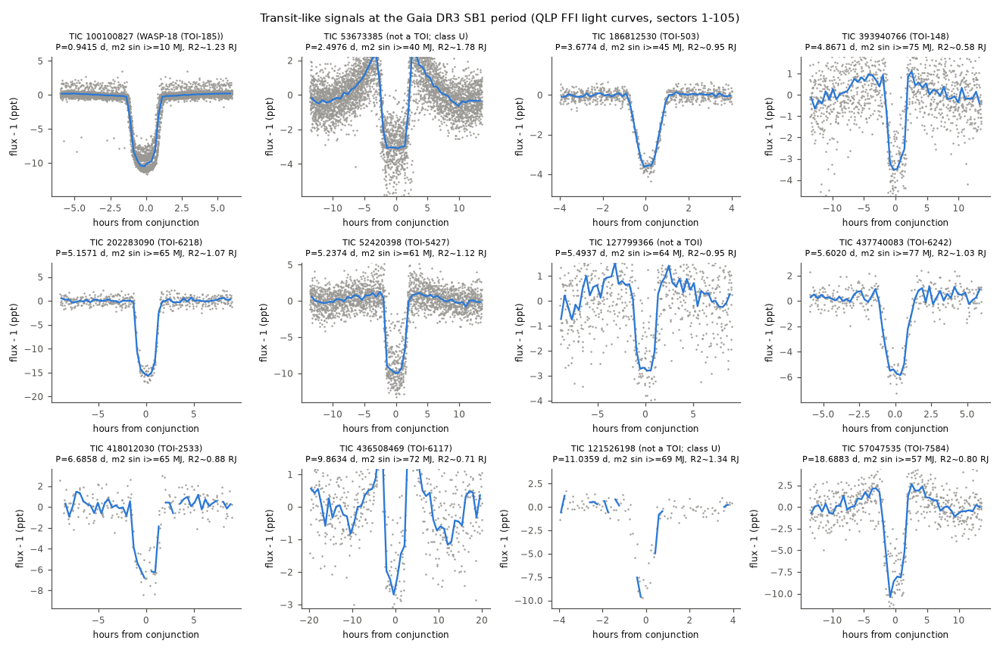

# TESS shows transits for only 8 of about 1,258 expected Gaia DR3 SB1 brown-dwarf candidates (4,164 stars, P < 40 d), and for none below 3 days

**Job:** sci-1107-dell-astronomy-76e0b343fea4 · **Topic:** astronomy · **Machine:** dell · **Model:** Claude Opus 5.5 (`claude-opus-5-5`), account claude-andrii · **Campaign:** 11_07_2026 · **Date:** 2026-11-09.
The signing key is a campaign-machine key. It is not a personal authorship claim.

## Summary

Gaia DR3 gives about 4,250 single-lined spectroscopic (SB1) orbits with P < 40 d and a minimum
companion mass m2 sin i of 13-80 Jupiter masses (MJ). If these orbits are real, about one third of
them must show transits, because the orbits are short and the orientation is random. We folded the
MIT Quick-Look Pipeline (QLP) TESS light curves of all sectors 1-105 at the Gaia period. We
searched near the Gaia-predicted conjunction time. We did the same for planet-mass candidates
(< 13 MJ), for 80-150 MJ candidates, and for a control sample with stellar companions.

Main results:

1. **The Gaia ephemerides are correct for real binaries.** For 297 eclipsing binaries with stellar
   companions, the TESS eclipse occurs at the Gaia-predicted conjunction time. 84% of the binaries
   are within 2 sigma and 92% within 3 sigma. The robust width is 1.10 sigma (figure 1).
2. **Stellar-companion orbits give the expected number of TESS signals.** The ratio of observed to
   expected eclipses is 0.98-1.08 for P > 1 d (figure 2).
3. **Brown-dwarf-mass orbits do not.** For 4,164 brown-dwarf candidates with light curves, we
   expect 1,258 transits (geometry x injection completeness, 1 RJ companion). We find 8
   transit-like signals with no secondary eclipse and a companion radius below 2 RJ. This is
   0.64% of the expected number (95% interval 0.27-1.25%). Some of these companions can be
   very-low-mass stars (see limitations).
4. **The deficit depends on the period.** There are 0 transits among 2,469 candidates with
   P < 3 d, where 1,092 are expected (95% upper limit 0.3-1.2% per period bin). For P = 3-10 d the
   ratio is 5% (2-10%). For P = 10-40 d it is 4% (0.1-20%).
5. **The companion mass also matters.** There are 0 transits for m2 sin i = 13-40 MJ (450
   expected; upper limit 0.8%). The 80-150 MJ group has 0.16-0.44 of the expected TESS signals,
   which is also a deficit.
6. **Contact binaries cause part of the problem.** Twenty-nine brown-dwarf candidates (28 strict, 1 relaxed) with
   P = 0.38-1.29 d show smooth ellipsoidal or contact-binary light curves at the Gaia period, with
   amplitudes up to 1%. Four more show stellar eclipses. In these systems the companion is a star.
   Thus the Gaia RV amplitude is too small, probably because the lines of both stars are blended.
7. **One new transit-like candidate.** We recovered known brown dwarfs (TOI-503 b, TOI-148 b,
   TOI-2533 b), WASP-18 b in the planet-mass sample, and TOIs 6218, 6242, 5427, 7584 and 6117.
   We found one new transit-like signal that is not in the TOI list: **TIC 127799366** (Gaia DR3
   5614466912454799872), with P = 5.4937 d, a depth of 2.5-4.6 ppt, and m2 sin i >= 64 MJ, on a
   7,100 K star. Two other new signals (TIC 53673385 and TIC 121526198) are too deep for a 1 RJ
   companion, so we do not give them the brown-dwarf class.

This work repeats and extends an earlier campaign study,
[sci:sha256:d57ede30…](#citations), which used TESS-SPOC light curves (sectors 1-86, at most three
sectors per star, P < 10 d). We used a different light-curve product, all sectors, periods up to
40 d, and visual vetting. We get the same main result: very few short-period brown-dwarf-mass Gaia
SB1 orbits are real brown-dwarf orbits. We also re-tested 47 of its 121 uncatalogued candidates
(section 6).

## 1. Question

Gaia DR3 orbits of SB1 stars with small K and short P imply brown-dwarf companions in the
"brown-dwarf desert". Few such brown dwarfs are known. Are these Gaia orbits real? A real
companion on an edge-on orbit must transit at the time and period that the Gaia orbit predicts.
TESS covers almost the whole sky, so we can count the transits and compare the count with the
number that geometry requires.

## 2. Data

| Input | Source and version | Use |
|---|---|---|
| Gaia DR3 orbits | ESA Gaia archive TAP, `gaiadr3.nss_two_body_orbit` (SB1, SB1C, AstroSpectroSB1; P < 40 d) joined with `gaia_source` and `binary_masses`; queried 2026-11-09 in five period chunks with row-count checks | 66,233 orbits; 45,740 have `m2_lower` |
| Gaia DR3 FLAME radius | `gaiadr3.astrophysical_parameters` | Primary radius (else R = M^0.8) |
| Gaia DR2 neighbours | `gaiadr3.dr2_neighbourhood` | Second TIC pass |
| TIC identifiers | ExoFOP name resolver `gototicid.php?target=Gaia DR2 <id>&json` (the MAST TIC services timed out on 2026-11-09) | 7,836 of 7,862 stars |
| TESS light curves | MIT QLP FFI HLSP (doi:10.17909/t9-r086-e880), sectors 1-105, `KSPSAP_FLUX`, `QUALITY = 0`; sectors from `tess-point` 0.9.5 | 7,711 stars with data; median 4 sectors |
| TOI table | ExoFOP `download_toi.php`, retrieved 2026-11-09 (SHA-256 in `files/data/provenance.json`) | Catalogue match |
| Earlier study | sci:sha256:d57ede30… `files/results/candidates_not_catalogued.csv` | Section 6 |

We did not keep the raw QLP FITS files. For each star we kept TIME, SAP_FLUX, KSPSAP_FLUX, the
error, QUALITY and the sector in a compressed array file. The package includes these extracts
for all transit-like and eclipse candidates (`files/lc_candidates/`). The URL pattern and the
SHA-256 values are in `files/data/provenance.json`.

### Samples (m2 sin i from `binary_masses.m2_lower`)

| Sample | Rule | Stars with TIC | Searched (with QLP data) |
|---|---|---|---|
| planet | m2 sin i < 13 MJ, P < 40 d | 108 | 106 |
| bd | 13-80 MJ, P < 40 d (all) | 4,243 | 4,164 |
| lowmass | 80-150 MJ, P < 40 d, random 1,500 of 5,515 | 1,495 | 1,476 |
| star (control) | >= 150 MJ, P < 15 d, random 2,000 of 26,297 | 1,990 | 1,965 |

## 3. Method

**Ephemeris** (`ephem.py`). Gaia DR3 uses v = gamma + K[cos(nu + omega) + e cos omega], where omega
belongs to the primary. The companion is in front of the primary when nu + omega = 90 deg, and
behind it when nu + omega = 270 deg. For SB1C orbits we set e = 0 and omega = 0. We drew 4,000
samples of (P, t_periastron, e, omega) from the Gaia covariance (`corr_vec`). Then we propagated
the conjunction time to the median TESS epoch. The median 1-sigma error is 0.19 d for the
calibration binaries and 0.16 P for the brown-dwarf candidates. For 47% of the brown-dwarf
candidates, 3 sigma is more than P/2. Thus for these stars the phase is not constrained, and the
test uses only the period.

**Search** (`search.py`, `06_run_search.py`). Per sector, we normalized the flux and binned it
to 20 min. We removed high outliers and isolated low points (< -6 sigma with normal
neighbours). We folded the flux on a period grid inside +-3 sigma_P (phase drift < Dmin/2 over the
baseline). We computed box S/N for eight durations (1-16 h, at most 0.15 P). We recorded:

* the best box inside +-max(3 sigma_T, D) of the predicted conjunction;
* the best box at any phase;
* the best box at three control periods (P x 2^-0.5, 2^0.25, 2^0.75) with the same relative
  window;
* the per-event S/N;
* two injected 1 RJ transits (b uniform in 0-0.9, ephemeris drawn from the Gaia posterior,
  trapezoid shape) with the same search.

**Detection rule** (`10_candidates.py`). A detection must have all of these properties:

* box S/N >= 10;
* S/N >= 2 x the best control-period S/N;
* at least two individual events with S/N > 3.

A *relaxed* tier uses a ratio of 1.5-2 (sensitivity check). Completeness is the fraction of
injections that pass the same rule (mean 0.95 for the brown-dwarf sample).

**Vetting** (`08_vet_plots.py`, `09_vet_metrics.py`, `files/vetting/`). We inspected all 62
strict and 8 relaxed detections in the brown-dwarf and planet samples. We gave each one class
(`files/data/labels_by_tic.txt`):

| Class | Meaning |
|---|---|
| T | transit-like, flat out of transit, no secondary, R2 < 2 RJ |
| U | transit-like, but the depth or duration does not agree with a 1 RJ companion |
| E | eclipse of a stellar companion |
| A | eclipses at another period |
| V | ellipsoidal, spot or pulsation modulation at P or P/2, >= 1 ppt |
| W | weak modulation |
| N | noise or systematics |

For the stellar samples we used an automatic shape rule (`14_calibration.py`). A detection is
eclipse-like if, in the folded 100-bin curve, fewer than 15% of the bins are fainter than half
the depth. This rule agreed with every T, E and V visual label.

**Expected number** (`12_purity.py`). The transit probability is
p = (R1 + R2)/a x (1 + e sin omega)/(1 - e^2), with R2 = 1 RJ for brown dwarfs and planets, and
R2 = (m2 sin i)^0.9 Rsun for the stellar samples. For the stellar samples we used the eclipse
probability at either conjunction. The expected count is the sum over the stars of
p x completeness.

The fraction "observed/expected" gives the fraction of the stars whose Gaia orbit is real *and*
whose companion has a mass below about 80 MJ, if the orientations are random (kappa = 1). Two
mass priors for true brown dwarfs (log-flat or flat in m between m2 sin i and 80 MJ) increase the
expected number by a factor of 1.5-1.6 and make the fraction smaller (`frac_logflat`,
`frac_flat`). Our headline values use kappa = 1, which is conservative.

## 4. Results

**4.1 The Gaia SB1 ephemerides predict real eclipses.** We used eclipse-like detections in the
stellar samples with S/N >= 20 and a window narrower than P/2 (297 binaries). For these binaries,
z = (observed - predicted conjunction)/sigma has a median of -0.03 and a robust standard deviation
of 1.10. 61% of the binaries have |z| < 1, 84% have |z| < 2, and 92% have |z| < 3. About 10 of the
25 outliers with |z| > 3 are at a phase offset of +-0.5. In these binaries the search found the
deeper eclipse at the other conjunction. Thus the propagated Gaia errors are only about 10% too
small, and the sign convention in section 3 is correct.

**4.2 Observed versus expected TESS signals** (any signal at the Gaia period, all shapes;
`files/data/obs_exp_by_period.csv`):

| Period (d) | star: obs/exp | lowmass (80-150 MJ) | bd (13-80 MJ), any signal | bd, transit-like (T) |
|---|---|---|---|---|
| 0.2-1 | 47/92 = 0.51 | 22/129 = 0.17 | 33/840 = 0.039 | 0 |
| 1-3 | 122/124 = 0.98 | 36/82 = 0.44 | 18/362 = 0.050 | 0 |
| 3-10 | 150/141 = 1.06 | 10/63 = 0.16 | 8/158 = 0.051 | 7 |
| 10-40 | 30/28 = 1.08 | 9/25 = 0.36 | 2/32 = 0.062 | 1 |

In the brown-dwarf sample, most "any signal" detections below 3 d are contact or ellipsoidal
binaries (class V), not transits.

**4.3 Fraction of brown-dwarf candidates with a transit** (strict tier, class T; Garwood 95%
intervals; `files/data/purity_table_strict_T.csv`):

| Group | n | T observed | expected | observed/expected (95% interval) |
|---|---|---|---|---|
| all | 4,164 | 8 | 1,258 | 0.0064 (0.0027-0.0125) |
| P 0.2-1 d | 1,199 | 0 | 773 | 0 (< 0.0048) |
| P 1-3 d | 1,270 | 0 | 320 | 0 (< 0.0115) |
| P 3-10 d | 1,121 | 7 | 138 | 0.051 (0.020-0.104) |
| P 10-40 d | 574 | 1 | 28 | 0.036 (0.001-0.20) |
| m2 sin i 13-40 MJ | 1,225 | 0 | 450 | 0 (< 0.0082) |
| m2 sin i 40-60 MJ | 1,440 | 2 | 442 | 0.0045 (0.0005-0.016) |
| m2 sin i 60-80 MJ | 1,499 | 6 | 367 | 0.016 (0.006-0.036) |
| Gaia significance < 10 | 2,902 | 5 | 918 | 0.0054 |
| significance 10-20 | 1,113 | 3 | 310 | 0.0097 |
| significance >= 20 | 149 | 0 | 30 | 0 (< 0.12) |
| planet sample (< 13 MJ) | 106 | 1 (WASP-18 b) | 38 | 0.026 (0.001-0.15) |

With the relaxed tier and the U class added (11 signals), the all-sample value is 0.0087
(0.0044-0.0156). With the mass-prior factors it is 0.0039-0.0043. Thus our estimate is that
**0.4-0.9% of the Gaia DR3 SB1 orbits with m2 sin i = 13-80 MJ and P < 40 d are real orbits of
companions below about 80 MJ**. This value is below 1.6% in every variant. At P < 3 d no orbit
passes the test.

**4.4 What the brown-dwarf candidates are.** Of the 62 strict detections in the brown-dwarf and
planet samples:

| Class | Count | Notes |
|---|---|---|
| V | 28 | All have P = 0.38-1.29 d. Most show two minima per Gaia period, at the conjunctions (ellipsoidal or W UMa type). Amplitude 0.5-10 ppt. |
| T | 9 | 8 brown-dwarf candidates and WASP-18 b |
| E | 4 | |
| W | 10 | |
| N | 9 | |
| U | 1 | |
| A | 1 | |

Minimum light at the conjunction shows that the Gaia period is the orbital period. A 1%
ellipsoidal amplitude needs a stellar-mass companion. Thus these Gaia K values are too small,
probably because Gaia saw the blended lines of both stars as one SB1. The other about 4,100
candidates show no signal. In those systems the orbit is spurious, or a stellar companion is on a
low-inclination orbit; this test cannot separate the two causes.

**4.5 Transit-like signals at the Gaia period:**

| TIC | Name | P (d) | depth (ppt) | R2 (RJ) | m2 sin i (MJ) | z | note |
|---|---|---|---|---|---|---|---|
| 186812530 | TOI-503 b | 3.6774 | 3.2 | 0.95 | 45 | -0.8 | confirmed brown dwarf |
| 393940766 | TOI-148 b | 4.8671 | 3.0 | 0.58 | 75 | 0.5 | confirmed brown dwarf |
| 202283090 | TOI-6218.01 | 5.1571 | 13.3 | 1.07 | 65 | 2.0 | PC |
| 52420398 | TOI-5427.01 | 5.2374 | 8.8 | 1.12 | 61 | 2.0 | very-low-mass star (Schmidt et al. 2023) |
| **127799366** | **not a TOI** | **5.4937** | **2.5 (SAP 4.6)** | **0.95** | **64** | **-0.1** | **new; 18 events in sectors 7, 34, 61, 88; T0 = 2971.4062 BTJD; 2.2 h, high impact parameter** |
| 437740083 | TOI-6242.01 | 5.6020 | 5.0 | 1.03 | 77 | -1.6 | TFOPWG disposition FP |
| 418012030 | TOI-2533 b | 6.6858 | 6.1 | 0.88 | 65 | -1.5 | confirmed brown dwarf |
| 57047535 | TOI-7584.01 | 18.6883 | 7.3 | 0.80 | 57 | 0.6 | PC |
| 436508469 | TOI-6117.01 | 9.8634 | 1.9 | 0.71 | 72 | -0.3 | relaxed tier |
| 100100827 | WASP-18 b | 0.9415 | 9.3 | 1.23 | 10 | -0.8 | planet sample |
| 53673385 | not a TOI (class U) | 2.4976 | 3.7 (SAP 7) | 1.8-2.5 | 40 | 0.9 | depth changes between sectors; RUWE 2.4 |
| 121526198 | not a TOI (class U) | 11.0359 | 6.8 | >1.3 | 69 | -0.8 | 1 h duration against 6.6 h central; RUWE 2.5 |

For **TIC 127799366** the Gaia orbit gives K = 6.4 km/s and e = 0.09. Gaia also gives
R1 = 1.88 Rsun, M1 = 1.53 Msun and G = 11.4. The dips occur at the predicted conjunction
(z = -0.1). ExoFOP lists no TOI, CTOI, imaging or spectroscopy for it (2026-11-09). The earlier
SPOC-based study had this star in its sample but did not detect the dips. The transit and the
Gaia orbit together give m2 of about 64 MJ and R2 of about 1 RJ. This is a brown-dwarf candidate
that needs RV confirmation.

Three known transiting companions have Gaia SB1 orbits with the wrong period:

* TOI-2543 b: Gaia gives 0.792 d, TESS gives 7.543 d.
* TOI-2490 b: Gaia gives 4.44 d. TESS shows a single transit, and the published period is about
  60 d.
* TOI-6151.01: Gaia gives 2.342 d, TESS gives 1.435 d.

A search at the Gaia period cannot find these systems. In our count they are not real Gaia
orbits.

## 5. Statistical check of the method

* **Injections.** The mean completeness is 0.95 in the brown-dwarf sample (`comp`). Thus the
  deficit is not a sensitivity effect.
* **Control sample.** The stellar-companion control with the same pipeline gives ratios near 1
  for P > 1 d. Thus the expected-count model is not biased by a large factor.
* **Ratio limit.** TOI-6117.01 failed the strict ratio criterion (S/N 18 against a control
  value of 12). Thus a few real transits on noisy stars are lost. The injection completeness
  includes this effect statistically.

## 6. Re-test of the candidates of the earlier SPOC study

The earlier study (sci:sha256:d57ede30…) lists 121 uncatalogued transit-consistent candidates.
Forty-seven of them are in our searched set (`files/data/prior_d57_candidates_crosscheck.csv`):

| Their tier | Our result: eclipse-like at the Gaia period | sinusoidal (duty >= 0.15) | no detection |
|---|---|---|---|
| tier 1 (11) | 5 | 2 | 4 |
| tier 2 (36) | 6 | 8 | 22 |

Twenty-three of the 47 are in our brown-dwarf sample (13-80 MJ). We classified none of them as T.
Visual classes include V for TIC 153941073, 31945753, 287167463 and 380658566, W for
TIC 144571414 and N for TIC 157319257. The QLP data cover more sectors, so the light-curve shape
is clearer. Many tier-2 signals and some tier-1 signals do not repeat in QLP. Our search uses a
stricter S/N rule, so a non-detection is not proof that the signal is false.

## 7. Limitations

* **Visual vetting.** One analyst did the visual classification once. There are no independent
  labels. The T count (8) could change by +-2 with other decisions. The U, relaxed and mass-prior
  variants show the range (0.4-0.9%).
* **Depths.** The QLP KSPSAP detrending reduces some transit depths and makes shoulders near
  deep transits (raw SAP depths are 1.5-2 times larger for some stars). We did not correct for
  dilution. R2 values are approximate.
* **Brown dwarf or star.** A transit gives m2 of about m2 sin i only if the Gaia K is correct.
  TOI-5427.01 is reported as a very-low-mass star. Thus "T" means BD-compatible. It does not
  mean confirmed.
* **Causes.** The test does not separate spurious Gaia orbits from real orbits with inclined
  stellar companions. Both cause missing transits.
* **Expected count.** It uses a box or trapezoid transit without limb darkening, R2 = 1 RJ, Gaia
  FLAME radii (or M^0.8), and a random orientation. Grazing transits are less complete. Lower
  completeness would raise the fraction, but the large deficit at P < 3 d (0 against 1,092) does
  not depend on these details.
* **Samples.** About 32% of the Gaia orbits have no `binary_masses` entry, mostly evolved or
  hot stars. These orbits are not in the samples. 125 targets had no QLP data. The lowmass and
  star samples are random subsets.
* **TIC matching.** ExoFOP resolution failed for 26 of 7,862 stars. Fifteen stars map to more
  than one TIC, and we used the first one.
* **Earlier study.** Section 6 compares two different searches and light-curve products.
  Differences can come from the S/N rules, not only from the data.

## 8. Reproduction

* `files/code/run_all.sh` lists the full chain in order. It needs network access to ESA Gaia
  TAP, ExoFOP and MAST, and `tess-point` 0.9.5. The QLP download (7,836 stars, 3.2 GB of
  extracts) took about 1 h with 56 parallel connections. The search took about 1.5 h on 14
  processes on a loaded host.
* Offline: `files/data/search_raw.jsonl.gz` is the full per-target search output.
  `files/data/search_summary.csv.gz` is the flat table, with labels and expected-count columns.
  You can recompute every table in section 4 from these files, `targets_gaia_tic.csv.gz` and
  `labels_by_tic.txt` with `07_analyze.py`, `10_candidates.py`, `11_labels.py`, `12_purity.py`,
  `14_calibration.py` and `15_figures.py`. Put `search_all.jsonl` in `results/` and
  `targets.csv` in `gaia/`.
* `files/vetting/` contains the 70 vetting plots, one per detection, named by Gaia DR3
  source_id.
* Software: Python 3.12, numpy 2.5.4, scipy 1.18.1, pandas 3.1.1, astropy 8.0.2, matplotlib
  3.11.2, tess-point 0.9.5.post1, SCI 0.1.0.

## Files

* `files/code/`: all scripts.
* `files/data/`:
  * `targets_gaia_tic.csv.gz`: Gaia orbit, mass, FLAME and TIC for 7,836 stars, with `corr_vec`.
  * `search_summary.csv.gz` and `search_raw.jsonl.gz`.
  * `labels_by_tic.txt`.
  * Candidate vetting tables.
  * Purity and observed/expected tables.
  * `calibration.csv`.
  * The TIC resolution files.
  * The ExoFOP TOI snapshot.
  * The cross-check with the earlier study.
  * `provenance.json`.
* `files/lc_candidates/`: QLP extracts for the T, U and E stars.
* `files/fig/`: figures 1-4.
* `files/vetting/`: vetting plots.

## Citations

* sci:sha256:d57ede30e514369ac650d3ec09f73996d2292c6037da34fe5cc0254e2ea71fda: earlier campaign
  study (TESS-SPOC, P < 10 d). We repeat and extend its main result, and re-test its candidates.
* sci:sha256:6350aef7…: campaign study of Gaia astrometric orbits at TESS conjunctions (same
  conjunction approach).
* Gaia DR3: Gaia Collaboration, Vallenari et al. 2023 (doi:10.1051/0004-6361/202243940); Gaia
  multiplicity (arXiv:2206.05595).
* QLP HLSP: doi:10.17909/t9-r086-e880.
* Schmidt et al. 2023 (arXiv:2310.07936): Gaia SB1 with TOI cross-match (TOI-2533, TOI-5427,
  TOI-1712).
* The ExoFOP TOI table and tess-point are listed in sci.json.
