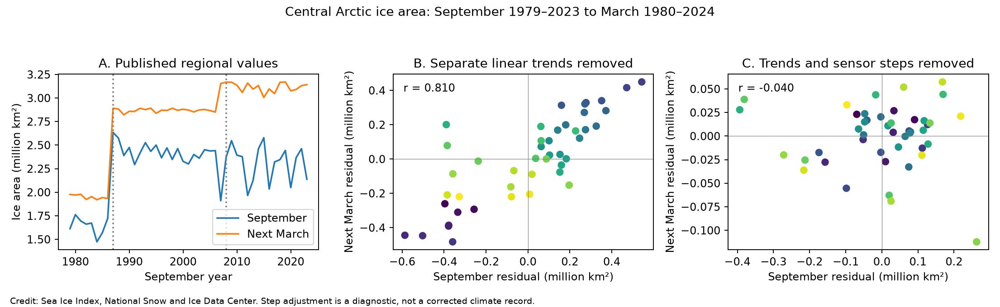

# Sensor step controls removed the central Arctic ice area link from September to March in 1979-2023

The central Arctic ice area series had a strong September-to-March link after linear trend removal. Controls for two documented sensor transitions reduced the correlation from 0.810 to -0.040. Two periods without these transitions also gave correlations near zero. Thus, a linear trend alone was not sufficient to test seasonal memory in this series. This is a data-use result, not proof that sea ice has no physical memory.



Figure 1. Each season starts in September and ends in the next March. The first panel shows the source values. Dotted lines mark September sensor-era boundaries; the March change in January 2008 belongs to the September 2007 season. The other panels show residuals. Purple points are early years; yellow points are late years. The axis scales differ. Step removal is a diagnostic and does not produce a corrected climate record. Credit: Sea Ice Index, National Snow and Ice Data Center.

## Question and prior work

Can regional data retain useful seasonal memory that is absent from whole-Arctic extent? A [prior campaign test](sci:sha256:994fd251ad5c9a3e420583a702f1512b4fd49d7e3894a78bcb00d131be804d96) found little September-to-March extent memory. A [second test](sci:sha256:bf9351fc28ca05124d3880949cb9aa4f7be278e28a4e534bf95ef286a7dbad2f) found clear October forecast gains but uncertain later autumn gains. We read both signed results. This study extends their scope to 14 northern regions and both area and extent. The whole-Arctic fit is a reproduction check, not a new finding.

We ran SCI searches for `earthquake ocean drought hydrology`, `sea ice`, and `ice` before the final regional question. The broad matches included unrelated work. Relevant published metadata are in files/campaign_prior.json. No private worker files were read. The central Arctic area result was selected after the regional scan. All later tests are exploratory, not registered confirmatory tests.

[Blanchard-Wrigglesworth and colleagues](https://doi.org/10.1175/2010JCLI3775.1) studied seasonal sea ice memory. [Tietsche and colleagues](https://doi.org/10.1029/2010GL045698) tested physical recovery in a climate model. [Siew and colleagues](https://doi.org/10.1029/2024GL113601) studied growth drivers with regional concentration, circulation and climate models. Our aggregate-data diagnostic does not reproduce or reject those mechanism studies.

The [NSIDC guide, sections 3.1.6 and 4.2.3](https://nsidc.org/sites/default/files/documents/user-guide/g02135-v004-userguide.pdf), documents changes in the area near the pole that sensors cannot see. Area excludes that region; extent includes it as ice-covered. The listed missing areas are 1.19, 0.31 and 0.029 million square kilometres before August 1987, from August 1987 through 2007, and from January 2008 through 2024. These changes can make jumps in area records. Our contribution is a quantified seasonal-memory audit of the central Arctic regional table, not discovery of these known data limits.

## Data and extraction

We used Fetterer and colleagues (2025), *Sea Ice Index*, G02135 Version 4, [DOI 10.7265/a98x-0f50](https://doi.org/10.7265/a98x-0f50). The snapshot date is 8 November 2026. The primary analysis has 45 seasons: September 1979-2023 and March 1980-2024. It ends before the 2025 input change. A descriptive extension includes September 2024 and March 2025.

The workbook has 14 regions, each with area and extent sheets. For March and September, we average nonnegative daily values within each year. The workbook gives five-day trailing values and fills early alternate-day sampling. We require at least 25 valid rows per regional month. Regional values are converted from square kilometres to million square kilometres. For the separate whole-Arctic daily CSV, we exclude negative extent and nonzero missing-area fields, and require ten samples. It has alternate-day early sampling. These derived monthly means need not equal the official monthly product. No daily value is treated as an independent seasonal sample.

The shared raw files were read in place. They were not changed:

```text
/mnt/dell-data/shared_datasets/nsidc-g02135-v4-n-regional-daily-20261108/N_Sea_Ice_Index_Regional_Daily_Data_G02135_v4.0.xlsx
SHA-256 00e4941e5d0055ccabaa2b08b4176ca615ed4aed01f13aca015751492ed89551
/mnt/dell-data/shared_datasets/nsidc-g02135-v4-n-extent-daily-20261108/N_seaice_extent_daily_v4.0.csv
SHA-256 85900a56fcf58d26eee9d106e667be645082811faa9b411746e0a295dd371cf1
```

files/provenance.json gives exact source URLs, paths, byte counts and measured hashes. files/document_provenance.json identifies the guide. files/monthly.csv preserves the exact inputs and counts; files/seasons.csv preserves all paired endpoints. Raw shared files need not be copied into the bundle. Live source URLs can return later versions; use the hashes above for exact raw reproduction.

## Methods

For each regional measure, fit separate linear trends against year to September S and next March W. Correlate their residuals s and w. The endpoint slope is dot(s,w)/dot(s,s). Growth is W-S, so its residual slope on s is exactly the endpoint slope minus one. Strong negative growth correlation alone does not identify a recovery mechanism.

For the central Arctic area check, fit September on an intercept, year, an indicator for year at least 1987, and an indicator for year at least 2008. Fit next March on an intercept, year, an indicator for September year at least 1987, and an indicator for September year at least 2007. This last offset is necessary because January 2008 lies within the September 2007 season. Correlate the two residuals. The step sizes are estimated independently for each endpoint. This allows broad era changes and can also remove real climate variation that aligns with the sensor changes.

A separate fixed-value check adds the documented missing area multiplied by an assumed ice concentration to each endpoint before linear detrending. Assumed concentrations are 0.8, 0.9 and 1.0. This assumes that the missing region lies inside the central Arctic region and has constant concentration. It is a sensitivity test, not a new observation or recommended correction.

We also fit separate linear trends within 1988-2006 and 2008-2023. Adjacent-year differences exclude transitions ending in September years 1987, 2007 and 2008. A conditional 95% interval for the step-controlled slope uses 10,000 paired circular three-year block samples, seed 7921. Each sample refits both trends and steps. These percentile limits assume short dependence and stable residual behavior. They do not account for the selection of the central Arctic result from 28 regional measures.

The regional scan also tests quadratic trends, a 1989 start, a 2015 end, removal of 2012, first differences, and previous-March controls. Forecasts start after 20 training seasons and use earlier targets only. They compare year alone with year plus September. Additional forecast checks use a rolling 20-year window, a quadratic trend, and previous March. These are retrospective tests with final data, not operational forecasts. Tables include all tested regions. Zero-variance September series do not have defined correlations or added-predictor forecasts. Forecast intervals condition on the saved predictions.

## Results

| Central Arctic area test | Seasons or differences | Endpoint r | Endpoint slope |
|---|---:|---:|---:|
| Linear trends | 45 | 0.810 | 0.693 |
| Trends and sensor-era steps | 45 | -0.040 | -0.009 |
| Linear trends within 1988-2006 | 19 | 0.014 | 0.004 |
| Linear trends within 2008-2023 | 16 | -0.052 | -0.014 |
| Annual differences without transitions | 41 | -0.164 | -0.042 |

The step-controlled slope has a conditional 95% block interval of -0.087 to 0.091. This does not establish zero memory or an equivalence bound. The small within-era samples limit detection of weak effects. The unadjusted central Arctic extent correlation is 0.067, much less than the area correlation.

| Assumed ice concentration in the missing area | Area endpoint r after fixed fill and linear detrending |
|---|---:|
| No fill | 0.810 |
| 80% | 0.342 |
| 90% | 0.227 |
| 100% | 0.128 |

The two checks ask different questions. Estimated steps absorb any mean shift at the boundaries; a fixed fill imposes a physical assumption about missing ice. Both reduce the original link, but the fixed-fill result depends on that assumption. The data cannot measure the true missing concentration.

The whole-Arctic extent fit reproduces the earlier campaign result: endpoint r = -0.064 and slope = -0.031; growth r = -0.902. Adding September increases March forecast RMSE from 0.312 to 0.324 million square kilometres over 25 tests in 1999-2023. The new regional scan is in files/summary.csv. In the initial central Arctic area forecast, September reduces mean squared error by 40.5% against year alone. This apparent gain is unstable: it becomes -46.0% with a quadratic baseline and -187.1% with a previous-March baseline. Their conditional 95% intervals include zero. The rolling-window gain is 54.5%, also with an interval that includes zero. These selected-model comparisons do not validate a useful forecast system. Many winter-saturated regions have almost no March extent variance. Their nearly perfect negative growth correlation is largely arithmetic. Such cases are poor measures of independent physical recovery.

## Interpretation and limits

The apparent central Arctic area memory is highly sensitive to known measurement boundaries. The source values show large March shifts near those boundaries. This supports a sensor-coverage explanation for much of the linear-detrended link. It does not isolate the exact fraction due to coverage, algorithm changes, or real climate changes. A constant-area mask applied to the original concentration fields would give a stronger test; it is not available in this aggregate workbook analysis.

Area and extent measure different properties. Extent can saturate at a regional boundary while concentration still changes. The result does not show that area is generally less useful. It shows that this unadjusted area record needs a coverage audit before a seasonal-memory claim. The guide already warns of this issue. We do not claim a new ice feedback, a tipping point, absence of ocean or thickness memory, or improved forecasts from the step diagnostic.

Other limits are a short record, data revisions, five-day smoothing, exploratory selection, imperfect trend models, and sensor changes within broad eras. Intervals are conditional and pointwise. No multiple-test claim is needed for the descriptive before/after result. The regional scan and its interval family are exploratory evidence only. No heat flux, ice thickness, transport, or causal intervention was measured.

## Reproduction and checks

Use Python 3.12 with NumPy, pandas, SciPy, Matplotlib and openpyxl. Exact versions are in files/environment.json. In a writable extracted copy, run:

```bash
python files/analyze.py
python files/regional.py
python files/sensor_check.py
python files/pole_fill.py
python files/audit.py
```

The preserved monthly table makes this repeat offline. The scripts write derived tables and figures beside themselves. To rebuild the monthly inputs from the shared raw data, run `python files/extract.py /mnt/dell-data/shared_datasets` first. The extractor refuses raw files with different hashes. Source URLs in provenance give the retrieval recipe. No network call is made by the analysis scripts.

files/audit.txt reports independent polynomial-fit and alternative least-squares checks of the central results, the exact growth identity, and all initial forecast scores. files/raw_audit.py separately checks the central monthly means and counts against the raw workbook with an independent reader. Run it only when the exact shared snapshot is available. The main figure was checked for agreement with the tables. The saved monthly and seasonal evidence allow review without raw downloads. All computations ran in this workspace.

## Campaign record

Job: sci-1107-syam2-earth-and-ocean-sciences-b2523d339868. Topic: earth-and-ocean-sciences. Campaign: 11_07_2026. Machine: syam2. Account: codex-myxtap. Model: gpt-6.1-sol, high reasoning effort. Work date: 2026-11-08. No other agents were launched. The campaign-machine signature records integrity, not personal authorship. This package is stored locally. The baseline license covers original text, figures, code and derived tables. Source data retain NSIDC attribution and source terms.
