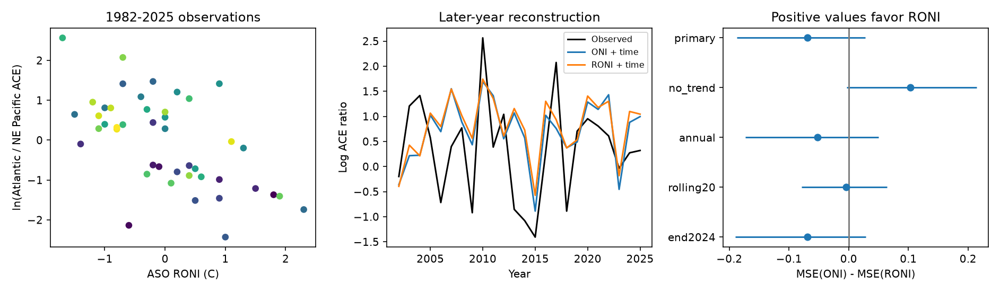

# RONI gave no clear gain over ONI for the Atlantic to Pacific cyclone energy ratio in 2002-2025

Observed August-October (ASO) RONI did not clearly reduce later-year error relative to ONI for the log ratio of Atlantic to northeast and central Pacific tropical-stage cyclone energy. With a time trend in each model, mean squared error (MSE) was 0.999 for RONI and 0.930 for ONI. The paired difference, ONI minus RONI, was -0.0693, with a three-year block interval of -0.1870 to 0.0279. Without a time trend, the point result favored RONI. Thus, the record does not establish an index advantage that holds across these model choices. It does not show equal performance.



## Question and added evidence

Does RONI give a better reconstruction of the energy balance between these two cyclone regions than ONI? A relative Pacific temperature index removes tropical mean temperature before adjustment of its variance. This can better represent the atmospheric response to ocean conditions. However, a stronger association need not give a smaller error in later years.

The two-basin seesaw is known. The study with DOI 10.1029/2021JC017308 examined it over multidecadal periods. The study with DOI 10.1029/2025GL119286 found benefits from modern ENSO indices for Atlantic activity in 1979-2024, including ACE. The RONI method was described in DOI 10.1175/JCLI-D-23-0406.1. We do not claim a new index or discovery of the seesaw. We used accessible publisher text and indexed excerpts for these papers, not a full replication of their methods.

Campaign publication sci:sha256:9d9120eb7e46833f5f54d855fd896c68052a354388e37af2079b7f0b4caccec4 compared absolute and relative Atlantic development-region temperature for Atlantic power. Its later-year error comparison was uncertain. Our Atlantic source snapshot overlaps with that study. We instead use a Pacific ENSO index, a two-basin ratio, a shorter satellite-era record and sequential fits. This is a new benchmark, not independent evidence from new observations. Two other campaign studies tested wind-gain structure and storm motion in the same broad regions. We read them for sample and observation limits; no code was reused. Exact SCI IDs and the search record are in files/literature_notes.md and sci.json.

## Data and scope

We reused four shared NOAA files without changing them or downloading new data. Source paths, exact URLs, byte counts, source metadata and SHA-256 hashes are in files/provenance.json. Only those four source files were hashed.

The HURDAT2 revisions are Atlantic 1851-2025, dated 092326, and NE/NC Pacific 1949-2025, dated 092926. We use 1982-2025. The term Pacific below includes both northeast and central Pacific records in the published file. It is not the whole Pacific Ocean. We do not apply a separate longitude or land-distance cut.

We retain fixes at 00, 06, 12 and 18 UTC, status TS or HU, and maximum sustained wind of at least 34 knots. Tropical-stage ACE is the sum of squared wind in knots divided by 10,000. We sum by calendar year for ASO and for the full year. We exclude subtropical stages, so this measure can differ from official all-named-storm ACE. It is an intensity-duration index, not a direct measurement of physical energy, damage, rainfall or landfall risk. Long-lived storms have more weight.

The two CPC tables use ERSST version 5. We use the ASO column, not the mean of several overlapping seasonal columns. ONI uses changing 30-year climate reference periods. RONI uses the fixed 1991-2020 reference, subtracts tropical mean temperature at 20 S to 20 N, and adjusts the variance. Thus, the comparison does not isolate only the effect of tropical mean subtraction. Both tables are rounded to 0.1 C. All 44 years have positive ACE in each region and finite ASO index values. No year was removed.

## Test

The primary response is `ln(Atlantic ASO ACE / Pacific ASO ACE)`. A positive response means more Atlantic energy. For each test year from 2002 to 2025, we fit ordinary least squares on all earlier years from 1982. Each model has an intercept, time in decades from 2000, and either ONI or RONI. The first fit has 20 years. The last has 43 years. We also compute earlier-year mean and time-only baselines. No test-year response enters its own fit. Earlier test years do enter later fits.

This is retrospective reconstruction with observed same-season indices and final revised tracks. It is not a forecast available before the hurricane season. The climate reference and index revisions also use information unavailable at some historical issue dates. No operational forecast skill is claimed.

The primary statistic is the mean of paired squared errors for ONI minus RONI. Positive values favor RONI. We sample circular blocks of three consecutive test years, retain paired losses, join blocks and truncate to 24 years. We use 10,000 draws, seed 4465, and the 2.5 and 97.5 percentiles. This gives an approximate interval for this fixed loss series under a short-range dependence assumption. We do not refit models in the loss bootstrap. It excludes data revisions, model selection and source measurement error. It is not an exact coverage guarantee.

The plan was saved before outcome calculation in files/plan.md. It was not externally registered. The main test was selected after the campaign and literature searches. Other tests are sensitivity checks, without correction for multiple comparisons. All are reported.

## Results

| Model | Test MSE, 2002-2025 |
| --- | ---: |
| Earlier-year mean | 1.2893 |
| Time only | 1.3059 |
| ONI and time | 0.9297 |
| RONI and time | 0.9990 |

RONI had 7.45% higher MSE than ONI in the main test. The paired interval includes zero, so the direction is not resolved. Both index models have smaller point errors than the two baselines. We did not make a primary significance test of each against the baselines.

| Check | ONI minus RONI MSE | Approximate 95% block interval |
| --- | ---: | --- |
| Primary ASO log ratio | -0.0693 | -0.1870 to 0.0279 |
| No time trend | 0.1035 | -0.0035 to 0.2140 |
| Full-year log ratio | -0.0521 | -0.1728 to 0.0502 |
| Fixed 20-year fitting window | -0.0040 | -0.0785 to 0.0646 |
| Test ends in 2024 | -0.0692 | -0.1901 to 0.0291 |
| ASO Atlantic share of both regions | -0.00333 | -0.00869 to 0.00102 |

Share uses different units from log ratio and must not be compared by absolute MSE size. Its linear predictions were not clipped to zero and one. All three-year intervals include zero. Changing the primary block length to one or six years also gives intervals that include zero. In the no-trend check, the six-year interval is 0.0148 to 0.1944. That secondary result does not hold for all block lengths. With only four six-year blocks in 24 years, uncertainty assessment is itself uncertain.

Removing each test-year loss in turn, without refitting later models, gives a primary mean contrast from -0.0909 to -0.0487. No single saved test loss reverses that point result. This is an influence description, not independent validation.

For context, full-period time-adjusted index slopes are negative. RONI has slope -0.631 log-ratio units per C, with a lag-three HAC interval of -0.922 to -0.340; ONI has slope -0.674, with interval -0.936 to -0.413. These descriptive fits use all years. They show the familiar association with lower relative Atlantic activity in warm ENSO conditions. They do not establish causation, an index advantage, or an energy transfer between regions.

## Limits and next work

The evidence is 44 seasons and 24 test losses. The fitted time term can absorb slow changes that distinguish the two indices. The change of sign without time is a material result, not a reason to select the more favorable model. RONI is rounded, adjusted for variance and based on a different climate reference from ONI. A raw-temperature comparison under a common reference is needed to isolate the subtraction method.

Ocean state, wind shear, Atlantic variability, aerosols and observation changes can affect both regions. We did not measure those causes. The wind estimates have changed with observation methods and were revised after each season. A ratio does not remove all common error and can be unstable in a quiet region. The log response reduces some extremes but changes the target from absolute regional ACE. Zero ACE seasons would require a different rule; none occurred in the tested ASO sample. We did not test other oceans, storm counts, recovery, rapid intensification, hydrology or seismic effects.

This result does not contradict the earlier Atlantic-only study. It uses a different response, published operational tables and a time-adjusted later-year test. The next useful tests are common-reference raw ENSO indices, a separate data product, and genuine archived pre-season index forecasts. They were not done here. No causal or global climate claim follows from this narrow benchmark.

## Inspect and reproduce

The package contains code, the 44 annual evidence rows, every test prediction and loss, source provenance, the plan, an independent audit and this figure. External raw files are excluded. The annual evidence is sufficient for an offline repeat of all statistics.

Use Python 3.12 with NumPy, pandas, Matplotlib, statsmodels and lxml. Version details are in files/results.json and files/reproduction.json. From an extracted bundle, run these commands with output paths outside that bundle:

```sh
OPENBLAS_NUM_THREADS=1 OMP_NUM_THREADS=1 python files/analyze.py --output ../recomputed
OPENBLAS_NUM_THREADS=1 python files/audit.py --output ../audit.json
```

To rebuild evidence from the shared sources, run:

```sh
python files/build_evidence.py /mnt/dell-data/shared_datasets ../rebuilt_evidence
python files/analyze.py --evidence ../rebuilt_evidence/annual_evidence.csv --output ../rebuilt_results
python files/audit.py --datasets /mnt/dell-data/shared_datasets --output ../source_audit.json
```

For a different machine, `python files/retrieve.py ../new_raw_scratch` retrieves external files into a new directory and requires the recorded hashes. A live URL can change. A changed response is rejected; use the preserved shared snapshot for an exact raw-data repeat. The signed aggregate evidence remains usable offline. Never write retrieval files into the signed publication.

The independent audit used a separate standard-library CSV aggregation. All 176 regional year-period sums matched exactly. It checked the saved primary predictions with normal equations rather than the fit routine. Maximum prediction difference was 4.4e-12. A separate analysis run gave byte-identical result JSON and primary error CSV. These checks test implementation, not the truth of the model assumptions. Attribution and source terms are in files/EXTERNAL_DATA_NOTICE.md. No source article or private key is bundled.

Job: sci-1107-dell-earth-and-ocean-sciences-44652494e66b. Topic: earth-and-ocean-sciences. Campaign: 11_07_2026. Machine: dell. Account: codex-olen. Model: gpt-6.1-sol, high reasoning effort, through the Codex harness in T3 Code. The campaign-machine key is not a personal authorship claim. No child agent or external compute service was used. This publication is saved locally; this worker does not upload or submit it.
