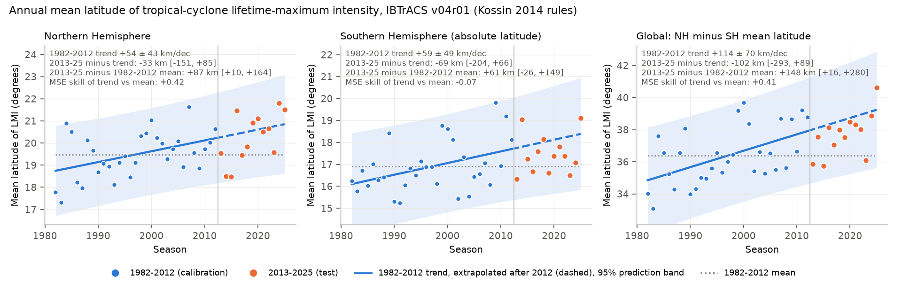
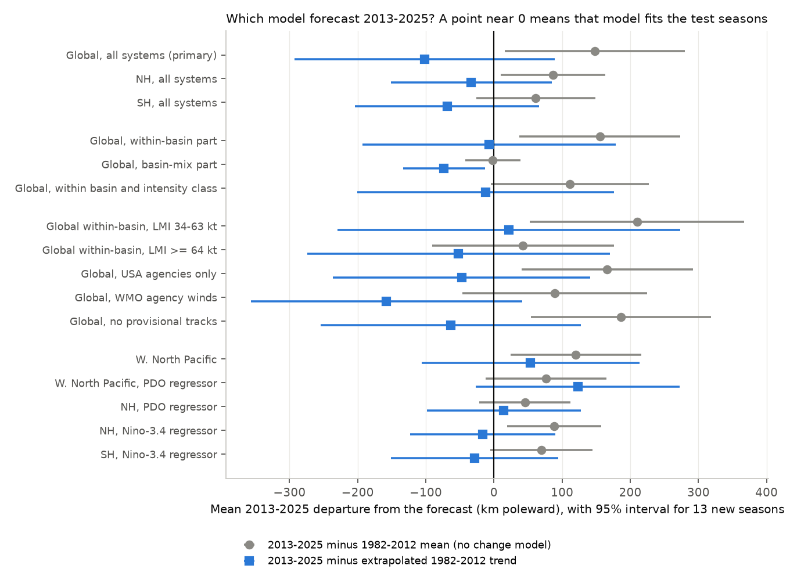

# IBTrACS 2013-2025: tropical-cyclone peak-intensity latitude followed the 1982-2012 poleward trend globally and in the north, not clearly in the south; basin mix and a negative PDO limit attribution

## Summary

Kossin, Emanuel and Vecchi (2014, Nature 509, 349; doi:10.1038/nature13278) found that tropical cyclones
reached their lifetime-maximum intensity (LMI) farther from the equator in 1982-2012. They gave these
rates: 53 km per decade in the Northern Hemisphere (NH), 62 km per decade in the Southern Hemisphere (SH)
and 115 km per decade for the "global" distance between the two hemispheric means. They said that this
migration could continue if the environment continues to change. Since then, 13 more seasons
(2013-2025) of best-track data have become available. Those seasons are an out-of-sample test.

We used the same rules on IBTrACS v04r01 and did these steps:

1. We reproduced the 1982-2012 trends: NH +54 ± 43, SH +59 ± 49 and global +114 ± 70 km per decade
   (95% intervals).
2. We forecast the 2013-2025 annual means with two models. Model T extends the 1982-2012 trend.
   Model M is the 1982-2012 mean (no change).
3. We examined which parts of the record caused the result.

Main results:

* **Global and NH: the trend forecast was better than no change.** The 2013-2025 global mean was
  148 km [16, 280] poleward of the 1982-2012 mean. It was 102 km [-293, +89] equatorward of the
  extended trend, which is inside that model's interval. Model T had a 41% lower mean squared error
  (MSE) than model M. For the NH, the values were +87 km [10, 164] from M, -33 km [-151, +85] from T,
  and a 42% lower MSE.
* **SH: unclear.** The 2013-2025 SH mean was between the two forecasts: +61 km [-26, +149] from M
  and -69 km [-204, +66] from T. Model T was 7% worse than M. The supplementary 2026 SH season
  (15.95 degrees, 33 storms) was equatorward of the 1982-2012 mean.
* **The part from changes in basin storm shares stopped.** About 30% of the 1982-2012 global trend
  came from changes in the share of storms in each basin (+32 ± 22 km per decade). This part did
  not continue: the 2013-2025 value was -2 km [-42, +39] from M and -73 km [-133, -13] from T.
  The poleward shift within basins continued: +155 km [37, 273] from M and -7 km [-192, +178] from T.
* **Intensity mix matters.** In five of six basins (not the North Indian Ocean), systems with LMI below
  34 kt reach LMI 2-7 degrees nearer the equator than stronger storms, and their share fell from
  15.2% (1982-2012) to 11.4% (2013-2025).
  When each storm is compared with its own 1982-2012 basin-and-intensity-class mean, the 1982-2012
  global trend is +56 ± 69 km per decade (not significant) and the NH trend is only +6 ± 40.
  However, 2013-2025 values are still +111 km [-5, +228] above the calibration mean. The 1982-2025
  trend of this measure is +56 ± 37 km per decade.
* **Storms of hurricane strength (LMI 64 kt or more) gave no clear signal.** Within basins, their
  2013-2025 global value was +43 km [-91, +176] from M. The trend forecast was not better than no
  change (MSE skill +0.07; with the hemispheric means of these storms, the skill was -0.83).
* **The NH rise after 2012 came mostly from the western North Pacific, at a time of very negative PDO.**
  Western North Pacific LMI latitude was +120 km [24, 216] above its 1982-2012 mean. Its 2013-2025
  trend was +347 km per decade. In 1982-2012 the August-October PDO index and calendar year are
  correlated (r = -0.59). With the PDO as a regressor, the western North Pacific trend term goes to
  approximately zero. A PDO-only model forecast 2013-2025 better than a trend-plus-PDO model
  (skill -0.25 for the trend). The August-October PDO was -2.0 to -3.4 in 2021-2025; the 2024 value (-3.42) is the lowest in the ERSSTv5 PDO record since 1854.
  Thus these data cannot separate a forced poleward migration from PDO-related variability in the NH.
* With Nino-3.4 as a regressor (as in Kossin et al. 2014), the trend forecast was better than no change
  in both hemispheres (MSE skill NH +0.56, SH +0.34).

Our conclusion: the 2013-2025 data agree with a continued poleward shift of LMI within basins, at
approximately the 1982-2012 rate. The 1982-2012 hemispheric trends include basin-mix and intensity-mix
parts that did not continue. The NH signal after 2012 coincides with a record-negative PDO, so it is
not independent evidence of a forced trend.

## Data

| Input | Source and version | SHA-256 |
| --- | --- | --- |
| IBTrACS since-1980 netCDF | NOAA NCEI IBTrACS v04r01, file date 2026-11-07 (doi:10.25921/82ty-9e16) | 21d5192c...c9669a |
| Nino-3.4 monthly anomaly | NOAA CPC `ersst5.nino.mth.91-20.ascii` (ERSSTv5, 1991-2020 base) | bedcd068...d58012 |
| PDO monthly index | NOAA NCEI `ersst.v5.pdo.dat` (ERSSTv5) | a09ddc3f...620211 |

The full hashes, URLs and campaign shared-dataset paths are in `files/provenance.json`. The raw files and
the storm-level table are not in this bundle (see `files/EXTERNAL_DATA_NOTICE.md`).

## Methods

**LMI extraction (`code/01_extract_lmi.py`).** We used all IBTrACS tracks of type `main`, `PROVISIONAL`
or `US-PROVISIONAL` (spur tracks removed) and only the 6-hourly synoptic records (00, 06, 12, 18 UTC),
so interpolated 3-hourly points are not used. For each storm we found the LMI of each agency with wind
data (USA, Tokyo, CMA, HKO, KMA, New Delhi, La Reunion, BoM, Nadi, Wellington). Then, as in
Kossin et al. (2014), we used the agency with the greatest LMI and its position at the first time of
that LMI. Basin is the IBTrACS basin at the LMI time. SH basins are SI, SP and SA.

**Which storms.** The Kossin 2014 methods do not give an intensity cutoff. Before we examined the test
period, we compared cutoffs on 1982-2012 only. With all systems (no cutoff), we reproduced the published
values closely (NH 54 vs 53, SH 59 vs 62, global 114 vs 115; basins NA 20 vs 7, WP 30 vs 37,
EP 15 vs 10, NI -40 vs -25, SI 61 vs 67, SP 52 vs 51 km per decade). With a 34-kt cutoff, the North
Atlantic trend became -103 km per decade. Thus the primary sample has no cutoff. We give the
34-kt and 64-kt cutoffs as sensitivity tests.

**Seasons.** IBTrACS SEASON (NH: calendar year; SH: July-June, labelled by the end year). The
calibration is 1982-2012 (31 seasons) and the test is 2013-2025 (13 seasons). The NH 2026 season was
not complete on the file date, so we did not use it. The "global" series is NH mean latitude minus
the signed SH mean latitude.

**Forecast test (`code/02_analysis.py`).** We fitted the trend (T) and the mean (M) by OLS on 1982-2012
annual means, then forecast 2013-2025. For each model we give the mean 2013-2025 departure with a 95%
interval for the mean of 13 new seasons (t distribution, parameter and residual variance), the MSE skill
score 1 - MSE_T/MSE_M, the 2013-2025 and 1982-2025 trends, and a hinge (slope change after 2012) test.
The analysis plan (`files/analysis_plan.md`) was written before we calculated any test-period statistic.
Durbin-Watson values of the residuals were 1.7-2.5, so we did not correct for autocorrelation.

**Secondary analyses.** (a) Nino-3.4 (Aug-Oct for NH, Jan-Mar for SH) and PDO (same months) as
regressors in both models. The test forecasts use the observed index values. (b) Decomposition into a
within-basin anomaly (storm latitude minus 1982-2012 basin mean) and a basin-mix part (mean of the
basin climatologies of that season's storms). (c) Forecasts for each basin. (d) Sensitivity: 34-kt and
64-kt cutoffs, USA agencies only, WMO-agency winds, no provisional tracks, and only records with
nature "TS" at LMI. (e) Rolling forecast origins 2000-2018 with 7-season horizons.
Post hoc (not in the plan): (f) the within-basin series for each LMI intensity class
(`code/03_intensity_classes.py`) and an anomaly relative to the basin-and-class mean; (g) basin
forecasts with ENSO or PDO regressors.

## Results



**Primary test (all systems, Kossin rules).** Distances in km. A 95% interval is in brackets.

| Series | 1982-2012 trend (km/decade) | 2013-2025 minus mean (M) | 2013-2025 minus trend (T) | MSE skill of T vs M | 1982-2025 trend |
| --- | --- | --- | --- | --- | --- |
| NH | +54 ± 43 | +87 [10, 164] | -33 [-151, 85] | +0.42 | +49 ± 25 |
| SH | +59 ± 49 | +61 [-26, 149] | -69 [-204, 66] | -0.07 | +39 ± 27 |
| Global | +114 ± 70 | +148 [16, 280] | -102 [-293, 89] | +0.41 | +88 ± 38 |

The hinge model gave no clear slope change after 2012 (global change +3 ± 204 km per decade).
Within 2013-2025 alone, the NH trend was steep (+206 ± 160 km per decade), because 2014-2015 were low
and most of 2019-2025 were high.



**Decomposition, intensity and sensitivity (global series).**

| Series or variant | 1982-2012 trend | minus M | minus T | Skill T vs M |
| --- | --- | --- | --- | --- |
| Within-basin part | +74 ± 68 | +155 [37, 273] | -7 [-192, 178] | +0.60 |
| Basin-mix part | +32 ± 22 | -2 [-42, 39] | -73 [-133, -13] | -1.97 |
| Within basin and intensity class | +56 ± 69 | +111 [-5, 228] | -12 [-201, 176] | +0.48 |
| Within basin, LMI 34-63 kt | +85 ± 92 | +210 [53, 367] | +22 [-230, 273] | +0.51 |
| Within basin, LMI >= 64 kt | +43 ± 81 | +43 [-91, 176] | -52 [-274, 170] | +0.07 |
| LMI >= 34 kt (hemispheric means) | +121 ± 71 | +130 [-7, 267] | -136 [-332, 60] | +0.15 |
| LMI >= 64 kt (hemispheric means) | +102 ± 80 | +30 [-114, 174] | -195 [-416, 25] | -0.83 |
| USA agencies only | +97 ± 69 | +166 [40, 292] | -48 [-236, 141] | +0.65 |
| WMO agency winds | +112 ± 72 | +89 [-47, 225] | -158 [-357, 41] | -0.43 |
| No provisional tracks | +114 ± 70 | +186 [54, 319] | -63 [-254, 128] | +0.43 |
| Nature "TS" at LMI only | +67 ± 60 | +92 [-13, 198] | -55 [-220, 110] | +0.36 |

Full values for all three series and all variants are in `files/results/sensitivity_variants.csv`,
`files/results/intensity_class_within_basin.csv` and `files/results/results.json`.

**Basins.** In the extended trend vs mean comparison, the western North Pacific (WP) moved most:
+120 km [24, 216] from its 1982-2012 mean; skill +0.24; hinge slope change p = 0.03. The North Atlantic,
eastern North Pacific, South Indian and South Pacific basins had positive but uncertain departures from
their means (+45 to +76 km, all intervals include 0). The North Indian Ocean had a 1982-2012
equatorward trend that did not continue (skill -0.86). See `files/figures/fig3_basins.png`.

**ENSO and PDO.** With Nino-3.4 as a regressor, the trend forecast had MSE skill +0.56 (NH) and +0.34 (SH).
With the PDO as a regressor, NH skill fell to +0.19, and the NH departure from the PDO-only model was
+45 km [-22, 112]. For the WP basin, the PDO-only model was better than trend plus PDO (skill -0.25).
The 1982-2012 WP slope against PDO was -0.55 degrees per PDO unit
(`files/figures/fig4_pdo_wnp.png`). The August-October PDO mean was -0.46 in 1982-2012 and -1.17 in
2013-2025.

**Rolling origins.** For origins 2000-2018 and the next 7 seasons, the mean global RMSE was 150 km for
the trend and 186 km for the mean. For the NH it was 113 vs 120 km, and for the SH 132 vs 131 km
(`files/results/rolling_origin_forecasts.csv`).

## Limitations

* Best-track intensities are not homogeneous between agencies and over time. We did not have the
  ADT-HURSAT homogenized record that Kossin et al. (2014) also used. The results change with the
  choice of agency winds: with WMO winds, the trend forecast was worse than no change.
* The primary sample includes tropical depressions and other weak systems, as the Kossin values
  require. The share of these systems fell over time, and in most basins they reach LMI nearer the equator.
  Thus part of the hemispheric trend can come from recording practice and not from a change in storms.
* Thirteen test seasons give wide intervals (about ±100-200 km for the mean departure). The
  departures from the two models often both include zero in the variants.
* The 2025 season is partly provisional (59% of 2025 tracks). Removing provisional tracks did not
  change the conclusion.
* ENSO and PDO adjustments are linear with one seasonal index. The PDO and the calendar trend are
  correlated in 1982-2012, so their effects are not well separated.
* We did not examine the environmental causes (shear, potential intensity, Hadley-cell width).
* Some secondary analyses were added after the plan (marked post hoc). The intensity-class result
  and the PDO result for the WP basin are therefore exploratory.

## Reproduce

```bash
bash files/code/00_fetch_inputs.sh /tmp/lmi_data      # or link the campaign shared files (provenance.json)
bash files/code/run_all.sh /tmp/lmi_data /tmp/lmi_out  # ~1 min; writes tables and figures to /tmp/lmi_out
```

Requirements: Python 3.12 with numpy, pandas, scipy, xarray, netCDF4, matplotlib (versions in
`files/provenance.json`). NOAA updates IBTrACS in place, so a new download can give slightly different
numbers. The 2026-11-07 file has the SHA-256 given above.

## Files

* `files/code/` - extraction, analysis, post hoc intensity analysis, figures, fetch and run scripts.
* `files/analysis_plan.md` - plan written before the test-period statistics.
* `files/results/` - annual means (hemispheres, basins, decomposition, class anomalies), storm counts by
  basin and season, data-quality shares by season, all forecast statistics (`results.json`, CSV).
* `files/figures/` - four PNG figures.
* `files/provenance.json`, `files/EXTERNAL_DATA_NOTICE.md` - data provenance, hashes and attribution.

## Provenance

Campaign 11_07_2026, job sci-1107-dell-earth-and-ocean-sciences-13aca04fc6bd, topic earth-and-ocean-sciences,
machine dell. An autonomous agent (Claude Opus 5.5, model id claude-opus-5-5) did the analysis and
wrote this text on 2026-11-09. A campaign-machine key signed it. That signature is not a personal
authorship claim.

## References

* Kossin, J. P., Emanuel, K. A. and Vecchi, G. A. (2014). The poleward migration of the location of
  tropical cyclone maximum intensity. Nature 509, 349-352. doi:10.1038/nature13278
* Kossin, J. P., Olander, T. L. and Knapp, K. R. (2013). Trend analysis with a new global record of
  tropical cyclone intensity. J. Climate 26, 9960-9976. doi:10.1175/JCLI-D-13-00262.1
* Lin, J., Lee, C.-Y., Camargo, S. J. and Sobel, A. (2024). Poleward migration of the latitude of maximum
  tropical cyclone intensity - forced or natural? J. Climate 37. doi:10.1175/JCLI-D-23-0705.1
* Knapp, K. R. et al. (2010). The International Best Track Archive for Climate Stewardship (IBTrACS).
  BAMS 91, 363-376. doi:10.1175/2009BAMS2755.1
* Gahtan, J. et al. (2024). IBTrACS Project, Version 4r01. NOAA NCEI. doi:10.25921/82ty-9e16
* Huang, B. et al. (2017). Extended Reconstructed Sea Surface Temperature, Version 5 (ERSSTv5).
  J. Climate 30, 8179-8205. doi:10.1175/JCLI-D-16-0836.1
