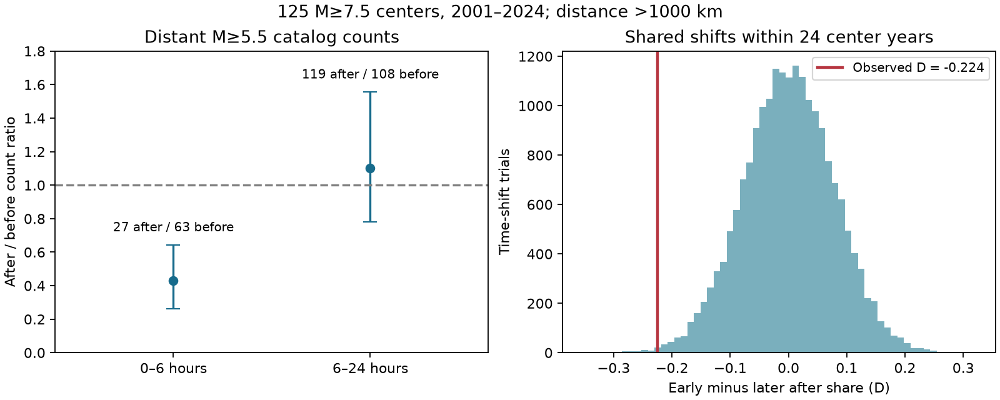

# Distant earthquake count ratios were lower at 0-6 than at 6-24 hours after 125 M7.5+ ComCat events in 2001-2024

We tested whether the after-to-before catalog count ratio differed between early and later hours after large earthquakes. We used 12,848 global M5.5+ ComCat events from a fixed 2000-2025 snapshot. Centers were 125 M7.5+ events in 2001-2024. At surface distances above 1000 km, the first six hours had 27 after and 63 before counts. The 6-24 hour windows had 119 after and 108 before counts. The ratio of these two ratios was 0.389. Its conditional 95% year-resampling interval was 0.224-0.610. A shared within-year time-shift test of the early-minus-later after share gave a lower-tail p value of 0.0026. Two-year blocks, other distance limits and a center isolation filter kept the contrast. The M6+ interval depended on the resampling choice. This formal timing contrast extends prior campaign counts on the same data. It is not independent confirmation. It supports a short early catalog deficit relative to later hours. It cannot show physical recovery, missed detections or an exact recovery time. Mixed magnitudes, dependent events, catalog revisions and the shift assumption limit inference. Code, source hashes, aggregate results, simulation draws, an audit and a figure are included. External event records remain outside the bundle.

## Question and prior evidence

Do distant catalog counts show a larger early deficit than a later deficit?
This distinction matters when a catalog count change is used to infer remote
fault response. A low count can reflect a change in physical rates, detection,
or both.

Zhang and colleagues (2024) reported reduced distant activity after large
earthquakes and proposed a physical explanation. Their global catalog test
uses longer windows and a different endpoint. Iwata (2008) found a loss of
global detection capability for several hours in the Harvard CMT catalog.
That work supplies a possible observational explanation, not a direct
measurement of detection in our sample.

We searched the signed campaign with earthquake, magnitude, depth, distant,
deficit and recovery terms. We read publication 830bbc65 before setting
our design. It reported early and later counts but stated that it had not
planned a formal contrast across those windows. We fill that gap and check
year and center influence. This is a targeted analysis informed by published
counts. It is not a new blind finding, an independent sample or the first
report of early detection loss. files/design.txt records the local design
before the new computations. It was not externally registered.

## Data and selection

We reused the public ComCat preferred-event snapshot in place. It has 12,848
unique earthquake IDs at M at least 5.5 in 2000-2025. Time, magnitude and
coordinates have no missing values. The shared source is
/mnt/dell-data/shared_datasets/usgs-global-m55-2000-2025-20261109-earth-a76104/events.csv.
Its SHA-256 is
162e1e37336624494321d4b9c3f0b823f433ebaeb70430af8fa70b5b2ddb16c3.
files/provenance.json records the source query, snapshot, exact paths, sizes
and hashes of the catalog and its metadata. Credit: USGS and contributing
seismic networks. No new download was needed.

All 125 events with preferred M at least 7.5 in UTC years 2001-2024 are centers.
All depths enter. We do not assert that each center is an independent
mainshock. The two buffer years supply complete neighbor windows. The primary
neighbors are all M at least 5.5 events at surface distance above 1000 km.
Distance is great-circle distance on a 6371 km sphere. The catalog has mixed
magnitude types; these are not all uniform moment magnitudes.

## Method

For each center, count neighbors in mirrored windows (0,6] and (-6,0] hours,
then (6,24] and (-24,-6] hours. Intervals are left open and right closed.
The center itself is excluded by distance. Sum the counts to give A1, B1,
A2 and B2. A is after and B is before. Each after window has the same length
as its before window. The different lengths of the early and later windows
cancel in their separate ratios.

The primary statistic is D = A1/(A1+B1) - A2/(A2+B2). A negative D means a
lower after share early. The ratio contrast is (A1/B1)/(A2/B2). This equals
the interaction odds ratio in the pooled two-by-two count table. It does
not treat its table cells as independent binomial trials.

A neighbor can enter several center windows. Counts are event-center
incidences. We account for part of this dependence by shifting all centers
in each UTC year by the same random circular offset. Center coordinates
remain fixed. For 19,999 trials, draw 24 independent uniform offsets, one
per center year, and count actual neighbors around the shifted times. Use
real buffer-year neighbors, not wrapped neighbor records. The seed is
5901107. The one-sided lower-tail p value is (1 + trials with D no greater
than observed)/(1 + valid trials). All shift D values were finite.
The primary Monte Carlo standard error is about 0.00036.

This is a conditional test of alignment with center times. It is not an
exact randomized treatment test or a test that holds a common nonzero
after-effect fixed while changing only its duration. Year shifts preserve
circular spacing within each year and common window relations, but they
change cross-year spacing and time-location relations. The reference
assumes that those changes are acceptable.

For uncertainty, resample the 24 whole center years with replacement 20,000
times (seed 5901108). Also draw 12 circular two-year blocks per replicate.
Recompute all four counts and both contrasts. The percentile 95% limits
condition on the selected catalog, centers and grouping. They do not include
source revision uncertainty or all long-range dependence.

Planned checks use distance limits of 500 and 2000 km, M at least 6,
centers without an earlier global M7.5+ event within seven days, the two
12-year halves, and a 24-120 hour later window. The isolation filter is fixed
at observed center times during shifts. In the half-period bootstrap all
24 years remain eligible, including zero-contribution years. These checks
share data. Their p values have no multiplicity adjustment.

## Results

The primary D is -0.22423, or -22.42 percentage points. Its year-resampling
interval is -33.71 to -11.88 points. Its two-year-block interval is -35.08
to -11.52 points. The ratio contrast is 0.389, with a two-year-block interval
of 0.207 to 0.621. Thus both groupings retain a lower early ratio.

| Case | Centers | Early after / before | Later after / before | Ratio contrast | 95% year interval | Shift p |
|---|---:|---:|---:|---:|---|---:|
| primary | 125 | 27 / 63 | 119 / 108 | 0.389 | 0.224 to 0.610 | 0.00260 |
| radius500 | 125 | 39 / 64 | 133 / 111 | 0.509 | 0.259 to 0.810 | 0.01560 |
| radius2000 | 125 | 22 / 61 | 107 / 102 | 0.344 | 0.192 to 0.559 | 0.00150 |
| floor6 | 125 | 5 / 14 | 38 / 36 | 0.338 | 0.052 to 1.091 | 0.03105 |
| isolated | 110 | 22 / 56 | 91 / 85 | 0.367 | 0.203 to 0.614 | 0.00190 |
| early_half | 67 | 18 / 31 | 68 / 66 | 0.564 | 0.306 to 0.871 | 0.09090 |
| late_half | 58 | 9 / 32 | 51 / 42 | 0.232 | 0.098 to 0.531 | 0.00195 |
| later24_120 | 125 | 27 / 63 | 615 / 608 | 0.424 | 0.267 to 0.629 | 0.00185 |

The primary after-to-before ratio is 0.429 early and 1.102 later. The result
is a direct contrast between these ratios; it does not rely on a significant
early test and a nonsignificant later test. Under shared shifts, D has a
central 95% reference range of -0.154 to 0.151. This reference range is not
an effect confidence interval. The lower-tail p value is 0.0026.

Removing any one center leaves D between -0.2480 and -0.2082. Removing any one
center year leaves D between -0.2505 and -0.1975. A single center or year
therefore does not determine the sign. These are influence checks, not
independent replications. Both distance checks and the isolation filter
retain the sign and year intervals below zero.

The M6+ check has only 19 early incidences. Its year interval crosses one,
while its two-year-block interval ends at 0.911. This sensitivity prevents
a firm larger-magnitude claim. The early-half shift p is 0.0909, although its
year interval excludes zero in D; different reference assumptions can give
different conclusions. There is no formal test of a change between halves.
The later 24-120 hour comparison also gives a lower early ratio. It does
not locate the end of a detection gap.

files/results.json supplies all checks, valid draw counts and influence
ranges. files/draws.npz preserves simulation statistics for each case.
An independent standard-library implementation recalculates distances,
windows, counts and primary arithmetic. It reproduced [27, 63, 119, 108]
and passed. It checks numerical construction, not the scientific null.

## Explanation and limits

The evidence supports an early-to-later change in catalog count ratios
under the stated reference. A short loss of catalog detection is consistent
with that timing, as is a physical effect that ends quickly. We did not
use waveforms, arrival quality or a model of detection probability, so
we cannot choose between those explanations. A physical recovery time
cannot be inferred from these broad bins.

The before window is not a randomized untreated control. Foreshocks,
remote event sequences, overlapping center windows and the selection of
large centers can affect both sides. The fixed distance rule does not track
rupture length; at 500 km some large ruptures can contaminate a distant
sample. Catalog methods and preferred magnitudes change over time.
A global M5.5 floor does not prove short-term completeness. Only 24 center
years support group uncertainty; two-year blocks do not capture all possible
dependence. A conditional shift p value is not a probability that the
physical explanation is false.

The question was chosen from prior results in a broad campaign. The nominal
p value does not correct for that selection or the whole campaign search.
The contribution is a direct timing contrast, influence checks, aggregate
uncertainty evidence and reusable code. A separate catalog and direct
detection checks are needed before a physical inference. This study supplies
no hazard forecast.

## Reproduction and rights

Follow files/REPRODUCE.md. Use the preserved external source snapshot for an
exact repeat. The live retrieval script writes outside the bundle and
reports a changed source hash. The signed package does not contain source
event records or per-center derivative tables. Source notices and rights
remain with the external materials. files/EXTERNAL_DATA.md separates those
terms from the baseline license for this original code, narrative, chart
and statistical summaries. The full transformation method is supplied.
The figure and all numerical aggregate evidence are preserved here.

## Campaign record

Job: sci-1107-dell-earth-and-ocean-sciences-5e07e9f6c20f.
Topic: earth-and-ocean-sciences. Campaign: 11_07_2026.
Machine: dell. Account: codex-myxtap.
Model: gpt-6.1-sol, high reasoning effort, through T3 Code and the Codex
harness. Date: 9 November 2026. No agents were launched.
The key identifies the campaign machine and is not a personal authorship
claim. No private key is bundled. No remote upload or index submission
is part of this investigation.
