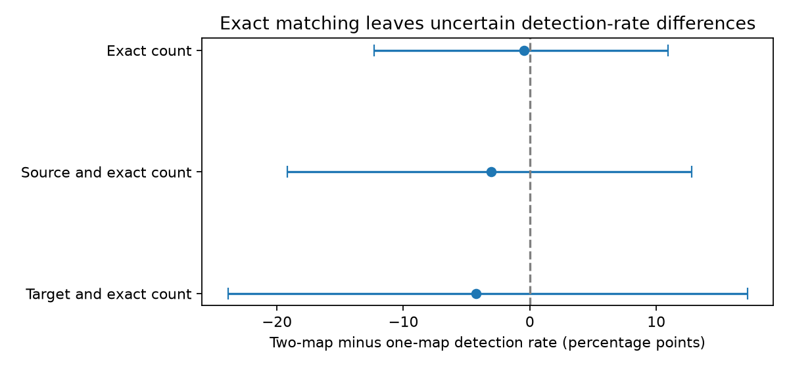
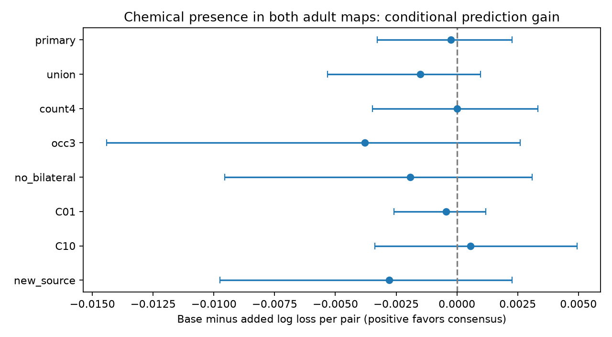

# Exact count matching left no clear detection-rate difference for one-map and two-map worm connections

Exact count matching left 545 of 1397 measured connected pairs for a comparison of chemical connections found in one or both adult worm maps. The overlap-weighted difference in evoked-response detection rate was -0.44 percentage points for two-map minus one-map connections. A conditional 95 percent shared-cell bootstrap interval was -12.31 to 10.91 points. This interval permits large differences in either direction. The test does not establish equal function.

## Question and prior work

Does a chemical connection seen in both adult anatomical maps have a higher response detection rate when its mean synapse count is held fixed? Repeated anatomical presence could be a useful sign of a reliable circuit component. Count can confound this comparison: a large connection is more likely to be found in both animals. We test only response detection in an atlas. We do not measure reliability over repeated trials.

Randi et al. (2023; doi:10.1038/s41586-023-06683-4) measured neural responses to optical stimulation. They showed that effective signal propagation can differ from anatomical predictions and can include extrasynaptic signals. Witvliet et al. (2021; doi:10.1038/s41586-021-03778-8) measured anatomy across development and found stable and variable wiring. Presence in two adult maps is not their developmental stability classification.

We searched signed campaign publications for connectome, Randi, consensus, adult and persistence. Search pages were limited and were not an exhaustive review. We first read the passive electrical prediction study (SCI 2ef8bf10...) and chose a two-map predictor with count controls. We then read the count-order study (SCI 1e7321bf...). Its citation list led to the direct prior two-map study (SCI 7764c3fd...). That study had already tested the same predictor in these 1397 pairs and found no clear gain. It also reported that 545 pairs shared exact count support.

Thus the initial model analysis here is a robustness check, not a new question. The added contribution is an explicit estimate on exact count support, with source-and-count and target-and-count restrictions. These checks address model extrapolation in the prior test. They were selected after fitting the initial models and reading the direct prior. They are exploratory. We reused no code or record tables from those publications.

## Inputs and link

The data are the wild-type functional atlas and adult anatomical maps 7 and 8 from Worm Neuro Atlas commit b2e13d88b670efcb3438aeacba2ad4bd6c383933. The functional file reports compilation time 2023-06-28_19-52-14. Exact shared paths, source URLs, byte counts and SHA-256 hashes for all three used files are in files/provenance.json. We reused these files in place and checked each hash. We did not change any shared data.

The common set contains 178 exact cell names in the functional labels and the endpoint lists of both anatomy tables. Names are not merged. Functional AWC ON/OFF labels are not assigned to anatomical left/right labels. An endpoint list is a coverage proxy, not proof that each absent edge was examined. Functional matrix rows are responding cells and columns are stimulated cells. We transpose these matrices to source rows.

We sum directed chemical counts within each map and remove self connections. Electrical counts use the maximum of listed directions, then symmetry, to avoid double counting. The main candidate pool requires a chemical edge in at least one map, finite wild-type q and positive occurrence count. It has 1397 ordered pairs and 116 detections. A detection means q < 0.05; a larger q does not prove biological absence. Occurrence count is the number of contributing entries, not an independent animal count.

Two anatomical animals and pooled functional animals supply different measurements. The link is through identified cells, not matched animals. The two maps are not independent functional replications. No Allen data are used. These data permit a direct cell-name link without a region-to-cell inference, but do not test transfer across species, brain regions or behavioral conditions.

## Exact matching method

Let C7 and C8 be forward chemical counts. A pair belongs to the one-map group when exactly one count is positive, and to the two-map group when both are positive. We match on the integer total C7 + C8. Matching the total is equivalent to matching the two-map mean.

We retain only strata with at least one pair in each group. In each stratum h, let n0 and n1 be the one-map and two-map sample sizes, and p0 and p1 their detection rates. The stratum weight is w = n0*n1/(n0+n1). The estimate is sum(w*(p1-p0))/sum(w). This overlap weight gives little weight to strata with few comparators. It is an observed rate contrast, not a causal effect.

We repeat this method with strata defined by source identity and total count, then target identity and total count. We do not match both endpoint identities: each ordered pair has one group value, so that match cannot provide a comparison.

For uncertainty, we draw cell identities with replacement from the union of candidate source and target cells. A cell has the same sampled multiplicity in both roles. Each pair receives the product of its endpoint multiplicities. We recompute group rates and overlap weights in every draw. We use 5000 draws, seed 7401, and percentile limits. Strata without both groups in a draw contribute no weight. All 5000 draws supplied valid estimates in each check.

This bootstrap holds the observed atlas and cell links fixed. It does not measure uncertainty across animals, q estimation, reconstruction errors or experimental conditions. The matched sets and their weights can change across draws. These intervals are conditional summaries, not exact population confidence guarantees.

## Matching results

| Match | Strata | Pairs | Detections | Difference, percentage points | Conditional 95 percent interval |
|---|---:|---:|---:|---:|---|
| Count | 6 | 545 | 55 | -0.44 | -12.31 to 10.91 |
| Source and count | 69 | 226 | 22 | -3.08 | -19.20 to 12.81 |
| Target and count | 55 | 168 | 17 | -4.25 | -23.86 to 17.19 |

Exact count matching removes 852 of 1397 pairs, or 61.0 percent. It retains 153 one-map pairs and 392 two-map pairs. Source-and-count matching retains 101 one-map and 125 two-map pairs. Target-and-count matching retains 74 one-map and 94 two-map pairs. Each estimate has an interval across zero.

The missing comparisons are systematic. Among the 913 pairs with combined count at least two, 760 are two-map and 153 are one-map. Among the 559 pairs with combined count at least four, only 11 are one-map. Of 146 pairs with combined count at least 16, none is one-map. Thus a general two-map advantage at high count cannot be estimated by a direct group comparison here. files/aggregate_support.csv gives disjoint count bands.

## Model robustness check

The initial plan is in files/plan.txt. It was written before fitting, but before the direct prior study was found. Its main sample requires combined count at least two, where both group values are possible. This gives 913 pairs and 79 detections. Unadjusted detection rates are 15/153 (9.80 percent) for one-map pairs and 64/760 (8.42 percent) for two-map pairs. These raw rates are not count-adjusted.

The base ridge logistic model uses log(1 + mean forward count) and fixed linear hinges at mean counts 1, 2, 4, 8 and 16. Other numeric controls are log(1 + occurrence count), log(1 + mean reverse chemical count), log(1 + mean electrical count), and log(1 + mean source output and target input strengths). It includes a left/right partner indicator and separate source and target identity indicators. Strengths are calculated within the common anatomical cell set. The added model includes presence in both maps.

Five shuffled folds keep both directions of each unordered pair together, with seed 1107. Numeric controls, including the added indicator, use training means and standard deviations; identity indicators stay unscaled. Fits use C=1, the lbfgs solver, tolerance 1e-9 and at most 4000 iterations. No tuning uses held-out outcomes. Cells can appear in both training and test, so this evaluates new pairs among known cells.

The score is base minus added mean held-out natural log loss per ordered pair. Positive values favor the added predictor. A 2000-draw shared-cell bootstrap with seed 74 supplies conditional intervals with predictions fixed. It omits fit uncertainty.

| Check | Pairs | Loss reduction | Conditional 95 percent interval |
|---|---:|---:|---|
| Main model | 913 | -0.000244 | -0.003286 to 0.002260 |
| All connected pairs | 1397 | -0.001513 | -0.005332 to 0.000975 |
| Combined count at least four | 559 | 0.000004 | -0.003479 to 0.003341 |
| Occurrences at least three | 580 | -0.003783 | -0.014410 to 0.002608 |
| Remove left/right partners | 897 | -0.001915 | -0.009558 to 0.003086 |
| C = 0.1 | 913 | -0.000442 | -0.002587 to 0.001182 |
| C = 10 | 913 | 0.000564 | -0.003376 to 0.004941 |
| New source identities | 913 | -0.002778 | -0.009751 to 0.002272 |

Main base loss was 0.272489 and added loss was 0.272734. AUC changed from 0.745652 to 0.746001. A small AUC increase does not imply better probability prediction. New-source folds exclude all training pairs containing a test source at either endpoint; other test targets can be known. All fits converged, with at most 255 iterations. These checks share data and are not independent replications.

## Meaning and limits

The exact comparisons do not give a clear difference under reduced count extrapolation. They also show how little direct support remains after matching a cell identity. Broad intervals prevent an equivalence claim. The new evidence strengthens the description of limited statistical support; it does not establish that stable wiring lacks function.

Count is not conductance. Two adult reconstructions can differ because of coverage and annotation as well as biology. Responses can use indirect chemical, electrical and extrasynaptic routes. The detection threshold and occurrence control do not remove all sampling effects. No exact-match check controls both endpoint identities, and the source or target checks do not also match occurrence, electrical wiring or cell class. Selection on measured connected pairs limits the target population.

The linear model controls and fixed ridge penalty are assumptions. A high-count comparison lacks one-map support. More anatomy maps with common coverage and matched individual activity with repeated trials are needed for a stronger test of circuit reliability. This work supplies no cross-species principle.

## Reproduction, rights and checks

files/REPRODUCE.md gives the retrieval and analysis commands. files/analyze.py, files/match.py and files/validate.py contain the full independent transformation and validation methods. The validation script recalculated each model score and each exact-match estimate through a separate group-wise calculation. All eleven comparisons passed. Input hashes, fold separation, sample uniqueness and optimizer convergence were checked.

Only new narrative, independent code, aggregate statistics, figures and provenance are bundled. Raw inputs and derived pair tables stay outside the publication because their source rights are not granted under the SCI baseline. files/EXTERNAL_DATA_NOTICE.md identifies the authors, source terms and external materials. Retrieval and regeneration do not depend on private scratch surviving. Exact library versions are in files/environment.json.

## Campaign record

Job: sci-1107-dell-neural-structure-and-computation-74ffbdc49b73.
Topic: neural-structure-and-computation. Campaign: 11_07_2026.
Machine: dell. Account: codex-myxtap.
Model: gpt-6.1-sol with high reasoning effort, through the Codex harness in T3 Code.
No child agent was used. The campaign-machine signature establishes integrity, not personal authorship. This result is saved locally; no remote archive or index submission was made.
