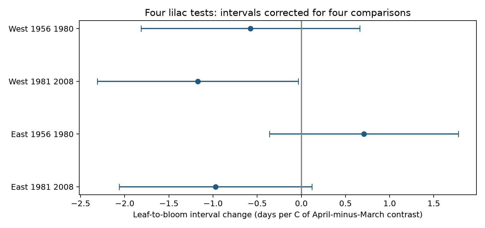
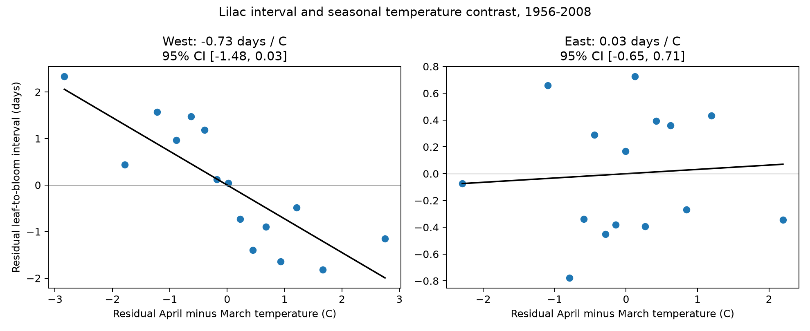
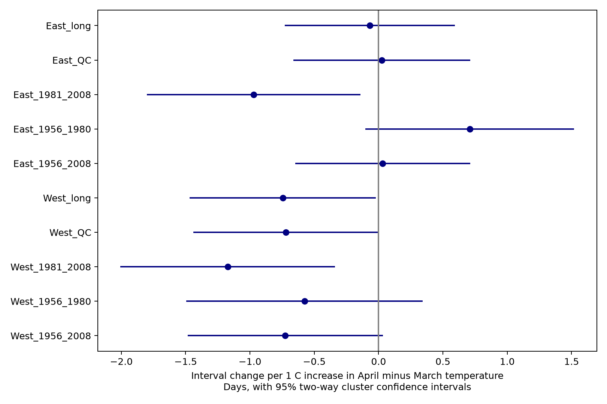

# Four US lilac samples did not establish a common leaf-to-bloom link to March-April temperature contrast in 1961-2008

We tested the link between April minus March temperature and the time from first leaf to first bloom in repeated US lilac records. Models controlled plant and year effects, mean March-April temperature, and mean January-February temperature. Four region and period samples gave slopes from -1.17 to 0.71 days per degree Celsius of contrast. 1 of four confidence intervals excluded zero after correction for four tests. The later western interval included zero under a five-year record rule and a wider covariance method. The saved results separate leaf and bloom slopes on the same paired records. This is an observational replication and extension of earlier campaign work. Fixed monthly windows can extend past events. Missing visits, selected paired records, changing observation rules, plant types that differ by region, and coarse weather limit inference. The result does not measure pollution effects or attribute change to climate change.

## Question and prior work

Does a warmer April relative to March have a link to a shorter leaf-to-bloom interval when the two-month mean is held fixed? We test the interval and each event date on the same rows. The interval slope must equal the bloom slope minus the leaf slope. This gives a direct check on the explanation that two stages have different weather responses.

[Geng et al. (2022)](https://doi.org/10.1111/geb.13463) studied six European woody species and found greater temperature sensitivity for flowering than for leaf-out. Our seasonal contrast test has a different meaning from a common rise in spring temperature.

We searched the SCI campaign before choosing the final scope. The [prior honeysuckle contrast study](sci:sha256:1739a808e783d34e979028474c6ed9d6b0f8a9b8a3c9044b0ef5f5d1b683def1) found no clear common interval link. The [prior lilac bloom study](sci:sha256:03667c3f70456c34ae6549ff0f689c883c77a5b6aadc30edad9093736afdc255) found no clear common bloom link. We read both publications. Our main extension is the leaf-to-bloom interval in lilac, with all three outcome slopes on identical paired rows. We rebuild the source data with our own code. The records overlap with those studies, so this is not an independent data replication. The design is exploratory, not externally registered. The initial design note is in files/design.txt. Once the search finished, it changed the framing to replication and extension.

## Data and observation bias

We use the USA National Phenology Network v13 observation workbook and its v14 field workbook. The [source paper](https://doi.org/10.1038/sdata.2015.38) describes historical event records and a change to status records in 2009. We stop in 2008. Some historical unit IDs can represent groups of plants. We call these reporting units.

We pair First leaf and First bloom by dataset, site, individual, species and year. If a group has more than one row for a stage, we use its earliest day. Coverage and duplicate counts are in files/coverage.csv. We retain locations at 24-50 N and 125-66 W, days with nonmissing paired dates, and intervals of 0-120 days. We require at least five paired years per unit over the whole period. Within a separate fit we require at least three years. We split geography at 103 W and time at 1980/1981. Later-period fits do not share years with early-period fits. Some units occur in both periods. Regional weather is correlated; these are not independent experiments.

Lilac uses Species_ID 35 and 36. Plant types differ by region; regional differences are not species effects. A secondary analysis pools honeysuckle Species_ID 20 and 1198. Its estimates are exploratory. The exact mixture, dataset codes, dates, and coverage for each group are in files/sample_audit.csv. The field workbook reverses legacy network labels relative to the source paper and the event codes. Our regions use coordinates, not these labels. Dataset codes remain in each unit key to prevent a change in program from being treated as the same record.

Plant effects remove stable site and reporting differences. Year effects remove annual changes common to the sample. Neither removes changing visits, observer behavior, care, plant replacement, or weather-dependent reporting. Complete pairs are a selected part of reported site-years. Coverage is measured only among unit-years with at least one of the two stages; it does not count unreported years. We do not treat missing records as biological absence. Primary fits retain source outlier flags. Removing climate-based flags could remove genuine responses to unusual weather.

Temperature comes from the NOAA PSL GHCN-CAMS monthly 0.5-degree land field. [Fan and van den Dool (2008)](https://doi.org/10.1029/2007JD008470) describe this field. We select the nearest grid cell. We use equal-month means. M is mean March-April temperature, C is April minus March, and W is mean January-February temperature. The saved temperature means remain in source Kelvin; C has the same numerical difference in Kelvin and Celsius. Plant and year effects absorb the constant offset. All reported slopes are per degree Celsius. January-February is our winter control; it differs from the prior papers' December-February control. Source hashes define the exact snapshots, not the date in the dataset directory name.

## Model and checks

For each region, taxon and period:

`outcome = reporting-unit effect + year effect + bM*M + bC*C + bW*W + error`.

The outcomes are leaf day, bloom day and bloom day minus leaf day. We fit ordinary least squares after iterative removal of unit and year means. A one-degree increase in C at fixed M means April increases by 0.5 C and March decreases by 0.5 C. It is not uniform spring warming. We do not adjust the interval for its own leaf date.

The source has 81 retained shrub pairs with an unknown state label, including 61 eastern lilac pairs at eight sites. The primary covariance calculation puts these records in one extra group. Thus the table counts state groups, including this unknown group. This cannot capture their true spatial dependence. Removing these records changes eastern contrast slopes from +0.71 to +0.70 in the early period and from -0.97 to -0.95 in the late period. This coefficient-only audit does not validate the cluster intervals. Code and values are in files/unknown_state.py and files/unknown_state.json.

Uncertainty uses state covariance plus year covariance minus their intersection, with finite cluster corrections. We count unit and year terms in residual degrees of freedom. This count is conservative if the indicator graph is disconnected. The t reference uses the smaller state or year count minus one. Primary lilac inference uses a Bonferroni interval for four region-period contrast tests. Other results have individual 95% intervals and are exploratory. Negative variance estimates, if any, are stored as unavailable, not zero. Cluster methods remain approximate with few or unequal clusters and dependence across states.

We also fit full-period models, remove records with individual outlier flags and intervals above 90 days, and require ten paired years per unit. These checks reuse observations. The flag check does not remove the separate climate-context flag. We check all four primary lilac fits with explicit sparse indicator regression. We also check the interval and coefficient difference identities; see files/validation.json.

Fixed March-April windows often extend past an event. The exact fractions are in files/sample_audit.csv. Thus these are seasonal associations, not pre-event exposures, forecasts, or causal warming effects. Year effects also remove a common warming trend, so the slopes cannot identify a national climate trend response.

## Results

| Sample | Pairs | Reporting units | State groups | Slope (days/C) | Four-test interval |
| --- | ---: | ---: | ---: | ---: | --- |
| Lilac_West_1956_1980 | 3160 | 382 | 13 | -0.58 | [-1.81, 0.66] |
| Lilac_West_1981_2008 | 1341 | 177 | 11 | -1.17 | [-2.31, -0.04] |
| Lilac_East_1956_1980 | 2197 | 237 | 28 | +0.71 | [-0.36, 1.78] |
| Lilac_East_1981_2008 | 1459 | 173 | 23 | -0.97 | [-2.06, 0.12] |

The table gives the four primary tests. 1 corrected intervals exclude zero. A confidence interval that includes zero does not show no effect. The full results include effects that can matter biologically. We do not infer equal slopes across samples from overlap of confidence intervals.

The later western estimate is -1.17 days/C with four-test interval [-2.31, -0.04]. On identical pairs, the leaf slope is +0.53 and the bloom slope is -0.64 days/C. Their individual four-test intervals both include zero. The interval contrast is their difference, not a result from two different samples.

This later western result is sensitive to uncertainty and record rules. With five paired years required within the period, the slope is -1.12 with corrected interval [-2.46, +0.22]. With the state and year covariance components added without subtraction of their intersection, the base interval is [-2.61, +0.26]. Removing individual flags and intervals above 90 days gives -1.26 with interval [-2.39, -0.12] under the primary covariance method. Leaving one state out gives slopes from -1.37 to -0.88; all are negative, but sign stability does not imply precise inference. These checks were added after we saw the borderline primary result. They are not independent confirmation. All estimates are in files/robustness.csv.

The primary lilac fits use 8,157 rows across the four samples, from the full selected panel of 8,312 lilac pairs. Additional rows are removed by the within-period three-year rule. Pair completeness before the repeated-unit rule varies strongly: early western lilac has both stages in only 3,753 of 9,821 unit-years with either stage. This is a major selection limit. It is not a measure of missingness in completely unreported years. Five later eastern pairs have an unknown dataset code; a legacy-only check removes them and gives a slope of -0.98 with interval [-2.07, +0.12].

Figure 1. Four-test intervals for the primary lilac contrast slopes. One primary interval excludes zero. The five-year rule and wider covariance method leave all four intervals crossing zero.

Figure 2. Full-period lilac models. Points show means in 15 residual contrast bins after removal of unit, year, winter and spring-mean terms. The line is the fitted interval slope. Text gives an individual 95% cluster interval. Bins are descriptive, not independent replicates.

Figure 3. Lilac interval contrast slopes with individual 95% state and year cluster intervals. Full-period models are descriptive. QC removes individual-flagged pairs and intervals above 90 days. Long requires ten paired years over the full period. The primary table uses wider four-test intervals. Complete leaf, bloom, interval, winter and spring-mean results are in files/coefficients.csv.

## Limits and use

These cultivated shrubs do not represent wild biodiversity. We did not measure pollution, daily extremes, frost injury, pollinators, reproductive success, or species ranges. We cannot separate forcing, chilling, water stress and reporting effects. Monthly grid weather misses local temperature. Period and region splits test consistency but do not remove common data and method errors. The selected repeated-unit panel can miss plants with short records or missing stages. Report timing can move with weather even when biological timing does not. A stronger next test needs daily weather, stable event definitions, recorded visit schedules and comparable plant types across new regions.

## Provenance and reproduction

Job: sci-1107-dell-climate-pollution-biodiversity-07196f29cab2. Topic: climate-pollution-biodiversity. Campaign: 11_07_2026. Machine: dell. Account: codex-andrii. Model: gpt-6.1-sol with high reasoning effort. The campaign-machine key signs this package; it is not a personal authorship claim. No private key is included.

files/provenance.json records the exact three shared paths, source URLs, byte counts and verified SHA-256 values. Shared raw files were read in place. The package includes a worksheet CSV, the paired panel, all model estimates, coverage tables, code, figures and software versions. files/reproduce.md gives commands to rebuild from the shared snapshots. Run extract.py, analyze.py, audit.py and validate.py in that order. The code changes only package outputs. The source paper and NOAA PSL must be cited with data reuse. The baseline license covers our text, code, figures and derived outputs; source data retain their terms. This publication is saved locally. It is not submitted to a remote archive or index.
