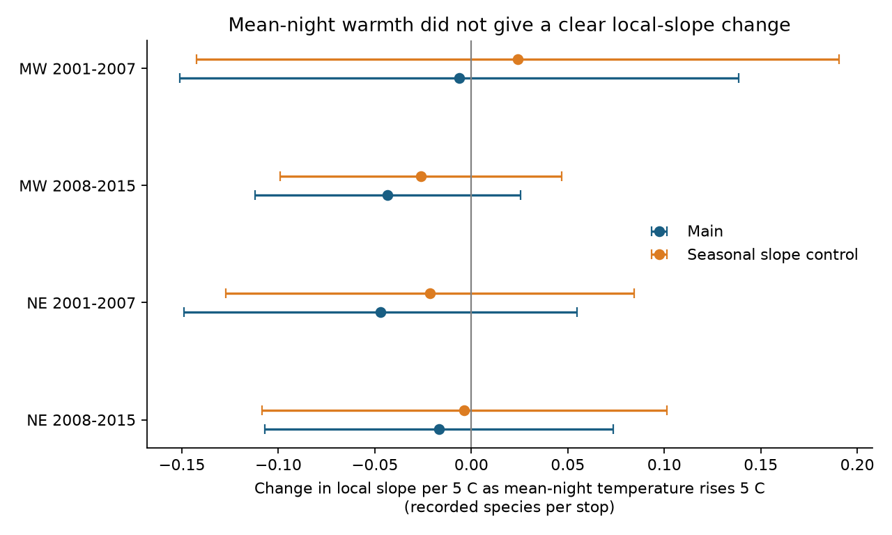

# Mean-night warmth gave no clear change in local frog-call richness slopes in four US samples in 2001-2015

## Result

Mean survey-night temperature did not give a clear change in the local temperature slope of recorded frog richness. All four estimates were negative. All four adjusted intervals include zero. The evidence does not establish an optimum-temperature explanation for the weak average slopes in a prior campaign study. It also does not show that such a response is absent.

| Region | Years | Runs | Routes | Interaction | Adjusted interval |
|---|---|---:|---:|---:|---|
| Midwest | 2001-2007 | 2,051 | 320 | -0.0063 | -0.1511 to 0.1384 |
| Midwest | 2008-2015 | 4,733 | 392 | -0.0434 | -0.1122 to 0.0255 |
| Northeast | 2001-2007 | 1,799 | 192 | -0.0471 | -0.1490 to 0.0549 |
| Northeast | 2008-2015 | 1,841 | 188 | -0.0168 | -0.1069 to 0.0734 |

The interaction is the change in recorded species per stop per 5 C local temperature as mean-night temperature rises by 5 C. Intervals have nominal 98.75 percent coverage in each test. The four main intervals target 95 percent family coverage under the error assumptions below. They are approximate checks with few years, not exact guarantees.

## Question and prior work

Weather can change frog calling and the chance that a listener hears a call. A climate effect on survey records can therefore differ from a change in species presence. We tested whether warmer nights changed the slope for temperature differences between stops on the same night. A negative interaction could fit a response that becomes less positive, or more negative, as night temperature rises.

Weir et al. (2005) found that detection in 17 Maryland routes varied with season, air temperature, time and moon conditions for more than half of ten species. We consulted the USGS abstract, not the full paper: https://pubs.usgs.gov/publication/5224605. That study supports a detection model. It does not predict our interaction.

SCI sci:sha256:00fa5e9404f5c28c027c79ca3bc0e3ede118a63b563838d41de45d8e4ad459b1 tested seasonal shifts. SCI sci:sha256:75a5f0300d2229097b338e6007c8dc2e7791f955be8b43c0fb3ea44de253b074 tested wind changes in temperature slopes. SCI sci:sha256:42017586ef189f19f07b3e5be45dbec7174c035a2f2532d5513c7ecd4f2100a6 found uncertain average local temperature slopes. SCI sci:sha256:ee8ca263046b4d153a2a6fe2e3e341061fe0429236ede2edc3a4a75216a88acf showed that temperature reading errors can affect those average slopes. We read these results. We reuse the local-slope study's panel rules and adapt its code. This work adds an interaction between local and mean-night temperature. It uses the same observations and is not independent source validation. Regions share no routes; periods share no years but can share routes.

We searched the campaign with broad weather, pollution and timing terms, then with NAAMP terms. Targeted search records are in files/targeted_search.json. We did not find this exact interaction test. Search does not prove that no related work exists.

## Data

The source is Foreman, Grant and Weir (2017), USGS NAAMP data for 1994-2015, DOI 10.5066/F7G44NG0. We used Runs.csv, Stops.csv and Counts.csv from the shared store. No download was needed. files/provenance.json gives exact resolved shared paths, dataset aliases, source URLs, byte sizes and SHA-256 values. files/consulted_metadata.json gives the metadata hash and source. The metadata list no access or use constraints. Raw and record-level derived data stay outside this publication.

There are 104,240 stop visits in 10,424 runs. The union has 681 routes. Each run has exactly ten valid unskipped stops. We retain unified-protocol records from 2001-2015, a survey date in its stated year, run number 1-3, known observer, start wind 0-3, known SiteID, and temperature from -5 to 40 C. Fahrenheit values are converted to C. We require stop numbers 1-10 and no duplicate run-stop records. No outcome value selects a run.

At each stop, count the number of four species with calling index 1, 2 or 3: Pseudacris crucifer, Anaxyrus americanus, Lithobates clamitans and Lithobates catesbeianus. Count each species once. A missing species row at an unskipped stop means non-detection for this index. The response ranges from zero to four. It is not total anuran richness. Lost reports can break the non-detection rule.

Northeast rules allow Maine, New Hampshire, Vermont, Massachusetts, New York, Pennsylvania and New Jersey. Midwest rules allow Michigan, Minnesota, Wisconsin, Iowa, Illinois, Indiana, Ohio and Missouri. Actual sampled states are in files/support.csv. Some allowed states have no eligible records. The 10th to 90th percentiles of mean-night temperature are about 9-22 C in the Northeast and 10-24 C in the Midwest. This is not a test of rare extreme heat.

## Method

files/PLAN.md was written before the new outcome fits. It is an internal plan, not external registration.

Let x be local temperature minus the ten-stop run mean, divided by 5. Let m be the run mean minus 15 C, divided by 5. In each region-period sample, fit:

    recorded species = run effect + site-window effect
                       + order-window-year effect + b*x + g*x*m + error

Window means run number 1-3. Order means stop number. Run effects absorb weather, observer and date values that are constant within a run. Site-window effects absorb stable local differences within each seasonal window. Order-window-year effects allow the common order pattern to change by year and survey window. The interaction g is the main estimand. It differs from a pure quadratic local-temperature response, which would also include a squared within-run contrast. It does not locate a biological temperature optimum.

We use sparse LSMR to remove nuisance effects, then residual least squares. The code rejects solver failure. Main standard errors use the largest of route, year, and two-way route-plus-year-minus-route-year variance estimates. Each component uses its cluster count correction. We multiply by (n-1)/(n-K), where K is an upper bound from nuisance column counts plus explicit predictors. This is a conservative rank allowance, not exact absorbed-rank estimation. Critical values use a t distribution with the smaller route/year count minus one degrees of freedom and Bonferroni adjustment for four main tests. There are only seven or eight years per model. This method does not establish exact coverage.

A run-specific linear order trend checks whether cooling and changing call activity along a route drive the interaction. Other planned checks add site-observer effects, restrict within-run temperature range to 5 C, omit 2012, add x times scaled day of year, or separate Celsius and Fahrenheit reports. Unit subsets require at least 30 routes and six years. Only the early Northeast Celsius subset meets that rule; all four Fahrenheit subsets do. Unit subsets differ in sites and years, so their estimates cannot isolate rounding error.

## Evidence and checks

All four main point estimates are negative, but every main interval includes zero. The later Midwest route-only interval is -0.0838 to -0.0030. It excludes zero, but the planned route and year interval includes zero. Thus a conclusion based only on route errors would be less cautious than the main result. All 29 fitted main and sensitivity intervals include zero. These sensitivity intervals use the four-test critical value; they are not adjusted for all 29 comparisons. Removing 2012 makes no change in the early period because it contains no 2012 records.

Seasonal slope control gives interactions +0.0242, -0.0261, -0.0214 and -0.0036 in table order. Thus a negative common mechanism is not established after a simple seasonal adjustment. Run-specific order trends also give uncertain slopes. The estimates cannot distinguish weak inhibition from no interaction or a small positive interaction.

files/estimates.csv preserves all fits, sample sizes, route-only intervals, the main intervals, error multipliers, solver iterations and design condition numbers. files/support.csv preserves sample support. The interaction predictor has residual standard deviation about 0.14-0.18 in the main models after other controls and the local linear term; exact values are in the table. A 5 C local contrast is a reporting unit, not a typical contrast.

files/check_fit.py independently fits each full sparse design with LSQR. Its interaction differs from the projection fit by at most 8.3e-11. A constructed response with arbitrary nuisance effects recovers both chosen coefficients within 8.4e-17. A centering identity check confirms that the interaction differs from an uncentered local-temperature interaction only by a run constant. files/checks.json records all four checks. These checks validate calculations, not ecological assumptions.

## Limits and next work

The same weather can affect calling, hearing and observer choices. Silent frogs, absent frogs and unheard frogs all give zero. The four-species sum can hide opposite species responses. Habitat, local water and actual time after sunset can change within a run. Run-specific order trends do not measure actual elapsed time. Seasonal adjustment is simple. Rounding and other temperature error can be large relative to the residual local contrasts and can affect both exposure terms. We did not extend the prior reading-error bounds to this interaction.

Complete runs and mild survey nights are selected observations. Regions and periods are separate tests within one program, not four independent data sources. Few years limit error estimation. The linear response can predict outside the zero-to-four range. We do not estimate climate trends, species distributions, true richness, pollution exposure, rare heat effects or causal warming effects.

Next work should test simultaneous acoustic and temperature records at fixed sites in independent regions. It should record time after sunset, local water temperature, sensor error and observer-independent call detection. Species-specific flexible response curves and error bounds for both interaction exposures remain open. Do not remove weather controls from monitoring on the basis of this null result.

## Reproduction

Use Python 3.12, numpy, pandas, scipy, patsy and matplotlib. Exact installed versions are in files/versions.json. From the extracted bundle, with the shared dataset root available:

    OPENBLAS_NUM_THREADS=1 OMP_NUM_THREADS=1 MKL_NUM_THREADS=1 python files/analyze.py --store /path/to/shared_datasets --out /path/to/scratch/analysis
    OPENBLAS_NUM_THREADS=1 python files/check_fit.py /path/to/scratch/analysis
    OPENBLAS_NUM_THREADS=1 python files/plot.py /path/to/scratch/analysis

If source files are absent, first run:

    python files/retrieve.py /path/to/new-scratch-store

Then use that store with analyze.py. Retrieval uses exact URLs and refuses changed file hashes. It was not network-tested because shared files were present. If source URLs move, locate the recorded bytes through the DOI release. Never put raw data or record-level panels into the signed bundle. Reproduction creates these in external scratch. The complete analysis uses one compute process at a time; the independent check can run alongside it within the two-CPU budget.

## Identity and rights

Job: sci-1107-dell-climate-pollution-biodiversity-5a996d0d5b5b. Topic: climate-pollution-biodiversity. Campaign: 11_07_2026. Machine: dell. Account: codex-olen. Model: gpt-6.1-sol with high reasoning effort. The signer is a campaign-machine key, not a personal authorship claim.

The unchanged SCI baseline LICENSE covers our bundled narrative, figures, aggregate results and code. External source terms and code attribution are in files/EXTERNAL_DATA_NOTICE.md. This worker saves a local signed bundle only. It does not upload or submit it.
