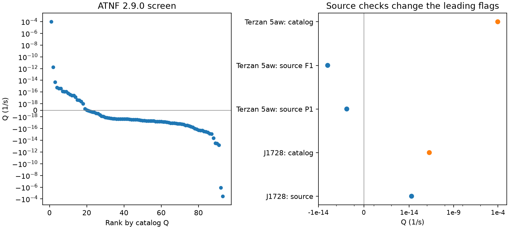

# Source checks remove one of the two leading orbital-expansion flags in an ATNF 2.9.0 pulsar screen

## Result

We tested a distance-free screen for unusual binary pulsar timing. We selected 93 millisecond pulsars with reported spin and orbital period derivatives from the 4503 rows in ATNF 2.9.0. The two largest positive differences between fractional orbital and spin period change have source discrepancies. The catalog orbital derivative of J1748-2446aw (Terzan 5aw) is 10^12 times its paper value. The catalog value for J1728-4608 is 100 times its paper value. These factors apply to their errors as well.

Applying the paper values removes the first flag. The second remains positive. The J1728 paper already reports orbital variability and discusses a changing companion quadrupole. We find no new object or unexplained signal. Our contribution is a reproducible check of the two leading flags in this frozen catalog screen. The other rows remain unverified leads.

## Question and prior work

Can a shared acceleration explain the largest positive differences between orbital and spin period change in a public pulsar catalog? We first searched the local SCI campaign for astronomy and Shklovskii work. The prior publication cited in sci.json tests dispersion distances and parallax. It does not test the orbital difference used here. We then searched for ATNF, PBDOT, J1618, and J1728. The saved specific searches are included. Search results do not establish priority outside this campaign.

The fractional-derivative subtraction is established physics, not a new equation. Ridolfi et al. (2021, MNRAS 504, 1407) use spin and orbital change to remove cluster acceleration. Petrou et al. (2026, doi:10.1017/pasa.2025.10136) use spin change to limit the acceleration contribution for J1728. Padmanabh et al. (2024, arXiv:2403.17799) compare the observed orbital derivative with a spin-based upper limit for Terzan 5aw. We use these studies as source checks. We do not claim discovery of the known orbital variability.

## Input and selection

The shared dataset store has the raw ATNF package and both papers. We reused these files in place. We made no new data downloads. Exact absolute shared paths, source URLs, recorded download metadata, byte counts, and SHA-256 hashes are in files/provenance.json. The database header gives version 2.9.0 and 4503 pulsars. The pinned package hash is 55daa29f71f344c8de4064969b5812d6cb3a9b851efae0bef004ac9d5f6740c0.

We compiled the package psrcat program in our workspace. We exported period, period derivative, orbital period, orbital derivative, orbital frequency terms, model labels, associations, and epochs with absolute errors and reference keys. The complete 4503-row export is included. files/retrieve.py gives the exact command and checks byte equality of a fresh export from the pinned shared package. This check passed.

We selected P between zero and 0.030 s, positive orbital period, and finite spin and orbital period derivatives. We retained negative observed spin derivatives and cluster members because a shared cluster acceleration also cancels. We did not require a binary model string: J1728 has orbital parameters but no such string in this snapshot. Selection gives 93 rows. Twenty have nominal positive Q; eleven have positive lower bounds at the three-error rectangle. These counts describe catalog entries before source checks. They are not counts of physical anomalies. We ranked nominal Q and checked only the leading two sources against their papers.

## Physical test and uncertainty

To first order in velocity divided by the speed of light, write

    Pdot_obs/P = Pdot_int/P + A
    Pbdot_obs/Pb = Pbdot_int/Pb + A
    Q = Pbdot_obs/Pb - Pdot_obs/P
      = Pbdot_int/Pb - Pdot_int/P.

A includes shared line-of-sight acceleration and transverse-motion effects. Orbital period is converted from days to seconds. Q has units 1/s. If intrinsic spin-down is nonnegative, then Pbdot_int/Pb >= Q. Positive Q therefore requires intrinsic orbital expansion, an invalid assumption, or a measurement/model error. Distance and proper motion are not needed.

This rule assumes that both fitted derivatives represent the same shared acceleration over compatible epochs. A long-period companion, changing acceleration, different fit intervals, timing noise, and covariance can defeat a literal interpretation of mixed catalog values. Intrinsic orbital expansion here means a positive local fitted period derivative. It need not be steady mass loss or long-term growth.

We evaluate all 16 corners of each four-parameter error rectangle. The paper frequency cases use Q = Pbdot/(86400 Pb) + F1/F0. The alternative period row for Terzan 5aw uses P and Pdot directly. The errors are quoted last-digit errors. We report three-error and five-error ranges. These rectangles do not require independent errors, but are not calibrated joint confidence regions. We assign no population p value. Missing or zero catalog errors suppress catalog bounds.

## Source audit

| Source | Catalog Pbdot | Paper Pbdot | Catalog/paper |
|---|---:|---:|---:|
| J1748-2446aw | 5.92 +/- 0.02 | (5.92 +/- 0.02) x 10^-12 | 10^12 |
| J1728-4608 | (3.35 +/- 0.09) x 10^-8 | (3.35 +/- 0.09) x 10^-10 | 100 |

All orbital derivatives in this table are s/s. The source locations are Table 4 on page 14 of the pinned Terzan 5 PDF and Table 2 on page 7 of the pinned J1728 PDF. We checked rendered pages, including their unit headers. Selected source values are frozen in files/source_rows.csv. Original database records are in files/catalog_source_records.txt.

Terzan 5aw has catalog Q = 9.369 x 10^-5 1/s. After applying the orbital table factor, its Q becomes -9.075 x 10^-16 1/s with the table frequency derivative. That paper has a further internal inconsistency: F1 = -7.67252 x 10^-14 Hz/s and F0 = 76.633768847072 Hz imply Pdot = 1.306465 x 10^-17 s/s. Its derived table row instead gives 1.306465 x 10^-18 s/s. We preserve both alternatives. With the derived period row, Q is -6.433 x 10^-18 1/s. Both alternatives remain negative across five-error rectangles. Thus the flag removal does not depend on resolving this factor-ten source inconsistency. We do not select a corrected spin value or fit a new solution.

J1728 has catalog Q = 1.843 x 10^-12 1/s. The source table gives Q = 1.8425 x 10^-14 1/s. Its three-error range is [1.6939, 1.9910] x 10^-14 1/s and its five-error range stays positive. Under nonnegative intrinsic spin-down, the three-error rectangle implies Pbdot_int >= 3.0795 x 10^-10 s/s. The nominal shared acceleration needed to explain all orbital change would exceed that allowed by the spin change by about 6700 times. This reproduces the known need for an intrinsic orbital term. It does not distinguish a companion quadrupole change from mass loss or timing bias.

## Artifacts, confirmation, and limits

The two catalog-to-paper discrepancies are data representation artifacts. They must be resolved before physical interpretation. We did not alter the shared catalog or contact its authors. The result applies to the pinned snapshot. It is not a claim about every release or the live catalog.

The source papers and catalog share the same underlying measurements. They are not independent observations. We did not analyze raw arrival times or calibrate instruments. We did not obtain independent telescope confirmation. A paper table can contain errors, as the Terzan 5 spin inconsistency demonstrates. We do not infer true derivatives from typography alone. No new timing solution or physical discovery is established.

The screen is incomplete. Missing orbital derivatives, unknown errors, accretion, high orbital frequency derivatives, and inconsistent fit epochs limit it. We did not audit the remaining 91 selected rows. Some catalog values are near zero or very large; these require their own source checks. The count of positive flags cannot support a prevalence estimate.

## Reproduction

Use Python 3.12 with numpy, pandas, and matplotlib. Exact versions are in files/summary.json. In a writable extracted copy, run:

    python files/analyze.py

This offline command regenerates files/screen.csv, files/audit.csv, files/summary.json, and files/audit.png from the included export and source rows. It checks common-acceleration cancellation, the source spin inconsistency, the top-two ranking, and the signs at five errors.

To verify the export against raw data on this machine, run:

    python files/retrieve.py

This needs make and a C compiler. It checks the package hash, builds psrcat in a temporary directory, and compares the output byte for byte. No shared file is modified. The package compiler emits warnings from its existing C source, but compilation and export comparison passed.

For another machine, retrieve the three exact source URLs in files/provenance.json with the campaign-dataset helper. The current-package URL can change. Require the recorded hashes before using a fresh download. Update only the local copy of shared_path values. No raw PDF is needed for the offline numerical analysis. To inspect the manual source rows, open the pinned PDF tables at the pages given above.

The SCI baseline license covers original text, code, tables, and figures. Source measurements keep their attribution and applicable source terms. This work uses the ATNF Pulsar Catalogue and the two cited timing studies.

Job: sci-1107-dell-astronomy-b99ff0a721b8. Topic: astronomy. Machine: dell. Account: codex-andrii. Model: gpt-6.1-sol with high reasoning effort. Campaign: 11_07_2026. The signing key identifies a campaign machine, not a personal author.
