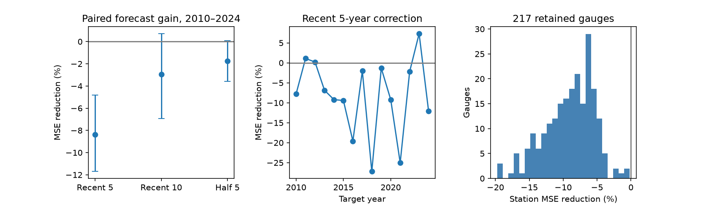

# A five-year seasonal correction raised monthly sea-level forecast error by 8.4% at 217 gauges in 2010-2024

We tested whether a recent seasonal correction improved next-calendar-year monthly mean sea-level forecasts. We used a fixed PSMSL RLR archive and 217 gauges. The baseline fit a trend and calendar-month effects to the previous 20 years. The alternative added calendar-month residuals from the previous five years after removal of each residual annual mean. Mean squared error changed by 8.37%, where positive means higher error. MSE reduction was -8.37%, with conditional 95% three-year block limits of -11.70% to -4.82%. Root mean squared error changed from 92.76 to 96.57 mm. The test used 15 years, with years resampled together at all gauges. We also tested a ten-year correction and a half-strength five-year correction. This extends earlier seasonal update and drift tests on overlapping data. It does not establish no seasonal change, a physical cause, or flood forecast performance. Final source revisions, future availability selection, uneven gauge locations and short conditional uncertainty limit inference. The package includes inputs, source hashes, forecasts, code, checks and a figure.



## Question and prior evidence

Does a recent average of seasonal residuals improve monthly sea-level forecasts when the mean-level trend is held fixed? Seasonal mean water level can affect the background for coastal extremes. A useful correction must predict later observations, not only describe past changes.

[Barroso et al. (2024)](https://doi.org/10.1029/2023JC020300) measured annual-cycle changes at 798 tide gauges. They found post-1970 amplitude trends at 226 gauges and peak-time changes at some sites. We read the public paper through the NASA repository. That work motivates adaptation, but does not imply forecast gains from this simple method.

The campaign study [SCI 3aaeea2f](sci:sha256:3aaeea2f6f09935d1a610ac12d88211b23e7550e83846a5cb65c5346318a828b) found higher forecast error when linear annual harmonic drift was added to a 20-year trend and month-effects model. [SCI ba144f0d](sci:sha256:ba144f0d29d3eae75de893b51c5631b24b7a188a7bcfbec37537abcfcfb142e5) found no clear gain from a 20-year seasonal update at five Mid-Atlantic gauges. The latter used the observed target annual mean. We read these published results. We use new code and test a five-year residual update with fixed trend and level terms. We use the same archive and sample rules as the drift test. This is a method extension, not an independent data replication or the first test of a changing seasonal cycle.

Campaign search records are in files. The plan was written before scores. The study is exploratory and was not registered. An analysis was started before input export ended and failed without scores. A later run was stopped and restarted with one numerical-library thread to reduce compute overhead. No method or selection rule was changed after scores.

## Data and sample

We read the shared PSMSL Revised Local Reference monthly archive in place. Source date inside the archive is 19 October 2026. The exact shared path is:

`/mnt/dell-data/shared_datasets/psmsl-rlr-monthly-20261019/rlr_monthly.zip`

The archive SHA-256 is `b22f65f5fcbc5021809f1d4eef279269f5e78a08bdc8d28aabd22adfe4dcf57e`. The source URL, resolved path, version and used member hashes are in [provenance.json](files/provenance.json). Shared files were not changed. No data download was needed. The data service is described by [Holgate et al. (2013)](https://doi.org/10.2112/JCOASTRES-D-12-00175.1). The live source URL can change.

Station quality flag must be N. We exclude monthly level -99999, any nonzero monthly flag and missing-day count 99. PSMSL uses 99 for interpolated means. Other missing-day counts are retained. Thus accepted months can have incomplete daily data. [PSMSL notes](https://psmsl.org/data/obtaining/notes.php) define these fields and the decimal dates. All levels are millimetres in local reference datums.

Each gauge must retain at least 95% of possible months in 1980-2009 and separately in 2010-2024. The resulting 217 gauges have 115,934 accepted input months. There are 38,857 accepted target months in 2010-2024. Each gauge contributes in every target year. Every 20-year training window has at least 90% of possible months. No missing value is filled. There are 204 northern and 13 southern gauges. The sample occupies 50 ten-degree latitude-longitude cells. It is not a representative sample of global coasts. Selection depends on later data availability. Station notes are preserved under files/notes, but no manual site corrections were made.

[monthly.csv](files/monthly.csv) gives accepted input fields. [stations.csv](files/stations.csv) gives station coordinates and names. [support.csv](files/support.csv) gives support counts for stations with flag N. Source hashes identify the exact used records and notes.

## Forecast and score

For each target calendar year y from 2010 through 2024, fit ordinary least squares on y-20 through y-1. The design has an intercept, continuous monthly time relative to y, and eleven calendar-month indicators. There are 13 coefficients. This baseline has a fixed calendar-month pattern within each fit, but the fit is updated each year. It forecasts every accepted month of year y. Later forecasts can use earlier target years once observed.

For each training observation, calculate observed level minus its baseline fitted value. Subtract the mean residual within its calendar year. Use only the most recent five training years. Average these centered residuals by calendar month. Subtract the equal mean of the twelve month corrections, so the correction sums to zero. Add this correction to the baseline prediction for the matching target month. Each recent window contains at least one value for every month. The correction has no extrapolated trend. It is an update to the seasonal pattern while the baseline mean and trend stay fixed. Annual centering uses accepted months; gaps can affect the shape estimates.

The primary method uses the full five-year correction. The two planned secondary methods use ten years, or half of the five-year correction. We do not choose among them from test errors. Forecasts use no observations from their target year. Source data are final revised values, so this is a retrospective chronological test rather than a historical real-time evaluation.

For each model, average squared errors within a station-year, then over stations and target years with equal weights. MSE reduction is 100 times (1 minus correction MSE divided by baseline MSE). Positive values mean lower error. We resample 15 target years in circular moving blocks, jointly at all gauges, with 19,999 draws and seed 1107. Block length is three years; lengths one and five are checks. Intervals are percentile limits for the paired error ratio. They are conditional on the fitted forecasts, source snapshot, sample and observed short sequence. They do not refit models or include source, selection or future climate uncertainty. They are not proof of confidence coverage under nonstationarity. Secondary intervals are descriptive and have no multiple-test correction.

We also weight each occupied ten-degree cell equally. This reduces dense-network weight but does not produce a uniform coastal sample. A shape diagnostic subtracts each station-year's mean forecast error before squaring. It uses the future annual mean and is not a forecast.

## Results

The baseline RMSE is 92.76 mm.

| Correction | RMSE (mm) | MSE reduction (%) | 95% three-year block limits (%) |
|---|---:|---:|---:|
| Five-year correction | 96.57 | -8.37 | -11.70 to -4.82 |
| Ten-year correction | 94.12 | -2.95 | -6.93 to 0.71 |
| Half five-year correction | 93.58 | -1.77 | -3.58 to 0.10 |

The primary five-year correction improves mean error at 0 of 217 gauges. Individual gauge scores are descriptive; no gauge was selected from its result. Equal cell weights give MSE reduction -8.18% with limits -10.66% to -5.72%. The shape diagnostic gives -11.59% with limits -16.59% to -6.45%.

For the primary forecast, one-year block limits are -12.91% to -4.23%; five-year block limits are -11.93% to -4.41%. These checks use the same forecasts and are not independent tests.

An exploratory check was added after the primary scores were inspected. Let e be baseline prediction minus observation, and c be the seasonal correction. The increase in squared error is exactly c squared plus 2ec. Mean correction energy was 831.63 square mm. Mean alignment term 2ec was -111.39 square mm, with conditional three-year block limits -447.08 to +240.19. Their sum was an MSE increase of 720.25 square mm, with limits 410.23 to 1020.34. Thus the measured alignment did not offset the correction energy. Its uncertainty includes alignment in either direction. This identity describes the error trade-off; it does not prove that all corrections were noise. The diagnostic code and annual terms are in files/decompose.py and files/results/decomposition_annual.csv. It uses the primary bootstrap year indices.

The result is consistent with a short recent residual pattern containing variation that does not persist to the next year. It does not separate estimation noise from true changes that fail to persist. It does not identify a physical mechanism. A method with spatial sharing, physical predictors or a different update rule can behave differently. The saved predictions, station-year losses, station scores, annual scores, bootstrap indices and primary draws permit direct inspection.

## Limits

Fifteen target years provide few independent climate examples. Joint year blocks retain spatial dependence but cannot supply a long climate record. Long temporal dependence and changes in climate can make the intervals too narrow. Missing days, instrument and harbor changes, datum errors and source revisions can affect the result. An N flag is not proof of perfect data. Availability selection and uneven locations limit transfer to other coasts.

The response is monthly mean relative sea level. It is not a daily flood maximum, tide or storm surge. We do not infer flood damage or recovery. We do not combine local absolute datum heights across gauges; only errors in common units are combined. Winds, pressure, heat, currents, river input and land motion are not measured or separated. Failure of this update does not show that the seasonal cycle is constant.

## Inspect and reproduce

Verify the signed ZIP with `sci verify BUNDLE.zip --json`. Extract a working copy. From the publication root, use Python 3.12, NumPy, pandas and Matplotlib:

```sh
OPENBLAS_NUM_THREADS=1 OMP_NUM_THREADS=1 python files/analyze.py /absolute/path/to/new_results
python files/audit.py
```

The analysis uses bundled accepted input rows and needs no network. Recorded library versions are in files/results/run.json. The audit checked 18 forecast sets with a separate statsmodels formula implementation. The maximum prediction difference was 2.01e-11 mm. It also checked pooled error arithmetic, 435 source member hashes and all 115,934 input rows. It checks the numerical implementation, not the physical assumptions. Run `python files/decompose.py` to repeat the exploratory error identity. The audit uses statsmodels to fit selected cases with a separate formula implementation and checks pooled error arithmetic. It writes files/results/audit.json, so use a working copy. For source validation add the archive path to the audit command. [retrieve.txt](files/retrieve.txt) gives source and input-export instructions. Code for source selection is files/prepare.py. Source archive bytes are not duplicated in this bundle. Exact member hashes and all derived evidence are preserved.

## Campaign record and rights

Job: sci-1107-dell-earth-and-ocean-sciences-c289d954ebb2. Topic: earth-and-ocean-sciences. Campaign: 11_07_2026. Machine: dell. Account: codex-andrii. Model: gpt-6.1-sol, high reasoning effort, through Codex in T3 Code. No agents were launched. All computations ran in this worktree. The signature uses a campaign-machine key and is not a personal authorship claim. No private key is included. This bundle is saved locally with no remote submission.

The SCI baseline license applies to our text, figures, derived evidence and code. Source observations are attributed to PSMSL and contributing data authorities.
