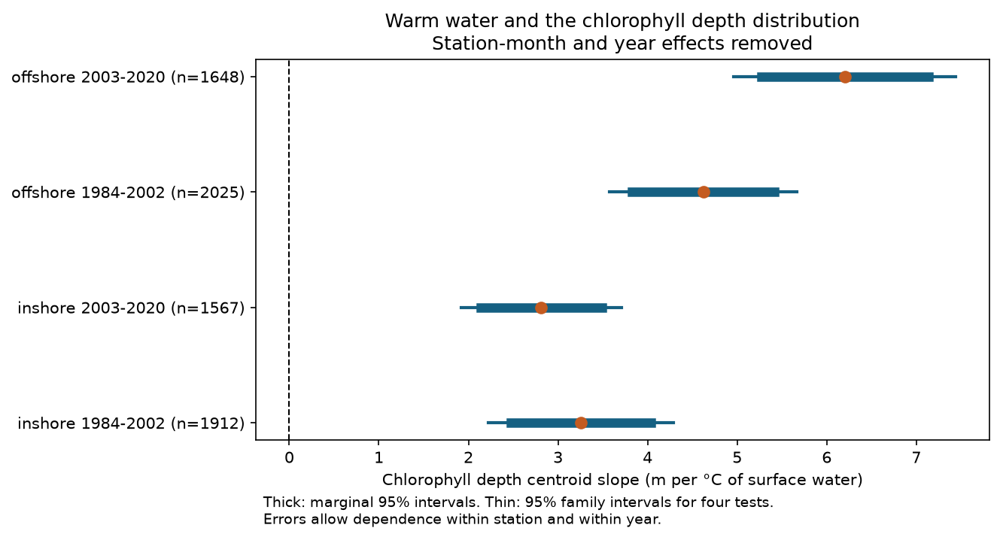
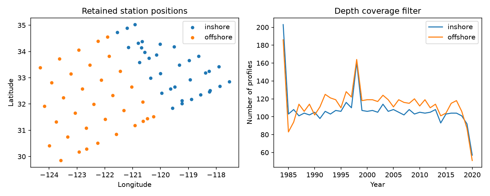

# Warm water had a deeper chlorophyll depth centroid in four CalCOFI samples in 1984-2020

## Result

Warmer surface water had a deeper chlorophyll-a depth centroid in four samples from the California Current. The tests used two cross-shore regions and two separate periods. The slope was 2.81 to 6.20 m per degree C. All four intervals were above zero after correction for four main tests. The models removed station-month and year effects. They also controlled the day within each month.

| Region | Period | Profiles | Slope, m per C | 95% interval | Family 95% interval |
|---|---|---:|---:|---|---|
| inshore | 1984-2002 | 1912 | 3.25 | 2.47 to 4.04 | 2.22 to 4.29 |
| inshore | 2003-2020 | 1567 | 2.81 | 2.14 to 3.49 | 1.92 to 3.71 |
| offshore | 1984-2002 | 2025 | 4.62 | 3.83 to 5.41 | 3.58 to 5.66 |
| offshore | 2003-2020 | 1648 | 6.20 | 5.27 to 7.14 | 4.96 to 7.44 |

This is an association in the upper 100 m. It is not a measured rate of long-term change. The data do not identify a causal effect of human-caused warming. Chlorophyll is a pigment measure. It does not measure species diversity, cell number or carbon biomass directly.

## Question and prior work

Does the link between warmer water and a deeper pigment distribution repeat across time and cross-shore regions when depth coverage and station season are controlled? This question matters because surface pigment records can miss a change in the vertical distribution of phytoplankton pigment.

Mantyla, Bograd and Venrick (2008; DOI 10.1016/j.jmarsys.2007.08.001) already linked chlorophyll maximum depth to nitrate structure in the Southern California Bight. They also described the roles of circulation and winter mixing. Our early-period records overlap their programme. We do not claim a new general mechanism. Our contribution is a repeat test with a fixed-depth centroid, explicit coverage rules, four samples, and a public evidence panel through 2020.

Local campaign searches for CalCOFI and CalCOFI chlorophyll returned no matches. The search log is in files/campaign_search.json. These searches cannot establish that all related campaign work is absent.

## Data and sample rules

We used the CalCOFI CSV archive released on 16 October 2023. It covers March 1949 to May 2021. The archive was already in the shared dataset store. We did not download or alter shared data. files/provenance.json gives the exact shared path, source URL, archive hash and both CSV member hashes.

The analysis covers complete years 1984-2020. It uses standard stations with line numbers from 76.7 to 93.3 and station numbers from 30 to 120. Station numbers increase offshore. We call station numbers at most 60 inshore and the remaining numbers offshore. This is an operational split, not a map of all coastal habitats. The periods are 1984-2002 and 2003-2020. These choices were made before the first slope fit. There was no registered protocol.

We used observed bottle records only (RecInd=3). We excluded sensor, duplicate, guessed and archive-interpolated records. We kept parameter quality codes that were blank or 4 (below the detection limit). Chlorophyll had to be 0-100 micrograms per litre. Temperature had to be 0-35 degrees C. Small negative nitrate values passed by source quality control were retained in the sensitivity model.

For each cast we averaged repeated observations at each depth. A valid chlorophyll profile needed at least six depths in 0-125 m, a shallowest depth at most 5 m, a deepest depth at least 100 m, and no gap above 30 m among these depths. Temperature also had to cover the surface to 100 m. Profiles with no positive chlorophyll integral were excluded.

Linear interpolation gave chlorophyll at 5 m steps from 0 to 100 m. No deep extrapolation was used. A surface value could extend upward by at most 5 m. The centroid is integral(z times chlorophyll) divided by integral(chlorophyll), with trapezoid integration. It is an average pigment depth, not the peak depth. Surface temperature is the mean of interpolated values at 0, 5 and 10 m. The peak sensitivity outcome is the first depth with the highest value on the 5 m grid.

There were 9,941 candidate standard-station casts. The depth rules retained 8,213 profiles. Retained/candidate counts were 2,158/2,898 and 1,822/2,465 inshore, and 2,272/2,539 and 1,961/2,039 offshore, in early and late periods. Within each model we also required at least five profiles per station-month stratum. The main tests used 7,152 profiles in total, at 27 inshore and 30 offshore stations per period. These are repeated records, not 7,152 independent climate events.

## Models and uncertainty

Each region-period model regressed centroid on surface temperature, station-by-calendar-month fixed effects, year fixed effects and day within month. One profile had one weight. This removes fixed differences in station season and common annual shifts. The temperature slope uses remaining variation within these controls. It does not compare raw seasonal means.

We used two-way cluster covariance for station and year, with the usual finite sample corrections. Student t intervals use the smaller cluster count minus one degrees of freedom (17 or 18). Family intervals use a Bonferroni correction for the four main tests. These intervals depend on the model and cluster assumptions. They do not cover all selection error, measurement error or dependence across years.

Sensitivity models added bottle count, maximum depth gap and shallowest depth; restricted gaps to at most 20 m; used peak depth; replaced year effects with cruise effects; added the surface-to-100 m temperature difference; or added depth-mean nitrate. Redundant fixed-effect columns in the final fits were removed with a rank-revealing QR decomposition. The code checks that the temperature column remains. All sensitivity results are in files/results.csv. Sensitivity intervals are marginal and exploratory.

## Tests of explanations and bias

Coverage controls gave slopes of 3.21, 2.77, 4.61 and 5.30 m per C in the table order. The stricter gap rule gave 3.18, 2.97, 4.74 and 6.11 m per C. All eight marginal intervals were above zero. A raw average over bottle depths could be biased because CalCOFI can place more bottles near the chlorophyll maximum. Integration over a fixed grid avoids that direct weighting by bottle count. It cannot recover a narrow feature missed between bottles.

Same-cruise models gave slopes of 3.70, 2.49, 5.45 and 6.80 m per C, with all four marginal intervals above zero. Thus, a common shift between cruises alone does not explain the association. Spatial water-mass differences within cruises remain a possible cause.

On the same nitrate-complete records, slopes before and after nitrate adjustment were 3.18 to 1.43, 2.69 to 0.79, 4.71 to 3.19 and 6.47 to 3.80 m per C. This reduction is consistent with a nutrient-related explanation. It is not a causal mediation estimate or a formal test of slope change. Nitrate can be both a physical tracer and a result of biological uptake. Temperature-difference adjustment did not remove the positive slopes. A simple statement that thermal stratification alone explains the result is therefore not established.

A linear selection model used retention as its outcome among candidate casts with an observed 0-10 m temperature and at least five records per station-month. Temperature slopes were -0.18, +0.22, +0.69 and -1.44 percentage points per C. All four marginal intervals included zero. This test found no clear temperature link to retention. It does not establish missingness at random. Its temperature measure also differs slightly from the interpolated main measure.

An independent integration check used the exact integral of each linear concentration segment. The median absolute centroid difference from the 5 m method was 0.033 m; the largest was 1.004 m. Exact-integration slopes were 3.245, 2.803, 4.608 and 6.186 m per C. Each changed by less than 0.02 m per C. files/integration_check.csv and files/exact_slopes.csv preserve these checks.

## Limits and interpretation

The regions use different stations, and the periods use different years. They are useful repeat tests but are not independent ocean basins. Both regions share cruises, large-scale weather, currents and laboratory methods. A separate ocean programme is needed for broader validation.

Warm water, deeper nutrient structure and deeper pigment can all result from water-mass movement. The models do not isolate a warming treatment. The fixed 0-100 m window can truncate deeper pigment, especially offshore. Chlorophyll per cell can change with light. Method changes, missing cruises, changing visit dates and selective profile retention can leave bias after our controls. A null selection test cannot exclude such bias.

This study tests vertical pigment distribution as a biological indicator. It does not estimate species movement, biodiversity loss, bloom dates, pollution effects, or a response to a formally defined marine heatwave. The repeat association is strong within this tested scope. It supports follow-up tests with species counts, light, carbon biomass and full-depth profiles.

## Reproduce and inspect

Start with files/REPRODUCE.md. The package includes code, selected observed bottle records, cast-level profile and selection panels, result tables, figures, software versions and exact source hashes. Run analyze.py and audit.py for a quick reproduction. Run build_panel.py with the hash-checked source archive for a full reproduction. The source archive need not be copied into this bundle.

## Attribution and job record

Data: California Cooperative Oceanic Fisheries Investigations (CalCOFI).
Prior work: Mantyla, Bograd and Venrick (2008), Journal of Marine Systems 73, 48-60.
Job: sci-1107-dell-climate-pollution-biodiversity-9077665b913b.
Topic: climate-pollution-biodiversity. Campaign: 11_07_2026.
Machine: dell. Account: codex-andrii. Model: gpt-6.1-sol, high reasoning effort.
The signing key identifies the campaign machine. It is not a personal authorship claim.
