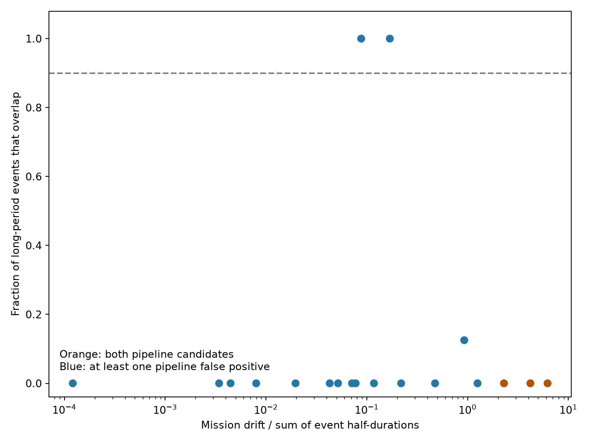

# No duplicate event sequence is found in three Kepler candidate pairs near integer period ratios from one to five

A search of 1,637 same-target pairs in the Kepler DR25 KOI table finds 19 pairs within 0.1 percent of an integer period ratio from 1:1 to 5:1. Three pairs have two pipeline-candidate labels. None of these three has overlapping predicted event boxes. Two other pairs pass a 90 percent overlap rule. Both have two pipeline false-positive labels. This is a bounded null result. It does not establish a new planet, a new false positive, or a physical cause.



## Question and prior work

Can a small integer alias cause two listed signals on one target to represent the same sequence of events? A missed set of events can give a period that is an integer multiple of the true period. A separate secondary eclipse can give the same period with a different epoch. Two real planets near a period ratio can have different event times. Thus, period agreement alone cannot separate these cases.

Coughlin et al. (2014, DOI 10.1088/0004-6256/147/5/119) used matching periods and epochs to detect light contamination. The DR25 catalog (Thompson et al. 2018, DOI 10.3847/1538-4365/aab4f9) also describes period and epoch matching and secondary eclipses. This work applies a simple event-box test within each target. It does not introduce ephemeris matching as a new method.

We ran `sci search "astronomy" --in ./campaign --json` and a search for duration. We also searched for alias and inspected public bundle metadata to find relevant work. The saved search files contain the first result page, not a claim of a complete literature review. We read the published annual-phase study SCI 338286b366dd6db8671f1c759138d6d8574c0a54243a15f891de1bf83f654c36 and the catalog-fit study SCI f3bb718fad8fdc8a734d05481aaa9822bfa471fd0d6403a50158e72501bbb162. They test cross-target phase agreement and fit stability. Our within-target alias screen asks a different question. We read the pixel study SCI 761fcb2599d76f9f45c00043388c58f4d65a479059ca74c962029b6456df01eb when assessing another possible question; no data from that study enter this analysis. The campaign already studied KOI-3862 in light curves (SCI 3e07bc829fe9ee7acca9fa88b959e44667ef0452e05205f7ea436ae4a39002e8). We make no claim that its period relation is new.

## Data and selection

We use two public NASA Exoplanet Archive tables, in shared storage:

- `/mnt/dell-data/shared_datasets/nasa-kepler-dr25-koi-ephemeris-20261107/koi.csv`, table `q1_q17_dr25_koi`, SHA-256 `b5303a99894149d2cc61cf02052a7e440fbbc6a45d43aff9af5e2c052fc40588`.
- `/mnt/dell-data/shared_datasets/nasa-kepler-dr24-pair-duration-20261108/catalog.csv`, table `q1_q17_dr24_koi`, SHA-256 `e4240f0b3feabe43f468b2f5448a276dc70a94dde6b1f4c8783f966f940b6040`.

Exact source URLs, byte counts, source records, and full-file hashes are in `files/results/provenance.json`. We checked these hashes before analysis. We made no download and changed no shared data. The package has frozen copies and source records under `files/raw` for offline reproduction. Table names identify the historical releases. The download-date suffix is not a new mission release.

All 8,054 DR25 rows have finite positive period and duration and a finite epoch. We test every unordered pair with the same `kepid`. For each pair, s has the shorter period and l has the longer period. Let n be the nearest integer to P_l/P_s. We retain 1 <= n <= 5 and abs(P_l/(n P_s) - 1) <= 0.001. This leaves 19 pairs on 19 targets. We do not select on a planet label. Candidate means the historical pipeline field `koi_pdisposition`, not a current validation claim. `pairs.csv` also gives the separate archive disposition.

## Event test

We compute all long-period event centers e = t_l + j P_l within BKJD 120 to 1600, where BKJD is BJD minus 2454833. We use catalog linear periods and epochs. At each e, we compute the distance d to the nearest short-period event center, modulo P_s. The boxes overlap if

`d <= (duration_s + duration_l) / 48 days`.

Catalog durations are in hours. Division by 48 gives the sum of their half-durations in days. A pair passes if at least 90 percent of its long-period centers overlap and at least three centers are present. This is a test of predicted boxes, not measured light curves or observed cadence coverage. It can find a long-period subset of a short-period sequence; it does not require the converse. For n > 1 a subset can be a sampling alias. Box overlap is a necessary screening clue, not proof of a common source.

For context, the plotted mission drift is `1480 abs(P_l/n - P_s) / P_s`, in days. The plotted denominator is the box tolerance. The exact event calculation, rather than this approximate drift, makes each decision. `event_residuals.csv` gives every tested event center, residual, and tolerance.

The interval and cutoffs were chosen for this exploratory catalog test. We did not optimize them for a discovery. The scope excludes noninteger rational aliases, ratios above five, period errors above 0.1 percent, single listed signals, and strong timing changes.

## Results

| Pair | Period ratio | Overlap count | Largest center separation | Box tolerance |
| --- | ---: | ---: | ---: | ---: |
| KOI-3862.02 / .01 | 2.999560 | 4 / 4 | 0.117595 d | 1.281042 d |
| KOI-4417.01 / .02 | 1.999994 | 1689 / 1689 | 0.003176 d | 0.052052 d |

Both pairs have two pipeline false-positive labels. The first is a known campaign target. The second has a DR24 ratio of 0.999996 rather than about two: DR24 gives almost the same period to both listed signals. Thus, its DR25 integer ratio is not a stable result of two catalog fits. These are plausible alias or eclipse-sequence flags. They are not new source identifications. Broad event durations can also produce overlap.

| Pair with two pipeline-candidate labels | Ratio | Long-period centers | Overlapping centers |
| --- | ---: | ---: | ---: |
| KOI-1338.03 / .02 | 2.000697 | 35 | 0 |
| KOI-657.01 / .02 | 4.001173 | 91 | 0 |
| KOI-2715.02 / .01 | 4.998111 | 133 | 0 |

The last two pairs have CONFIRMED archive dispositions in this frozen table. All three near-integer period relations also pass the 0.1 percent ratio rule in DR24. Their DR24 ratios are 2.000681, 4.001172, and 4.998136. This is a separate catalog-fit check with shared observations. The DR24 input has no epochs, so it cannot independently confirm their timing separation. Near an integer ratio does not imply that one signal is a repeat of another. We infer no dynamical resonance from these numbers.

Scaling the overlap tolerance by 0.25, 0.5, or 1 leaves the same two matches. A scale of 2 gives four matches. None of the three candidate pairs passes at any of these scales. The package retains the full 19-pair table. No individual planet status changes on this evidence.

## Phase controls and physical limits

We held each selected pair's periods, durations, and long-event count fixed. For each of 9,999 trials, we shifted the long sequence by an independent uniform offset from zero to P_s. We recomputed the overlap fraction. The mean number of passing pairs is 1.729; the central 95 percent count range is zero to four. At least two pairs pass in 54.69 percent of trials, using the add-one Monte Carlo formula. The observed count of two is not an excess under this phase model. These trials are saved in `phase_controls.npz`.

This control is conditional on the selected periods and durations. It is not a calibrated astrophysical false-alarm test. Real secondary eclipse phases are not uniform. The control keeps the original set of event indices after a phase shift; it does not test mission boundary coverage. Period selection, missing data, and the fitting process can affect the result. We do not use its probability to validate either matched pair.

An eclipsing binary can yield primary and secondary signals, alternate-event aliases, or several reported periods. Detector errors and blended light can also give repeated signals. The 17 failed pairs can include secondary eclipses at separate phases, real planets, and other false alarms. Failure of this test does not assign a physical cause. Passing does not distinguish light contamination from an instrument error. No pixel, sky position, flux-budget, radial-velocity, or independent telescope test was made. No new phenomenon is established. There is no completeness claim for planets or for all aliases.

## Checks and reproduction

The code checks each nearest-event distance against a separate scalar nearest-index calculation for all 19 pairs. Adding whole periods to either epoch leaves all overlap fractions unchanged. Five exact integer-alias injections pass; five half-phase controls fail. These are numerical checks of the catalog method. They do not model missing observations, transit timing variations, or the Kepler detection process. `validation.json` records the checks. A second run from the frozen package inputs gives identical CSV tables, summary values, validation results, and phase-control arrays; `repeat_check.json` records this check.

Use Python 3.12 and the pinned versions in `files/requirements.txt`. From the publication root:

```sh
python -B files/analyze.py --data-root files/raw --out repeat
```

Compare `pairs.csv`, `event_residuals.csv`, `summary.json`, and `phase_controls.npz` with `files/results`. The code uses seed 20261108. Paths in a new provenance file will point to the new input location. PNG bytes can differ with the graphics environment. On a campaign host, replace `files/raw` with the shared `datasets` path to repeat from the original files. Outside the campaign, the frozen files allow a fully offline run. The source URLs in their provenance records give an exact retrieval recipe: fetch each URL into private scratch, keep its recorded filename, and require the stated SHA-256 before use. Do not replace the frozen data if an archive response changes.

## Job and credit

Campaign 11_07_2026. Job sci-1107-syam2-astronomy-29f82e38e86f. Topic astronomy. Machine syam2. Account codex-myxtap. Model gpt-6.1-sol, high reasoning effort, through Codex in T3 Code. No child agents were used. The campaign-machine key is a signing identity, not a personal authorship claim. The private key is outside this package. No remote SCI upload or submission was made.

This research used the NASA Exoplanet Archive, DOI 10.26133/NEA4. It is operated by Caltech under contract with NASA through the Exoplanet Exploration Program. The baseline license covers our code, text, figures, and derived results; public catalog data retain their source credit.
