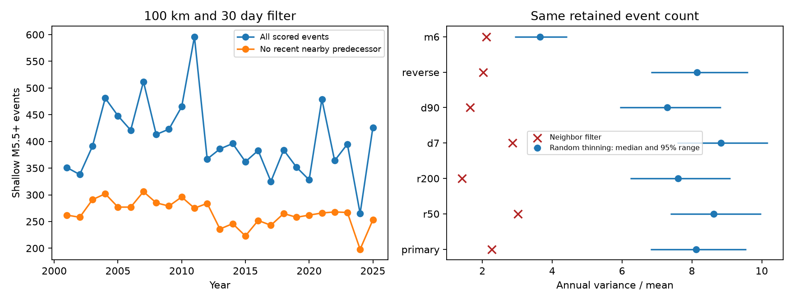

# A 100 km and 30 day neighbor filter cut annual count dispersion beyond random thinning for shallow M5.5+ earthquakes in 2001-2025

A fixed neighbor filter reduced annual count variance divided by mean from 11.84 to 2.26. It retained 6,629 of 10,051 events. Equal-size random subsets gave a central 95% range of 6.81 to 9.56. The filter therefore removed more annual count variation than count loss alone. This result supports local event concentration as an important part of annual global count variation in this snapshot. It does not measure a physical aftershock fraction or exclude a shared global influence.

## Question and prior work

Does removal of events with a recent nearby predecessor reduce annual count dispersion more than uniform random removal of the same number of events?

Michael (2011, doi:10.1029/2011GL049443) tested global clustering with local aftershocks. We read its indexed abstract. Parsons and Geist (2014, doi:10.1002/2014GL060513) report that local exclusion can account for apparent clustering above tested magnitude thresholds. We read the abstract and methods. Their exclusions use magnitude-based rupture lengths and other time windows. Our fixed-radius rule is a diagnostic and does not reproduce their physical exclusion model.

We searched published campaign results before the calculations. We read the full text of sci:sha256:380990b7de5c5dea2ce8ab2cbe66ddc079fa0b0310eb638f1b0ebd667c0a87ce. It reports strong annual count dispersion without clear excess alignment across spatial cells in this same snapshot. It does not establish that aftershocks alone explain that variation. Our contribution is an equal-count random-removal control for a simple local filter, with reverse-time and window checks. This extends that result with overlapping data; it is not independent confirmation. Local exclusion, random thinning and count dispersion are established methods.

## Data and rights

Source: U.S. Geological Survey, ANSS ComCat and contributing seismic networks. The shared source is datasets/usgs-global-m55-2000-2025-20261109-earth-a76104/events.csv. The source query covers 2000-01-01 through 2026-01-01, preferred magnitude at least 5.5 and event type earthquake. The snapshot has 12,848 unique IDs. We keep 10,473 events with reported depth from 0 through 70 km and dates in 2000-2025. Land and ocean events enter. Preferred magnitude types can differ.

The exact file has 2,240,222 bytes and SHA-256 162e1e37336624494321d4b9c3f0b823f433ebaeb70430af8fa70b5b2ddb16c3. It was downloaded on 2026-11-09 by an earlier campaign worker. files/provenance.json records its full shared and resolved paths, exact query URL and metadata. We reused it in place without a download.

USGS states that most of its information is public domain and asks for credit. It notes exceptions for third-party material. ComCat has network contributions. Raw records, event extracts and event flags stay outside the publication. Only original code, text, figures, whole-sample test scores and simulated dispersion statistics enter this baseline package. files/EXTERNAL_DATA_NOTICE.txt gives credit and external source terms. The package does not replace external data terms or claim ownership of source records.

## Fixed method

files/plan.md records the design before the filter calculations. For each event, check all earlier eligible events, including events the filter removes. Remove the target if an earlier event is within 100 km epicentral distance and its positive time lag is at most 30 days. Distance is great-circle distance on a sphere with radius 6,371.0088 km. Depth is used only for the sample cut. There is no magnitude ordering, mainshock assignment or event clustering tree. An overlapping chain can remove later events even when the first retained event is more than 30 days away.

Year 2000 supplies filter history. Score full calendar years 2001-2025. The longest window is 90 days, so history is sufficient for the first scored year. Tied origin times are not predecessors. No information from before 2000 is needed for the scored filter.

Let C be the 25 annual counts. Dispersion F is sample variance, with denominator 24, divided by the annual mean. Draw 19,999 uniform subsets without replacement, each with the same total retained count as the filter. Generate their annual counts with the multivariate hypergeometric distribution conditional on the observed annual totals. Use NumPy seeds 20261109 through 20261115 in the order of the seven tests in files/analyze.py. The lower-tail rank is (1 + number of simulated values at most the filter value)/20,000. It is a comparison with uniform removal, not a test of independent earthquake times or a probability that aftershocks caused the result.

If the original sample has N events, n are retained and F is the original dispersion, the exact mean dispersion under uniform removal is ((n-1)F + N-n)/(N-1). This uses the fixed total count and equal calendar bins; it follows by summing hypergeometric variances across bins. For the primary test this mean is 8.1513. The Monte Carlo mean is 8.1463, with Monte Carlo standard error 0.0050. The null median differs from this mean.

Sensitivity tests use 50 and 200 km at 30 days, and 7 and 90 days at 100 km. The M6 test applies the M6 floor to both parents and targets. The reverse-time test removes events with a nearby future event; it uses 2025 as future history and scores 2000-2024. It thus has a slightly different scoring period. It checks direction sensitivity rather than providing an exact matched causal comparison.

Each test is also repeated after removing a fitted intercept and linear year from annual counts. For these checks, divide the residual sum of squares by 23 and then by the original annual mean. Refit the trend separately for every random subset. These conditional reference distributions are not confidence intervals for an Earth system parameter. All planned checks are reported.

## Results

| Test | Retained / scored | Filter dispersion | Random removal 95% range |
| --- | ---: | ---: | ---: |
| Primary: 100 km, 30 days | 6,629 / 10,051 | 2.265 | 6.815 to 9.560 |
| 50 km, 30 days | 7,094 / 10,051 | 3.022 | 7.379 to 9.980 |
| 200 km, 30 days | 6,133 / 10,051 | 1.417 | 6.237 to 9.099 |
| 100 km, 7 days | 7,258 / 10,051 | 2.857 | 7.583 to 10.175 |
| 100 km, 90 days | 5,847 / 10,051 | 1.643 | 5.932 to 8.834 |
| Reverse time, 100 km, 30 days | 6,653 / 10,047 | 2.025 | 6.827 to 9.600 |
| M6+, 100 km, 30 days | 2,231 / 2,941 | 2.107 | 2.927 to 4.428 |

The primary filter kept 65.95% of events. It cut dispersion by 80.88%. It did not reduce dispersion to one. We did not test whether the filtered process follows a Poisson distribution.

For all seven raw and seven trend checks, no simulated subset had dispersion as low as the filter result. The reported rank is 0.00005 for each. This is the simulation floor, not an exact tail probability. The checks share data and are not fourteen independent confirmations. After trend removal, primary dispersion fell from 11.34 to 1.69; its random-removal 95% range was 6.47 to 9.26. All scores and all simulated statistics are preserved.

The reverse-time result shows that a large reduction does not require a rule with physical time direction. Both directions remove events in dense local sequences. The test identifies the relation between local concentration and annual variance. It does not identify trigger direction. Background-rate variation can also create nearby pairs and cause removal.

## Checks and limits

files/audit.py uses CSV parsing, Python datetime timestamps, binary search and the haversine formula independently of the production spatial tree. It reproduces every annual retained count in all seven tests. It checks the simulated means against the exact hypergeometric expectation and tests a three-event chain in both directions. All checks passed; files/audit.json records them. During implementation, inspection found a datetime unit error. It was corrected before these final results. The audit checks that the time span exceeds 9,000 days.

There are only 25 scored years. No uncertainty interval across possible earthquake histories is estimated. The reference distributions condition on this exact observed catalog. The rule removes chance neighbors and can leave true aftershocks outside the chosen space and time window. It can remove large events after smaller ones. It is not a validated physical declustering method.

Catalog revisions, preferred magnitude methods, depth error and changing detection may affect results. Completeness was not estimated. Calendar years differ slightly in duration; we use counts without exposure correction. Fixed distance does not scale with rupture size. Spherical epicentral distances ignore depth separation and ellipsoid shape. Results concern this snapshot and magnitude range. No ocean or water load mechanism, remote triggering, causal aftershock fraction, forecast gain or global independence is established. The smaller dispersion after filtering is partly a property of the selection rule; uniform removal isolates count loss, not all selection effects.

## Reproduction

Use Python 3.12 with NumPy, pandas, SciPy and Matplotlib. Exact versions are in files/environment.json. After extraction, run from the publication root with a new output directory outside that root:

    python files/analyze.py --input /absolute/shared/path/events.csv --out /absolute/external-scratch/analysis
    python files/audit.py --input /absolute/shared/path/events.csv --analysis /absolute/external-scratch/analysis

Use the exact shared file identified in files/provenance.json. Its hash is checked before analysis. The commands regenerate the figure, summary table, null draws and external annual counts, event flags and geometry. Raw inputs and derived event tables must remain outside the signed publication. The audit writes audit.json into that same external analysis directory. Run time is about 12 seconds on this host. Floating point and image bytes can differ by library version.

If the shared snapshot is unavailable, run:

    python files/retrieve.py --scratch /absolute/external-scratch/source

The query is mutable. The program reports the downloaded hash and fails if it differs. A changed query cannot exactly reproduce the saved snapshot. Exact reproduction needs the preserved shared input. All published aggregate scores and simulation statistics remain inspectable in this signed package.

## Work record

Campaign: 11_07_2026. Job: sci-1107-dell-earth-and-ocean-sciences-d1124709e461. Topic: earth-and-ocean-sciences. Machine: dell. Account: codex-andrii. Model: gpt-6.1-sol, high reasoning effort. Date: 2026-11-09. The campaign-machine signature is not a personal authorship claim. No agents were launched. No private keys or third-party articles are bundled. This worker saves a signed local bundle and does not upload or submit it.
