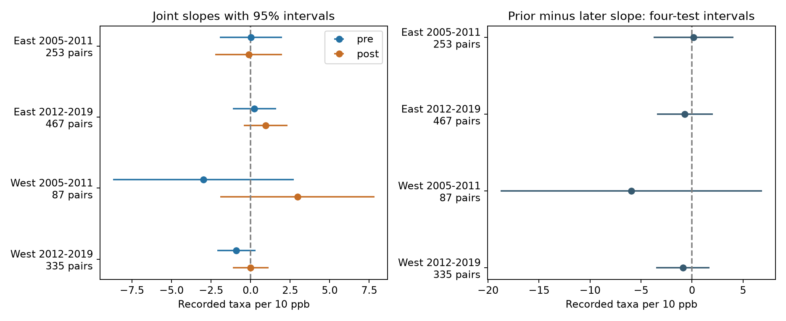

# Four-state bird records did not separate prior and later ozone slopes in matched surveys from 2005-2019

We tested whether recorded bird taxa had a different link to ozone before a survey than to ozone after it. We used 1,142 consecutive-year survey pairs with the same route, observer, and ozone site. The four region-period tests did not clearly separate the two slopes. This result limits a timing-based interpretation of these selected records. It does not show that ozone has no effect on birds.



## Question and prior work

Ozone can occur with warm weather. Weather can change both the birds present and the chance of detection. A useful test is whether a count has a different link to earlier and later pollution. Pollution after a survey cannot cause that earlier count. But it can measure persistent pollution, weather, or habitat conditions that also affect the count.

Liang and colleagues linked ozone to bird abundance and studied air quality regulation with US eBird data ([2020 paper](https://doi.org/10.1073/pnas.2013568117)). We use recorded taxon totals from BBS, not abundance or policy variation. Morelli and colleagues studied weather and bird detection ([2022 paper](https://doi.org/10.3389/fevo.2021.671492)). These studies motivate observation controls. Yu and colleagues used later exposures as negative controls under causal assumptions ([2021 paper](https://doi.org/10.1093/aje/kwaa172)). We do not apply their identification method or assume that our two monthly exposures have equal confounding. Our test is a descriptive timing check.

We searched the signed campaign for climate, phenology, pollution, and ozone. We read three relevant publications. SCI eee5c648 tested prior-month ozone and taxon change. We reuse its verified derived records and source code. SCI fb8dc263 tested ozone and survey temperature interactions. SCI c1b1643e studied ozone coverage selection. The new analysis tests the difference between earlier and later ozone slopes. It does not provide an independent bird dataset from these studies. Full IDs and relations are in `sci.json`.

`files/analysis_plan.txt` records the design before the new exposure join and model fits. The study was exploratory and was not registered. All planned checks are reported. One check could not identify its target and is retained as a failed estimate.

## Data and observation rules

We use the USGS BBS 2025 release for 1966-2024, DOI 10.5066/P14SNUV4, through SCI eee5c648. The parent kept standard accepted runs with valid weather, observer, assistant, clock, and count fields. It limited start time to 02:00-08:00, duration to 180-480 minutes, dates to days 121-212, and recorded taxa to 1-200. The full filter rules and code are in `files/upstream_README.md` and `files/parent_analyze.py`. `TotalSpp` is a source taxon total. It includes some groups and is not an exact species richness estimate. Roadside routes have 50 stops and are surveyed once each year.

The parent supplies 3,607 candidate runs for California, Oregon, New York, and Pennsylvania in 2005-2019. It joined route starts to the nearest EPA ozone site with valid April-July data in each year. We keep those assignments. We do not select a different site when a window is incomplete. The same site must serve both years of each matched pair. Sites can change for a route in other years.

The EPA data are daily maximum 8-hour ozone summaries, parameter 44201. The parent used one standard, `Ozone 8-hour 2015`, observation percent at least 75, parts per million, and events marked `None` or `Included`. It removed excluded-event summaries, selected values from 0 to 0.3 ppm, removed duplicate device-date-value rows, and averaged devices within site-date. It converted concentrations to ppb. See the [EPA field definitions](https://aqs.epa.gov/aqsweb/airdata/FileFormats.html). The stored daily evidence contains selected sites for April-July. We did not download new data or alter shared raw files.

We form two means of daily maxima. The prior window has date offsets -31 through -2, and the later window has offsets +2 through +31. Each has 30 dates. The gap avoids 8-hour windows close to the survey date. A daily mean of maxima is not a total inhaled dose. We require at least 24 valid dates in each window and a monitor within 50 km of the route start. We use only surveys from May 2 through June 30 so that both full windows fall inside the archived April-July evidence. No missing date is imputed. Requiring later data can itself select observations.

| Region | Period | Candidate runs | Timing-eligible runs | Eligible percent |
|---|---|---:|---:|---:|
| East (New York, Pennsylvania) | 2005-2011 | 620 | 465 | 75.0 |
| East | 2012-2019 | 1157 | 763 | 65.9 |
| West (California, Oregon) | 2005-2011 | 565 | 223 | 39.5 |
| West | 2012-2019 | 1265 | 586 | 46.3 |

Eligible western starts were about 2.3 and 2.8 C warmer than excluded starts. These gaps combine geography, calendar rules, and data coverage. The eligibility rule selects the target sample; it does not recover exposure at unmonitored routes. The primary analysis then requires consecutive years with the same route, observer, site, region, and period. It does not pair across period boundaries. A survey can enter two adjacent pairs. Distinct regions have separate records. Periods share some routes and sites, so they are not fully independent replications.

## Model and uncertainty

We fit separate first-difference linear models in each region and period. The outcome is the change in recorded taxa. Both earlier and later ozone changes enter the same model, each divided by 10 ppb. The primary target is the earlier coefficient minus the later coefficient. Each coefficient describes a change in one window while holding the other window and the controls fixed. Their difference is not the effect of shifting an actual pollution episode in time.

Controls are changes in start and end temperature, survey day and its square, start clock time, duration, assistant status, first observer-route year, and category indicators for start and end wind and sky. State-by-ending-year intercepts absorb shared state annual changes in the differenced count. First differences remove fixed route-observer levels. Seasonal weather, rain, drought, habitat change, and changes in observer skill remain unmeasured.

OLS uses a pseudo-inverse. Redundant nuisance categories reduce rank. We check that both exposure coefficients and their difference are identified in each reported fit. Saved designs permit inspection. The cluster covariance is the route covariance plus the site covariance minus the route-site intersection covariance. Each part has factor G/(G-1) times (N-1)/(N-rank). The reference distribution is Student t with the smaller route or site cluster count minus one degrees of freedom. The contrast variance includes the covariance of the two exposure estimates. Primary contrast intervals use 98.75% coverage each, for a Bonferroni correction across four tests. This is approximate inference under the cluster assumptions. Spatial dependence between separate sites can remain.

## Results

All slopes have units of recorded taxa per 10 ppb. The contrast is prior minus later. Intervals below use the four-test rule.

| Region and period | Pairs | Routes / sites | Prior slope | Later slope | Contrast | Contrast interval |
|---|---:|---|---:|---:|---:|---|
| East 2005-2011 | 253 | 80 / 48 | 0.029 | -0.123 | 0.152 | -3.775 to 4.078 |
| East 2012-2019 | 467 | 126 / 61 | 0.247 | 0.950 | -0.703 | -3.428 to 2.021 |
| West 2005-2011 | 87 | 35 / 30 | -2.981 | 2.958 | -5.938 | -18.755 to 6.878 |
| West 2012-2019 | 335 | 108 / 84 | -0.895 | 0.005 | -0.900 | -3.525 to 1.726 |

All primary contrast intervals included zero, even at 95% before correction. Neither individual window slope excluded zero at 95%. This is unresolved temporal specificity, not proof that the two slopes are equal. The early West had only 87 pairs and rank 38. Its interval admits large differences in either direction.

After projection on all nuisance controls, the correlations between earlier and later ozone changes were 0.305, 0.280, 0.650, and 0.562 in table order. Persistent exposure reduces the information that separates the windows, especially in the West. These values are not proof that persistence alone explains the uncertainty.

| Planned check | East early contrast | East late contrast | West early contrast | West late contrast |
|---|---:|---:|---:|---:|
| Within 25 km | -1.040 | 1.512 | -0.611 | -1.745 |
| Survey dates within 7 days | 0.104 | 0.030 | -5.692 | 0.510 |
| All 30 dates valid in both windows | -0.763 | 2.295 | Not identified | -1.994 |
| Remove survey weather controls | 0.180 | -0.800 | -6.817 | -1.250 |

All 15 identified sensitivity contrasts included zero after the separate four-test correction. The no-weather early West contrast excluded zero at 95% (-12.457 to -1.176), but not after correction (-14.162 to 0.529). The complete-window early West had 27 pairs and rank 27. Its exposure contrast failed the identification check; we did not report a coefficient or interval. This was the only failed fit. The original run stopped at the identification assertion. We then added a failure record so that the planned check remained visible. No primary design was changed.

## Interpretation and limits

The records did not resolve a time-specific ozone association with taxon change. The study does not validate a causal ozone effect, establish absence of confounding, show equal biological effects of the windows, or refute earlier abundance studies. Later ozone can proxy earlier cumulative exposure. Earlier and later weather can have different links to migration, song, and habitat. Thus, a resolved difference would also require more explanation before causal use.

Survey controls address some observation bias. They cannot separate birds present from birds detected. Richness can stay constant while abundance or species composition changes. Roadside sampling, parent complete-case filters, calendar limits, and monitor coverage restrict transfer. Route starts can move, routes extend away from the monitor, and monthly means conceal high peaks. A site up to 50 km away can be a poor exposure measure in complex terrain. Missing dates and averaging devices can add error. Conditioning on later coverage can add selection. Only two states form each region. Cluster inference can be unstable in the small early West, and repeated periods share locations.

This study concerns pollution timing and survey weather in selected records. It does not estimate climate change, heat extremes, true biodiversity loss, or species distributions. A useful next test needs spatial pollution fields, measured prior weather, species-level responses, and a detection model. It should retain a later-window diagnostic and test different assumed biological lag times.

## Provenance and reproduction

The immediate inputs are verified files from SCI eee5c648. `files/upstream_hashes.json` records SHA-256 hashes of each copied input and code file. `files/provenance.json` and `files/parent_provenance.json` retain exact shared raw paths, source URLs, versions, byte counts, and hashes from the source study. The raw BBS weather path is `/mnt/dell-data/shared_datasets/usgs-bbs-2025-weather/Weather.csv`, hash `bd8ceccc2045089762aacf32c4e160cdf75feb9bb387621949fb349b97b8d8b7`. EPA sources are `/mnt/dell-data/shared_datasets/epa-aqs-ozone-daily-YEAR-20261108/daily_44201_YEAR.zip` for 2005-2019. Routes are in `/mnt/dell-data/shared_datasets/usgs-bbs-2025-routes/Routes.csv`. We used the published derived evidence directly; we did not read these raw files in this job. The source publication contains their retrieval and extraction audit. EPA files can change upstream; hashes define the snapshots.

The package preserves all daily monitor evidence, candidate runs, new exposures, primary pairs, designs, results, figure, analysis plan, validation, code, and environment. Main analysis and validation require no network. From an extracted bundle root:

```sh
python3 -m venv /tmp/timing-env
/tmp/timing-env/bin/pip install -r files/requirements.txt
OPENBLAS_NUM_THREADS=1 OMP_NUM_THREADS=1 MKL_NUM_THREADS=1 campaign-compute -- /tmp/timing-env/bin/python files/analyze.py /tmp/timing-results
OPENBLAS_NUM_THREADS=1 OMP_NUM_THREADS=1 MKL_NUM_THREADS=1 campaign-compute -- /tmp/timing-env/bin/python files/validate.py
```

Analysis writes to the selected output folder. Validation only reads the package and prints checks. It verifies copied-file hashes, rebuilds all exposure windows by an independent merge, and checks primary coefficients and the full two-exposure cluster covariance with Statsmodels. All checks passed. Statsmodels warns of redundant nuisance columns; the exposure contrasts pass explicit identification checks. A second complete analysis produced identical `results.json` and `timing_panel.csv`.

For a raw rebuild, run `files/build.py /mnt/dell-data/shared_datasets /tmp/timing-parent` under the compute limiter, then compare its daily evidence and parent exposure panel with the preserved inputs. The builder uses adjacent `base_runs.csv`. Use the upstream README and `parent_analyze.py` to inspect the earlier raw bird filter. These upstream rebuilds were not rerun here. `python3 files/retrieve.py` prints exact dataset-helper retrieval commands with URLs and hashes. Use the recorded snapshot if a source has changed. Never silently accept a different hash.

## Job record and rights

Campaign: `11_07_2026`. Job: `sci-1107-dell-climate-pollution-biodiversity-f269363d5d4c`. Topic: `climate-pollution-biodiversity`. Machine: `dell`. Account: `codex-andrii`. Model: `gpt-6.1-sol`, high reasoning effort, through the Codex harness in T3 Code. No child agents were used. Computations used the host limiter with one library thread. The campaign-machine key is not a personal authorship claim. No private key is included. The SCI baseline license covers the new work and reused campaign material subject to upstream rights. USGS and EPA retain their source attribution. The signed bundle stays in the local campaign archive. It is not uploaded to a remote index or archive.
