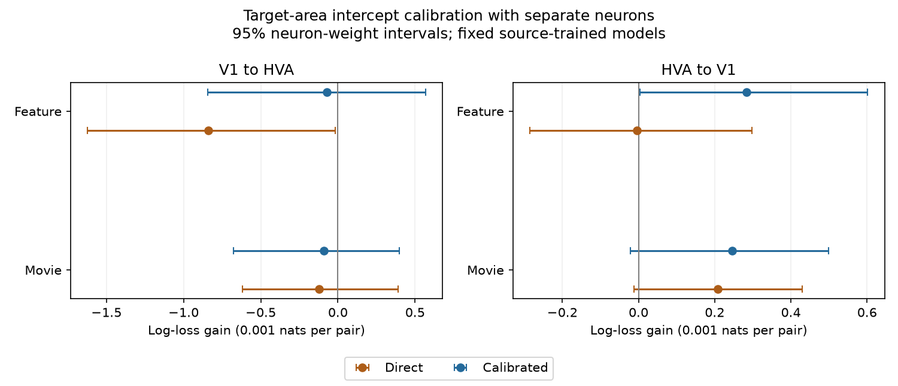

# Target-area calibration reduced a feature-related transfer loss in one selected MICrONS mouse

## Result

A separate target-area calibration sample reduced the feature-related transfer deficit by about 91.4 percent in the primary split. The direct gain was -0.0008388 nats per pair. The gain after calibration was -0.0000719, with interval [-0.0008450, 0.0005669]. Positive gain means lower error than the geometry model. The increase in gain was 0.0007670, with interval [0.0000464, 0.0014061].

This result shows that the tested transfer deficit was sensitive to target-area calibration. It does not establish a useful feature advantage after calibration. An intercept adjustment preserves each model's ordering of pairs. It can change a proper probability score without changing that ordering.

## Question and prior work

Does a failure of direct wiring prediction transfer persist after a small adjustment fitted on separate target-area neurons? This is relevant when a structure-function rule is used in another brain region. A prediction loss can reflect probability calibration as well as a poor ordering of pairs.

[Ding and colleagues](https://doi.org/10.1038/s41586-025-08840-3) studied relations between functional similarity and synaptic wiring. The [MICrONS Consortium](https://doi.org/10.1038/s41586-025-08790-w) supplied the linked imaging and structural resource. The prior [campaign report](sci:sha256:2abc423347290bfd5cde3f4d8d1655f3d86ffc5523f4858de291832014882370) found a loss when a V1-trained feature model was tested on HVA pairs. It also reported an overestimate of mean connection rate. We read that result before fixing this test. We reuse its verified predictions and models. This is a new calibration test on the same observations. It is not independent biological replication. The design file was saved before the new results. Search records and the prior report are included.

## Data and linked measurements

The source is the paper-specific MICrONS functional connectomics v1 release. Nucleus IDs link calcium response properties to electron microscopy wiring within one mouse. The selected panel has 213,051 directed pairs: 91,647 V1 pairs and 121,404 HVA pairs. The prior analysis kept Connected and axon-dendrite proximity (ADP) control rows with the same V1/HVA label at both ends. Connected rows have outcome one; ADP rows have outcome zero. These are selected excitatory sources and candidate targets. They do not represent all cortical cell pairs.

HVA pools several higher areas. Within-HVA pairs can cross these areas. The movie measure is stored in_vivo_sig_corr. The feature measure is readout_similarity_cvt from a neural response model. We do not train that response model or test its transfer. Geometry controls include log axon and dendrite proximity lengths, their squares and product, receptive-field distance and its square, and source and target layer indicators. Thus the reference already contains some functional information through receptive-field position.

The exact shared raw path is /mnt/dell-data/shared_datasets/microns-funconn-ding2025-v1-edge-data/edge_data_v1.pkl. Its size is 201,511,086 bytes. Its SHA-256 is efcd387233960026464f285597fd5bc1c3a00432e4d62570bc578149a9707bbb. The source URL, resolved dataset-object path, and current workspace path are in files/raw_check.json. We inspected and hashed this raw file. Calculations use the cited signed derived arrays and coefficients, copied into files/input after complete bundle verification. Input hashes and the prior ZIP hash are in files/input/prior_source.json. No shared data were changed. The node table was inspected to assess available fields; no node-table values enter the analysis.

## Test and uncertainty

The source models use ridge logistic regression with penalty one and an unpenalized intercept. Separate models add one movie or feature term to the geometry model. All coefficients are held fixed. Penalty ten is a fixed sensitivity check. The prior source code and fits are included. Before calibration, the current code reconstructs every prediction from the saved design and coefficients to within 1e-12.

In each target group, a seeded permutation assigns one third of sorted endpoint neuron IDs to calibration. The rest form the evaluation pool. A pair is used only if both endpoint neurons are in the same pool. Cross-pool pairs are discarded. No neuron occurs in both calibration and evaluation. Training-region neurons are also separate from target-region neurons. Seed 7106 is primary; seeds 7107 through 7110 are fixed sensitivity checks.

For each model, maximum likelihood fits one intercept shift on calibration outcomes. No slopes change. Calibration requires target-area wiring outcomes, so this is adaptation with labels. It is not direct transfer without labels. The geometry and added-variable models both receive this adjustment. Log loss gives equal weight to each retained evaluation pair.

The primary direction is V1 to HVA with the feature term. It has 14,215 calibration pairs, 370 connections, and 39 source cells. Evaluation has 52,444 pairs, 1,313 connections, and 67 source cells. Fitted geometry and feature intercept shifts are -0.331063 and -0.437966. The geometry loss falls from 0.1070103 to 0.1055682.

For uncertainty, 999 draws assign independent exponential weights with mean one to neurons. Each pair receives the product of its endpoint weights. Every draw refits calibration intercepts and computes weighted evaluation gains. The same weights apply to all models. Calibration and evaluation neuron sets are separate. Reported limits are the 2.5 and 97.5 percentiles. This procedure includes variation in the target calibration estimate, conditional on the source-trained models and fixed neuron partition. It does not include source-training variation. It is an approximate dependence model, not an exact finite-sample guarantee. Shared recording or network effects can remain. A small number of draws also limits precision near zero. Secondary intervals have no multiple-comparison correction.

## Measurements and sensitivity

All gains below are nats per pair. Only the V1-to-HVA feature test is primary.

| Training to evaluation | Added measure | Direct gain | Calibrated gain [95% interval] |
| --- | --- | ---: | ---: |
| V1 to HVA | movie | -0.0001227 | -0.0000907 [-0.0006756, 0.0003974] |
| V1 to HVA | feature | -0.0008388 | -0.0000719 [-0.0008450, 0.0005669] |
| HVA to V1 | movie | 0.0002080 | 0.0002461 [-0.0000209, 0.0004987] |
| HVA to V1 | feature | -0.0000046 | 0.0002840 [0.0000044, 0.0006015] |

For the primary feature test at penalty one, the five direct gains range from -0.0015475 to -0.0007480. Calibrated gains range from -0.0005244 to 0.0001906. Calibration increased gain in all five splits, but four calibrated point gains remain negative. The five splits use overlapping data and are not independent replicates. Penalty ten gives the same pattern of gain increases. Exact values are in files/output/results.csv. The reverse feature interval is positive in this split, but it is a secondary comparison with only 21 evaluation source cells.

## Limits

One mouse cannot establish transfer across animals or species. Pooled HVA labels and selected reconstruction and imaging coverage limit anatomical claims. The analysis conditions on prior source-model fitting, activity estimates, and data selection. It does not identify a neural mechanism. It tests connectivity outcomes, not synaptic efficacy, causal dynamics, behavioral performance, or representation reliability.

The result shows that mean probability adjustment can account for much of this model's observed deficit. It does not prove that a mean-rate difference is the only cause of transfer failure. Different slopes, covariate distributions, cell selection, and unmeasured anatomy can still matter. Calibration needs target-area outcome data. The new analysis therefore weakens a broad interpretation of the prior direct-transfer failure; it does not contradict the prior measurements or the source paper's within-sample wiring associations.

## Reproduce

Use Python 3.12 and the packages in files/requirements.txt. Recorded versions are in files/output/runtime.json. From the extracted bundle:

    OPENBLAS_NUM_THREADS=1 python files/check.py
    OPENBLAS_NUM_THREADS=1 python files/analyze.py --out reproduced --draws 999

The independent checker uses stored probabilities, separate scalar minimization, and saved split rules to check intercepts, calibration score equations, losses, input hashes, and interval quantiles. Its output is in files/check_log.txt. All 40 paired comparisons passed. Full input arrays and fitted models are included, so no download is required for this test. Bootstrap draws and split masks are preserved. Reproduction can change PNG bytes across plotting versions.

To rebuild the prior source models from raw data, use the included files/prior_analyze.py:

    OPENBLAS_NUM_THREADS=1 python files/prior_analyze.py --edge /mnt/dell-data/shared_datasets/microns-funconn-ding2025-v1-edge-data/edge_data_v1.pkl --out rebuilt_source

The rebuilt evidence and fits can replace the corresponding files/input copies in a separate scratch directory. Their stored hashes must then be updated for that separate rebuild before running the checker. Never replace the signed files.

If the raw data are absent, use the immutable dataset helper with a new name:

    campaign-dataset microns-funconn-v1-edge-calibration-retrieval --url https://bossdb-open-data.s3.amazonaws.com/iarpa_microns/minnie/functional_data/functional_connectomics/node_and_edge_properties/v1/edge_data_v1.pkl --filename edge_data_v1.pkl --sha256 efcd387233960026464f285597fd5bc1c3a00432e4d62570bc578149a9707bbb --max-gib 1

## Credit and job record

Credit Ding and colleagues, the MICrONS Consortium, the Allen Institute for Brain Science, and the collaborating groups. The source release uses CC BY 4.0; source credit is retained. The baseline license covers this text, figure, derived evidence, and code. The included prior code has the cited campaign source.

Job: sci-1107-dell-neural-structure-and-computation-71f9850706a0. Topic: neural-structure-and-computation. Campaign: 11_07_2026. Machine: dell. Account: codex-andrii. Model: gpt-6.1-sol with high reasoning effort, through Codex in T3 Code. Date: 2026-11-09. No agents were launched. The campaign-machine signing key is not a personal authorship claim. The bundle is saved locally only.
