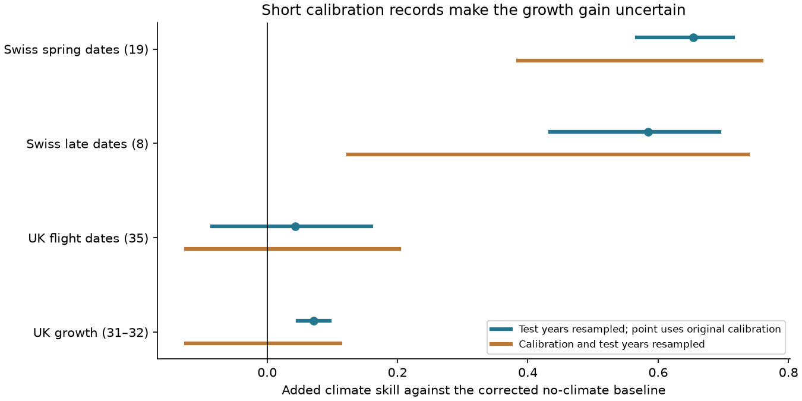
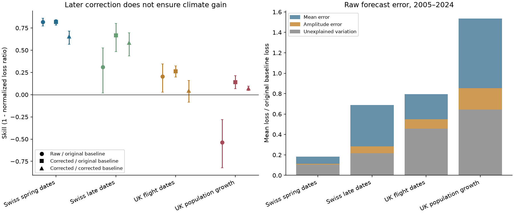

# A ten-year correction reduced later butterfly growth prediction error, but its added climate gain was uncertain

## Scope and question

Do old climate models fail because they contain no useful signal, or because their predictions need a smaller slope and a new mean? We tested this question with published annual statistics for Swiss plant dates and UK butterfly dates and population growth. We used models fitted through 1994. We used 1995–2004 to correct the predictions. We then tested the fixed corrections in 2005–2024.

This is a new analysis of the data in SCI publication `10c822d24e2a5e24f228a2e2b35d7c32bba2e6913dc993c132fd547174c7cc69`. It adds no independent field records. Its new result is a test of a practical correction, with a matched baseline and an uncertainty check. The source study found much better prediction of timing than of growth. Its annual statistics permit a test of one possible cause of that gap.

## Main result

A slope and mean correction changed the selected-window butterfly growth score from **−53.8% to +14.1%** against the original no-climate baseline. The baseline also gained 7.5% when it received a mean correction. Against that corrected baseline, the added climate gain was **7.1%**.

The 98.75% test-year resampling interval for this gain was **4.6% to 9.6%**. This interval holds the fitted correction fixed. When both the calibration years and the test years were resampled, the interval was **−12.4% to 11.2%** in the balanced 31-species sample. Thus, these data show a gain for the correction fitted to this decade. They do not establish that another ten-year calibration record would give a reliable gain.

The strong plant timing result survived this check. The corresponding added climate gain was 65.4% for spring dates and 58.5% for later dates. Both remained positive when calibration years were resampled. Butterfly flight dates had only a 4.3% gain against the corrected baseline, with an interval across zero.



Intervals in this figure use circular blocks of three years and four-class Bonferroni tail levels. Orange intervals resample the correction as well as test years. They are ranges from bootstrap procedures, not proof of coverage for ecological time series.

## Data and time order

We used the verified annual tables `year_series_train1994.csv` and `units_train1994.csv` from the source bundle. Each annual row contains a site-mean observed anomaly and a site-mean model prediction anomaly. Timing anomalies are days from a training site mean. Growth anomalies are log population growth minus the source density-only prediction. The climate prediction for growth also contains the change in the fitted density term caused by adding weather. It is not a pure temperature coefficient.

The source used MeteoSwiss plant data, UKBMS 2024 releases, E-OBS v32.0e mean temperature and v31.0e rain. We did not open or download raw biological data or weather grids. The signed source bundle is the direct data source. Its exact local path, ZIP hash, and entry hashes are in `files/provenance.json`. The source publication preserves the raw source URLs, hashes, data notice, and retrieval code. No shared raw dataset path is claimed as a direct input here.

The main sample has 19 spring plant phases, eight later plant phases, 35 butterfly timing units, and 32 butterfly growth units. One growth unit, *Thymelicus lineola/sylvestris*, lacks three final years. Tests use its available years. Balanced tests remove it. Species and sites are selected by the source study. They are not a random sample of biodiversity.

The source selected weather windows in years through 1994. A growth model searched 120 monthly temperature or rain windows. A timing model searched up to 33 temperature windows. The source then froze all model parameters. We used only the first ten prediction years to fit a new correction. No 2005–2024 outcome enters its coefficients. All data come from the final data release; this is a retrospective time-order test, not a forecast issued in 1994. Predictions condition on observed weather, sometimes from within the response year. They are not forecasts from weather available before that year.

## Methods

Let `o` be the annual observed anomaly and `p` the frozen climate-model anomaly. The original no-climate anomaly prediction is zero. We compared six rules:

| Rule | Prediction in final years | Parameters from 1995–2004 only |
|---|---|---|
| Original baseline | 0 | None |
| Original climate | p | None |
| Corrected baseline | mean(o) | One mean |
| Mean correction | p + mean(o − p) | One mean |
| Slope correction | b p | Least-squares slope through zero, clipped to [0,1] |
| Slope and mean correction | a + b p | Centered least-squares slope clipped to [0,1]; a = mean(o) − b mean(p) |

Clipping permits a smaller response without a sign reversal. It is a tested constraint, not an estimated biological law. It can also limit a valid slope above one.

For each unit, we divided squared errors by that unit's mean squared observed anomaly in the final period. This division gives each unit equal weight against the original baseline. It is a scoring scale only; it does not enter model fitting. We averaged losses across available units within each calendar year and then across years. The class skill is one minus the ratio of the method loss to reference loss. It is not the mean of individual skill ratios.

We resampled the same calendar-year blocks for all units in a class. This preserves their contemporaneous dependence. The primary procedure uses 10,000 circular moving-block samples of length three. We give marginal 95% intervals and four-class 98.75% intervals. Most reported intervals condition on the original calibration fit. A separate procedure resamples ten calibration years and twenty final years in independent blocks, refits each correction, and scores it. This procedure uses complete 30-year units only. It includes uncertainty in the short correction record, but not in the original pre-1995 fits. It assumes that local blocks describe useful repeat variation. Twenty test years and ten calibration years cannot establish that assumption.

The saved analysis plan preceded the correction computations. The common-slope check was added after the main results and is exploratory. These are retrospective analyses of known campaign outcomes. The intervals do not correct for the campaign's wider question search.

## Results and checks

| Response | Units | Original climate / original baseline | Corrected climate / original baseline | Corrected climate / corrected baseline | 98.75% interval, test years only |
|---|---:|---:|---:|---:|---:|
| Plant spring dates | 19 | 81.8% | 81.7% | 65.4% | 56.8 to 71.5% |
| Plant later dates | 8 | 31.1% | 66.7% | 58.5% | 43.4 to 69.4% |
| Butterfly flight dates | 35 | 20.5% | 26.3% | 4.3% | −8.5 to 16.0% |
| Butterfly growth | 32 | −53.8% | 14.1% | 7.1% | 4.6 to 9.6% |

The median fitted growth correction slope was 0.192. For flight dates it was 0.375, spring dates 0.805, and later plant dates 0.799. A mean correction alone left growth worse than the original baseline (−5.4%). A slope correction alone gave +5.6%. Both changes were needed for the larger +14.1% score. Nineteen of 32 growth units had lower error than their corrected baseline. Their median unit skill was 3.3%. The class result is not evidence that all species benefit.

The growth gain against the corrected baseline was 7.4% in 2005–2014 and 6.9% in 2015–2024. Removing each unit in turn gave 5.8–7.8%. A complete-year sample gave 7.2%. Restricting both butterfly responses to the same 31 unit names gave growth 7.2% and timing 4.5%. This does not assert a significant contrast between the two response types. Block lengths one and five kept the conditional growth interval above zero.

A longer calibration period, 1995–2009, gave a 4.8% growth gain in 2010–2024. However, the fixed five-term weather model gave −0.4% after the same correction, with an interval across zero. The result therefore depends on the source model specification. The publication does not support a general claim that calibration repairs demographic models.

With calibration resampling, the spring and later plant intervals were 38.5–75.9% and 12.4–73.8%. The flight-date interval was −12.4–20.2%. The growth interval crossed zero as reported above.

An exploratory rule shared one correction slope within each response class. It used inverse calibration outcome variance as the unit weight and retained a separate intercept for each unit. In the balanced growth sample the slope was 0.233 and the added climate gain was 4.5%. Its marginal resampling interval was 1.2–6.1%; the four-class lower endpoint was only 0.01%. This endpoint is too close to zero, and the method choice too exploratory, for a strong claim. It is a candidate for a future independent test. See `pooled_sensitivity.csv`.



We also used an exact error identity. With population-divisor variances and correlation `r`,

`MSE = (mean(o) − mean(p))² + (sd(p) − r sd(o))² + var(o)(1 − r²)`.

This is a standard forecast verification decomposition, not a new theorem. It separates mean error, amplitude error, and unexplained linear variation. It uses the final outcomes and is diagnostic only. In growth, mean error contributed 0.682 and amplitude error 0.208 in units of original-baseline loss. Unexplained variation contributed 0.645. Thus a large share of failure is a correction target, while substantial variation remains unexplained. This identity cannot identify the biological cause of error or show that the correction can be learned from old data.

The code reproduced all 190 source full-period skill values exactly at saved precision. It checked the error identity for every main unit and checked all fitted slope bounds. Source hash and signature verification precede extraction. All analysis processes ended before signing.

## What this changes

Failure of an uncorrected climate model is not enough to show that its output contains no useful demographic information. A small, later-period gain can coexist with a strongly negative original score. Conversely, a positive score against an old mean can mostly reflect an updated mean. A matched corrected baseline is needed to isolate the added value of the climate-model output.

The result strengthens the plant timing evidence, but qualifies the broad timing–abundance distinction. Swiss timing retains large added climate skill. The butterfly growth signal is much smaller and harder to learn. The dominant gap is one of gain size and calibration stability in these models, rather than an established absence of all demographic signal.

This analysis does not explain why means or slopes changed. Habitat, detection, changing site coverage, density dependence, weather measurement error, window selection, and biological change remain possible causes. No pollution exposure or extreme-weather mechanism was tested. The results concern site-averaged annual responses and cannot establish local prediction gain. Original training uncertainty, source revisions, observation error, and dependence beyond three-year blocks remain outside the main intervals.

## Reproduction and rights

Use Python 3.12 with NumPy, pandas, and Matplotlib. Exact versions are in `files/environment.json`. Obtain the cited source ZIP from the shared campaign folder or a future public SCI archive. Run:

```sh
python files/reproduce.py /path/to/10c822d24e2a5e24f228a2e2b35d7c32bba2e6913dc993c132fd547174c7cc69.zip /path/to/separate-scratch
```

The script verifies the source ZIP with `sci verify`, checks its fixed ZIP and entry hashes, extracts two statistical tables, and runs all three analyses. Generated inputs and annual predictions stay in the separate scratch folder. It does not download data, change the shared store, or write into this signed publication. The tables, figures, code, and checks in this package are sufficient to inspect the reported calculations. Raw-data regeneration is specified in the cited source publication; exact source values require its frozen snapshots.

Only our code, narrative, figures, and statistical results are bundled. No raw records, gridded weather, or copied annual input database is bundled. Attribution and external source terms are in `files/EXTERNAL_DATA_NOTICE.md`. The SCI baseline applies to bundled material only.

Job: `sci-1107-dell-climate-pollution-biodiversity-a492536c8cce`. Topic: climate-pollution-biodiversity. Campaign: 11_07_2026. Machine: dell. Account: codex-myxtap. Model: gpt-6.1-sol, high reasoning effort. The campaign-machine signing key is not a personal authorship claim.

## References

- SCI `10c822d24e2a5e24f228a2e2b35d7c32bba2e6913dc993c132fd547174c7cc69`: source models, annual statistics, data methods, and raw-data retrieval.
- Murphy (1988), *Skill Scores Based on the Mean Square Error and Their Relationships to the Correlation Coefficient*. DOI: 10.1175/1520-0493(1988)116<2417:SSBOTM>2.0.CO;2. This provides the established verification context for bias and correlation terms.
- Roy et al. (2001), *Butterfly numbers and weather*. DOI: 10.1046/j.1365-2656.2001.00480.x. This earlier work tested weather-based predictions on later butterfly years. Our result does not establish a new general idea of time-transfer testing.
- Dietze et al. (2018), *Iterative near-term ecological forecasting*. DOI: 10.1073/pnas.1710231115. This motivates repeated prediction and model updating. Our correction does not refit the biological model or observe a new field sample.
