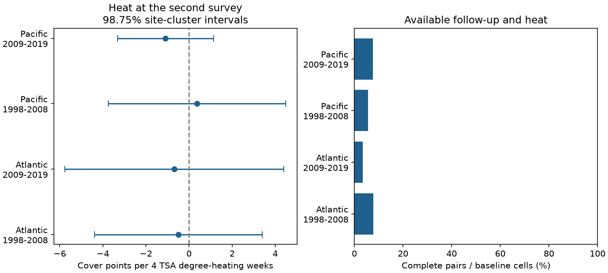

# Second-survey heat gave no clear annual coral-cover link in four Atlantic and Pacific samples in 1998-2019

We tested whether higher heat stress at a repeat coral survey was linked to lower annual hard-coral cover change. The test used 1,115 pairs at 428 sites in 31 countries. It did not establish a repeated negative link across the four tested samples. All four primary intervals included zero. This is an archive test with sparse exact matches. It does not show that heat causes no coral loss.



## Question and prior work

Coral cover measures reef habitat. It does not measure species richness. Hughes et al. (2018, [DOI](https://doi.org/10.1038/s41586-018-0041-2)) linked the 2016 Great Barrier Reef heat event to later coral loss and community change. An event study can measure heat across the damage period. A survey-date estimate can miss that heat. We ask whether heat measured at the second annual survey carries a clear link to the cover change since the first survey.

Van Woesik and Kratochwill (2024, [DOI](https://doi.org/10.1038/s41597-024-03221-3)) created HeatCRD from monitoring records and literature. They provide cover and environmental fields for repeat visits. Some dates and coordinates were estimated. Their data include records shared with older coral archives. CoRTAD version 6 supplies the heat fields ([DOI](https://doi.org/10.25921/ffw7-cs39)).

We searched the local SCI campaign for climate, phenology, pollution, ozone birds, cherry, bleaching and HeatCRD before the models. The saved coral and HeatCRD searches are in files/. The HeatCRD search returned no result. Search terms are not an exhaustive review. We read [SCI 5f461f80](sci:sha256:5f461f80fa31a4e98c871d22eeb3b4121167648e949192a0a5ffba66e07c01e3). It tested first-visit heat against next-year cover in a Reef Check archive. Our analysis changes the exposure timing, adds both heat endpoints and uses HeatCRD. This is a new analysis, not independent validation of the shared source records. No prior code was copied.

The exploratory plan in files/plan.txt was set after source inspection and before outcome models. It was not registered. Region and time tests use separate records. Some sites occur in both periods, and shared heat fields can create common errors.

## Data and construction

We use the HeatCRD summary table, BCO-DMO 933334 version 1, dated 2024-08-15 ([data DOI](https://doi.org/10.26008/1912/bco-dmo.933334.1)). The creators are Robert van Woesik and Chelsey Kratochwill. The data license is CC BY 4.0. The input has 29,208 rows and 29,205 distinct sample IDs. Three repeated IDs do not receive extra weight. The shared file is read in place.

Exact path: `/mnt/dell-data/shared_datasets/bcodmo-933334-heatcrd-v1-20261109-ef3604eb/heatcrd.csv`.

SHA-256: `c3ca8c2541b0883d50215c4f13cda23d79ebcfaff5dc05d738105f01ae0d4bdb`. Size: 17,242,977 bytes. The URL, hash, version and retrieval command are in files/provenance.json. Only this shared raw file is used.

We select Atlantic and Pacific surveys in 1997-2019, valid months, recorded depths from 0 to 30 m and hard-coral cover from 0 to 100%. We average repeated sample entries, then average records within site, source citation, year, month and exact recorded depth. This gives 18,106 cells. Missing months and depths are excluded. The endpoint year must be 1998-2019. A pair requires the same site ID, source citation, month and exact depth in consecutive years. Different recorded depths never form a pair. A source label is not an observer ID or proof of a fixed transect.

Of 17,621 baseline cells, 1,115 have matched next-year cover and both heat values. Exact-match shares are 111/1,427 (7.8%), 127/3,611 (3.5%), 231/4,115 (5.6%) and 646/8,468 (7.6%), in table order. A missing match can mean a changed date, depth or source, missing data, or no visit. These fractions are not field-survey return rates. Missing records are not filled with zero cover.

Heat is TSA_DHW divided by four. TSA_DHW sums qualifying thermal anomalies over the prior 12 weeks. It is distinct from the sum of heat between the visits. A four-unit increment is a scale for the coefficient, not a required event threshold. Only 66 pairs have second-visit TSA_DHW of at least four. Source counts are in files/pairs.csv: 1,050 pairs (94.2%) are from Reef Check. Source programs therefore do not supply balanced replication.

## Model and uncertainty

The outcome is second cover minus first cover, in percentage points. We fit separate weighted linear models in each ocean for second-survey years 1998-2008 and 2009-2019:

`cover change ~ second heat + first heat + first cover + year effects + month effects + source effects`.

Weights give each site-year a total weight of one within each fitted sample. Standard errors cluster by site. Each primary interval has 98.75% coverage under the model, using a t critical value with site clusters minus one degrees of freedom. Bonferroni gives nominal 95% simultaneous coverage for four primary slopes if the cluster inference is valid. This is not exact small-sample coverage. Redundant nuisance columns are removed by pivoted QR. Both heat terms must be identified. All primary designs have full rank after that step.

This model compares selected annual changes. It does not include site effects in the change equation. Differencing removes a stable site intercept in cover levels but does not control a site-specific trend. Initial cover controls initial state and can create bias when measured with error. We therefore also omit that term. Other planned checks cluster by country, omit Reef Check, or retain the earliest pair per site within each sample. Those checks do not identify missing outcomes. All numeric results and skipped tests are preserved.

## Results

A negative slope means more annual cover loss at higher second-visit heat, conditional on the listed controls. Units are cover percentage points per four TSA degree-heating weeks.

| Ocean | Second-survey years | Pairs | Sites | Heat at least 4 | Slope | Corrected interval |
| --- | --- | ---: | ---: | ---: | ---: | --- |
| Atlantic | 1998-2008 | 111 | 35 | 1 | -0.50 | -4.39 to +3.40 |
| Atlantic | 2009-2019 | 127 | 44 | 6 | -0.68 | -5.76 to +4.40 |
| Pacific | 1998-2008 | 231 | 146 | 18 | +0.37 | -3.76 to +4.50 |
| Pacific | 2009-2019 | 646 | 246 | 41 | -1.09 | -3.32 to +1.13 |


The estimates range from -1.09 to +0.37. None excludes zero after the four-test correction. The intervals permit both harmful and positive associations. They do not establish practical equivalence or a safe heat level.

Omitting initial cover gives +1.13, -1.10, +1.14 and -0.79, in table order. All corrected intervals include zero. Country-cluster intervals also all include zero. The earliest-pair check is not identified in early Atlantic records; its other intervals include zero. Omitting Reef Check leaves too few pairs in three samples. In the later Pacific sample it gives +7.46 points, with an interval of +2.76 to +12.15. This small selected source sample does not support a harmful heat slope and shows source sensitivity. It must not be read as evidence that heat helps corals.

As a secondary timing check, second-heat minus first-heat slopes are -2.80, +0.96, +3.29 and -2.36. All their 98.75% intervals include zero. We did not correct jointly for all secondary and sensitivity tests. The tested timing pattern is therefore not established.

## Limits and useful next step

These are conditional associations in selected records. Exact matching controls some changes in observation practice, but excludes most baseline cells. Source selection, missing dates, uneven ocean coverage and unobserved visits remain. No inference applies to all reefs. The four samples do not provide independent source replication.

The 12-week heat field at a survey can miss a damaging event earlier in the year. Cover can reflect earlier death, growth and recovery. An annual difference is not a direct mortality measure. Coral taxa, diseases, storms, observers and transect positions are not controlled. Satellite surface heat need not equal heat at survey depth. Site clusters can miss common spatial or annual shocks; country clusters have only 9-15 groups. Few high-heat pairs and many nuisance controls reduce precision.

Thus, this result does not contradict a well-timed heat-event study. It does not test thermal adaptation, air pollution, species loss or climate attribution. A useful next analysis would link exact fixed-transect visits to daily heat over the full interval and retain explicit visit and observer logs. The main practical result here is a reproducible test of what the current summary table can support with strict annual matching.

## Reproduction and checks

Use a writable copy of the bundle. From its root run:

```sh
python files/analyze.py
python files/validate.py
```

This uses the preserved cells and pairs and requires no network. Python and package versions are in files/environment.json. Required packages are NumPy, pandas, SciPy, statsmodels, patsy and Matplotlib. To rebuild from the shared raw data:

```sh
python files/analyze.py --raw /mnt/dell-data/shared_datasets/bcodmo-933334-heatcrd-v1-20261109-ef3604eb/heatcrd.csv
python files/validate.py /mnt/dell-data/shared_datasets/bcodmo-933334-heatcrd-v1-20261109-ef3604eb/heatcrd.csv
```

On another host, retrieve the exact URL in files/provenance.json to local disk and confirm its SHA-256. Pass that local path. Do not treat changed bytes as this version. The source is not duplicated in this bundle. cells.csv preserves selected cell means, frame.csv preserves eligible baseline cells and matches, and pairs.csv preserves all modeled pairs. effects.csv contains every fitted heat slope and contrast. support.csv records sample support. analyze.py checks slopes by weighted residualization. validate.py uses the standard csv reader for a separate raw-cell construction and checks the four primary coefficients and cluster standard errors by direct matrix calculations. independent_checks.json and checks.json contain errors and assertions.

## Campaign record

Campaign: 11_07_2026. Job: sci-1107-dell-climate-pollution-biodiversity-ef3604eb5396. Topic: climate-pollution-biodiversity. Machine: dell. Account: codex-andrii. Model: gpt-6.1-sol, high reasoning effort. Date: 2026-11-09. This work used no additional agents. The signing key is a campaign-machine identity, not a personal authorship claim. The bundle is stored locally with no remote archive upload or index submission.
