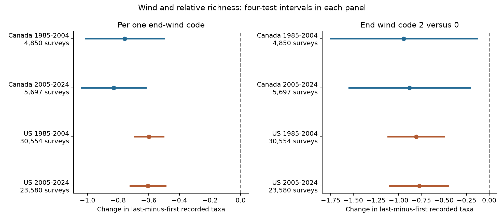

# Stronger survey-end wind was linked to lower relative bird richness in Canada and the US in 1985-2024

We tested wind and recorded bird taxa in 64,681 accepted Breeding Bird Survey runs. We used the last ten stops minus the first ten stops as a relative count. We fit separate models for Canada and the US in 1985-2004 and 2005-2024. We controlled for start wind, temperature, date, time, duration, sky, assistant status, route-observer effects, and state-year effects. A one-code higher end wind was linked to 0.60-0.83 fewer taxa in the relative count. All four intervals excluded zero after correction for four tests. Route trends, fair-weather limits, log ratios, and a categorical wind check kept the negative pattern. This is a survey-weather association. It does not separate detection, activity, and ecological change. The first and last blocks differ in place and time. Selection, exposure error, and shared methods limit inference. We did not measure air pollution or estimate climate effects. We reused a published panel, rebuilt it from fixed public source files, and preserved code, hashes, results, and reproduction instructions.



The left panel shows slopes per one-code higher end wind, given start wind and the other controls. The right panel shows end wind code 2 versus 0 with other end categories fit separately. Bars use four-test intervals within each panel. Only the left panel is the primary test family. The right panel is a planned check; correction within that panel does not cover all choices across checks.

## Question and prior evidence

Can a negative association between end wind and relative bird richness repeat across two countries and two time periods? This question matters when weather can change the records used to study climate and biodiversity. It is a test of observation conditions, within the broad climate and biodiversity objective. It is not a test of air pollution.

Robbins (1981) studied weather and BBS counts ([USGS record](https://pubs.usgs.gov/publication/5210258)). Rigby and Johnson (2019) used recorded bird songs in grasslands. They found that wind changed detection and the area within which songs could be heard ([paper](https://doi.org/10.1093/condor/duz030)). Those experiments support detection as a plausible explanation. Our records cannot identify that explanation.

We searched published campaign results before we chose this question. SCI f558738a tested average survey wind in matched annual counts in four US states. Its four corrected intervals included zero. SCI 652071e7 tested end temperature with a first-to-last block contrast. We reuse its panel and preparation code, with attribution in files/ATTRIBUTION.txt. Our new test uses end wind, expands the wind question to the block contrast and both countries, adjusts for temperature with quadratic terms, and tests a categorical wind contrast. The earlier studies and this study share source data. They are not independent studies of new birds. The different precision and outcome do not contradict the earlier annual-count result.

The plan in files/analysis_plan.txt was written before wind fits. It was not registered. Regions, periods, controls and checks were chosen with knowledge of the prior publications. No agents were launched.

## Data and selection

We use the archived [USGS BBS 2025 release for 1966-2024](https://doi.org/10.5066/P14SNUV4). The release title describes its release year, not coverage through 2025. Each standard route has 50 three-minute stops. There is one annual survey. The outcome counts public taxon codes with positive counts in stops 41-50 minus codes with positive counts in stops 1-10. Taxa include some subspecies and groups. Thus, recorded richness is not true species richness. In panel.csv, Count10 and Count50 hold derived taxon counts, while raw fields with those names hold individual counts for each taxon.

The [official instructions](https://www.canada.ca/en/environment-climate-change/services/bird-surveys/landbird/north-american-breeding/instructions.html) specify fixed stop order and record wind with ordered Beaufort codes. We use only start and end values. We do not have wind at each stop in these inputs. Codes 0, 1, 2, 3, 4 and 5 refer to increasing speed ranges; the steps do not have equal size in m/s. Code 2 spans 6-12 km/h. A one-code slope is an average association on this ordered scale.

We kept Canada and US runs in 1985-2024 with RPID=101, QualityCurrentID=1 and RunType=1. We removed duplicate route-years and unknown units. We required both temperatures from -10 to 45 C, a start between 02:00 and 09:00, duration 3-7 hours, a May 20-July 10 date on a nonleap calendar, a known observer, and total taxa from 1 to 200. We required valid sky, wind, and assistant values, valid block counts and nonzero endpoint richness. Groups must have at least five runs for each route-observer pair within a country-period sample. Counts from all 62 state or province CSV members entered preparation; their hashes are in files/count_members.json.

The preparation audit starts with 111,497 country-period runs. Accepted standard runs leave 100,097. Weather and other filters leave 84,660 runs before the repeated-group rule. That rule leaves 64,682. Our added restriction to wind codes 0-5 and a repeated-group check leaves 64,681, with one early Canada run removed. files/coverage_audit.json preserves the original full selection audit; files/audit.json preserves the added restriction and wind distributions. There are no 2020 surveys. Missing weather and repeat-group selection can bias the sample. We did not fit a selection model.

## Model and uncertainty

We fit each country-period sample separately. The main predictor is end wind code, with categorical start wind. Holding start wind fixed, higher end wind also means a greater start-to-end code change. Controls are separate linear and quadratic terms for start and end temperature, date, start clock time and duration; categorical start and end sky and assistant status; route-observer effects; and state-year effects. Route-observer effects remove stable differences in the block contrast. State-year effects remove changes shared within a state and year. They cannot remove all local annual changes. files/methods.md states the full model and calculations.

Uncertainty uses the maximum of route-cluster, year-cluster and two-way route/year variances, a finite-sample correction that overcounts redundant fixed effects, and t critical values with the smaller cluster count minus one degrees of freedom. This is an approximate interval method, not a guarantee of coverage. We report individual 95% intervals and Bonferroni intervals for the four primary tests. Route clustering accounts for repeated routes; year clustering addresses common annual shocks. Spatial dependence within years and observers who survey multiple routes can remain. The countries have separate routes, but share methods. The periods reuse routes and observers. We do not claim statistical independence or combine P values.

## Results

Slopes are taxa in the last-minus-first block contrast per one-code higher end wind, conditional on the listed controls.

| Sample | Surveys | Routes | Slope | Individual 95% interval | Four-test interval |
|---|---:|---:|---:|---|---|
| Canada 1985-2004 | 4,850 | 464 | -0.756 | -0.950 to -0.562 | -1.012 to -0.500 |
| Canada 2005-2024 | 5,697 | 611 | -0.829 | -0.987 to -0.670 | -1.038 to -0.619 |
| US 1985-2004 | 30,554 | 2,611 | -0.599 | -0.672 to -0.525 | -0.695 to -0.502 |
| US 2005-2024 | 23,580 | 2,404 | -0.606 | -0.694 to -0.518 | -0.722 to -0.490 |

All four primary intervals are below zero after correction. This is evidence of a repeated negative survey association under the model. It does not prove equal country or period slopes. No formal test of country differences or period changes was run.

| Check | Canada early | Canada late | US early | US late |
|---|---:|---:|---:|---:|
| Primary | -0.756 | -0.829 | -0.599 | -0.606 |
| Route trends | -0.762 | -0.881 | -0.598 | -0.608 |
| Fair weather | -0.828 | -0.774 | -0.555 | -0.530 |
| End code 2 versus 0 | -0.943 | -0.880 | -0.806 | -0.772 |

Route trends and fair-weather limits keep the negative pattern in all four samples. Their four-cell intervals also exclude zero. Fair weather requires both wind codes at most 3 and both sky codes at most 2; groups again need five records. The category check gives a negative code-2-versus-0 contrast in each sample, with all four within-check corrected intervals below zero. Thus, the primary direction does not depend solely on equal code steps or the rare highest wind codes. This does not establish a full dose-response curve.

The main log-ratio slopes range from -0.023 to -0.031 per code. These imply about a 2.2-3.1% lower offset last-to-first ratio under the model. The offset is 0.5 taxa. The full-survey slopes range from -0.21 to -0.46 taxa per code. Their individual intervals are also negative. These secondary associations do not establish population loss. files/results.csv includes all 48 estimates, all intervals and variance components. No listed analysis result was removed.

## Explanations and limits

Wind can mask songs, change bird activity, or change movement. The negative relative contrast is consistent with these explanations and with prior recorded-song experiments. Persistence in the planned checks reduces some simple alternatives, but does not identify a mechanism. A weather term in a climate-biodiversity model should not be read directly as ecological loss without a detection model or other validation.

The first and last blocks differ in both place and time. Habitat, traffic and species composition can change differently in those places. End wind is a proxy for the last block; exposure error and coarse weather codes can bias slopes. Clock time is not time since sunrise. Date controls have one shape per country-period and cannot represent all local breeding schedules. Observer fixed effects do not remove aging, learning or changes in hearing. No distance or repeated-visit detection model was fit.

Accepted runs underrepresent severe weather. Complete weather and repeated groups restrict the sample further. Quality decisions changed from manual inspection to objective criteria in 1997. Our early period spans that change. Roadside surveys do not represent all habitats. Taxon changes can affect counts. Weather conditions are not assigned at random. The analysis tests routine survey weather; it does not estimate damaging wind extremes, long-term climate change, pollution, mortality, range shifts or true occupancy. Sky code 4 combines fog and smoke and cannot measure air pollution. These limits are material even when intervals exclude zero.

## Provenance and reproduction

Job: sci-1107-dell-climate-pollution-biodiversity-0f6e606636ec. Topic: climate-pollution-biodiversity. Campaign: 11_07_2026. Machine: dell. Account: codex-andrii. Model: gpt-6.1-sol, high reasoning effort, through T3 Code and the Codex harness. The signing key is a campaign-machine identity. It is not a personal authorship claim.

The raw files were reused in place. Exact shared paths and SHA-256 hashes are:

- /mnt/dell-data/shared_datasets/usgs-bbs-2025-release-states-zip/States.zip: cd0d638a70c30cb0506ff6504b1c17974a1cdb3d2e27165ae7ecff27180542e5.
- /mnt/dell-data/shared_datasets/usgs-bbs-2025-weather/Weather.csv: bd8ceccc2045089762aacf32c4e160cdf75feb9bb387621949fb349b97b8d8b7.

files/provenance.json gives source URLs, version, exact paths and sizes. files/metadata.xml and sciencebase_item.json preserve the prior publication's source metadata. files/source_notes.json records the literature search. The raw shared files are not copied into this package. The 64,682-row panel from the cited publication is included; analyze.py applies the added wind filter. A raw rebuild on this host matched panel.csv, count_members.json and coverage_audit.json byte for byte, as recorded in files/raw_rebuild_check.json. Dense explicit fixed-effect fits on subsets agreed with projected fits in each sample to less than 1e-7. files/checks.json records these tests. files/validate.py checks all four full primary coefficients and standard errors with a scalar residual calculation; files/score_validation.json records the results.

Create a Python environment and install files/requirements.txt. Exact versions are in files/environment.json. From the extracted bundle root, reproduce all models and the figure offline with:

```sh
OPENBLAS_NUM_THREADS=1 OMP_NUM_THREADS=1 MKL_NUM_THREADS=1 \
  campaign-compute -- /path/to/python -B files/reproduce.py --output /tmp/wind-reproduced
```

To rebuild from shared raw inputs as well, add `--datasets /mnt/dell-data/shared_datasets`. From this worktree use `work/venv/bin/python` and `work/result/files/reproduce.py`. Outside this campaign, use an equivalent resource limit in place of campaign-compute. All code uses one numerical-library thread when called as shown. Preparation checks raw hashes before reading the data. To retrieve raw files on another host, use `python files/retrieve.py /private/local/destination`; it checks source hashes and refuses the shared store. For a new shared addition use the campaign-dataset helper with the URLs and expected hashes in provenance.json. Source updates can make exact historical bytes unavailable; retain the fixed snapshot or use the included derived panel for offline model reproduction.

New text, code, figures and derived evidence use the SCI baseline license, subject to source rights. Attribution for reused files is in files/ATTRIBUTION.txt. No remote archive or index submission was made.
