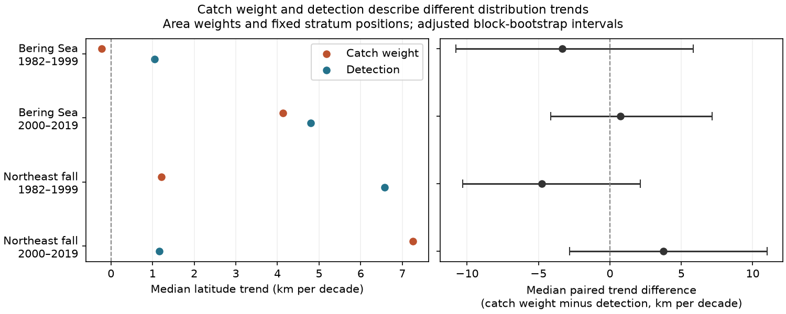

# Median differences between catch and detection latitude trends were not clear in four US trawl samples in 1982-2019

We tested whether catch weight and detection give different latitude trends for marine taxa. We used public trawl records from the eastern Bering Sea and Northeast US fall surveys in 1982-2019. We held survey strata, area weights, stratum positions and regional taxon sets fixed. We compared two periods for 59 Bering Sea taxa and 62 Northeast taxa. Median paired differences ranged from -4.76 to +3.74 km per decade. All four adjusted block bootstrap intervals included zero. Trend signs differed for 11 to 21 taxa per sample. An exact identity links the annual centroid gap to the spatial pattern of catch per detection. The results do not show that the two measures are equal. Detection error, catchability, survey changes, selected taxa and short time series limit inference. We measure no climate or pollution effect. The package gives code, data summaries, source hashes, checks and a figure.



## Question and prior work

Marine distribution indicators help people assess climate responses. Pinsky et al. (2013, DOI 10.1126/science.1239352) linked marine distribution shifts to local climate velocity. OceanAdapt reports mean positions weighted by catch biomass. A catch-weighted position can change when catch density changes within the detected footprint. It need not mean that the footprint moved by the same amount.

We ask whether the median trend from catch weight differs from the median trend of detections, with area weights and survey positions held fixed. The primary contrast is the median of paired taxon slope differences. It is not the difference between two separate medians. We also give an exact identity for the annual position gap. This identity is basic weighted covariance algebra. It is a useful diagnostic, not a new mathematical theorem.

We searched the local campaign for phenology, climate, pollution, bleaching, trawl and occurrence centroid terms. We read publications 574c7309 and f07015b2, cited in sci.json. They test survey weights with the same raw source. We do not claim independent data validation against them. This study changes the biological measure from catch weight to detection. Regional samples are separate surveys. Periods have no years in common, but share taxa and methods. Climate conditions can link regions.

## Data and sample

We reused `/mnt/dell-data/shared_datasets/.campaign-dataset-objects/oceanadapt-all-regions-full-fltr-0d4bcaffe6-ctgm6jle/all-regions-full-fltr.csv.gz` in place. The source is OceanAdapt commit `0d4bcaffe649e970674fe165fe892ab4d787e76a`. The file is 30,884,574 bytes. Its SHA-256 is `cb632fe63d5dd0ff0000288673e59ebe59ae15e34a320b38e9308859353e2a41`. The exact pinned download URL is in files/provenance.json. No shared data were changed or downloaded. NOAA AFSC supplies the Bering Sea data and NOAA NEFSC supplies the Northeast data. Source metadata and the source README are preserved with their hashes. The upstream license is preserved. The source README states a fair use request for user notice and coordination. This worker sent no external message.

We chose the two surveys and the 1982-1999 and 2000-2019 split before the first full fit. This split is a period check, not an estimated climate break. We used only strata with a recorded haul in every available regional year. The Bering Sea has 38 years, 10 strata and 13,427 hauls. The Northeast has 37 years, 61 strata and 9,328 hauls. The Northeast source has no 2017 data. We do not fill this gap.

We count hauls from all source rows before taxon filtering. Haul locations and stratum assignments are unique, and areas are constant within strata. We assume that all survey hauls appear in the table. Completely empty or omitted hauls cannot be found. We keep scientific names with two alphabetic words in genus and species form. We exclude a taxon if any haul has conflicting catch values: Platichthys stellatus in the Bering Sea and Placopecten magellanicus in the Northeast. We remove 5,538 repeated Northeast haul-taxon rows with equal catch values. We retain taxa with positive catch in every available regional year. This gives 59 and 62 taxa. These are fish and invertebrate taxa. The rule excludes arrivals, losses, rare taxa and unresolved names. It does not measure all biodiversity.

## Measures and exact diagnostic

Let A_s be stratum area, n_st be the number of recorded hauls in a stratum and year, k_jst be the number of positive hauls for a taxon, and q_jst be the sum of positive weight catch per unit effort. We use one fixed position L_s per stratum: the mean latitude of all its recorded hauls over 1982-2019. This removes all within-stratum position change, including real animal movement.

The catch-weighted latitude is B = sum(L_s A_s q_jst/n_st) / sum(A_s q_jst/n_st). The detection latitude is O = sum(L_s A_s k_jst/n_st) / sum(A_s k_jst/n_st). A non-detection adds zero to the numerator, but its haul remains in n_st. Unrecorded taxon-stratum combinations have zero contributions. Area units need only be consistent within each survey, since the ratio removes a common scale.

Define normalized weights w_s proportional to A_s k_jst/n_st on positive strata, and m_s = q_jst/k_jst. Then B minus O equals Cov_w(L_s,m_s) / E_w(m_s). Thus the annual gap measures the latitude pattern in catch per positive haul within the detected strata. It does not identify colonization, extinction, true occupied area or animal movement. files/decomposition.csv.gz verifies this identity for all annual pairs.

The detection measure is area weighted positive-haul frequency, not a fitted occupancy model. Changes in detection, gear and taxon density can change it. Neither measure is a known unbiased population position. Our comparison keeps area, effort denominator, taxa and positions the same. The remaining weight contrast is the question of interest. It is not a correction that makes one measure true. These fixed-position estimators are not a full reproduction of the OceanAdapt indicator.

## Trends and uncertainty

We fit annual latitude on actual calendar year, separately for each taxon and period. We convert degrees per year to km per decade by 111.195 times 10. North is positive. The main outcome is the regional median across paired slope differences B minus O.

For each sample we remove the fitted taxon lines from the annual B minus O series. We resample residuals in circular blocks of three successive observed survey years. Each draw uses the same year indices for all taxa. We add the sampled residuals to the original fitted lines and refit the slopes. We take the median slope per draw. There are 4,000 draws, with random seed 1107329. The 0.625 and 99.375 percentiles give 98.75 percent marginal intervals, with a Bonferroni intent of 95 percent coverage across four main tests. These are approximate intervals. We do not treat taxa as independent replicates. Short periods, dependence, few tail draws and non-normal medians can limit coverage. Blocks in the Northeast late period can cross the 2017 gap. They do not preserve exact calendar-time dependence.

## Results

All table values are km per decade. The interval applies to the paired difference, not to either separate median trend.

| Survey | Period | Taxa | Median catch trend | Median detection trend | Median paired difference | Adjusted interval | Opposite trend signs |
| --- | --- | ---: | ---: | ---: | ---: | --- | ---: |
| Eastern Bering Sea | 1982-1999 | 59 | -0.23 | +1.05 | -3.35 | -10.80 to +5.83 | 14 |
| Eastern Bering Sea | 2000-2019 | 59 | +4.13 | +4.80 | +0.72 | -4.15 to +7.17 | 11 |
| Northeast US Fall | 1982-1999 | 62 | +1.22 | +6.57 | -4.76 | -10.31 to +2.13 | 11 |
| Northeast US Fall | 2000-2019 | 62 | +7.25 | +1.16 | +3.74 | -2.81 to +11.01 | 21 |

All four intervals include zero. Both early point estimates are negative, and both late point estimates are positive. The evidence does not establish a shared median difference or a change between periods. We did not test a formal early versus late interaction. A null interval does not establish equivalence. Differences of several km per decade remain allowed. Opposite trend signs are descriptive counts; small slopes can change sign without a large ecological difference. Taxon-level slopes are preserved for inspection.

## Sensitivity checks

Block lengths two and four also give intervals that include zero in all samples. A fixed taxon-specific threshold removes positive catches at or below the tenth percentile of that taxon's positive catch values pooled over all years. This is a detection diagnostic, not a biological absence threshold. It uses future observations to set a fixed retrospective threshold and is not a prediction test. We compare catch and threshold detection on the same taxa with a defined threshold position in every year of each period. Counts are 59, 57, 60 and 61. Median paired differences are -3.14, +0.90, -1.66 and +5.77 km per decade, respectively. These checks have no uncertainty intervals and do not establish a reliable difference. They show that small detections can affect the estimate.

A late-period Northeast fit with a 2009 level step gives a median paired difference of +4.56 km per decade, compared with +3.74 in the main fit. This check allows a documented survey transition to produce a constant level change. It cannot remove all changes in catchability or trend. No uncertainty interval is claimed for this sensitivity fit. The checks were planned in the script before the first results were read.

## Limits and scientific use

A fixed footprint and common weights reduce some observation problems. They do not remove changes in catchability, taxon labels, survey season, within-stratum sampling, fishing, abundance or detectability. Source processing includes gear corrections, but residual changes can remain. A two-word name filter is not a full taxonomic audit. A persistent taxon cohort cannot describe new arrivals, extirpations, or diversity loss. Fixed stratum positions omit fine scale change and survey boundaries censor range edges.

This study supplies a reproducible measure audit for climate distribution research. It does not measure temperature, extreme weather, air pollution, climate velocity, or a causal response to warming. It cannot test all parts of the campaign objective. The two indicators concern different targets. Future climate attribution should state the target, model detection, and include exposure and method changes. Our data do not show that distribution indicators are equal, wrong, or free of bias.

## Reproduction and package

Use Python 3 with NumPy, pandas and Matplotlib. Versions are in files/audit.json. From the bundle root, run `python files/verify_results.py` for offline numerical checks. It rebuilds both annual centroids from stratum summaries, checks the covariance identity, refits slopes with a separate polynomial routine and checks four median differences. It writes the derived decomposition table.

For a full run, use the exact shared raw path in files/provenance.json, or retrieve the pinned HTTPS URL there to a private path and check its SHA-256. Do not replace existing shared data. Then run:

```sh
python files/analyze.py --raw /path/to/all-regions-full-fltr.csv.gz --out reproduced
python files/verify_results.py reproduced
```

The script rebuilds sample rules, data summaries, all fits, sensitivity checks and the PNG. Gzip timestamps can differ; compare decoded tables. No network or signing key is needed for the analysis. files/stratum_evidence.csv.gz stores positive taxon-year-stratum sums and the haul denominators. The regional design tables also give strata with zero detections. files/annual.csv.gz stores three annual measures. files/taxon_slopes.csv and files/summary.csv preserve fits. No raw data are copied into this bundle.

## Responsibility and license

Job: sci-1107-dell-climate-pollution-biodiversity-3dd79f6f6dfa. Topic: climate-pollution-biodiversity. Campaign: 11_07_2026. Machine: dell. Account: codex-andrii. Model: gpt-6.1-sol with high reasoning effort. One finite automated worker did this study. The campaign-machine key is not a personal authorship claim. The baseline license covers original text, figures, derived tables and code. Upstream source files retain their original terms in files/OceanAdapt_LICENSE. No private key is included. The signed bundle stays in the local campaign.
