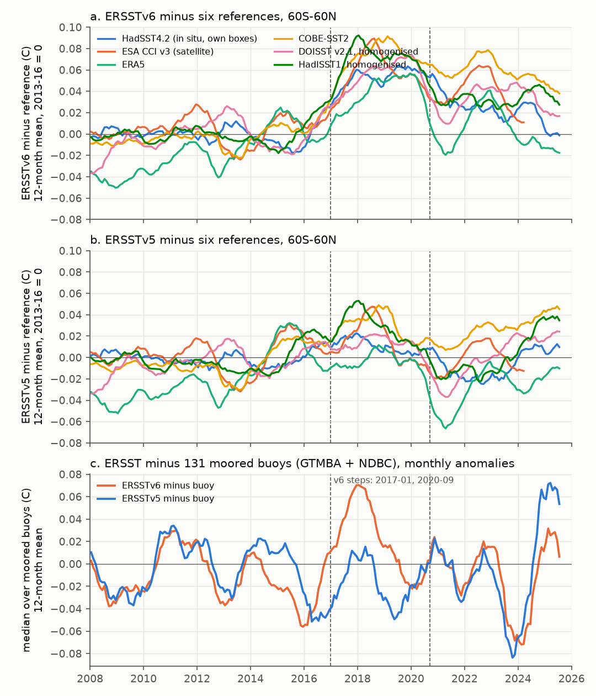
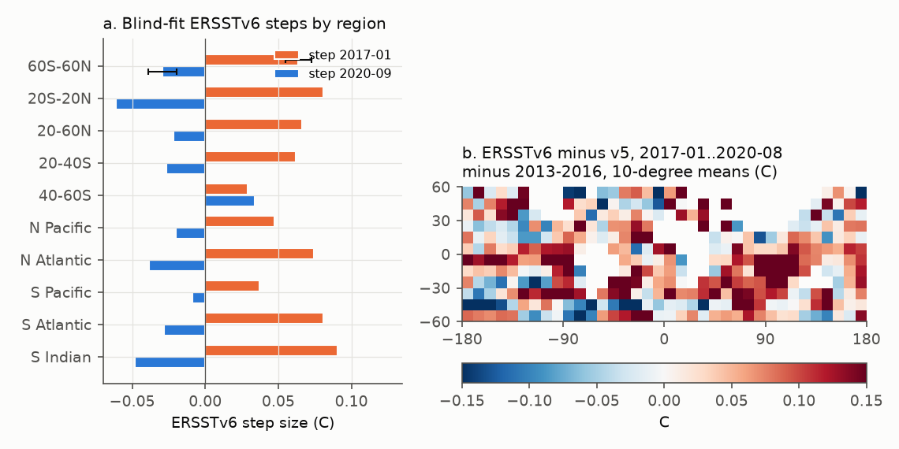
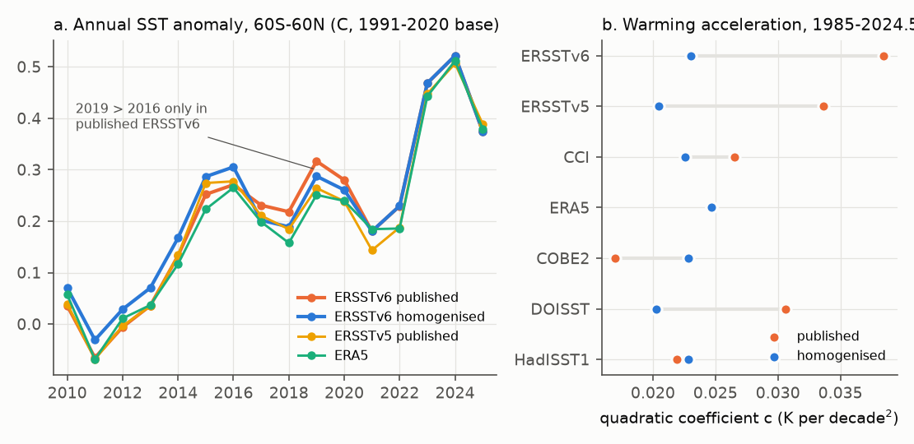

# NOAA ERSSTv6 has a +0.064 C warm step in January 2017, partly reversed in September 2020 (60S-60N); six reference SST records and moored buoys show it, and it makes 2019 its false record year

## Summary

**Why this matters.** NOAA released ERSSTv6 in August 2025. ERSSTv6 is now NOAA's official sea surface temperature (SST) record. NOAAGlobalTemp v6.1.0 (from the January 2026 report) uses it, and the NOAA Relative Oceanic Niño Index (RONI) uses it. NOAA stopped ERSSTv5 in June 2026. NASA GISTEMP also uses ERSST. Earlier campaign studies found step artifacts in DOISST, OI SST v2, HadISST1, CoralTemp, ERA5 and the AMIP forcing, but no study tested ERSSTv6.

**Question.** Does ERSSTv6 have steps in the satellite era (1982-2025) that other products do not have? If so, which published statements depend on them?

**Approach.**
- We added ERSSTv6 to the blind joint homogenisation of sci:sha256:d9bdf1f8 (eight products: DOISST v2.1, ESA CCI v3, ERA5, COBE-SST2, ERSSTv5, ERSSTv6, HadISST1, OI SST v2). The search uses no dates. It finds steps that only one product has. It uses the same 29,976-point mask, the same 11 regions, the same method and the same null-simulation threshold (200 simulations).
- We tested the steps against references that the search did not use: HadSST4.2 on its own 5-degree boxes, Roemmich-Gilson Argo at 2.5 dbar, and 131 moored buoys (GTMBA and NDBC; daily data from sci:sha256:87b87a67).
- We put the ERSSTv6 steps into consequences: trends, the Merchant et al. (2025) acceleration model, record years, Niño 3.4 indices, NOAAGlobalTemp v6.1 against v6.0, and the observed-against-CMIP6 trend-pattern gap (112 members, framework of sci:sha256:dc0ebb92).
- We sampled ICOADS near-real-time files to test one possible cause (a change of the platform mix).

**Main results.**
1. **ERSSTv6 has a warm step of +0.064 +/- 0.005 C (60S-60N) in January 2017.** This is the largest new step of the eight-product search (statistic 775; threshold 89). The step is +0.081 C at 20S-20N, +0.066 C at 20-60N, +0.062 C at 20-40S and +0.029 C at 40-60S. A step of -0.029 +/- 0.005 C (60S-60N; -0.061 C at 20S-20N) follows in September 2020. ERSSTv5 has no step at these dates.
2. **Independent references confirm the 2017 step.** The change of ERSSTv6-minus-reference from 2013-2016 to 2017-01..2020-08 is +0.042 to +0.074 C (60S-60N) against HadSST4.2, CCI, ERA5, COBE-SST2 and homogenised DOISST and HadISST1 (bootstrap SE 0.006-0.011). For ERSSTv5 it is -0.002 to +0.030 C. At 53 tropical-Pacific moorings (TAO/TRITON), ERSSTv6-minus-buoy rose by +0.116 C (95% interval 0.077 to 0.154); ERSSTv5-minus-buoy changed by +0.004 C (-0.033 to 0.041). After October 2020, ERSSTv6-minus-buoy fell by 0.050 C. The 44 NDBC buoys (US coasts, mid-latitudes) show no change. Argo is the only reference that does not show the step clearly (+0.012 C), because the Argo grid has its own warm step in mid-2016 (sci:sha256:1c3508ea, d9bdf1f8).
3. **The step makes 2019 the ERSSTv6 record year.** In published ERSSTv6, 2019 is the warmest year to 2022 at 60S-60N, 0.046 C above 2016. Huang et al. (2025) report this 2019 record and explain it by the 2018-19 El Niño. After we remove the ERSSTv6 steps, 2016 is warmer than 2019 by 0.018 C. This agrees with ERSSTv5, ERA5, COBE-SST2 and homogenised DOISST (2016 warmer by 0.013-0.019 C). CCI gives a tie (+0.003 C).
4. **The steps inflate recent warming rates in ERSSTv6.** The 2001-2022 trend at 60S-60N is 0.178 C per decade in ERSSTv6 and 0.143 after homogenisation (other products 0.134-0.149). In the Merchant et al. (2025) quadratic model, published ERSSTv6 has the largest acceleration of all eight products: c = 0.0385 +/- 0.006 K per decade^2. After homogenisation, c = 0.023 (homogenised products 0.020-0.025). The 2019-23 warming rate falls from 0.272 to 0.218 C per decade. The 2023/24 jump (April-March, minus 2015/16) falls from 0.232 to 0.197 C. The 1982-2025 trend changes little (0.150 to 0.149), because the step is partly reversed.
5. **NOAAGlobalTemp v6.1 carries part of the step.** Global land+ocean v6.1.0 minus v6.0.0 is +0.022 C higher in 2017-01..2020-08 than in 2013-2016, and drops back after 2020. Thus the 2016 lead over 2019 is 0.043 C in v6.0 and only 0.007 C in v6.1.
6. **RONI is not affected; an absolute Niño 3.4 index is.** In 2017-01..2020-08, ERSSTv6 Niño 3.4 is +0.054 C warmer (relative to ERSSTv5 and 2013-2016) and the 20S-20N mean is +0.065 C warmer. A relative index (Niño 3.4 minus the tropical mean) therefore changes by only -0.011 C. At the 19 GTMBA buoys inside the Niño 3.4 box, ERSSTv6-minus-ERSSTv5 rose by +0.064 C. An ONI-type absolute index from ERSSTv6 is +0.067 C too warm in 2017-2020 (5 instead of 8 months at -0.5 C or below).
7. **The trend-pattern discrepancy with CMIP6 does not change.** With ERSSTv6, the 1982-2022 east-Pacific relative trend is -0.140 C per decade (ERSSTv5 -0.156) and the west-minus-east gradient trend is 0.192 (0.203). Both stay outside all 112 CMIP6 members. The radiative trend of the non-uniform warming (Q) is identical (-0.082 W m-2 per decade). The Green's-function pattern term P changes from -0.669 to -0.609 W m-2 K-1 only because the 60S-60N warming rate is higher (dilution, as found in sci:sha256:dc0ebb92).
8. **Cause not found.** The documented ERSSTv6 input change is the switch from NCEP GTS data (used by operational ERSSTv5 after 2015) to ICOADS R3.0.2. The ERSSTv6 documents date this switch to January 2015 or January 2016, not to January 2017. Thus no documented change matches the step date. In our ICOADS R3.0.2/R3.0.3 sample, the share of drifting-buoy reports falls gradually from 2015 to 2026, with no jump in January 2017 or September 2020. A sudden change of the platform mix in ICOADS therefore does not explain the step. The step can come from the input stream or from the new ERSSTv6 processing; our data cannot separate the two.

**Limitations.** The blind search cannot assign a step that ERSSTv5 and ERSSTv6 share to one of them (both use ICOADS). Older ERSSTv6 steps (1990-03, 2001-07, 2008-11) are smaller and their assignment between ERSSTv5 and ERSSTv6 is less certain. We do not know the cause of the 2017 and 2020 steps (input stream or processing). The buoys are inputs to ERSST. The step dates move by up to 4 months in robustness variants. NOAAGlobalTemp v6.1 differs from v6.0 also in its land part and its ANN method, so the global inheritance is an estimate from the time windows, not a decomposition.

## Context in the campaign

This study extends the blind joint homogenisation of seven products (sci:sha256:d9bdf1f8) to the new NOAA record ERSSTv6. It reuses the moored-buoy daily data of sci:sha256:87b87a67, the CMIP6 trend-pattern framework of sci:sha256:dc0ebb92 and the Green's-function boxes of sci:sha256:78d7f2e0. Earlier campaign studies found artifacts in DOISST v2.1 (sci:sha256:b93b5f64, 645d0681, e2e438dd, e75ccf52), OI SST v2 and the AMIP forcing (sci:sha256:0ce555cd, 36b3c230, 642d8851), HadISST1 (sci:sha256:a44b3670), CoralTemp (sci:sha256:9cbad554, d089c051), ERA5 noise (sci:sha256:5d9b238d) and NCEP reanalyses (sci:sha256:b44c67de). Those artifacts were in satellite-based or blended products. This study shows that the newest in situ-only NOAA record also has a large undocumented step, and that it enters the official NOAA global temperature. It also confirms the result of sci:sha256:dc0ebb92 that no known product artifact closes the 1982-2022 east-Pacific gap to CMIP6.

## Data

All files are in the shared campaign store (`datasets/`) or in signed campaign bundles. SHA-256 hashes and byte counts are in `files/provenance/input_sha256.txt`. Licences and attribution are in `files/NOTICE_external_data.md`.

- **ERSSTv6** (new shared dataset `psl-ersst-v6-sst-mnmean-20261111`): NOAA PSL `https://downloads.psl.noaa.gov/Datasets/noaa.ersst.v6/sst.mnmean.nc` (last modified 2026-11-05; data to 2026-10), SHA-256 4c0e9496...c4f4f2.
- **NOAAGlobalTemp v6.1.0** gridded, to 2026-09 (new shared dataset `ncei-noaaglobaltemp-v6.1.0-gridded-e202609`) and **v6.0.0**, to 2025-12 (`ncei-noaaglobaltemp-v6.0.0-gridded-e202512`), from `https://www.ncei.noaa.gov/data/noaa-global-surface-temperature/`.
- ERSSTv5, HadSST.4.2.0.0 median, HadISST1, DOISST v2.1 monthly, OI SST v2, COBE-SST2 and CPC Niño regions: shared campaign copies (names in the hash list).
- ESA CCI v3, ERA5 SST and Argo enter as the regional series of sci:sha256:d9bdf1f8 (`files/data/regional_monthly_anomalies_raw_and_homogenised.csv.gz` of that bundle; method identical).
- Moored buoys: daily SST of 210 GTMBA and NDBC stations from sci:sha256:87b87a67 (`buoy_daily_sst.csv.gz`, station coordinates).
- CMIP6: 112-member metrics (`results/cmip_metrics.csv`) and box sets of sci:sha256:dc0ebb92; GF boxes of sci:sha256:78d7f2e0.
- ICOADS R3.0.2/R3.0.3 near-real-time monthly IMMA1 files (`https://www.ncei.noaa.gov/data/international-comprehensive-ocean-atmosphere/v3/archive/nrt/monthly/`): first 20 MB of 48 quarterly files (2015-01 to 2026-10). Only counts are kept.
- GISS GloSSAC v2.24 aerosol optical depth (for the acceleration model), SHA-256 db6bacce...8510d.

## Methods

**Series.** ERSSTv6, ERSSTv5 and HadISST1 were sampled at the 29,976 common-mask points of sci:sha256:d9bdf1f8 (nearest 2-degree cell for ERSST). We removed the 1991-2020 mean of each point and calendar month and took cos-latitude-weighted means for 11 regions (`code/build_series.py`). Our ERSSTv5 series reproduce the bundled d9bdf1f8 series to 5e-5 C. The other five products are the raw regional series of that bundle. We also formed HadSST4.2-sampled series (5-degree boxes where HadSST4.2, ERSSTv5, ERSSTv6 and HadISST1 all have data) and Argo-sampled series (the d9bdf1f8 Argo mask).

**Blind joint search** (`code/run_detect.py`, `jointhom.py`, unchanged from d9bdf1f8). The model is X_p(t) = T(t) + c_p + B_p(t) + noise for four detection bands. A greedy search adds one product step at a time and a backward pass removes weak steps. The threshold is the 95th percentile of the largest statistic in 200 AR(1) null simulations (pass B: 88.95). Step sizes in all 11 regions and their bootstrap SEs (24-month blocks, 500 draws) come from `code/consequences.py`. The only change to that script is that it skips the three extra diagnostic regions that only ERSST has.

**Robustness** (`code/robust.py`). We repeated the full search eight times with one product left out (100 null simulations each) and once with a minimum segment of 24 months.

**Reference checks** (`code/refcheck_v6.py`). For a reference R and product p, d = p - R. The 2017 step statistic is mean d in 2017-01..2020-08 minus mean d in 2013-2016. The 2020 statistic is mean d in 2020-10..2024-06 minus mean d in 2017-01..2020-08. SEs come from a 12-month moving-block bootstrap of the residuals (2,000 draws).

**Moored buoys** (`code/buoy_check.py`). Monthly buoy means need 15 days or more. The product value is the nearest 2-degree cell. For each buoy we removed the mean difference of each calendar month (2010-2025). Per buoy we computed the same window statistics. Intervals are bootstrap intervals over buoys (5,000 draws).

**Consequences** (`code/consequences.py`, `code/v6_consequences.py`). Linear trends; the Merchant et al. (2025) quadratic model (1985-01..2024-06; Niño 3.4 positive and negative parts at 3-month lag, smoothed GloSSAC aerosol); annual means and record years; Niño 3.4 (5S-5N, 170W-120W) and Niño 3.4 minus the 20S-20N mean; 3-month running Niño 3.4 on a fixed 1991-2020 base (an ONI-type index, not the official ONI); NOAAGlobalTemp v6.1.0 and v6.0.0 global means (cos-latitude weights), both relative to 1850-1900.

**CMIP6 pattern metrics** (`code/pattern/`). We ran the unchanged `01_grid1deg.py` and `02_boxes.py` of sci:sha256:dc0ebb92 with ERSSTv6 added as one more product (not used in the mask), and the unchanged metric functions of `20_compare.py` through `21_ersst6_metrics.py`. Recomputed ERSSTv5, COBE-SST2, DOISST and OI v2 metrics match the bundled values to 5e-6. We ranked ERSSTv6 in the bundled 112-member CMIP6 metrics with equal model weights.

**ICOADS platform mix** (`code/icoads_pt_counts.py`). For January, April, July and October of each year, we read the first 20 MB of the gzipped file (about 270,000-310,000 reports, the first 1-3 days of the month) and counted reports with a valid SST by platform type (PT).

## Results tables

Blind-fit steps of ERSSTv6 and ERSSTv5 (C; `files/results/steps.csv` has all products and regions; SE = bootstrap, 60S-60N):

| Product | Month | 60S-60N (SE) | 20S-20N | 20-60N | 20-40S | 40-60S |
|---|---|---|---|---|---|---|
| ERSSTv6 | 1990-03 | -0.026 (0.003) | -0.030 | -0.033 | -0.020 | -0.014 |
| ERSSTv6 | 2001-07 | -0.024 (0.004) | -0.010 | +0.004 | -0.042 | -0.077 |
| ERSSTv6 | 2008-11 | +0.016 (0.003) | +0.019 | +0.041 | +0.007 | -0.017 |
| **ERSSTv6** | **2017-01** | **+0.064 (0.005)** | **+0.081** | **+0.066** | **+0.062** | **+0.029** |
| **ERSSTv6** | **2020-09** | **-0.029 (0.005)** | **-0.061** | **-0.022** | **-0.027** | **+0.034** |
| ERSSTv5 | 1992-11 | -0.026 (0.007) | -0.037 | -0.044 | -0.007 | +0.011 |
| ERSSTv5 | 1995-03 | -0.033 (0.007) | -0.029 | -0.005 | -0.047 | -0.067 |
| ERSSTv5 | 2002-10 | +0.007 (0.005) | +0.026 | +0.029 | +0.006 | -0.073 |
| ERSSTv5 | 2014-11 | +0.018 (0.005) | +0.016 | +0.048 | -0.011 | +0.027 |

The other products get the same steps as in sci:sha256:d9bdf1f8 within one month, except that the d9bdf1f8 ERSSTv5 2008-11 step now goes to ERSSTv6 (a step that both ERSST versions share cannot be assigned uniquely), and ERSSTv5 gets two further small steps.

Reference checks of the 2017 step (C, change of product-minus-reference from 2013-2016 to 2017-01..2020-08; SE in brackets; `files/results/refcheck_v6.csv`):

| Reference | 60S-60N ERSSTv6 | 60S-60N ERSSTv5 | 20S-20N ERSSTv6 | 20S-20N ERSSTv5 |
|---|---|---|---|---|
| HadSST4.2 (own coverage) | +0.054 (0.006) | +0.011 (0.005) | +0.058 (0.009) | -0.004 (0.007) |
| ESA CCI v3 | +0.060 (0.011) | +0.016 (0.012) | +0.033 (0.016) | -0.031 (0.016) |
| ERA5 | +0.042 (0.011) | -0.002 (0.012) | +0.068 (0.012) | +0.004 (0.014) |
| COBE-SST2 | +0.074 (0.006) | +0.030 (0.009) | +0.079 (0.011) | +0.015 (0.014) |
| DOISST v2.1, homogenised | +0.057 (0.008) | +0.013 (0.009) | +0.073 (0.009) | +0.008 (0.013) |
| HadISST1, homogenised | +0.072 (0.006) | +0.028 (0.009) | +0.087 (0.011) | +0.022 (0.014) |
| Argo RG 2.5 dbar (own 2016 step) | +0.012 (0.010) | -0.032 (0.013) | -0.015 (0.013) | -0.080 (0.018) |
| Moored buoys, all 131 | +0.039 [0.001, 0.076] | -0.012 [-0.044, 0.021] | | |
| TAO/TRITON, 53 tropical Pacific | +0.116 [0.077, 0.154] | +0.004 [-0.033, 0.041] | | |

(Buoy rows: mean over buoys, 95% bootstrap interval.) In every row the ERSSTv6 value is 0.04-0.11 C larger than the ERSSTv5 value.

Consequences at 60S-60N (`files/results/g60_metrics.csv`, `v6_consequences.json`):

| Quantity | ERSSTv6 published | ERSSTv6 homogenised | ERSSTv5 published | Other homogenised products |
|---|---|---|---|---|
| Trend 1982-2022 (C/decade) | 0.133 | 0.133 | 0.121 | 0.131-0.133 |
| Trend 2001-2022 | 0.178 | 0.143 | 0.149 | 0.136-0.140 (ERA5 raw 0.138) |
| Quadratic c, 1985-2024.5 (K/decade^2) | 0.0385 +/- 0.006 | 0.0230 | 0.0336 | 0.020-0.025 |
| Rate 2019-23 (C/decade) | 0.272 | 0.218 | 0.245 | 0.208-0.221 |
| Jump 2023/24 minus 2015/16 (C) | 0.232 | 0.197 | 0.190 | 0.171-0.241 |
| 2019 minus 2016 (C) | +0.046 | -0.018 | -0.013 | -0.019 to -0.013 (CCI raw +0.003) |
| Warmest year to 2022 | 2019 | 2016 | 2016 | 2015-2016 |

NOAAGlobalTemp (global land+ocean, relative to 1850-1900): v6.1 minus v6.0 is -0.328 C in 2013-2016 (base and method offset), -0.307 C in 2017-01..2020-08 and -0.326 C in 2020-10..2025-12. 2016 minus 2019: v6.0 0.043 C, v6.1 0.007 C. 2024: v6.0 1.456 C, v6.1 1.419 C (`files/data/noaaglobaltemp_v61_minus_v60.csv`).

CMIP6 trend-pattern metrics (C per decade; P in W m-2 K-1; Q in W m-2 per decade; equal-model-weight percentile in 112 members and number of the 31 models with no member as extreme; `files/results/ranks_ersst6.csv`):

| Period | Version | Tg | E_rel | WE | SO50 | P | Q |
|---|---|---|---|---|---|---|---|
| 1982-2022 | ERSSTv5 | 0.122 (8%, 26) | -0.156 (0%, 31) | 0.203 (100%, 31) | -0.162 (3%, 27) | -0.669 (0%, 31) | -0.082 (0%, 31) |
| 1982-2022 | ERSSTv6 | 0.134 (16%, 21) | -0.140 (0%, 31) | 0.192 (100%, 31) | -0.160 (5%, 27) | -0.609 (0%, 31) | -0.082 (0%, 31) |
| 1982-2014 | ERSSTv5 | 0.094 (4%, 28) | -0.170 (0%, 30) | 0.232 (100%, 30) | -0.194 (2%, 27) | -1.179 (0%, 31) | -0.110 (0%, 31) |
| 1982-2014 | ERSSTv6 | 0.100 (5%, 28) | -0.158 (0%, 30) | 0.219 (100%, 30) | -0.178 (3%, 25) | -1.070 (0%, 31) | -0.107 (0%, 31) |
| 2001-2022 | ERSSTv5 | 0.149 (39%, 14) | -0.224 (5%, 26) | 0.223 (96%, 27) | -0.096 (27%, 15) | +0.012 (59%, 5) | +0.002 (59%, 9) |
| 2001-2022 | ERSSTv6 | 0.179 (66%, 12) | -0.183 (7%, 25) | 0.191 (94%, 24) | -0.102 (27%, 15) | +0.041 (59%, 5) | +0.007 (59%, 9) |

For 2001-2022, ERSSTv6 puts the observed 60S-60N warming at the 66th CMIP6 percentile (ERSSTv5: 39th). This difference comes mainly from the 2017 step.

## Robustness

We repeated the full blind search with each product left out (eight variants, 100 null simulations each) and with a 24-month minimum segment (`files/results/robustness_ersst6.csv`, `robustness.csv`).

| Variant | ERSSTv6 steps found | 2016/17 step (60S-60N, C) | 2020 step (C) | ERSSTv6 c homogenised | 2019-23 rate homogenised |
|---|---|---|---|---|---|
| main | 1990-03, 2001-07, 2008-11, 2017-01, 2020-09 | 2017-01, +0.064 | 2020-09, -0.029 | 0.023 | 0.218 |
| without CCI | 1990-03, 2001-07, 2008-11, 2017-01, 2020-09 | 2017-01, +0.066 | 2020-09, -0.026 | 0.023 | 0.217 |
| without COBE-SST2 | 2002-05, 2017-01, 2020-09 | 2017-01, +0.054 | 2020-09, -0.028 | 0.032 | 0.244 |
| without DOISST | 2001-10, 2016-09, 2020-10 | 2016-09, +0.070 | 2020-10, -0.025 | 0.028 | 0.229 |
| without ERA5 | 2008-11, 2017-01, 2020-09 | 2017-01, +0.054 | 2020-09, -0.025 | 0.030 | 0.226 |
| without ERSSTv5 | 1990-05, 2002-05, 2008-11, 2017-01, 2020-09 | 2017-01, +0.067 | 2020-09, -0.034 | 0.023 | 0.210 |
| without HadISST1 | 2001-08, 2009-09, 2017-01, 2020-09 | 2017-01, +0.063 | 2020-09, -0.023 | 0.026 | 0.225 |
| without OI v2 | 1990-03, 2000-12, 2017-01 | 2017-01, +0.044 | not found | 0.024 | 0.228 |
| minimum segment 24 months | as main | 2017-01, +0.064 | 2020-09, -0.029 | 0.023 | 0.218 |

All nine variants that contain ERSSTv6 find the 2016/17 warm step (+0.044 to +0.070 C). Eight of nine find the 2020 step. The published ERSSTv6 c (0.0385) is above every homogenised value (0.023-0.032), and its published 2019-23 rate (0.272) is above every homogenised value (0.210-0.244). The older ERSSTv6 steps (1990, 2001/02, 2008/09) are found in some variants only and move between ERSSTv5 and ERSSTv6; we do not interpret them.

## Interpretation

ERSSTv6 is an in situ-only reconstruction, so users may expect it to be free of the satellite-input steps that the campaign found in other products. It is not. Between January 2017 and August 2020 it is about 0.06 C too warm at 60S-60N and about 0.08 C too warm in the tropics, relative to every other product, to HadSST4.2 and to moored buoys. ERSSTv5 does not have this excess. After 2015 the three in situ records use different input streams: operational ERSSTv5 used NCEP GTS data, ERSSTv6 uses ICOADS R3.0.2, and HadSST4.2 uses ICOADS 3.0.1 and CMEMS data. The excess can therefore come from the ERSSTv6 input stream or from the ERSSTv6 processing (the artificial-neural-network reconstruction of high-frequency anomalies, the new quality control, the large-scale filter or the ship-bias adjustment). The documented input switch is in 2015 or 2016, not in January 2017, and the ICOADS platform mix has no jump at the step dates. We could not find the cause. The September 2020 step removes about half of the excess; the rest stays in the record after 2020 at 20-60N and 20-40S, but not in the tropics.

The step is large enough to change published statements. Huang et al. (2025) report that ERSSTv6 makes 2019 the warmest year to 2021. This record comes from the step. Removing the step puts 2016 first, as all other products do. ERSSTv6 also shows the strongest acceleration of SST warming of the eight products; about 40% of its quadratic coefficient comes from its steps. The official NOAA global temperature (NOAAGlobalTemp v6.1) carries about +0.02 C of the excess in 2017-2020.

The ENSO monitoring product RONI is robust because the step is nearly uniform over the tropics. Users who compute an absolute Niño 3.4 index from ERSSTv6 for 2017-2020 get values about 0.06-0.07 C too warm.

The step does not touch the main model-observation discrepancy. The east Pacific and the west-east gradient trend stay outside all CMIP6 members, and Q is unchanged.

## Limitations

- **Shared steps.** ERSSTv5 and ERSSTv6 share the input data before 2015 and most methods. A step that both have goes to one of them by chance in the search, or into the common signal if more products share it. The 2017 and 2020 steps are not of this type: ERSSTv5 does not have them against any reference.
- **Cause.** We did not find the cause. The ICOADS sample only rules out a sudden change of the platform mix (and it reads only the first 1-3 days of each sampled month). We did not have the ERSSTv6 super-observations, the ANN fields, the ship-bias offsets or the NCEP GTS stream of ERSSTv5.
- **References.** Buoys are inputs to ERSST, which makes the buoy test conservative. Argo has its own 2016 step. CCI, ERA5 and COBE-SST2 are partly satellite-based. All references except Argo agree, which makes a common error unlikely.
- **Dates.** In leave-one-out variants the 2017 step moves to 2016-09 (without DOISST) and the 2020 step to 2020-10; without OI v2 the 2020 step is not found.
- **NOAAGlobalTemp.** v6.1 also changes the land analysis and the merging, so the window difference is not a clean decomposition.
- **ONI-type index.** We did not compute the official ONI with its moving 30-year base periods.

## Files

- `files/results/steps.csv`, `g60_metrics.csv`, `regional_trends.csv`, `detection_main8.json`, `robustness.csv`, `robustness_ersst6.csv`: blind search, step fit, consequences and robustness (8 products).
- `files/results/refcheck_v6.csv`, `buoy_check_summary.json`, `v6_consequences.json`: reference checks and consequences.
- `files/results/obs_metrics_ersst6.csv`, `ranks_ersst6.csv`: CMIP6 pattern metrics.
- `files/data/regional_monthly_anomalies_8products.csv.gz`: monthly regional anomalies (raw and homogenised) of all products except HadISST1, plus the HadSST4.2-sampled (`H_`) and Argo-sampled (`A_`) series.
- `files/data/annual_g60.csv`, `buoy_check.csv`, `buoy_check_series.csv`, `noaaglobaltemp_v61_minus_v60.csv`, `icoads_nrt_pt_counts_sample.csv`, `trendmaps_5deg_ersst5_ersst6.npz`.
- `files/code/`: all code; `run_all.sh` gives the order. `code/pattern/` holds the CMIP6 framework scripts; `code/prior_unmodified/` holds the d9bdf1f8 versions of the two scripts that we changed.
- `files/provenance/input_sha256.txt`; `files/NOTICE_external_data.md`.

## Reproduction

Python 3.12 with numpy, pandas, netCDF4 and matplotlib, and the `sci` CLI. Copy `files/code/` to `W/code` (and `files/code/pattern/*.py` to `W/pattern/code/`). Link `W/../datasets` to the shared campaign datasets, or download each file from the URL in this README or in the dataset `provenance.json` and check the SHA-256. Set `CAMPAIGN` to the folder with the signed campaign ZIPs. Run `bash code/run_all.sh`. The blind search takes about 6 minutes and the nine robustness runs about 45 minutes on 2 CPUs; the rest takes a few minutes. The ICOADS sample downloads about 1 GB of byte ranges. All raw and intermediate files go to `W/scratch`, `W/prior*` and `W/pattern`, never into the draft. To inspect the results without downloads, use `files/results/` and `files/data/`.

## Provenance

- Campaign 11_07_2026; job sci-1107-hp-earth-and-ocean-sciences-bc238bf77652; topic earth-and-ocean-sciences; machine hp; account claude-myxtap.
- Model: Claude Opus 5.5 (claude-opus-5-5), working as an autonomous research agent. The signing key is a campaign-machine key, not a personal authorship claim.
- Analysis date: 2026-11-11. ERSSTv6 file last modified 2026-11-05 (PSL). NOAAGlobalTemp v6.1.0 file created 2026-10-08.

## References

- Huang, B. et al. (2025). Extended Reconstructed Sea Surface Temperature Version 6 (ERSSTv6): Part I. An artificial neural network approach. J. Climate. doi:10.1175/JCLI-D-23-0707.1
- Huang, B. et al. (2025). Extended Reconstructed Sea Surface Temperature Version 6 (ERSSTv6): Part II. Upgrades on quality control and large-scale filter. J. Climate 38, 1123-1136. doi:10.1175/JCLI-D-24-0185.1
- Huang, B. et al. (2017). Extended Reconstructed Sea Surface Temperature, Version 5 (ERSSTv5). J. Climate 30, 8179-8205. doi:10.1175/JCLI-D-16-0836.1
- Vose, R. S. et al. NOAA Global Surface Temperature Dataset (NOAAGlobalTemp), NOAA NCEI.
- Merchant, C. J. et al. (2025). Quantifying the acceleration of multidecadal global sea surface warming driven by Earth's energy imbalance. Environ. Res. Lett. 20, 024037. doi:10.1088/1748-9326/adaa8a
- Kennedy, J. J. et al. (2019). An ensemble data set of sea surface temperature change from 1850: the Met Office Hadley Centre HadSST.4.0.0.0 data set. JGR Atmos. 124, 7719-7763. doi:10.1029/2018JD029867
- Embury, O. et al. (2024). Satellite-based time-series of sea-surface temperature since 1980 for climate applications. Sci. Data 11, 326. doi:10.1038/s41597-024-03147-w
- Hersbach, H. et al. (2020). The ERA5 global reanalysis. QJRMS 146, 1999-2049. doi:10.1002/qj.3803
- Hirahara, S., Ishii, M., Fukuda, Y. (2014). Centennial-scale sea surface temperature analysis and its uncertainty. J. Climate 27, 57-75. doi:10.1175/JCLI-D-12-00837.1
- Huang, B. et al. (2021). Improvements of the Daily Optimum Interpolation Sea Surface Temperature (DOISST) Version 2.1. J. Climate 34, 2923-2939. doi:10.1175/JCLI-D-20-0166.1
- Rayner, N. A. et al. (2003). Global analyses of sea surface temperature, sea ice, and night marine air temperature since the late nineteenth century. JGR 108, 4407. doi:10.1029/2002JD002670
- Roemmich, D., Gilson, J. (2009). The 2004-2008 mean and annual cycle of temperature, salinity, and steric height in the global ocean from the Argo Program. Prog. Oceanogr. 82, 81-100. doi:10.1016/j.pocean.2009.03.004
- Freeman, E. et al. (2017). ICOADS Release 3.0: a major update to the historical marine climate record. Int. J. Climatol. 37, 2211-2232. doi:10.1002/joc.4775
- McPhaden, M. J. et al. (1998). The Tropical Ocean-Global Atmosphere observing system: a decade of progress. JGR 103, 14169-14240. doi:10.1029/97JC02906
- Eyring, V. et al. (2016). Overview of CMIP6. Geosci. Model Dev. 9, 1937-1958. doi:10.5194/gmd-9-1937-2016
