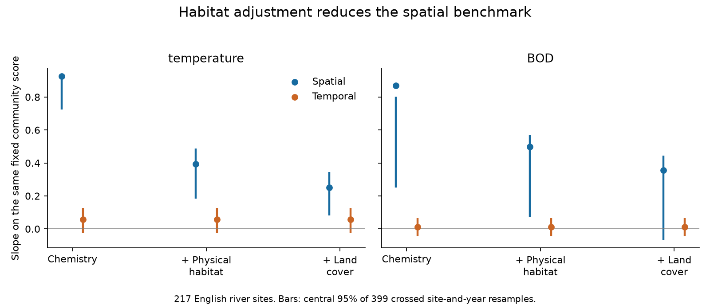

# Static habitat adjustment cut the spatial thermal slope by 73% at 217 English river sites

## Main result

At 217 English river sites, adjustment for river habitat and upstream land cover reduced an early, held-out spatial temperature slope from 0.925 to 0.251. This is a 73% reduction. The central 95% range from 399 crossed site-and-year resamples was 59–90%. The comparison held the community score and sites fixed. It thus measured a change in the spatial benchmark, not a faster community response.

The annual temporal slope on this same score was 0.058. Its ratio to the spatial slope rose from 6.3% to 23.2% after habitat adjustment. This increase is a denominator effect. It is not evidence that habitat change caused community change or that habitat management would raise the tracking rate.

The result challenges the use of the unadjusted river spatial gradient as a purely thermal equilibrium target. It does not remove the observed weak annual temperature link. When the community axis was also trained with habitat controls, both slopes were smaller and the spatial denominator was unstable under resampling. These records do not establish a precise residual tracking rate.



Bars show central 95% resampling ranges. The point estimate can lie outside a percentile range because refitting the axes shifts validation performance. Blue and orange marks use the same frozen community score in all three columns. The temporal model is unchanged across those columns.

## Question and prior work

The campaign found weak space-for-time transfer in many communities. Earlier raw-data analyses at these river sites reported annual thermal transfer of 4–8% after pollution controls (SCI ab21b52e), and weak transfer of the biochemical oxygen demand (BOD) gradient as well (SCI 0bfafb93). Neither analysis adjusted for measured channel habitat or upstream land cover in the spatial benchmark. We test that missing assumption.

Vaughan and Gotelli (2019, DOI 10.1038/s41467-019-09736-3) studied water-quality recovery and climatic debt in river communities. Pharaoh et al. (2024, DOI 10.1016/j.scitotenv.2024.174369) studied land cover, chemistry and climatic influences in English and Welsh rivers. These studies make habitat covariation a plausible concern. Our contribution is a paired audit of the spatial denominator and an independently trained conditional axis, with the same community records, site cohort and later test window. It is new analysis of a previously used source network, not a new monitoring programme or a causal test of those papers.

## Data and selection

We used ChemPop version 2.0, Bachiller-Jareno et al. (2025), DOI 10.5285/23f194b0-1e21-4f14-be9c-6eabdcc1feb7. Contains data supplied by UK Centre for Ecology & Hydrology. It combines Environment Agency biology and chemistry, CHESS-met air temperature and site descriptors.

We retained the prior selection exactly: September–November samples in 1991–2017; one sample per site-year, nearest to 15 October, then sample ID as tie rule; complete temperature, BOD and ammonia; at least three baseline years in 1991–2000 and eight later years in 2001–2017. There were 3,715 samples, of which 1,397 were baseline and 2,318 were later. All 217 sites had all ten selected habitat covariates. No imputation or cohort change was needed. The seven regions and their counts are in files/diagnostics.json.

Positive source abundance defines presence. Repeated records of a family within a sample use their union. The vocabulary consists of 79 family labels present at 30 or more baseline sites. Some labels are broader operational groups. Family presence can hide species replacement. Each community entry is sqrt(presence/richness), with richness restricted to this vocabulary.

Temperature and chemistry are six-month pre-sample means. Temperature is air temperature, not river water temperature. Chemistry uses source LOQ3 substitution and log(1 + concentration). The baseline temperature coordinate is a site effect after year-by-month adjustment. The baseline chemical coordinates are site means.

## Method

We split sites into two folds within region, with seed 810. For each fold, multivariate ordinary least squares on the other fold predicts baseline mean community vectors from temperature, log BOD and log ammonia. For exposure k, let g_k be the vector of its partial family coefficients. Each sample receives the score S_k = Y dot g_k / (g_k dot g_k), using only the other fold's g_k. The score has unit spatial slope in training by construction, but its validation slope is estimated on held-out sites. Vocabulary selection uses all baseline sites, as in the prior work.

The primary comparison keeps these chemistry-trained scores fixed. Held-out spatial regressions predict baseline site-mean scores from the three exposures and fold. We add two nested control sets:

- Physical habitat: altitude; log(1 + slope), log(1 + distance from source), log(1 + channel width), log(1 + channel depth); boulder/cobble and silt/clay shares.
- Physical habitat plus upstream woodland, arable and urban shares. Seminatural share is omitted to avoid the cover sum constraint.

All ten habitat covariates are standardised. The scale does not change ordinary least-squares slopes. Effluent exposure was omitted before outcome fitting because about half of the source sites lacked it. This decision and the analysis plan are in files/PLAN.md.

Later score regressions use temperature, log BOD, log ammonia, survey day, and site, month and year effects. Habitat covariates are static and are absorbed by site effects. Thus the annual coefficient cannot change in the fixed-score comparison. We then train new axes with each control set and validate them with the same controls. This second test asks whether a conditional spatial direction transfers. It changes the biological outcome and must not be read as another denominator-only correction.

## Estimates and uncertainty

| Axis and score | Spatial controls | Spatial slope | Annual slope | Point ratio |
|---|---|---:|---:|---:|
| Temperature, fixed | Chemistry | 0.925 | 0.058 | 6.3% |
| Temperature, fixed | + physical habitat | 0.393 | 0.058 | 14.8% |
| Temperature, fixed | + land cover | 0.251 | 0.058 | 23.2% |
| Temperature, retrained | Physical habitat | 0.398 | 0.047 | 11.9% |
| Temperature, retrained | Habitat and cover | 0.316 | 0.030 | 9.5% |
| BOD, fixed | Chemistry | 0.870 | 0.011 | 1.3% |
| BOD, fixed | + physical habitat | 0.498 | 0.011 | 2.3% |
| BOD, fixed | + land cover | 0.356 | 0.011 | 3.2% |

The physical controls reduced the fixed thermal slope by 58% (range 42–77%). Adding cover increased the reduction to 73%. The paired absolute reduction was 0.674 (0.478–0.776). The fixed BOD slope fell by 59%, but its fraction-reduction range was 38–123%. BOD's fully adjusted denominator was non-positive in 22 of 399 draws. Its ratio has no reliable bounded interval here.

For the fixed thermal score with all controls, the spatial range was 0.082–0.346 and the annual range was -0.024–0.128. The temporal-minus-spatial range was -0.332 to -0.007, narrowly below zero in this resampling scheme. One draw had a non-positive spatial slope. We retain the full ratio draws in files/bootstrap.csv but do not interpret their percentile span as a confidence set for a ratio near a zero denominator.

The fully retrained thermal axis had spatial range -0.069–0.385 and annual range -0.091–0.109. Its denominator was non-positive in 35 of 399 draws; temporal-minus-spatial range was -0.390 to 0.094. Thus a precise 9.5% residual tracking rate, or rejection of equal slopes on that new axis, is not supported. Ammonia denominators were also unstable. Complete results, including null findings, are in files/summary.csv.

Each resample draws sites within region and years independently within baseline and test periods. It rebuilds baseline community and chemical means, refits axes, and refits spatial and temporal slopes. Folds, vocabulary and baseline temperature coordinates remain fixed. Paired reductions use the same draw. Percentile ranges are sensitivity intervals, not a proved finite-sample coverage procedure. They omit serial year dependence, basin clustering and errors in climate coordinates and static descriptors. Spatial slopes shift downward under resampling, especially for weak fitted directions. We do not hide this bias by centring the ranges on the point estimates.

Five other fold seeds gave fixed-score, fully adjusted thermal slopes of 0.235–0.265 and ratios of 19.8–27.2%. Omitting one region at a time gave slopes of 0.189–0.430 and ratios of 9.5–37.0%. Adding region to both training and spatial validation gave slope 0.398 versus a chemistry-only slope of 0.860, a 54% reduction. The exact 73% is therefore model-dependent. The retrained axis was less stable: omitting Midlands gave a spatial slope of 0.00275 and ratio 3.13. This is another denominator warning, not evidence of rapid tracking.

An independent full dummy regression matched the fixed-effect projection solver within 1.7e-15 on a synthetic unbalanced weighted panel. After an audit found a broadcasting error in an exposure-support diagnostic only, that diagnostic was corrected. All point estimates and sensitivity fits were rerun and unchanged. The diagnostic did not enter bootstrap fits.

## Meaning and limits

The measured river template is a large part of the spatial thermal association in this cohort. The result places a limit on claims that most of this particular spatial-to-temporal gap must reflect colonisation or demographic delay. A smaller, conditional spatial benchmark and uncertainty in its estimation must be considered first. It does not identify which habitat feature is responsible, establish mediation, or exclude ecological constraints.

Altitude and habitat can encode real temperature exposure, including air-to-water differences. Adjustment can therefore remove part of a real thermal signal. Channel descriptors have dates from 1995 to 2016; upstream cover is Land Cover Map 2015. They are not all baseline measurements. They can reflect later change or ecological pathways affected by climate and pollution. The controls are descriptive and can overadjust. No lag time or intervention effect is estimated.

Other limits include only 217 of 1,519 source sites, family-level identification, changing methods and detectability, unmeasured flow and channel change, correlated exposure errors, and a linear model. Year effects remove shared temporal change, so the annual ratio is not a fraction of national warming followed. This study does not decide between dispersal, demographic inertia, stable habitat filtering or exposure-proxy error as explanations for the remaining response.

## Reproduce

Use Python 3.12 and the package versions in files/environment.json. Set library thread pools to one; the scripts do this. Raw data and all derived record-level tables must stay outside the signed folder.

Use the exact shared archive documented in files/provenance.json, or run retrieve.py to obtain it. That script verifies all 35 used CSV hashes. The original archive SHA256 is 06ff765e64667a9af38cf0ae44bdd8d797480f5058a5963b5ad9a567c32a0b9e. Server-generated ZIP metadata can change; constituent CSV hashes are the strict input check.

From the extracted publication directory:

```bash
python files/retrieve.py /absolute/path/to/external
python files/build.py --archive /absolute/path/to/external/chempop.zip --out /absolute/path/to/input
python files/analyze.py --input /absolute/path/to/input --archive /absolute/path/to/external/chempop.zip --out /absolute/path/to/analysis --boot 399
python files/report.py --analysis /absolute/path/to/analysis --out /absolute/path/to/report
python files/audit.py --input /absolute/path/to/input --out /absolute/path/to/audit
```

Compare points.csv, checks.csv, bootstrap.csv, summary.csv, paired.csv and habitat.png with the bundled outputs. EXTERNAL_DATA.md gives source terms and attribution. Only our code, narrative, original figure and aggregate statistical outputs are bundled. No external record-level database is relicensed.

Campaign 11_07_2026. Job sci-1107-dell-climate-pollution-biodiversity-ed0a1a501e46. Topic climate-pollution-biodiversity. Machine dell. Account codex-olen. Model gpt-6.1-sol with high reasoning effort. One worker performed the investigation. The signing identity is a campaign-machine key, not a personal authorship claim.
