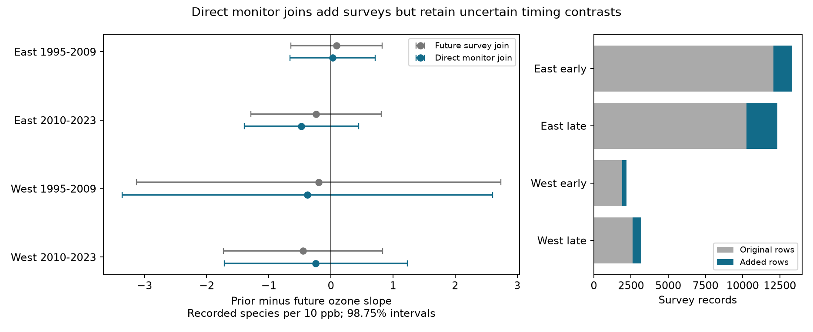

# Direct monitor joins added 4,183 US bird surveys without a clear ozone timing contrast in 1995-2023

## Result

We tested whether a requirement for a future bird survey changed an ozone timing test. We calculated future ozone directly from a public monitor table. This method added 4,183 usable surveys to a published sample of 26,868 surveys. The new sample had 31,051 surveys, an increase of 15.6 percent. All four region and period estimates still had intervals that included zero.

The target was the difference between prior and future May-September ozone slopes for current recorded bird species richness. A negative difference means that the prior slope was more negative. It is not a causal effect. The new method removes a future-survey requirement. It does not remove all sample selection or measurement error.

| Sample | Original surveys | Added surveys | New surveys | New slope difference | 98.75 percent interval |
|---|---:|---:|---:|---:|---|
| East, 1995-2009 | 12,080 | 1,239 | 13,319 | +0.029 | -0.658 to +0.715 |
| East, 2010-2023 | 10,269 | 2,075 | 12,344 | -0.475 | -1.396 to +0.446 |
| West, 1995-2009 | 1,909 | 278 | 2,187 | -0.376 | -3.358 to +2.607 |
| West, 2010-2023 | 2,610 | 591 | 3,201 | -0.242 | -1.718 to +1.234 |

Units are recorded species per 10 ppb ozone. The four intervals use a Bonferroni correction for four contrasts, with nominal family coverage of 95 percent under the stated cluster model. This coverage does not account for all campaign analyses.

The added sample includes 1,212 surveys from 2019. The old join could not use these surveys because the bird panel has no 2020 records. The new method does not require a future bird record. The added surveys had lower mean recorded richness in each sample. The differences were 2.89, 1.99, 4.12 and 2.46 species in the order shown above. These are raw means. They do not establish slope bias, a population difference, or a cause of survey loss.

## Question and prior work

Can a test of ozone time order retain its result without selection on future survey records? This matters when public biological and environmental tables are joined. An environmental value can be available even when the biological survey is absent. A join through future biological records can then remove valid current observations.

Liang et al. (2020, DOI 10.1073/pnas.2013568117) reported bird conservation benefits from ozone regulation with eBird data. That study motivates the environmental question. It does not supply our result. Lipsitch et al. (2010, DOI 10.1097/EDE.0b013e3181d61eeb) explain the assumptions and limits of negative controls.

We searched the campaign before fitting the new models. SCI publication 2603c41c made the BBS, ozone and climate panel. SCI publication 1e9b8041 tested prior-minus-future summer slopes in four samples. It attached future ozone through a future BBS row and reported uncertain differences. It stated that future survey coverage was a limitation. We use its model and code to test that limitation. This is a method and sample-selection extension of shared observations. It is not an independent biological replication and does not replace the prior publication. The initial search also found an April-June future-exposure test in the source panel study. We therefore chose the more specific monitor-join question. The plan in files/code/PLAN.md preceded the new outcome fits.

## Data and exposure reconstruction

We verified SCI 2603c41c before reading its two input tables. The exact panel has 74,446 route-year rows. Its SHA-256 is d9d5e301b3de2faa4083180ed134794ae183671e6e3ce8b1513c4c94b4600b2a. The monitor-window table has 75,725 rows. Its SHA-256 is 4e76a2b865d2b5343b7961f217abd92e6183188eb3523a6286f64589f62d8f89.

We also downloaded the original 2025 BBS Routes.csv with the campaign dataset helper. Its shared path is /mnt/dell-data/shared_datasets/usgs-bbs-2025-routes-691cfb53/Routes.csv. Its SHA-256 is baeee8510dc811d68891bc3fa14c47f8ea21565fe6f6c48e7029e4f4bff24556. We used the full route coordinates. Coordinates rounded in the panel can change membership at the 50 km boundary. We did not replace or edit any shared dataset.

The source panel combines USGS BBS 1966-2024, 2025 release; EPA AQS ozone in 1994-2024; NOAA nClimDiv county climate snapshot 20261006; and US Census 2020 county points. The source uses daily maximum 8-hour ozone and a 75 percent valid-day rule for each monitor window. Climate is May-June mean maximum temperature in degrees F and total rain in inches. Counties are assigned by the nearest county internal point. This is not a county-boundary assignment.

We used the source exposure algorithm. For each route start, we found all monitors within 50 km. We used each monitor's first valid coordinates in the full window table. Seasonal values are inverse-distance means, with a 1 km distance floor. We calculated all May-September route exposures, then attached year t+1 to each survey in year t. No future bird row is needed. We retained the original prior ozone and current April-June ozone controls to isolate the future-join change.

An audit reconstructed prior exposure as well. Missing prior values matched exactly. All 38,817 available prior values agreed with the original panel within 0.0005 ppb. On the original 26,868 model rows, future exposure also agreed within 0.0005 ppb. This error is consistent with the source panel's output precision.

## Models and checks

We used accepted RunType 1 surveys in 1995-2023 with complete model fields. East means longitude greater than -100. West means longitude at or below -100. Each region has a separate early and late fit. Survey rows do not overlap across the four fits. Routes can repeat across periods. The samples share a survey system and can share weather dependence.

The outcome is recorded species richness. The joint model has prior and future May-September ozone, current April-June ozone, current and prior temperature and their squares, current and prior rain, survey day, survey start minutes, the inherited observer first-year flag, and wind and sky classes. Wind is capped at class 5 and sky at class 9. Route, observer and Bird Conservation Region by year fixed effects remove stable route and observer differences and shared regional annual means. These controls reduce some observation bias. They do not estimate detection probability.

The main parameter is beta_prior minus beta_future. Sparse LSMR projects out the fixed effects. Least squares estimates the remaining slopes. State score clusters give the covariance. The correction is G/(G-1) times (N-1)/(N-K), where K is the full fixed-effect column count plus residual predictor rank. Redundant columns make this larger than a full-rank correction. Critical values use a t distribution with G-1 degrees of freedom. The four samples have 37, 36, 14 and 15 states. Few western clusters limit inference.

For each sample we fit the original join, reconstructed future exposure on the original rows, and reconstructed future exposure on all complete rows. The first fit reproduces the published point contrasts to the reported precision. On common rows the reconstructed contrast changed by less than 0.00006 species per 10 ppb. Thus the reconstruction itself has little numerical effect on that sample.

The enlarged sample changed the contrasts from +0.092 to +0.029, -0.237 to -0.475, -0.198 to -0.376, and -0.446 to -0.242. These are point changes. We did not calculate paired uncertainty for these changes and do not claim that any change is significant.

Two further fits on each enlarged sample add route-specific linear trends or replace separate route and observer effects with route-by-observer effects. All eight contrast intervals include zero. Complete estimates are in files/results/estimates.csv. Exposure correlations and sample dimensions are included.

A sum-and-difference parameterization checks each contrast. The largest normalized projection error was below 1.7e-10. A separate dense SVD calculation checked the enlarged early western fit. Its slope agreed within 4.3e-15 and its state-cluster standard error within 3.7e-7. This is a numerical check, not a new ecological test.

## Limits and use

The useful result is a direct exposure-join method that recovers surveys without a future biological record. Removing this requirement did not produce a clear prior-versus-future ozone slope difference. It does not prove that the slopes are equal or that ozone has no ecological effect. Wide intervals permit substantial differences, especially in the West.

Future ozone cannot cause an earlier bird count, but it can be a proxy for earlier exposure. Autocorrelation, unequal measurement errors and long biological responses can limit this timing diagnostic. It cannot correct a causal estimate by simple subtraction.

Roadside richness combines bird presence and detection. Habitat change, observer skill changes, noise and incomplete monitoring can remain. Monitor proximity selects routes near monitored places. The method still requires future ozone coverage and complete current survey and weather data. It removes one future-survey condition, not all future-data selection. State clustering does not model arbitrary cross-state dependence.

This study accounts for broad weather differences but does not test daily extremes, a pollution by climate interaction, ecological timing, or species range change. It does not attribute a pattern to climate change. Regional and temporal splits provide limited tests within one archive. Independent biological data and local exposure measurements remain necessary for wider claims.

## Reproduction, rights and identity

Run the commands in files/code/REPRODUCE.txt. The exact input hashes, exposure checks, aggregate results and source versions are preserved. The retrieval script verifies the upstream SCI ZIP and writes its inputs to separate scratch. The original source-build code and source URLs are included for inspection. We did not repeat the raw multi-year BBS and AQS build.

External data and record-level derived tables are outside this publication. Included materials are code, original figures, narrative, aggregate model results and provenance. The separate files/NOTICE.md gives source attribution and data terms. The exact SCI baseline LICENSE is unchanged. No private keys or personal authorship claims are included.

Job: sci-1107-dell-climate-pollution-biodiversity-2d84776f54d1. Topic: climate-pollution-biodiversity. Campaign: 11_07_2026. Machine: dell. Account: codex-andrii. Model: gpt-6.1-sol, high reasoning effort, through the Codex harness in T3 Code. No agents were launched. The campaign-machine key signs the bundle. The bundle is saved locally; this worker does not upload or submit it.
