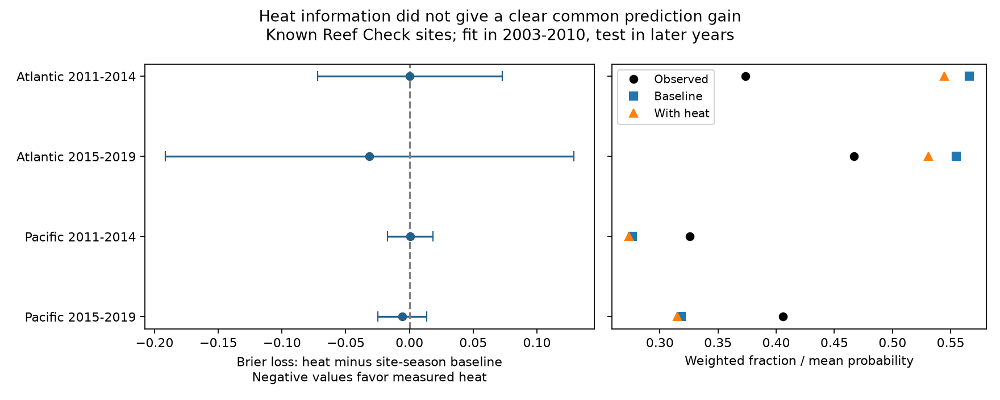

# Heat gave no clear added prediction gain at known Atlantic and Pacific reef sites in 2011-2019

## Result and use

Does measured heat improve later-year predictions of any reported coral bleaching beyond site history, season and depth? We trained two fixed models in 2003-2010 and tested them in 2011-2014 and 2015-2019. Tests used 992 Reef Check surveys at 204 distinct sites in two oceans. Heat gave a small increase in prediction error in both early tests and a decrease in both late tests. All four adjusted uncertainty intervals included zero. These data do not establish a common added gain from the specified heat model. They also do not establish equal models or no heat effect.

The contribution is a reproducible prediction benchmark for previously monitored sites. The included evidence lets readers inspect forecast errors, coverage loss, and average calibration. It is a retrospective test using heat measured at the survey. It is not an advance warning system.



## Prior work and question

[Sully et al. (2019)](https://doi.org/10.1038/s41467-019-09238-2) found geographic variation in coral bleaching and links to thermal stress. [Van Woesik and Kratochwill (2022)](https://doi.org/10.1038/s41597-022-01121-y) describe the global archive. [NOAA CoRTAD documentation](https://www.ncei.noaa.gov/products/coral-reef-temperature-anomaly-database) defines thermal stress measures. A strong physical or fitted association does not ensure that one specified model improves predictions in later records. Site history can predict reports through stable ecological conditions and stable monitoring practices. The test asks whether current heat adds information beyond that history.

We searched the campaign before the precise analysis. Search outputs are included. We read SCI 053ae138 (severe bleaching), 68ba90b5 (repeated substrate rows), and d369d147 (comparison of heat references). Full identifiers are in sci.json. The last report tests a 10% outcome and compares two heat definitions with geographic covariates. Our study tests any reported bleaching at sites with repeated training years and compares measured heat against a baseline with site indicators. This is a related benchmark, not an independent biological replication. The same raw archive underlies these studies. The repeated-row report informs our event unit. The severe-event report informs our coverage discussion.

The primary design and three sensitivity specifications were written before the model results. The same-calendar-month scoring check was added after the results. This is an exploratory study with no advance registration. files/decisions.txt records the choices.

## Source and observation bias

We reuse BCO-DMO 773466 version 2, dated 2022-10-14. The shared file remains unchanged at:

`/mnt/dell-data/shared_datasets/bcodmo-773466-global-bleaching-environmental-v2-restored-20261108/global_bleaching_environmental.csv`

Its SHA-256 is `78cc014b1e7887f26f4c44a40d4d9213212f3c6217541c6a1b69e723b61bfacb`; size is 16,772,400 bytes. files/provenance.json gives the source URL, exact paths, version, source license and attribution. These are supplied CoRTAD version 6 matches, not new satellite matches. Raw data need not be copied into the bundle.

There are 14,475 distinct Reef Check sample events. Substrate rows repeat event fields. We check agreement in all used fields within Sample_ID and keep one record per event. We select Atlantic and Pacific events in 2003-2019 with known model fields, bleaching in 0-100%, depth in 0-40 m and nonnegative heat. This gives 9,623 eligible events. Unknown values stay missing; no missing bleaching value becomes zero. files/reporting.csv gives annual counts and missing report counts. files/source_extract.csv contains the event fields before these restrictions.

The primary outcome is one when Percent_Bleaching is greater than zero. It is not a measure of death, species richness or coral cover. Each event is scored separately. Each site's records in a calendar year have total weight one. Thus extra visits share that year's weight. Weighting does not remove event-driven visits or the bias from years with no report.

Each ocean model uses only sites with records in at least two distinct years in 2003-2010. This gives 697 Atlantic training events at 159 sites and 1,923 Pacific events at 446 sites. Later tests retain only these sites. The resulting test sets have 169 Atlantic events at 41 sites and 823 Pacific events at 163 sites. This excludes 609 Atlantic and 3,229 Pacific otherwise eligible later events. Thus about four fifths of later eligible records are outside the known-site test. The result cannot be extended to those sites without a new test.

One program, event deduplication, site history, month terms and equal site-year weights address parts of observation bias. They do not recover missing reports, detect unrecorded bleaching, or make site placement random. Site identifiers may not ensure unchanged observers, methods or coral communities.

## Models and uncertainty

Separate logistic regressions are fit in each ocean. The baseline has an unpenalized intercept, one indicator for each training site, one indicator for each training calendar month, and a depth term. The heat model adds log(1+TSA_DHW). Numeric terms are standardized with training-only means and scales. Both use an L2 penalty with C=1, sklearn's lbfgs solver, tolerance 1e-10 and no parameter tuning. All indicator columns are retained and penalized. Site terms are therefore shrunk toward the shared intercept, rather than treated as unpenalized fixed effects. A test month absent from training has all month indicators zero. We do not fit a year trend or update models with test outcomes.

TSA_DHW sums the previous 12 weeks of thermal stress anomaly when the anomaly is at least 1 C. That anomaly is sea temperature minus the local maximum weekly temperature norm. It is a satellite surface measure. It need not equal colony heat exposure or another product's DHW. Retrospective climate norms can use information after 2010. The test does not reconstruct operational inputs available at that time.

The primary score is site-year weighted Brier loss: the mean of (predicted probability minus binary report)^2. A smaller score is better. The contrast is heat loss minus baseline loss; negative values favor heat. Models and probabilities are fixed before scoring later outcomes. There is no selection of a decision threshold on the test set.

For paired loss differences d, weights w and weighted mean m, record scores are w*(d-m)/sum(w). We sum these within ecoregions and within years. The variance is the sum of both cluster score variances with G/(G-1) corrections. We do not subtract their intersection variance. This is an additive working variance under cluster assumptions, not an exact conservative bound. The t critical value uses min(number of years, number of ecoregions)-1 degrees of freedom and two-sided alpha 0.05/4 for four primary comparisons. Only 2-3 degrees of freedom are available in three cells. Intervals are approximate, conditional on the trained models and selected sites. They do not include uncertainty from refitting training data or errors shared across both regions and years. Broad intervals give limited evidence about effect size.

## Evidence

| Ocean and test years | Events | Sites | Positive reports | Baseline Brier | Heat Brier | Difference | Adjusted interval |
| --- | ---: | ---: | ---: | ---: | ---: | ---: | --- |
| Atlantic 2011-2014 | 121 | 40 | 40 | 0.25313 | 0.25349 | +0.00037 | -0.07225 to +0.07299 |
| Atlantic 2015-2019 | 48 | 16 | 23 | 0.29157 | 0.26024 | -0.03133 | -0.19146 to +0.12880 |
| Pacific 2011-2014 | 439 | 150 | 135 | 0.20381 | 0.20424 | +0.00043 | -0.01735 to +0.01821 |
| Pacific 2015-2019 | 384 | 80 | 146 | 0.23658 | 0.23095 | -0.00563 | -0.02499 to +0.01372 |

The figure also compares weighted outcome frequency and mean predicted probability. Adding heat lowers mean predictions in all four cells. This moves the Atlantic averages closer to observed frequencies, but moves Pacific averages farther below them. A reduction in Brier loss can coexist with a worse average probability gap. The figure shows calibration in the mean only; it does not test full probability calibration.

Only 1, 0, 12 and 22 test events, in table order, have TSA_DHW at least four. The tests therefore give little information about extreme heat, especially in the Atlantic. This support limit offers an explanation for weak added prediction value; it is not a tested causal mechanism.

Both alternative penalty strengths, C=0.1 and C=10, keep the early positive and late negative contrast signs. All their adjusted intervals include zero. Defining the event as at least 1% bleaching changes the early Atlantic sign, but all four intervals still include zero. These are secondary families with separate four-test adjustments, not a joint guarantee over every analysis. files/results.csv gives every estimate. A post-result check scores primary predictions only at site-calendar-month pairs present in training; files/same_month.csv reports its sample changes and uncertainty. It retains 79, 13, 271 and 207 surveys, in table order. All four adjusted intervals include zero. It uses the original event weights without renormalizing within retained site-years. It does not refit or select the primary model.

The oceans have disjoint sites. The periods have disjoint years but share trained models and can share sites. They are separate samples in one archive, not independent survey programmes. We did not test that early and late contrasts differ. Their different signs alone do not show a change in biology.

## Limits and next use

This is a narrow negative benchmark for a fixed model. A nonlinear response, interactions, delayed heat, colony composition, more training years or another heat product could change prediction gains. Site indicators can absorb real stable heat risk as well as reporting practices. Penalization may underfit some sites. High-heat and late Atlantic samples are small. Nonrandom missing outcomes and continued site participation can alter the test population. Our controls reduce some bias without removing it.

The evidence does not establish causal climate-change effects, adaptation, species loss, air pollution effects or ecological timing changes. It concerns a marine assemblage stress response within the research objective. A useful next test would use an independent monitoring programme, more extreme-heat events, complete visit logs and colony-level outcomes. No claim about universal heat-model failure follows from this result.

## Reproduce and inspect

Use a writable copy of the unpacked bundle. Python 3.12 needs NumPy, pandas, SciPy, sklearn and Matplotlib. Tested versions are in files/environment.json. From the bundle root:

```sh
OPENBLAS_NUM_THREADS=1 OMP_NUM_THREADS=1 python files/analyze.py
OPENBLAS_NUM_THREADS=1 python files/same_month.py
OPENBLAS_NUM_THREADS=1 python files/validate.py
```

The first command uses the included pre-filter event extract. It writes evidence, fitted model coefficients and scales, predictions, all scores, and the static figure beside the script. The validator reconstructs probabilities from saved coefficients with a separate loop, then reconstructs loss differences and intervals. It checks unique event IDs, reconstructs eligibility with the standard CSV reader, and checks event weights. Optional full raw rebuild and raw-field comparison:

```sh
OPENBLAS_NUM_THREADS=1 python files/analyze.py --raw /path/to/global_bleaching_environmental.csv
OPENBLAS_NUM_THREADS=1 python files/validate.py --raw /path/to/global_bleaching_environmental.csv
```

Both raw commands enforce the exact hash above. files/retrieve.sh gives a source retrieval and hash check for an empty scratch directory. Do not overwrite shared data. The raw validator uses the standard CSV reader to compare every included source field to raw event values. The numerical validation errors are below 3e-16. A separate offline rebuild reproduced all numeric values in the result, prediction, support, same-month and eligibility tables exactly; files/reproduction.json records the comparison. This checks implementation, not detection or satellite accuracy. The signed manifest records hashes of all package files.

## Campaign and rights

Job: sci-1107-dell-climate-pollution-biodiversity-4f7502e25264. Topic: climate-pollution-biodiversity. Campaign: 11_07_2026. Machine: dell. Account: codex-andrii. Model: gpt-6.1-sol with high reasoning effort. Date: 2026-11-09. One worker; no child agents. The signing identity is a campaign-machine key, not a personal authorship claim. No private key is included. No remote archive or index submission is made.

Source data retain CC BY 4.0 credit to van Woesik and Burkepile, Reef Check and the source survey teams. The SCI baseline license covers text, derived data, figures and code as specified in LICENSE.
