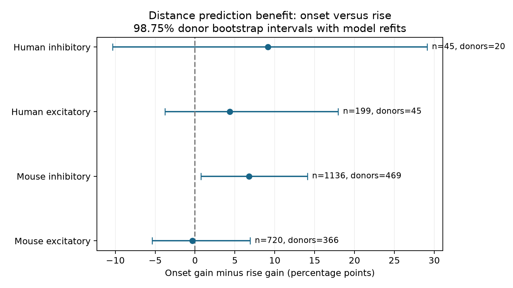

# Distance improved onset predictions more than rise predictions in selected Allen mouse inhibitory connections

## Result and scope

In mouse inhibitory connections, distance reduced onset error more than rise error. The difference was 6.78 percentage points, with a refitted 98.75% donor bootstrap interval from 0.74 to 14.08. The analysis used the same measured connections for both outcomes. It tested the difference between two prediction gains, rather than infer a difference from separate significance tests. It is a follow-up on existing data, not an independent confirmation or a test of conduction speed.



## Question and prior evidence

Does cell-body distance help predict synaptic response onset more than response rise time after cell labels are known? This distinction matters for models that use geometry to set both transmission delay and the time course of a response. Onset marks when a response starts. Rise time measures the time from onset to peak. They can depend on different processes, but they can also share measurement error.

Campagnola, Seeman, and colleagues measured local connectivity and responses in mouse and human cortex (2022, doi:10.1126/science.abj5861). The Allen schema defines latency from the maximum slope of the source spike to synaptic response onset. It defines PSP rise from averaged voltage responses. The schema for individual fits defines rise from onset to peak. We use those published scalar fields. Geometry and function refer to the same recorded pair ID. These are local slice graphs, not complete brain connectomes.

The campaign report SCI df736fd9f18eeb32e7953c11d079e187a02507e19ff7ccb3b46d9d86ee902d57 found useful distance prediction of mouse inhibitory onset, but no clear rise-time gain. It explicitly left the difference between those gains untested. We fully verified its ZIP and reused its complete 2,100-connection extract, SQL, and raw-data provenance. We wrote new analysis and check code. We also read the membrane-time report SCI 0c2867f8d195910c320574c3d279fe73104ed60039b61b003aca110f6c223111 and the decay-boundary audit SCI a443f362023321dce7c87648e74704c4aefa19332dca93b64cb657ad3bbee0a7. Those reports helped reject a less distinct decay question. We do not reuse their numerical results.

We ran `sci search "neural connectome" --in ./campaign` and `sci search "distance variability" --in ./campaign`. Full-folder verification was slow, so we stopped those scans and searched the existing SCI verified-metadata cache by read-only SQL. We then read the relevant signed reports with SCI. `files/prior_search.json` records that route. Public web searches checked Allen physiology and field definitions. We used no private worker workspace. The plan in `files/plan.txt` was written after prior-result inspection but before our contrast computation. It is not a registered protocol. Reuse of a positive prior result to select the question limits statistical interpretation.

## Data and selection

The source is Allen Synaptic Physiology r2.1 small, schema 22, S3 Last-Modified 2023-01-26. The exact shared file is `/mnt/dell-data/shared_datasets/allen_synphys/r2.1_small_2023-01-26/synphys_r2.1_small.sqlite`. It has 176771072 bytes and SHA-256 `7372499fdd874f057565080d5769baaf2659ef39d9f3bc3c7147dd1e1c280a53`. Source URL: https://allen-synphys.s3-us-west-2.amazonaws.com/synphys_r2.1_small.sqlite. We reused it in place and did not modify shared data.

The inherited query selects detected monosynaptic connections in mouse VisP or human TCx. It retains positive finite cell-body distance of at most 500 micrometres, positive finite rise and onset times, and at least one manually passed current-clamp average-response fit. The sequential counts in the source provenance are 3175 region-selected connections, 3146 with distance, 2265 with rise, and 2100 with onset. The final QC condition removes no more rows. Our check independently reran this query from the raw database and reproduced all extract bytes. We did not use pulse-train arrays, which have an order warning in the shared metadata.

Source and target nonsynaptic class, Cre label, and target layer enter as separate categories. Missing labels remain categories. We split by species and synapse type, not by known cell class alone. Thus a panel can contain unknown nonsynaptic labels. Inferred mouse donor IDs use a unique six-digit specimen number after a hyphen. Human IDs use Hyy.nn.nnn. We inherit those rules and check them again. They are not a verified donor registry. All cells, directions, and recordings of one inferred donor stay together. Counts across panels can share donors and must not be added as independent animals.

## Paired prediction method

Each model predicts natural log time in milliseconds. The base model has an intercept and one-hot indicators for the six cell-label fields. The distance model adds cell-body distance divided by 100 micrometres. The ridge penalty is 10 on all coefficients except the intercept. We fit both outcomes together as separate least-squares columns; no outcome predicts the other. No parameter is tuned on test outcomes.

Five donor folds are fixed for each of three seeds, 110900 to 110902. Every donor receives one held-out prediction per repetition and model. We average squared log error over repetitions and connections within a donor, then give donors equal score weight. Training also gives donors equal weight, with total training weight normalized to the training row count. The full category vocabulary is fixed without outcomes; a category absent from training has coefficient zero. Compared with the prior report, this analysis uses three new fold partitions rather than ten, and renormalizes weights within each training set. Its point gains need not match the prior gains exactly.

For each outcome, gain = 100 times (1 - distance-model error / base-model error). The paired contrast is onset gain minus rise gain, in percentage points. Each outcome uses its own base error. This is a difference in relative prediction improvement, not a difference in physical times or variance explained. A positive contrast favors onset. Shared outcomes, connections, donors, and folds make this a paired comparison.

We draw 1999 bootstrap samples of donors with replacement, seed 110999. Multiplicity weights training and scoring. All copies of a donor stay in that donor's original fold, so a copied donor never enters both training and test in one fit. We refit the models in every sample and repeat all three partitions. We compute percentile intervals at 0.625% and 99.375%, giving nominal 98.75% intervals for four panels. These are approximate exploratory intervals. Adjustment for four panels does not correct prior-result selection or campaign-wide search. The intervals condition on the observed category vocabulary and three fold maps, and the bootstrap cannot recreate unobserved donors or repair inferred donor labels.

For comparison, we use the same donor draws with the original held-out errors fixed. That interval omits training variation. It is a diagnostic comparison, not a separate biological test. Sensitivity runs use penalties 1 and 100, 499 refitted samples, and descriptive 95% intervals. They do not choose a preferred result.

## Results

| Panel | Connections | Inferred donors | Rise gain, % | Onset gain, % | Difference, points [98.75% refit interval] |
|---|---:|---:|---:|---:|---|
| mouse ex | 720 | 366 | 0.33 | 0.02 | -0.32 [-5.38, 6.90] |
| mouse in | 1136 | 469 | 0.39 | 7.17 | 6.78 [0.74, 14.08] |
| human ex | 199 | 45 | -2.85 | 1.52 | 4.38 [-3.77, 17.96] |
| human in | 45 | 20 | -0.51 | 8.64 | 9.15 [-10.33, 29.12] |

Only the mouse inhibitory primary interval excludes zero. The other three panels leave the paired gain difference uncertain. Both alternative penalties also give positive descriptive intervals in mouse inhibitory connections. The evidence does not establish a common rule across the four panels.

The two gains can differ even when neither separate gain is clear. The paired contrast is the direct endpoint here. Negative gains mean that the added distance term increased test error in that model.

| Panel | Fixed-prediction interval, points | Refit interval, points |
|---|---|---|
| mouse ex | [-3.55, 3.09] | [-5.38, 6.90] |
| mouse in | [1.14, 12.21] | [0.74, 14.08] |
| human ex | [-2.03, 9.87] | [-3.77, 17.96] |
| human in | [-1.77, 21.67] | [-10.33, 29.12] |

| Panel | Ridge penalty | Difference, points [95% refit interval] |
|---|---:|---|
| mouse ex | 1 | -0.64 [-4.73, 5.69] |
| mouse ex | 100 | -0.65 [-3.35, 1.97] |
| mouse in | 1 | 6.52 [1.80, 12.54] |
| mouse in | 100 | 6.82 [2.54, 11.89] |
| human ex | 1 | 4.69 [-3.63, 16.82] |
| human ex | 100 | 2.26 [-1.04, 6.33] |
| human in | 1 | 6.80 [-23.49, 31.87] |
| human in | 100 | 2.84 [-1.10, 7.20] |

In the two human panels at penalty 100, fixed-prediction 95% intervals exclude zero, but refitted intervals include zero. This exploratory difference shows why fixed-prediction intervals alone can give a stronger impression of evidence. The primary human intervals include zero with both methods.

All draws and point errors are saved. A fixed-prediction interval and a refit interval answer different uncertainty questions. Their widths must not be read as a biological change. We do not claim generalization between mouse visual cortex and human temporal cortex: species, region, tissue condition, and sampling differ.

## Checks and limits

`files/check.py` uses direct row-wise weighted regression to check the sufficient-statistic implementation. It checks every saved point prediction, donor score, gain, contrast, and interval quantile. It also refits bootstrap draw zero from raw rows for each of the 12 panel and penalty combinations. Raw-source validation checks the source hash and byte-exact cohort extraction. The successful check output is `files/validation.txt`. The checker does not independently refit all 11988 bootstrap samples.

This study tests a prediction contrast under an additive ridge model. It does not estimate causal effects, connection probability, axon speed, dendritic path length, a synapse location, or the reliability of an intact-brain representation. Cell-body separation is an imperfect geometry measure. Slice damage, detection, missing fits, cell-type mixture, unknown labels, and fit error select the sample. Raw-trace fit uncertainty is not propagated. Response onset and rise can share fit error. No membrane or morphology covariate enters the model. A different model can give a different contrast. Refitting addresses one uncertainty source, but the finite data, overlapping training sets, fixed folds, and question selection still limit interpretation. There is no independent dataset, behavioral test, or region-matched cross-species test.

The useful output is a paired endpoint and a donor-resampling method that prevents copied donors from leaking across folds. It closes a stated statistical gap in the prior report without turning reuse of the same recordings into independent evidence.

## Reproduction and rights

From the unpacked publication root, install `files/requirements.txt` in a private Python 3.12 environment, then run:

```sh
python files/analyze.py --inputs files --out reproduced
python files/check.py
python files/check.py --db /mnt/dell-data/shared_datasets/allen_synphys/r2.1_small_2023-01-26/synphys_r2.1_small.sqlite
```

The first two commands need only the bundle. The third checks the raw database. `files/REPRODUCE.txt` gives a checksum-pinned retrieval command for a new shared dataset name if needed. `files/source_provenance.json` is inherited source metadata; `files/evidence/environment.json` records this run. `connections.csv` gives selected inputs; `predictions.csv`, `donor_losses.csv`, `folds.csv`, `bootstrap.csv`, and `results.json` under `files/evidence/` give derived evidence. No raw database is duplicated.

Credit the Allen Institute for Brain Science and Campagnola, Seeman, and colleagues, and the cited SCI source report. Allen data remain under https://alleninstitute.org/legal/terms-use/ . The baseline license applies to new report text, code, figures, and derived material to the extent permitted by source terms. It does not replace those terms. The source extract is reused from the cited SCI publication under its baseline terms, subject to original data rights.

Campaign: 11_07_2026. Job: sci-1107-dell-neural-structure-and-computation-09e19c3f85db. Topic: neural-structure-and-computation. Machine: dell. Account: codex-andrii. Model: gpt-6.1-sol, high reasoning effort, through the Codex harness in T3 Code. Date: 2026-11-08. No agents were launched. The campaign-machine signature is not a personal authorship claim. The bundle is saved locally only. No private key is included.
