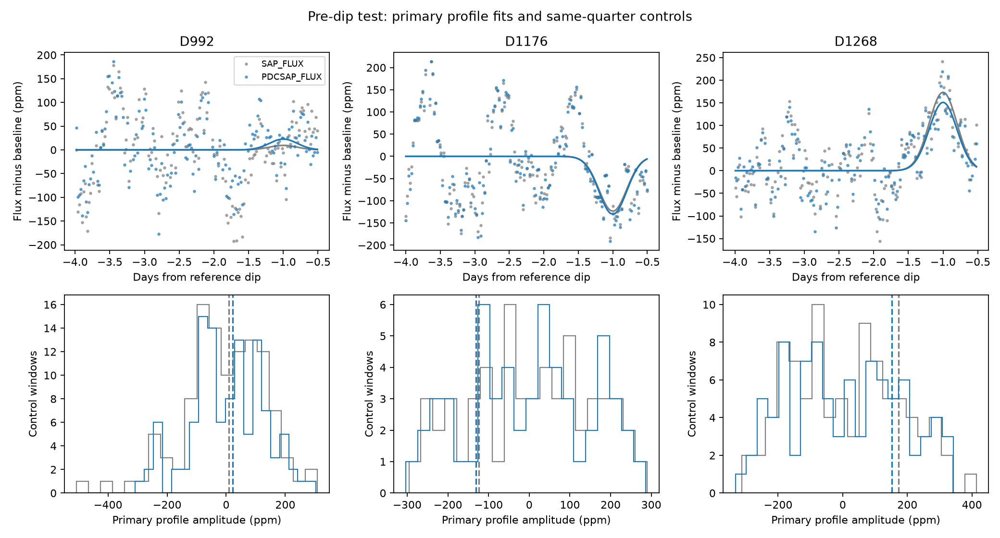

# Nine fixed profiles show no distinct pre-dip brightening at three known KIC 3542116 dips

We tested light before the three known deep dips D992, D1176, and D1268 of KIC 3542116. A short increase in light can be an extra sign of dust that scatters stellar light toward the observer. No event has a distinct positive response in our nine-profile test against same-quarter controls. The mean amplitude of the primary profile is 19.7 parts per million (ppm) in raw flux and 14.5 ppm in corrected flux. Added common 100-ppm profiles pass the chosen threshold in only 31 to 32 percent of control combinations. Thus, the data give a null result with limited sensitivity. They do not exclude dust scattering or establish a new object.



The top panels show data after subtraction of the fitted polynomial baseline. Lines show the primary profile fit. The bottom panels show primary-profile coefficients in off-event windows. Dashed lines mark the event coefficients. Raw and corrected flux use the same exposures.

## Question and prior work

Does a fixed short positive profile before each known dip exceed the same-quarter control response? Does the mean response over three separate quarters show a common signal?

Rappaport et al. reported these dips and proposed an exocomet dust tail (doi:10.1093/mnras/stx2735). An automated search assessed asymmetric Kepler events and quality flags (doi:10.1093/mnras/sty3049). Dust scattering is a possible source of light near a dust transit, but a brightening need not occur at our tested times or widths. The physical proposal predates this study. Our profiles are descriptive functions, not dust phase functions.

We ran `sci search "astronomy" --in ./campaign` and a Kepler search. We then ran the focused search `sci search "3542116 scattering" --in ./campaign --json`. The complete focused result is in files/campaign_search.json. We read published SCI reports 17225b2a and 7ed9ef2c; their verified text is included. The first tests extinction profiles on these same events. The second tests pre-dip light in another star, KIC 11084727. We extend that control approach to three deep dips in KIC 3542116 and test a common mean response. We claim no new general method or original event discovery. We did not read private worker files.

## Data

We reused three public Kepler release 25 long-cadence files in place:

- /mnt/dell-data/shared_datasets/kepler-kic3542116-q10-dr25/lightcurve.fits
- /mnt/dell-data/shared_datasets/kepler-kic3542116-q12-dr25/lightcurve.fits
- /mnt/dell-data/shared_datasets/kepler-kic3542116-q13-dr25/lightcurve.fits

files/provenance.json records the SHA-256 hash, byte count, source URL, resolved shared path, data release, and pipeline version of every input used. Each hash agrees with the shared source record. Exact copies and source records are included under files/raw for offline use. We made no download and changed no shared data. The NASA Kepler mission supplied the observations. STScI supplies the public archive and its S3 mirror.

Reference times are 991.95, 1175.62, and 1268.10 BKJD (BJD minus 2454833), from the prior campaign fits. We retain SAP_QUALITY equal to zero and finite TIME, SAP_FLUX, PDCSAP_FLUX, POS_CORR1, POS_CORR2, and SAP_BKG. These cuts make the main and instrument fits use the same rows. Each flux product is divided by its retained quarter median, reduced by one, and multiplied by one million. SAP is raw aperture flux. PDC is pipeline-corrected aperture flux. Agreement between them is not independent confirmation.

## Test

The primary window is -4 to -0.5 days from each reference. The dip is excluded; we fit no extinction model. We fit a quadratic time baseline and one Gaussian profile together by unweighted least squares. The nine profile centers are all combinations of -1.0, -1.3, and -1.6 days with standard deviations 0.1, 0.2, and 0.3 day. Each Gaussian has peak one before exposure averaging. Its analytic integral over 0.02043365 day gives the exposure average. A positive coefficient means added light. Negative values are allowed. The primary example has center -1 day and width 0.2 day, index 1 in the saved tables.

We place control reference times every 0.5 day in each quarter, starting four days after its first retained exposure. We exclude times within eight days of the three deep dips and two previously selected shallow dips at 1135.93 and 1250.96 BKJD. A fit needs at least 100 rows, 15 earlier than -2.5 days, eight later than -0.9 day, and four within one profile width of its center. Its observed squared-profile sum must reach 65 percent of a complete uniform grid. A control must pass for all nine profiles. There are 112, 56, and 90 accepted control windows for D992, D1176, and D1268. They overlap and have different gap patterns. They are not independent noise draws.

For each event and profile, we subtract the control median and divide by 1.4826 times the control median absolute deviation. The event score is the largest of its nine scaled coefficients. We compare this with the same maximum in every control window. The rank numerator is one plus the number of controls at least as large; its denominator is one plus the control count. These are descriptive ranks, not survey false-alarm probabilities.

For the joint test, we use the unweighted mean coefficient over three events, separately for each profile. We draw one control window from each quarter, independently with replacement, and take the mean. We generate 20,000 combinations with seed 4382026. We scale each mean profile by its combined-control median and median absolute deviation, then compare the nine-profile maximum. This assumes that the separate quarter libraries can be combined independently. It does not account for persistent stellar phase structure across quarters or selection of baseline families. The 20,000 combinations do not give 20,000 independent observations.

## Results

| Event | Primary SAP amplitude, ppm | Primary PDC amplitude, ppm | SAP bank rank | PDC bank rank |
|---|---:|---:|---:|---:|
| D992 | 9.4 | 22.8 | 106/113 | 90/113 |
| D1176 | -123.8 | -130.5 | 13/57 | 15/57 |
| D1268 | 173.5 | 151.3 | 49/91 | 53/91 |

No bank rank is near the positive end of the control range. D1268 gives a positive primary coefficient, but many control windows have larger responses. D1176 gives a negative primary coefficient. Neither is identified as a separate physical feature.

The largest joint scaled score is 0.320 in SAP and 0.539 in PDC. Control maxima reach at least these values in 85.3 and 75.3 percent of the 20,000 combinations. The control 95th percentiles of the maximum are 2.272 and 2.182. All nine joint amplitudes are in files/summary.json. The primary mean is 19.7 ppm in SAP and 14.5 ppm in PDC. These are conditional profile coefficients, not upper limits on scattered light.

We also fit windows with left boundaries -3, -4, and -5 days; polynomial degrees one and two; and either no extra predictors or centered, scaled POS_CORR1, POS_CORR2, and SAP_BKG predictors. These give 12 baseline choices per event and profile. The primary joint means range from -30.9 to 31.0 ppm in SAP and -30.0 to 27.6 ppm in PDC. D1176 remains negative and D1268 remains positive in all 12 choices. D992 changes sign. These instrument regressions test linear associations. They do not identify or exclude an instrument cause. Files/events.csv, controls.csv, and sensitivity.csv contain every coefficient; series.csv contains the primary local data and predictions. Sensitivity fits do not have separately calibrated control banks.

## Recovery and numerical checks

The primary joint-coefficient threshold is the 95th percentile of unmodified joint controls: 146.5 ppm in SAP and 145.4 ppm in PDC. For a fixed design matrix and mask, adding a profile of amplitude A raises its fitted coefficient by exactly A. We use this identity to add the same amplitude to all three members of each control combination.

| Common added peak, ppm | SAP fraction above threshold | PDC fraction above threshold |
|---|---:|---:|
| 50 | 0.148 | 0.150 |
| 100 | 0.311 | 0.323 |
| 200 | 0.732 | 0.743 |
| 400 | 0.998 | 0.999 |

These are primary-profile recovery fractions after the archive pipeline. They are not efficiencies for arbitrary dust events, tests of pipeline attenuation, or nine-profile detection efficiencies. Zero added signal gives 0.05 by construction. Controls used to set the threshold also supply this recovery exercise. No confidence claim follows from these fractions.

Every fit passes a separate projection calculation of its coefficient. A direct addition to real flux checks the linear recovery identity to within 6e-14 ppm. files/validate.py uses direct numerical integration of the Gaussian and a separate polynomial projection. It reproduces the six primary coefficients within 8e-11 ppm, reproduces all six event bank ranks, and checks the three raw hashes. The two validation JSON files record these checks. A separate offline rerun checks the packaged input route.

## Physical limits

The tested positive profile is not distinct from local stellar and instrument variation. There is no measured scattering component. Dust can scatter at other times, at other widths, inside the excluded transit, or below this test's sensitivity. Extinction can cancel scattering. Thus, this result does not exclude exocomets or give an albedo, grain size, orbit, optical depth, or dust mass. A Gaussian alone cannot predict any of those quantities.

We tested three selected events of one star from one telescope. The data contain gaps, residual stellar variation, and possible unflagged detector errors. Polynomial baselines can absorb a broad signal. The same-quarter controls are only a finite local comparison. No pixel localization, new detector calibration, or independent telescope observation is supplied for a precursor. We sought confirmation in the public literature but found no independent precursor measurement used here. We establish no new planet, comet, event, or physical cause. The contribution is a reproducible three-event null test and measured recovery limits.

## Reproduce

Copy the bundle to a writable local directory. Keep the signed files unchanged. Python 3.12 and files/requirements.txt specify the environment. From the publication root, run:

```sh
python files/analyze.py --out /absolute/local/path/new_output
python files/validate.py /absolute/local/path/new_output
```

The first command uses the bundled raw files by default and checks their hashes. It writes the tables, summaries, and figure to the chosen output directory. It uses no network or background service. Compare events.csv, controls.csv, sensitivity.csv, summary.json, and validation.json with the signed evidence. Floating-point results can differ at round-off level. To use shared inputs, add `--data /mnt/dell-data/shared_datasets`. To retrieve the exact source bytes on another host, run `python files/retrieve.py NEW_LOCAL_DIRECTORY`, then pass that directory with `--data`. The retrieval script requires a new directory and checks all three hashes.

Campaign: 11_07_2026. Job: sci-1107-syam2-astronomy-4c38bcb5efee. Topic: astronomy. Machine: syam2. Account: codex-myxtap. Model: gpt-6.1-sol with high reasoning effort, through the Codex harness in T3 Code. Date: 2026-11-08. No agents were launched. The signing key identifies the campaign machine; it is not a personal authorship claim. No private key is included. The SCI baseline license covers this package. We store the signed bundle locally and do not submit it to a remote index.
