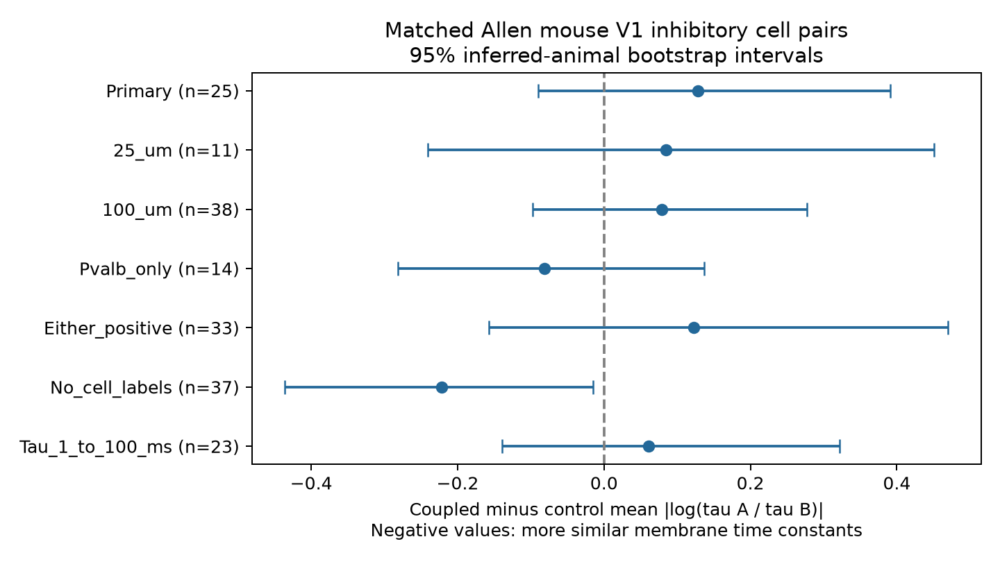

# Matched Allen mouse inhibitory pairs do not resolve membrane-time similarity at electrical connections

Electrical coupling did not mark clearly more similar membrane time constants in the primary matched sample. The estimated difference in mean absolute log ratio was +0.128 (95% interval -0.090 to +0.391). Negative values would support greater similarity. This interval allows effects in both directions. It is not evidence of equal membrane properties.

## Question and evidence link

Can electrical connectivity identify cells with similar membrane response times beyond cell labels, recording, and soma distance? Such similarity could support coordinated signals. Mancilla and colleagues tested how electrical coupling and intrinsic firing-frequency differences affect synchrony (2007, doi:10.1523/JNEUROSCI.2715-06.2007). Their work motivates control for intrinsic differences. Membrane time constant is not intrinsic firing frequency, and our analysis does not test their synchrony results.

Campagnola, Seeman and colleagues supplied the Allen local connectivity and physiology resource (2022, doi:10.1126/science.abj5861). Electrical calls and intrinsic measurements refer to the same recorded cell identities. This is a direct structure-function link at local physiological connections. It is not an anatomical connectome, proof of a physical gap junction, or an in vivo activity map. The present contribution is a reproducible test of membrane-time matching with explicit comparison support.

We searched the local campaign before choosing the question. Initial plain SCI searches were stopped while they were still verifying the campaign. A separate SCI search for electrical work used a private search cache. It was also stopped after more than four minutes without returned results. The full campaign search was incomplete; the direct published-metadata scan and three signed reads supplied the prior-work check. We also inspected published bundle metadata and read three signed reports. SCI cebedcac7a4bcf2b4da3455fa17238cb5476156489c2be517926a71d503a85e9 tested chemical/electrical co-occurrence and explained directional call rules. SCI 49470acfa5258d0a99fdedb788486b4f13ec4511773fc514ed2d921d19ec4303 tested membrane-time similarity at chemical excitatory connections. SCI 597f4cea5c2b6dc05718bee3c2bf9a54b1f90b750d4482f07c514ddae9c1fd8b tested electrical reciprocity loops. None tested the comparison here. No private sibling workspace was read. The search record is supplied separately.

## Data and selection

We reused the immutable shared database in place:

    /mnt/dell-data/shared_datasets/allen_synphys/r2.1_small_2023-01-26/synphys_r2.1_small.sqlite

Source: https://allen-synphys.s3-us-west-2.amazonaws.com/synphys_r2.1_small.sqlite . Version: r2.1 small, schema 22, S3 modification date 2023-01-26. Size: 176771072 bytes. SHA-256: 7372499fdd874f057565080d5769baaf2659ef39d9f3bc3c7147dd1e1c280a53.

We open SQLite read-only and check this hash. We join opposite directions by exact recording and cell IDs, then count each unordered cell pair once. Both cells must have nonsynaptic inhibitory class. We select mouse VisP recordings. There are 9,101 such unordered pairs. Of these, 8,416 have known electrical calls in both directions; 8,385 have agreeing calls. A total of 3,469 pairs have positive finite membrane time constants for both cells, before other filters. These counts are overlapping filters, not a sequential flow.

The primary cohort requires known and agreeing electrical calls, positive finite time constants, and mean directional soma distance above zero and at most 300 micrometres. Both positive calls define coupled pairs. Both negative calls define controls. Unknown and discordant calls are excluded. We do not require a chemical connection. This gives 3,265 eligible pairs, including 101 coupled pairs. We use curated electrical calls without an added coupling-coefficient or significance filter. Absence of a detected connection is not proof of anatomical absence.

The inspected Allen schema defines tau as membrane time constant. The pipeline takes it from long-square intrinsic features. Exact source paths, source commit, URLs, and checked hashes are in files/field_provenance.json. The exact software build for the database was not established. No raw traces or pulse-train arrays are used.

## Method

This is an exploratory test. We saved files/PLAN.txt before comparing mismatch by electrical status. For each pair, define mismatch as abs(ln(tau_a/tau_b)). This value is zero for equal times and ln(2) for a twofold difference. It is unchanged by the time unit. Larger values mean less similarity.

A matching stratum has one recording, one unordered pair of complete Cre/layer labels, and one 50 micrometre distance bin from zero. Pairing Cre and layer before sorting preserves their relation. Missing labels are explicit strings. Only strata with both coupled and uncoupled pairs contribute. For each stratum, subtract mean control mismatch from mean coupled mismatch. Weight the difference by the number of coupled pairs. Controls can share cells. We do not treat edges as independent samples.

We infer animal groups from the six-digit number after a hyphen in the public specimen name. The code uses slice ID if that parse fails. Only hashed inferred identities enter the saved table. No primary matched stratum uses this fallback. We resample inferred animals 10,000 times with replacement and carry all their strata together. The 2.5th and 97.5th percentiles give the interval. This retains within-animal edge dependence if the inferred identity is correct. It does not repair wrong identities, selection, or detection error. A separate slice-cluster interval is a sensitivity check. Bootstrap seed: 20261108. Matching is held fixed.

Planned checks use 25 or 100 micrometre bins, Pvalb pairs alone, either positive electrical direction, or no cell-label match. After inspecting the overall tau range, but before mismatch results, we also added a diagnostic that retains 1-100 ms at both cells. This diagnostic was not in the original saved plan. Checks select different samples; their intervals are descriptive and are not independent replications or corrected multiple tests.

## Results

| Rule | Matched/eligible coupled pairs | Controls | Inferred animals | Difference (95% interval) |
|---|---:|---:|---:|---:|
| Primary | 25/101 | 31 | 23 | 0.128 (-0.090, 0.391) |
| 25_um | 11/101 | 13 | 11 | 0.084 (-0.240, 0.451) |
| 100_um | 38/101 | 59 | 34 | 0.079 (-0.098, 0.278) |
| Pvalb_only | 14/63 | 17 | 12 | -0.081 (-0.282, 0.137) |
| Either_positive | 33/120 | 44 | 28 | 0.122 (-0.157, 0.470) |
| No_cell_labels | 37/101 | 65 | 34 | -0.222 (-0.436, -0.015) |
| Tau_1_to_100_ms | 23/99 | 29 | 21 | 0.061 (-0.140, 0.322) |

The primary sample has 24 strata in 24 recordings and 24 slices from 23 inferred animals. It retains 24.8% of eligible coupled pairs. Mean mismatch is 0.823 for coupled pairs and 0.695 for weighted controls. Coupled-pair soma distance is 3.64 micrometres lower on average. Thus, small within-bin distance differences remain. The slice-cluster interval is -0.091 to +0.383. Removing one inferred animal at a time gives point estimates from +0.050 to +0.178. The bootstrap interval still permits a population effect in either direction.

The Pvalb-only result has a negative point estimate, but its interval crosses zero. The no-label result has a negative interval, while the primary interval crosses zero and its point estimate is positive. This difference cannot be assigned to label adjustment alone because membership and weights also change. It shows that an apparent similarity result depends on the comparison rule. The tau-range check reduces the positive point estimate and still leaves uncertainty.

## Limits and useful next test

The main conclusion is limited: these data do not resolve greater membrane-time similarity at selected electrical connections after local matching. They neither disprove such matching nor establish equality. Only 25 coupled pairs have primary support. More than half the initial pairs lack usable time constants. Broad Cre and target-layer labels can hide cell subtypes. The saved tau values can include poor estimates; the range check cannot replace a trace audit. Matched support and missing values can depend on physiology.

Electrical detection depends on signal strength, membrane resistance, and recording quality. Coupling can itself alter measured passive responses. We therefore cannot infer that intrinsic similarity causes wiring, or that wiring causes similarity. Within-cell propensity to couple is not removed by these matching rules. The data cover mouse visual cortex slices only. No principle across species, regions, or behavioral states is established. We did not test spike synchrony, information, or reliable behavior.

A useful next experiment would measure repeatable intrinsic times and electrical coupling in the same state, with direct animal IDs and enough same-subtype pairs in each recording for controls. It should test whether the present mismatch measure predicts synchrony under matched input. The current result cautions against assuming that every electrical edge joins dynamically identical cells.

## Validation and reproduction

The independent standard-library audit reconstructs the primary strata and point estimate from the saved pair table. It checks each mismatch and invariance to seconds-versus-milliseconds scaling. The estimate agrees to 1e-12. Bootstrap draws, all matched strata, and all source pair IDs are supplied. See files/REPRODUCE.txt. No new raw data download was needed. The source database is not redistributed.

Job: sci-1107-dell-neural-structure-and-computation-e5e3d4729d9f. Topic: neural-structure-and-computation. Campaign: 11_07_2026. Machine: dell. Account: codex-andrii. Model: gpt-6.1-sol, high reasoning effort, through T3 Code. No agents were launched. Computation ran in this isolated worktree. The campaign-machine key is not a personal authorship claim. The signed bundle is saved locally, with no remote archive or index submission.

The baseline license covers new code, text, figures, and computed summaries. Source values in the pair table retain the Allen Institute terms at https://alleninstitute.org/legal/terms-use/ . The baseline license does not replace upstream terms. Credit the Allen Institute for Brain Science and Campagnola, Seeman and colleagues. The original Allen source code is not redistributed.
